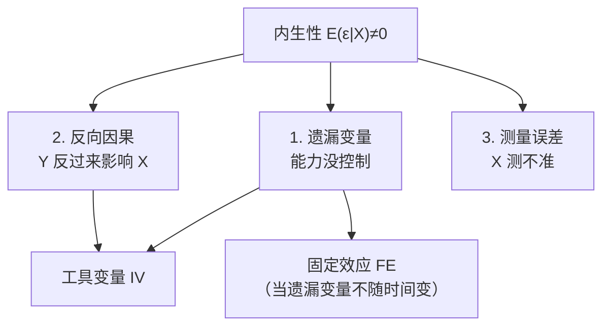
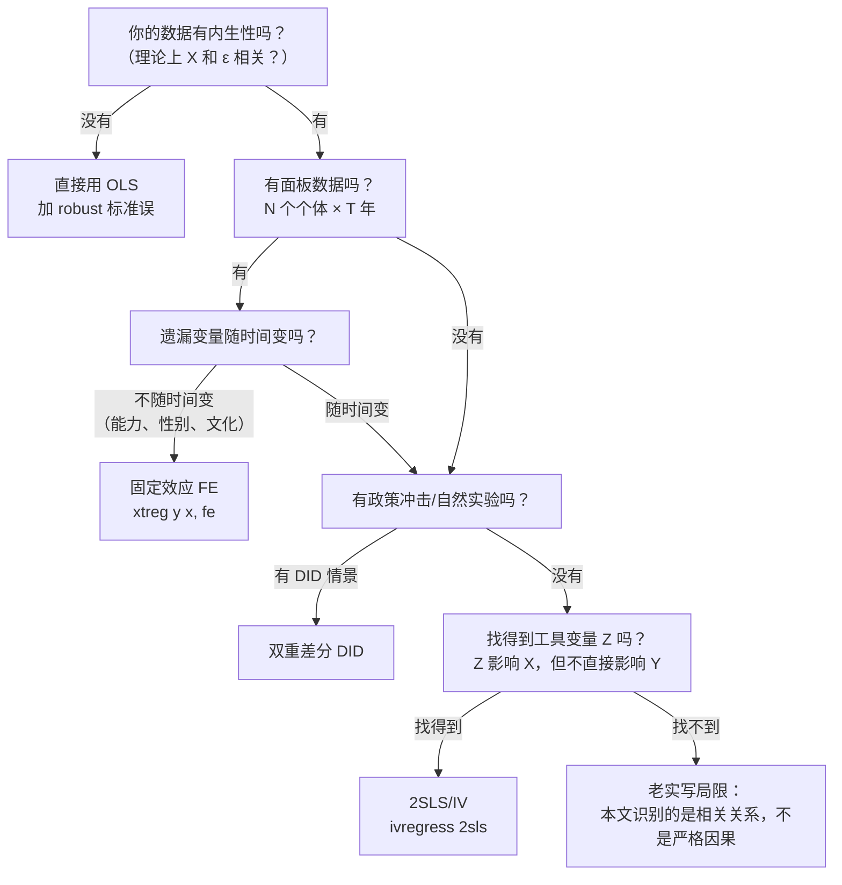

# 05 章节总结：内生性与面板

> 这一章讲了经济学实证最核心的问题：**怎么从"相关"跳到"因果"。**
> [[04_OLS截距和拟合值|OLS]] 只能告诉你 X 和 Y 相关；IV 和 FE 才能告诉你 X 导致 Y。

---

## 一、内生性的三种来源



---

## 二、方法选择决策图（核心）



---

## 三、三种方法对比表

| 方法 | 解决什么 | 需要什么数据 | 核心思想 | 代价 |
|------|----------|-------------|----------|------|
| **IV/2[[04_两阶段最小二乘2SLS|SLS]]** | 所有内生性 | 找一个好[[03_工具变量IV|工具变量]] Z | 用 Z 把 X 中干净的部分提出来 | 找 IV 极难，弱 IV 更糟 |
| **FE** | 不随时间变的遗漏变量 | 面板数据 | 每个人减自己均值 | 时间不变变量估不出 |
| **RE** | 同 FE，但假设强 | 面板数据 | GLS 加权 | 假设 u_i 和 X 无关 |

---

## 四、核心公式清单

### 1. [[02_遗漏变量偏误|遗漏变量偏误]]

$$E(\tilde{\beta}_1) = \beta_1 + \beta_2 \cdot \frac{\mathrm{Cov}(X,Z)}{\mathrm{Var}(X)}$$

方向判断：β₂ 符号 × Cov(X,Z) 符号。

### 2. IV 估计量（一元）

$$\hat{\beta}_{IV} = \frac{\mathrm{Cov}(Z,Y)}{\mathrm{Cov}(Z,X)}$$

### 3. FE within 估计量

$$\hat{\beta}_{FE} = \frac{\sum_{i,t}(X_{it}-\bar{X}_i)(Y_{it}-\bar{Y}_i)}{\sum_{i,t}(X_{it}-\bar{X}_i)^2}$$

### 4. Hausman 检验

$$H = (\hat{\beta}_{RE}-\hat{\beta}_{FE})'[\mathrm{Cov}_{FE}-\mathrm{Cov}_{RE}]^{-1}(\hat{\beta}_{RE}-\hat{\beta}_{FE}) \sim \chi^2(k)$$

p<0.05 选 FE。

---

## 五、关键 Stata 命令速查

```stata
-- IV/2SLS
ivregress 2sls y (x = z) controls
estat firststage          // 弱工具变量 F>10
estat endog               // DWH 内生性检验
estat overid              // 过度识别（Hansen J）

-- 面板
xtset id year
xtreg y x, fe             // 固定效应
xtreg y x, re             // 随机效应
hausman fe re             // 选 FE 还是 RE
xtreg y x i.year, fe vce(cluster id)   // 论文标配
```

---

## 六、自测题

**Q1**：内生性的三种来源是什么？

<details>
<summary>答案</summary>
遗漏变量、反向因果、测量误差。共同结果是 E(ε|X)≠0，OLS 系数有偏。
</details>

**Q2**：遗漏变量偏误的公式是什么？怎么判断方向？

<details>
<summary>答案</summary>
偏误 = β₂ × Cov(X,Z)/Var(X)。方向 = β₂ 符号 × Cov(X,Z) 符号。
</details>

**Q3**：工具变量 Z 必须满足哪两个条件？

<details>
<summary>答案</summary>
1. 相关性：Cov(Z,X)≠0；
2. 外生性：Cov(Z,ε)=0（只通过 X 影响 Y，排他性约束）。
</details>

**Q4**：2SLS 的两个阶段分别做什么？

<details>
<summary>答案</summary>
第一阶段：X 对 Z 回归，得到 X̂（X 中干净的部分）。
第二阶段：Y 对 X̂ 回归，得到因果效应。
注意：不要手动跑两次 reg，用 ivregress 2sls。
</details>

**Q5**：FE 的本质是什么？它能解决什么内生性？

<details>
<summary>答案</summary>
本质：每个人减去自己的时间均值（within 估计）。
能解决：所有不随时间变的个体特征（能力、性别、出生地、文化）。
不能解决：随时间变的遗漏变量、反向因果。
</details>

**Q6**：Hausman 检验怎么选 FE 和 RE？

<details>
<summary>答案</summary>
原假设 H₀：RE 一致（u_i 和 X 无关）。
p<0.05 拒绝 H₀ → 选 FE；
p>0.05 不拒绝 → 选 RE。
本科论文默认 FE。
</details>

**Q7**：为什么说"OLS 是 2SLS 的特例"？

<details>
<summary>答案</summary>
当工具变量 Z 就是 X 本身时（没有内生性），2SLS 公式退化为 OLS 公式。
这说明 IV 是 OLS 的推广——没有内生性时，IV 就变回 OLS。
</details>

**Q8**：面板数据里为什么要加 i.year（时间[[06_固定效应FE|固定效应]]）？

<details>
<summary>答案</summary>
控制所有不随个体变、但随时间变的冲击（疫情、全国性政策、宏观经济周期）。
否则这些冲击会混进 ε，导致内生性。
</details>

**Q9**：FE 为什么估不出"性别"的系数？

<details>
<summary>答案</summary>
性别不随时间变，被个体固定效应 α_i 完全吸收了。
X-it - X̄i = 0（对同一个人，性别每年都一样），within 变异为 0，估不出来。
想估性别效应，用 RE 或换截面方法。
</details>

**Q10**：你的论文里找不到好工具变量，也没有面板数据，怎么办？

<details>
<summary>答案</summary>
老实承认局限："本文识别的是相关关系，不是严格因果。"
然后跑[[06_稳健性检验|稳健性检验]]：换样本、换变量、换函数形式，说明结论对各种设定都稳健。
不要硬凑一个自己都说不清的 IV。
</details>

---

## 七、下一章预告

到这里，你已经学会了：
- 怎么算回归（第 3 章）；
- 怎么诊断回归的毛病（第 4 章）；
- 怎么说出因果（第 5 章）。

下一章：[[../06_受限因变量/README]]——当你的因变量只能是"是/否"（比如"是否考上研究生"）或"几档"（比如"满意度 1-5 分"）时，OLS 就不合适了，要换 Logit/Probit。

---

## 本章方法答辩速查

1. **问：写论文时怎么在 IV、FE、DID 之间做选择？** 答：走决策链——先看有没有面板数据：有面板、且遗漏变量不随时间变（能力、文化、地理禀赋），上双向 FE（`xtreg y x i.year, fe vce(cluster id)`）；遗漏变量随时间变或存在反向因果，才找 IV；没有面板但有明确政策冲击时点和对照组，用 DID；三者都不具备，老实写"本文识别的是相关关系"，别硬凑 IV。
2. **问：答辩时老师问"你怎么证明这是因果不是相关"，怎么答？** 答：分三层：① 诊断——DWH 内生性检验 p<0.05 证明 X 确实内生；② 策略——用 FE 控制了所有不随时间变的个体效应（或用 IV，报告第一阶段 F>10、Hansen J p>0.1）；③ 排除——时间固定效应控制了全国性冲击，标准误聚类到个体层面修正组内相关。三层都做了，才能说"控制混淆后的因果效应"。
3. **问：IV 和 FE 都能治内生性，为什么我的论文只用 FE 不用 IV？** 答：因为我的内生性主要来自不随时间变的个体特征（如各省地理禀赋、企业文化、创始团队），FE 通过去均值直接把 α_i 消掉，比找 IV 干净——不需要论证排他性，也不怕弱工具。反向因果和随时间变的冲击，我通过核心解释变量滞后一期、加年份固定效应缓解；剩下的识别局限，我在稳健性部分老实承认。

---

上一篇：[[07_随机效应RE与Hausman检验]]


---

## 📖 配套教材笔记
- [[../../教材笔记/02_计量经济学/09_工具变量法/00_章节总结|计量经济学·第9章 工具变量法]]

## 📚 配套原书
- [[../../原文件/计量经济学/陈强_计量经济学及Stata应用_全书|陈强《计量经济学及Stata应用》第9-10章]]
