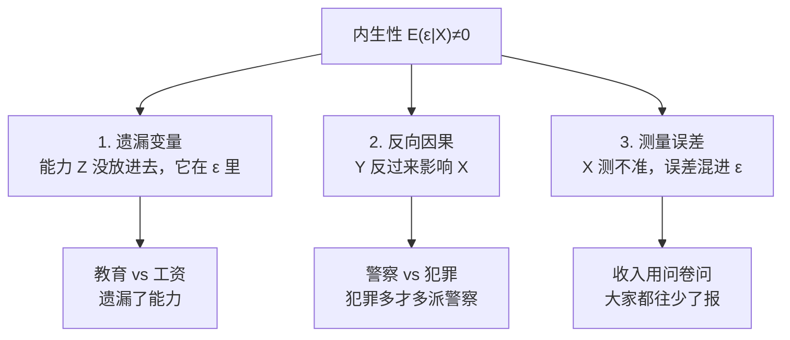

# 01 什么是内生性：为什么 [[04_OLS截距和拟合值|OLS]] 会骗人？

## 一、为什么要学这个？

**新闻标题**："研究发现，经常健身的人工资更高。"

你要不要立刻去办健身卡？

**先别急。** 健身的人本来就更自律、更有钱、更有时间——是健身涨工资，还是自律既让你健身又让你涨工资？

这就是内生性问题。OLS 告诉你"健身和工资相关"，但它**说不清谁导致谁**。

**不学会怎样？** 你写论文只跑 OLS，导师一句"你这有内生性"，整篇实证就废了。这是本科毕业论文被骂得最多的地方。

---

## 二、是什么？（比喻 + 定义）

### 比喻：体检

你想研究"跑步 X → 健康 Y"。

但有个隐藏因素：**"自律" Z**。自律的人既爱跑步，又注重饮食、睡眠、体检。

- 你看到跑步的人健康——你以为是跑步的功劳；
- 其实可能是自律的功劳；
- 跑步只是自律的"马甲"。

**内生性 = 解释变量 X 背后藏着一个看不见的 Z，这个 Z 同时影响 X 和 Y。** 你的 OLS 系数把 Z 的功劳全算到 X 头上了。

### 严格定义

经典假设 MLR.4 要求：
$$E(\varepsilon | X) = 0$$

内生性就是这条假设被违反：
$$E(\varepsilon | X) \neq 0$$

**翻译成人话**：给定 X 值，误差项 ε 的平均值不是 0。也就是说，**X 和 ε 相关**——X 大的样本，ε 也倾向大（或小）。

为什么会这样？三种来源：



---

## 三、公式怎么来的？（为什么内生性让系数有偏）

真实模型：
$$Y = \beta_0 + \beta_1 X + \varepsilon$$

OLS 估计量：
$$\hat{\beta}_1 = \frac{\sum (X_i-\bar{X})(Y_i-\bar{Y})}{\sum (X_i-\bar{X})^2}$$

把 $Y = \beta_0 + \beta_1 X + \varepsilon$ 代入分子：

$$\sum (X_i-\bar{X})(Y_i-\bar{Y}) = \sum (X_i-\bar{X})[\beta_1(X_i-\bar{X}) + (\varepsilon_i-\bar{\varepsilon})]$$
$$= \beta_1 \sum (X_i-\bar{X})^2 + \sum (X_i-\bar{X})(\varepsilon_i-\bar{\varepsilon})$$

两边除以 $\sum (X_i-\bar{X})^2$：

$$\hat{\beta}_1 = \beta_1 + \frac{\sum (X_i-\bar{X})(\varepsilon_i-\bar{\varepsilon})}{\sum (X_i-\bar{X})^2}$$

**最后这一项就是偏误。**

- 如果 $X$ 和 $\varepsilon$ 不相关（$E(\varepsilon|X)=0$），最后一项期望为 0，$\hat{\beta}_1$ 无偏。
- 如果 $X$ 和 $\varepsilon$ 正相关（比如教育高的人能力也高，能力藏在 ε 里），最后一项为正，$\hat{\beta}_1 > \beta_1$——**高估了教育的作用**。

**大样本版本**（概率极限）：

$$\mathrm{plim}\,\hat{\beta}_{OLS} = \beta_1 + \frac{\mathrm{Cov}(X, \varepsilon)}{\mathrm{Var}(X)}$$

关键：只要 $\mathrm{Cov}(X, \varepsilon) \neq 0$，这个偏误**样本再大也不消失**（不一致）——这是内生性和[[02_异方差|异方差]]、[[03_自相关|自相关]]最本质的区别：后两者只是标准误错，加大样本会自己修正；内生性是系数错，n→∞ 也救不了。

> 详细推导与 IV 两个条件见 [[../../教材笔记/02_计量经济学/09_工具变量法/知识点/KP01_内生性与工具变量|KP01 内生性与工具变量]]。

---

## 四、符号表

| 符号 | 含义 |
|------|------|
| $Y$ | 因变量（结果） |
| $X$ | 解释变量（原因，但可能内生） |
| $\varepsilon$ | 误差项（所有没放进模型的因素） |
| $Z$ | 遗漏变量（藏在 ε 里的那个） |
| $\beta_1$ | X 对 Y 的真实因果效应 |
| $\hat{\beta}_1$ | OLS 估出来的系数（有偏） |
| $E(\varepsilon|X)$ | 给定 X 时 ε 的条件期望 |

---

## 五、一个完整的数字例子（迷你版）

**真实世界**：工资 Y = 1000 + 500×教育 + 300×能力 + 噪声。

我们有 5 个人的数据（简化）：

| 人 | 教育 X | 能力 Z（看不见） | 工资 Y |
|----|--------|-----------------|--------|
| A | 9 | 1（低） | 5800 |
| B | 12 | 2 | 7600 |
| C | 12 | 3 | 7900 |
| D | 16 | 4 | 10800 |
| E | 19 | 5 | 13100 |

**第一步：我们只看到 X 和 Y（看不到 Z）。**

用 OLS 回归 Y ~ X，会得到什么？（手算略，直接给结果）

$\hat{\beta}_1 \approx 610$。

**第二步：真相是什么？**

真实的教育效应是 $\beta_1=500$。但我们估出 610——**多估了 110**。

**这 110 哪来的？** 因为教育高的人能力也高（X 和 Z 正相关），Z 的效应被错误地算到 X 头上了。

**第三步：如果我们能看到 Z 呢？**

把 Z 也放进模型：Y ~ X + Z，重新回归，得到 $\hat{\beta}_1 \approx 510$——接近真实的 500 了。

**结论**：遗漏变量 Z 让 X 的系数从 500 膨胀到 610。这就是内生性的代价。

**Python 验证**：

```python
import numpy as np
np.random.seed(0)
n = 200
ability = np.random.normal(0, 1, n)
edu = 12 + 2*ability + np.random.normal(0, 1, n)  # edu 和 ability 相关
wage = 1000 + 500*edu + 300*ability + np.random.normal(0, 50, n)

# 错误模型：遗漏 ability
import statsmodels.api as sm
X_bad = sm.add_constant(edu)
print(sm.OLS(wage, X_bad).fit().params[1])  # ≈621，高估

# 正确模型：控制 ability
X_good = sm.add_constant(np.column_stack([edu, ability]))
print(sm.OLS(wage, X_good).fit().params[1])  # ≈510，接近真实500
```

---

## 六、什么时候用？

**内生性在经济学里几乎是常态，不是例外。** 任何时候你想从"相关"跳到"因果"，都要问：

1. 有没有遗漏变量 Z 同时影响 X 和 Y？
2. 是不是 Y 反过来影响 X？
3. X 是不是测错了？

只要有一个答案是"可能"，OLS 就不能直接说因果。

---

## 七、易错点

1. **OLS 系数不显著，不代表 X 没用**——可能是共线性或样本小；OLS 系数显著，也不代表 X 因果导致 Y——可能是内生性。
2. **"相关 ≠ 因果"** 这句话，本质就是在说内生性。
3. **内生性不是跑个[[KP03_稳健标准误|稳健标准误]]能修的**。robust 修的是[[02_异方差|异方差]]，内生性必须用 IV/FE/DID 这些方法。
4. **不要在论文里写"本文研究了 X 对 Y 的影响"**——如果你只跑了 OLS，只能说"X 和 Y 相关"。要说"影响"，必须解决内生性。
5. **反向因果比想象中常见**：警察越多犯罪越多——不是警察导致犯罪，是犯罪多了才派警察。

---

## 八、Stata 代码（怎么初步诊断内生性）

```stata
-- 内生性诊断：先跑 OLS，再想想有没有遗漏变量
reg wage edu              -- 这是有偏的
estimates store ols

-- 第一步：理论思考（最重要）
-- 有没有看不见的变量同时影响 edu 和 wage？
-- 能力、家庭背景、地理位置……

-- 第二步：找工具变量（下一章细讲）
-- ivregress 2sls wage (edu = birth_quarter)

-- 第三步：内生性检验（Hausman / Durbin-Wu-Hausman）
estat endog               -- 检验 edu 是否真的内生
                          -- p<0.05 说明确实有内生性，必须用 IV
```

---

## 九、和别的问题对比

| 问题 | 系数 | 标准误 | 修法 |
|------|------|--------|------|
| 异方差 | 无偏 | 错 | robust |
| [[03_自相关|自相关]] | 无偏 | 错 | Newey-West |
| [[04_多重共线性|多重共线性]] | 无偏但不稳 | 大 | 删变量 |
| **内生性** | **有偏** | 错 | **IV / FE / DID** |

**关键区别**：前三个问题打补丁就行，内生性必须"动手术"——要么找[[03_工具变量IV|工具变量]]，要么换面板方法。

---

## 十、为什么不用别的方法？

- **为什么不用直接 OLS？** 内生性下 E(ε|X)≠0，OLS 系数 $\hat{\beta}_1 = \beta_1 + \text{偏误}$，是系统性偏差，不是抽样噪声——样本再大、标准误再小，系数也不会收敛到真实值，整篇实证的因果结论直接作废。
- **为什么不用稳健标准误 robust？** robust 修的是异方差，它只让标准误算得更准，系数本身还是偏的。内生性病在"点估计错了"，robust 只是把一个错系数的置信区间算对，治标不治本，答辩时一说"你这有内生性"就露馅。
- **为什么不靠"多塞控制变量"硬凑？** 能观测到的 Z 可以放进去，但内生性的根源往往是不可观测的 Z（天生能力、偏好、企业文化、制度基因），问卷问不出来、统计局也不统计，加控制变量根本够不着它，必须上 IV / FE 这种"动手术"的方法。

---

## 十一、答辩常问（直接背）

1. **问：内生性的三个来源是什么？** 答：遗漏变量（能力没放进去，藏在 ε 里）、反向因果（Y 反过来影响 X，如警察多是因为犯罪多）、测量误差（X 测不准，误差混进 ε）。三者共同后果都是 E(ε|X)≠0，OLS 系数有偏。
2. **问：怎么判断你的回归到底有没有内生性？** 答：两手抓——一是理论推演：有没有不可观测的 Z 同时影响 X 和 Y，有没有 Y 反过来影响 X；二是统计检验：跑 Durbin-Wu-Hausman 内生性检验（Stata: estat endog），p<0.05 说明 X 确实内生，必须换 IV。
3. **问：内生性和异方差、自相关、多重共线性有什么区别？** 答：后三者只让标准误算错（系数仍无偏），用 robust 或 Newey-West 打补丁就行；内生性让系数本身有偏，样本再大也不收敛到真实值，必须换 IV / FE / DID，不是打补丁能解决的。
4. **问：为什么只跑了 OLS 不能在论文里写"X 影响 Y"？** 答：OLS 估出来的只是相关关系。只要存在一条未控制的混淆路径（遗漏变量或反向因果），系数里就混着 Z 的功劳，比如教育回报被能力抬高，这时写"影响"就是在过度解读。

---

## 十二、速记卡

> **内生性 = X 和误差项 ε 相关 = OLS 系数有偏。**
> 三个来源：遗漏变量（能力）、反向因果（警察↔犯罪）、测量误差。
> 后果：$\hat{\beta}_1 = \beta_1 + \text{偏误}$，偏误方向取决于 X 和 ε 的相关方向。
> 修法：**工具变量 IV**（找一个 Z）或**面板[[06_固定效应FE|固定效应]] FE**（去个体均值）。
> 记住：**OLS 告诉你"相关"，IV/FE 才能告诉你"因果"。**

---

下一篇：[[02_遗漏变量偏误]]

---

## 📖 配套教材笔记
- [[../../教材笔记/02_计量经济学/09_工具变量法/知识点/KP01_内生性与工具变量|计量经济学·KP01 内生性与工具变量]]

## 📚 配套原书
- [[../../原文件/计量经济学/陈强_计量经济学及Stata应用_全书|陈强《计量经济学及Stata应用》第9章]]
