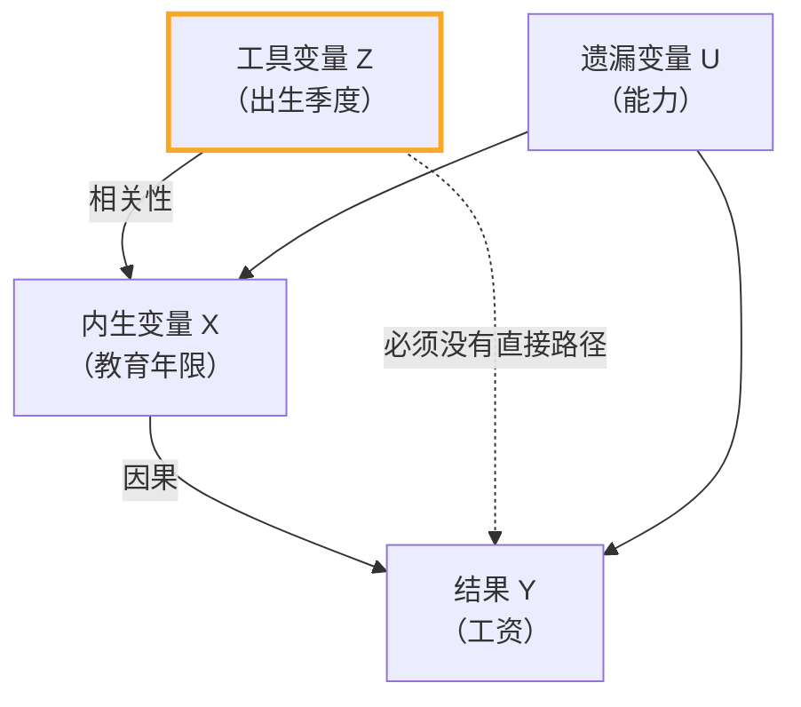

# 03 工具变量 IV：找一个"干净"的 X

<div style="text-align:right;margin:10px 0;"><a href="../../exam.html" target="_blank" style="display:inline-block;padding:6px 16px;background:#2563eb;color:#fff;border-radius:6px;text-decoration:none;font-size:14px;">📝 开始做题</a></div>


## 一、为什么要学这个？

上一节我们说：漏了"能力"，教育回报被高估了。

但"能力"是看不见的——你问卷问不出来，统计局也不统计。**你没法把它放进模型。**

怎么办？

答案是：**别去碰能力，找一个和教育相关、但和能力无关的"替身"**。

这个替身就叫**工具变量 Z**。Angrist 拿诺贝尔奖的那篇论文，就是用"出生季度"当教育的工具变量。

---

## 二、是什么？（比喻 + 定义）

### 比喻：称体重的杠杆

你想知道一个人的真实体重（X 对 Y 的因果效应），但这个人站在秤上时**手还压着桌子**（内生性，X 和 ε 相关）。

你直接读秤，数不准。

怎么办？找一根绳子（工具变量 Z）：
- 绳子一头绑在这个人身上（Z 和 X 相关——拉绳子他会动）；
- 绳子不碰桌子（Z 和 ε 无关——拉绳子不影响他手压桌子的力）；
- 你拉绳子，看秤怎么变——这部分变化就是"干净的"体重效应。

### 严格定义

工具变量 Z 必须满足两个条件：

**条件 1：相关性（Z 影响 X）**
$$\mathrm{Cov}(Z, X) \neq 0$$
工具变量必须和内生解释变量 X 相关。

**条件 2：外生性（Z 不直接影响 Y，只通过 X 影响 Y）**
$$\mathrm{Cov}(Z, \varepsilon) = 0$$
工具变量和误差项无关——它只通过 X 这条路径影响 Y。



**关键**：Z 必须绕开 U，只通过 X 影响 Y。这叫**排他性约束**。

---

## 三、公式怎么来的？（IV 估计量）

我们想估 $\beta_1$，但 X 和 ε 相关，[[04_OLS截距和拟合值|OLS]] 有偏。

IV 的思路：把 X 分成两部分——一部分和 ε 相关（脏的），一部分和 ε 无关（干净的）。我们只用干净的那部分估 $\beta_1$。

**怎么分？** 用 Z。

第一阶段：把 X 对 Z 回归：
$$X = \pi_0 + \pi_1 Z + v$$

得到预测值 $\hat{X}$——这是 X 中"能被 Z 解释的部分"，也就是和 ε 无关的干净部分。

第二阶段：用 $\hat{X}$ 代替 X 回归 Y：
$$Y = \beta_0 + \beta_1 \hat{X} + \text{error}$$

**一元情形下，IV 估计量的公式是**：

$$\hat{\beta}_{IV} = \frac{\mathrm{Cov}(Z, Y)}{\mathrm{Cov}(Z, X)}$$

**这个公式怎么来的？**

从真实模型 $Y = \beta_0 + \beta_1 X + \varepsilon$，两边对 Z 取协方差：

$$\mathrm{Cov}(Z, Y) = \beta_1 \mathrm{Cov}(Z, X) + \mathrm{Cov}(Z, \varepsilon)$$

因为外生性，$\mathrm{Cov}(Z, \varepsilon)=0$，所以：

$$\mathrm{Cov}(Z, Y) = \beta_1 \mathrm{Cov}(Z, X)$$

两边除以 $\mathrm{Cov}(Z, X)$：

$$\hat{\beta}_{IV} = \frac{\mathrm{Cov}(Z, Y)}{\mathrm{Cov}(Z, X)}$$

**对比 OLS**：$\hat{\beta}_{OLS} = \mathrm{Cov}(X,Y)/\mathrm{Var}(X)$。IV 就是把分母的 X 换成了 Z。

---

## 四、符号表

| 符号 | 含义 |
|------|------|
| $Z$ | 工具变量 |
| $X$ | 内生解释变量 |
| $Y$ | 因变量 |
| $\pi_0, \pi_1$ | 第一阶段回归系数 |
| $\hat{X}$ | 第一阶段预测值（X 的干净部分） |
| $\hat{\beta}_{IV}$ | IV 估计的因果效应 |

---

## 五、经典例子：Angrist 的出生季度 IV

**问题**：教育 X → 工资 Y，能力 U 是遗漏变量。

**Angrist 的天才想法**：美国有义务教育法——必须上到 16 岁才能辍学。

- 出生在 1 月的人：16 岁那年是高三上学期，他们可以辍学去工作；
- 出生在 12 月的人：16 岁那年是高二结束，他们必须多上一年高三才能辍学。

**于是出生季度 Z 和教育年限 X 相关**：年底出生的人，平均多上一点学（因为他们被义务教育法卡得更久）。

**关键：出生季度 Z 和能力 U 无关**。你出生在 1 月还是 12 月，和你聪不聪明、家庭富不富，基本没关系。

**这就满足了两个条件**：
1. Cov(Z, X) ≠ 0：年底出生 → 多上一点学；
2. Cov(Z, ε) = 0：出生季度和能力无关。

**Angrist 估出来的教育回报是多少？**

- OLS 估：多上一年学涨 7% 工资；
- IV 估：多上一年学涨 7~9% 工资。

两者接近，说明 OLS 在这里高估不多（后来的文献也用了其他 IV 做了类似研究）。

**Python 伪代码演示**：

```python
import numpy as np
np.random.seed(0)
n = 1000
# 出生季度 Z：0=上半年，1=下半年
Z = np.random.binomial(1, 0.5, n)
# 能力 U：和出生季度无关
U = np.random.normal(0, 1, n)
# 教育 X：受 Z 影响（下半年多上0.3年）+ 受 U 影响（能力高多上）+ 噪声
X = 12 + 0.3*Z + 1.5*U + np.random.normal(0, 1, n)
# 工资 Y：X 效应=500，U 效应=300
Y = 1000 + 500*X + 300*U + np.random.normal(0, 50, n)

# IV 估计
beta_iv = np.cov(Z, Y)[0,1] / np.cov(Z, X)[0,1]
print(f"IV 估计 beta = {beta_iv:.2f}")   # 接近 500
```

---

## 六、什么时候用？

**找 IV 是一门艺术，不是科学。** 好的 IV 往往来自制度细节：

| 问题 | 工具变量 |
|------|----------|
| 教育 → 工资 | 出生季度（Angrist）、义务教育法改革 |
| 警察 → 犯罪 | 警察工资外生变化、选举年警力安排 |
| 外资 → 经济增长 | 距离港口距离、政策试点的距离 |
| 医疗 → 健康 | 医院距离、医保政策外生变化 |

**检验工具变量是否合格**：
1. **相关性**：第一阶段回归 F 统计量 > 10（[[KP03_弱工具变量|弱工具变量]]检验）。
2. **外生性**：过度识别检验（当工具变量个数 > 内生变量个数时）。

---

## 七、易错点

1. **弱工具变量是灾难**。如果 Z 和 X 只是微弱相关，IV 估计比 OLS 还糟。第一阶段 F > 10 是底线。
2. **外生性无法检验**（当恰好识别时）。你只能靠经济理论和制度背景**论证** Z 为什么外生，不能靠统计检验。这是 IV 最受质疑的地方。
3. **IV 估的是 LATE（局部平均处理效应）**——只对"被 Z 影响的那部分人"有效。比如出生季度 IV 只对"被义务教育法卡着辍学边缘的人"有效，不能推广到所有人。
4. **不要硬凑 IV**。找了一个 Z，自己都解释不通它为什么外生，审稿人一句话就毙了。
5. **内生性检验（Hausman/DWH）p<0.05 才说明需要 IV**。如果 p>0.05，说明 OLS 已经够好，IV 反而低效。

### 弱工具变量到底有多糟？（[[../../教材笔记/02_计量经济学/09_工具变量法/知识点/KP03_弱工具变量|KP03 弱工具变量]]）

**比喻**：强 IV 像钢丝绳拉卡车——拉得动；弱 IV 像棉线拉卡车——纹丝不动，估计又回到 OLS 的老路上。

**三个后果**：

| 后果 | 说明 |
|------|------|
| 2SLS 不一致 | 即使大样本也不收敛到真实值 |
| **偏误偏向 OLS** | IV 越弱，2SLS 越像 OLS（极端情况等于 OLS） |
| 标准误虚低 | 看着显著，实际不可信；名义 95% 置信区间实际覆盖率可能只有 30% |

**F>10 的来源**（Stock-Yogo 经验法则）：
- F > 10：2SLS 的偏误不超过 OLS 偏误的 10%，可以接受；
- F < 10：弱工具变量问题严重；
- 只有一个 IV 时，等价于第一阶段 t > √10 ≈ 3.2。

**发现弱 IV 怎么办？**
1. **在经济理论指导下另找更强的 IV**（首选）；
2. 改用 **LIML**（有限信息最大似然，`ivregress liml`）——对弱 IV 的偏误比 2SLS 小，但标准误更大；
3. 放弃 IV，换面板[[06_固定效应FE|固定效应]]、DID、断点回归等其他识别策略；
4. 坦诚讨论局限，不要硬上弱 IV。

---

## 八、Stata 代码

```stata
-- IV 回归完整流程
use "mydata.dta", clear

-- 第一步：先跑 OLS 对比
reg wage edu
estimates store ols

-- 第二步：跑 2SLS（IV 的实操版本）
-- 语法：ivregress 2sls 结果变量 (内生变量 = 工具变量) 控制变量
ivregress 2sls wage (edu = birth_quarter) exper tenure
estimates store iv

-- 第三步：检验弱工具变量
estat firststage
-- 看第一阶段 F 统计量，>10 才放心

-- 第四步：检验内生性（DWH）
estat endog
-- p<0.05 说明 edu 确实内生，用 IV 是对的

-- 第五步：对比 OLS 和 IV 结果
estimates table ols iv, b se
```

---

## 九、和别的方法对比

| 方法 | 什么时候用 | 优点 | 缺点 |
|------|-----------|------|------|
| OLS | 没有内生性 | 简单、有效 | 有内生性就有偏 |
| **IV/2[[04_两阶段最小二乘2SLS|SLS]]** | **有内生性 + 能找到好 IV** | **能说因果** | **找 IV 极难，弱 IV 更糟** |
| [[06_固定效应FE|固定效应]] FE | 面板数据 + 不随时间变的遗漏变量 | 不需要找 IV | 只能控制时间不变的特征 |
| DID | 有政策冲击 + 对照组 | 接近自然实验 | 需要平行趋势假设 |

**本科论文建议**：优先用 FE（面板数据）或 DID（政策冲击）。IV 很难找好，写不好会被审稿人追着打。

---

## 十、为什么不用别的方法？

- **为什么不用直接 OLS？** 当 X 和 ε 相关（能力混在 ε 里），OLS 系数有偏且不收敛，样本再大也没用。IV 的思路是用 Z 把 X 中"与 ε 无关的干净部分"提取出来，只靠这部分识别因果，绕开污染路径。
- **为什么不用面板 FE？** FE 只能消掉"不随时间变"的个体效应（能力、出生地、文化）。如果内生性来自随时间变的因素（政策冲击、经济周期）或反向因果（创新好的城市会主动优化营商环境），FE 救不了，必须上 IV。
- **为什么不用 DID？** DID 需要一个明确的政策冲击时点和对照组，且要满足平行趋势。你的核心解释变量如果是连续型的（教育年限、营商环境指数、数字经济水平），没有"处理组 vs 对照组"之分，就没有 DID 的用武之地，只能找 IV。

---

## 十一、答辩常问（直接背）

1. **问：好的工具变量必须满足哪两个条件？** 答：一是相关性 Cov(Z,X)≠0（Z 要真的影响 X）；二是外生性 / 排他性 Cov(Z,ε)=0（Z 只能通过 X 影响 Y，不能有直接路径）。教科书例子是 Angrist 的出生季度：它通过义务教育法影响教育年限，但和天生能力无关。
2. **问：怎么检验工具变量是不是弱工具？** 答：看第一阶段回归的 F 统计量，经验底线是 F>10。F<10 说明 Z 和 X 只是微弱相关，IV 估计的偏误会非常大，结果比 OLS 还糟——弱工具变量是灾难，答辩报不出 F 值直接扣分。
3. **问：外生性（排他性约束）怎么检验？** 答：恰好识别（工具变量个数 = 内生变量个数）时统计上无法检验，只能靠经济理论和制度背景论证 Z 为什么外生；过度识别（IV 个数 > 内生变量个数）时可以做 Hansen J / Sargan 检验，p>0.1 才能接受"所有 IV 都外生"。
4. **问：IV 估出来的因果效应能推广到所有人吗？** 答：不能。IV 估的是 LATE（局部平均处理效应），只对"被 Z 影响的那群人"有效——出生季度 IV 只识别了"在义务教育法边缘、本来会辍学的人"的教育回报，不能推广到主动读书的人。

---

## 十二、速记卡

> **IV = 找一个 Z，满足两个条件：**
> 1. Z 和 X 相关（相关性）；
> 2. Z 和 ε 无关，只通过 X 影响 Y（外生性/排他性）。
>
> IV 估计量：$\hat{\beta}_{IV} = \mathrm{Cov}(Z,Y)/\mathrm{Cov}(Z,X)$。
> 经典例子：出生季度作为教育的 IV（Angrist 诺奖工作）。
> 记住：**好 IV 比好论文还难找。外生性靠论证，不能靠检验。**

---

## 💡 经济学视角：一个"出生季度"，怎么就值了诺贝尔经济学奖

**这个方法是为了解决什么经济学问题？**
要估计教育回报，你得找一个"只影响读几年书、但和能力毫无关系"的随机事件。Angrist 和 Krueger 1991 年想到了一个天才设计：美国义务教育法规定"年满 16 岁才能辍学"，所以**出生在年初的人，到 16 岁时已经读了更多书；出生在年末的人，16 岁时读书时间更短**。一个人的出生季度由老天爷决定，和能力、家庭背景八竿子打不着——它就是完美的工具变量 Z。

**经济学里哪些经典模型正好对应这个方法？**
劳动经济学的核心问题"教育到底值多少钱"困扰了学界几十年。IV 方法把这问题拆成两步：①出生季度 Z 是否真的影响教育年限 X？（第一阶段相关性）②教育年限 X 中"由 Z 驱动的那部分"是否影响工资 Y？（排他性）。这个思路直接催生了 Angrist、Imbens、Card 拿 2021 年诺贝尔经济学奖，颁奖词就叫"自然实验的因果识别"。

**举个实证论文的例子：**
《出生季度对教育回报的影响》用 1980 年美国人口普查 30 万人数据跑 IV，估出来教育回报约 7.5%，和 OLS 的 7.4% 几乎一致——但这是**第一次让学界敢说"教育真的值钱"**，而不是"聪明的人恰好也爱读书"。

**📚 配套经济学笔记：**
- [[../../教材笔记/06_西方经济学/06_生产要素市场与收入分配/知识点/KP03_劳动供给与工资决定|原KP·劳动供给与工资决定]]

---

下一篇：[[04_两阶段最小二乘2SLS]]


---

## 📖 配套教材笔记
- [[../../教材笔记/02_计量经济学/09_工具变量法/知识点/KP01_内生性与工具变量|计量经济学·KP01 工具变量IV]]

## 📚 配套原书
- [[../../原文件/计量经济学/陈强_计量经济学及Stata应用_全书|陈强《计量经济学及Stata应用》第9章]]
