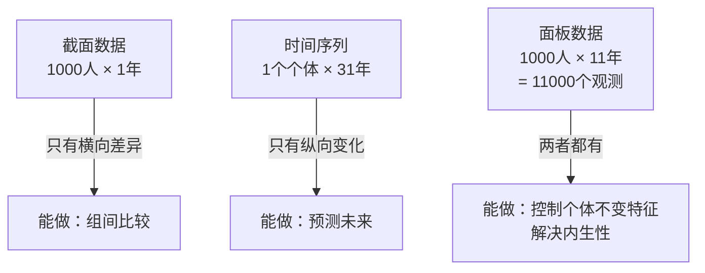
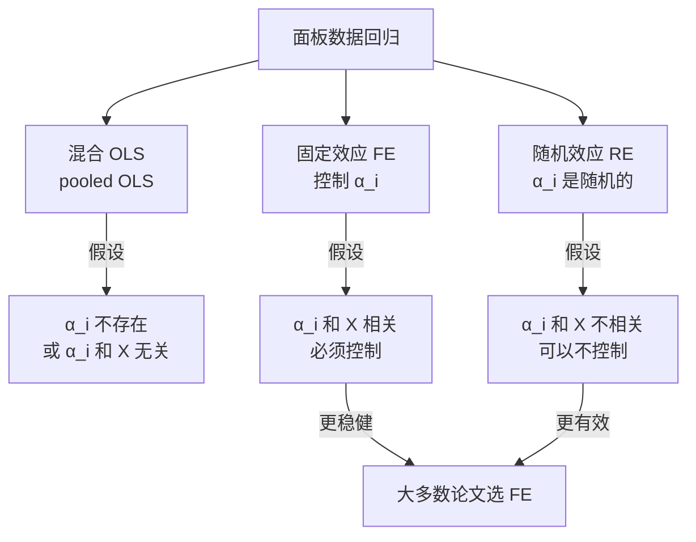

# 05 面板数据是什么：同一个人跟踪很多年

## 一、为什么要学这个？

**截面数据**：2020 年某一时刻，1000 个人，每人一行。你看到的是"不同人之间的差异"。

**时间序列数据**：1990-2020 年，全国 GDP，每年一行。你看到的是"同一个体随时间的变化"。

**面板数据**：2010-2020 年，每年调查 1000 个人。你既看到"人与人的差异"，又看到"每个人随时间的变化"。



**为什么面板数据是宝？** 因为很多内生性问题来自"不随时间变的个体特征"——比如天生能力、性别、出生地。面板数据可以把这些全部控制掉，不需要找[[03_工具变量IV|工具变量]]。

---

## 二、是什么？（比喻 + 定义）

### 比喻：跟踪调查

你想研究"减肥 X → 工资 Y"。

- 截面数据：问 1000 个人，谁减肥了、谁没减，对比工资。但减肥的人可能本来就自律，工资本来就高。
- 面板数据：跟踪 1000 个人 5 年，看同一个人**减肥前后**的工资变化。这就排除了"自律"这个不变因素——同一个人，自律程度不变，但他减肥了，工资变了，那就是减肥的功劳。

### 严格定义

面板数据的结构：

$$\text{个体} i = 1, 2, \ldots, N$$
$$\text{时间} t = 1, 2, \ldots, T$$

每个观测是一对 $(i, t)$，共 $N \times T$ 个观测。

模型：
$$Y_{it} = \beta_0 + \beta_1 X_{it} + \alpha_i + \lambda_t + \varepsilon_{it}$$

- $\alpha_i$：个体[[06_固定效应FE|固定效应]]——不随时间变的个体特征（能力、性别、出生地）；
- $\lambda_t$：时间固定效应——不随个体变的时间冲击（2020 年疫情对所有人都有影响）；
- $\varepsilon_{it}$：真正的误差项。

---

## 三、面板数据的三种回归选择



**混合 [[04_OLS截距和拟合值|OLS]]**：把面板当成截面数据，直接 reg。问题：忽略了 α_i，如果 α_i 和 X 相关，OLS 有偏。

**固定效应 FE**：把 α_i 全部控制掉（用个体[[09_虚拟变量|虚拟变量]]或去均值）。代价：不能估时间不变变量的系数（比如性别）。

**[[07_随机效应RE与Hausman检验|随机效应]] RE**：假设 α_i 是随机的、和 X 无关，用广义最小二乘 GLS。更有效（更省自由度），但假设更强。

**选 FE 还是 RE？** 用 Hausman 检验（07 文件细讲）。

### FE 的三种等价做法（[[../../教材笔记/02_计量经济学/11_面板数据/知识点/KP01_固定效应模型|KP01 固定效应模型]]）

解决"个体效应 α_i 和 X 相关"有三条路，估出来的 $\hat\beta_1$ 完全一样：

| 方法 | 做法 | Stata 命令 |
|------|------|-----------|
| **LSDV**（最小二乘虚拟变量） | 给每个个体加一个虚拟变量（N=31 省加 30 个） | `reg y x1 x2 i.id` |
| **组内估计量**（within） | 每个观测减自己的时间均值，α_i 自动消掉 | `xtreg y x1 x2, fe` |
| **一阶差分 FD** | 相邻两期相减：$(y_{it}-y_{i,t-1})=\beta_1(x_{it}-x_{i,t-1})+(\varepsilon_{it}-\varepsilon_{i,t-1})$ | `reg D.y D.x`（先 `xtset`） |

**T=2 时 FD 和 FE 完全相同**；T>2 时 FE 更有效。论文里最常用 `xtreg, fe`，它自动用 within 变换。

**先判断要不要 FE**：跑 `xtreg y x1 x2, fe` 后看输出最后一行：

```
F test that all u_i=0:   F(30, 270) = 8.42   Prob > F = 0.0000
```

p < 0.05 → 个体效应 α_i 联合显著，混合 OLS 有偏，必须上 FE。

---

## 四、符号表

| 符号 | 含义 |
|------|------|
| $i$ | 个体下标（人、公司、省） |
| $t$ | 时间下标（年、月） |
| $N$ | 个体个数 |
| $T$ | 时间期数 |
| $Y_{it}$ | 个体 i 在 t 期的 Y |
| $\alpha_i$ | 个体固定效应（不随 t 变） |
| $\lambda_t$ | 时间固定效应（不随 i 变） |
| $\bar{X}_i$ | 个体 i 自己在所有期的平均 |

---

## 五、一个完整的数字例子（迷你面板）

**数据**：2 个人，3 年。

| 人 | 年 | X（工龄） | Y（工资，千） |
|----|----|-----------|---------------|
| A | 1 | 1 | 3 |
| A | 2 | 2 | 5 |
| A | 3 | 3 | 7 |
| B | 1 | 2 | 6 |
| B | 2 | 3 | 8 |
| B | 3 | 4 | 10 |

**肉眼观察**：
- A 从 3 涨到 7，B 从 6 涨到 10；
- B 每年都比 A 高 3——这是个体效应 α_B - α_A = 3（B 天生工资高）；
- 两个人都是工龄+1，工资+2——这是真实的工龄效应 β=2。

**第一步：混合 OLS（错误做法）。**

把 6 个观测当成截面，直接回归。会得到 β ≈ 2.27——比真实 2 大，因为它把 B 天生工资高的效应算进去了。

**第二步：固定效应（正确做法）。**

每个人减自己的均值：

- A 的均值：X̄_A = 2，Ȳ_A = 5；
- B 的均值：X̄_B = 3，Ȳ_B = 8。

去均值后：

| 人 | X-X̄ | Y-Ȳ |
|----|-----|-----|
| A1 | -1 | -2 |
| A2 | 0 | 0 |
| A3 | 1 | 2 |
| B1 | -1 | -2 |
| B2 | 0 | 0 |
| B3 | 1 | 2 |

对去均值后的数据回归：

$$\hat{\beta}_{FE} = \frac{(-1)(-2)+0+1\times2+(-1)(-2)+0+1\times2}{(-1)^2+0+1^2+(-1)^2+0+1^2} = \frac{8}{4} = 2$$

**FE 估出 β=2，正好是真实值！** 个体效应 α_i 被减掉了，工龄效应被干净地识别出来。

Python 验证：

```python
import numpy as np
x1 = np.array([1,2,3.]); y1 = np.array([3,5,7.])
x2 = np.array([2,3,4.]); y2 = np.array([6,8,10.])
# within 估计
xd = np.concatenate([x1-x1.mean(), x2-x2.mean()])
yd = np.concatenate([y1-y1.mean(), y2-y2.mean()])
print("FE:", np.sum(xd*yd)/np.sum(xd**2))   # 2.0
```

---

## 六、什么时候用？

**面板数据的来源**：
- 国家统计局：各省每年 GDP、财政收入；
- 上市公司：每个公司每年财务数据；
- 跟踪调查：CFPS、CHIP 等追踪数据库。

**本科论文常用面板**：
- 31 个省 × 10 年 = 310 个观测；
- 几百个上市公司 × 5 年 = 几千个观测。

**什么时候必须用 FE？**
- 你的核心解释变量 X 随时间变；
- 你怀疑有不随时间变的遗漏变量（能力、文化、地理）；
- 你想说出"控制了个体固定效应后，X 对 Y 的影响是……"。

---

## 七、易错点

1. **不能估时间不变变量的系数**。性别、出生地被 α_i 吸收了，FE 估不出来。想估这些，用 RE 或者换方法。
2. **N 和 T 要分清**。短面板（N 大 T 小，如 31 省 10 年）用 FE/RE；长面板（T 大 N 小）要考虑时间序列方法（第 9 章）。
3. **面板数据也要检验[[02_异方差|异方差]]和[[03_自相关|自相关]]**。用 xttest3（异方差）和 xtserial（自相关），然后用 cluster 标准误。
4. **不要把面板数据当截面数据跑 pooled OLS**——除非你明确检验过 α_i 不存在。
5. **时间固定效应别忘加**。年份虚拟变量能控制全国性冲击（疫情、政策变化），几乎是论文标配。

---

## 八、Stata 代码

```stata
-- 面板数据完整流程
use "panel_data.dta", clear
xtset id year              -- 声明面板：id是个体，year是时间

-- 三种回归对比
reg y x1 x2                -- 混合 OLS
xtreg y x1 x2, fe          -- 固定效应
xtreg y x1 x2, re          -- 随机效应

-- 加双向固定效应（个体+时间）
reg y x1 x2 i.id i.year    -- 个体虚拟变量+年份虚拟变量
estimates store twfe

-- 标准误聚类到个体层面（解决面板自相关+异方差）
xtreg y x1 x2 i.year, fe vce(cluster id)
```

---

## 九、和别的方法对比

| 方法 | 控制 α_i | 能估时间不变变量 | 效率 |
|------|---------|-----------------|------|
| 混合 OLS | 不控制 | 能 | 最高（但有偏） |
| **FE** | **控制** | **不能** | 较低 |
| RE | 部分（GLS） | 能 | 最高（假设强） |

**论文默认：FE + 聚类标准误 + 时间固定效应。** 这是 90% 实证论文的标配。

---

## 十、为什么不用别的方法？

- **为什么不用截面数据？** 截面只有一年观测，看到的全是"人与人之间的差异"——减肥的人本来就自律，你分不清是减肥涨工资还是自律涨工资。面板跟踪同一个人多年，能看"同一个人减肥前后"的工资变化，把不随时间变的自律直接消掉。
- **为什么不用纯时间序列？** 全国 GDP 31 年只有 31 个观测，样本量小，而且它把全国平均成一个"平均人"，看不到个体差异。面板有 N×T 个观测（31 省×10 年 = 310），统计功效强得多。
- **为什么不能把面板直接当截面跑混合 OLS？** 混合 OLS 假设所有个体截距相同，但 α_i（个体效应）和 X 往往相关（B 天生工资高、工龄也长），忽略它等于又犯了一次[[02_遗漏变量偏误|遗漏变量偏误]]。必须在 FE 和 RE 之间选，不能图省事跑 reg。

---

## 十一、答辩常问（直接背）

1. **问：面板数据相比截面和时间序列，核心优势是什么？** 答：同一个体跟踪多期，能把不随时间变的个体特征 α_i（天生能力、性别、出生地、文化传统）全部控制掉，不需要找工具变量就能解决一大类遗漏变量偏误；同时 N×T 个观测让样本量成倍增加，统计功效更强。
2. **问：面板回归有哪三种选择？论文怎么默认选？** 答：混合 OLS（假设 α_i 不存在或与 X 无关）、固定效应 FE（控制 α_i）、随机效应 RE（假设 α_i 随机且与 X 无关）。本科论文默认"双向 FE（个体+年份）+ 聚类标准误"，这是 90% 实证论文的标配。
3. **问：为什么要加时间固定效应 i.year？** 答：个体 FE 控制不了"对所有人同时发生的冲击"，比如 2020 年疫情、全国性政策、宏观周期。这些冲击随时间变、不随个体变，混在 ε 里会造成新的内生性，必须用年份虚拟变量 λ_t 控制——这就是"双向固定效应"。
4. **问：短面板和长面板怎么分？方法上有什么区别？** 答：N 大 T 小（如 31 省×10 年、几百公司×5 年）叫短面板，用 FE / RE；T 大 N 小（一个省 31 年）叫长面板，要考虑时间序列方法（单位根、协整），不能直接套 FE。

---

## 十二、速记卡

> **面板数据 = N 个个体 × T 年。**
> - 核心优势：能控制不随时间变的个体特征 α_i（能力、性别、出生地）。
> - 三种选择：混合 OLS（不控制）、FE（控制）、RE（假设 α_i 随机）。
> - FE 的本质：每个人减去自己的均值，"和自己比"。
> - 论文标配：双向 FE（个体+年份）+ 聚类标准误。
> - 代价：时间不变变量估不出来（被 α_i 吸收了）。

---

## 💡 经济学视角：为什么现在的经济学论文，一半以上都在跑面板

**这个方法是为了解决什么经济学问题？**
10 年前你写论文，找一个省 30 年的时间序列，或者 30 个省某一年的截面，都能发文章。今天不行了——审稿人会问：你怎么控制省份之间"天生的差异"？东西部的文化、制度、地理禀赋差了十万八千里，单截面数据根本分不开。**面板数据 = N 个个体 × T 个年份**，让你既能"横向比省"，又能"纵向看年"，是当代经济学实证的主力形态。

**经济学里哪些经典模型正好对应这个方法？**
增长核算方程 $g_t = \alpha \cdot g_K + \beta \cdot g_L + g_A$ 原本是时间序列模型，自从 Caselli、Barro 改用"100 个国家 × 30 年"面板之后，全要素生产率 A 的跨国比较一下子活了。今天研究中国经济，标准动作就是 31 个省 × 20 年的面板；研究企业，就是 3000 家上市公司 × 10 年的面板。

**举个实证论文的例子：**
《数字普惠金融对城乡收入差距的影响》用 31 省 2011—2020 年面板跑 $\ln gap_{it}=\alpha_i+\beta \cdot DFI_{it}+\gamma X_{it}+\varepsilon_{it}$，双向固定效应控制"省份天生差异 + 全国共同冲击"，结果发现数字金融覆盖率每升 1%，城乡差距缩小 0.32%。这结论在单截面或纯时间序列里根本出不来。

**📚 配套经济学笔记：**
- [[../../教材笔记/06_西方经济学/16_经济增长/知识点/KP01_增长核算方程|原KP·增长核算方程]]

---

下一篇：[[06_固定效应FE]]


---

## 📖 配套教材笔记
- [[../../教材笔记/02_计量经济学/11_面板数据/知识点/KP01_固定效应模型|计量经济学·第11章 面板数据]]

## 📚 配套原书
- [[../../原文件/计量经济学/陈强_计量经济学及Stata应用_全书|陈强《计量经济学及Stata应用》第10章]]
