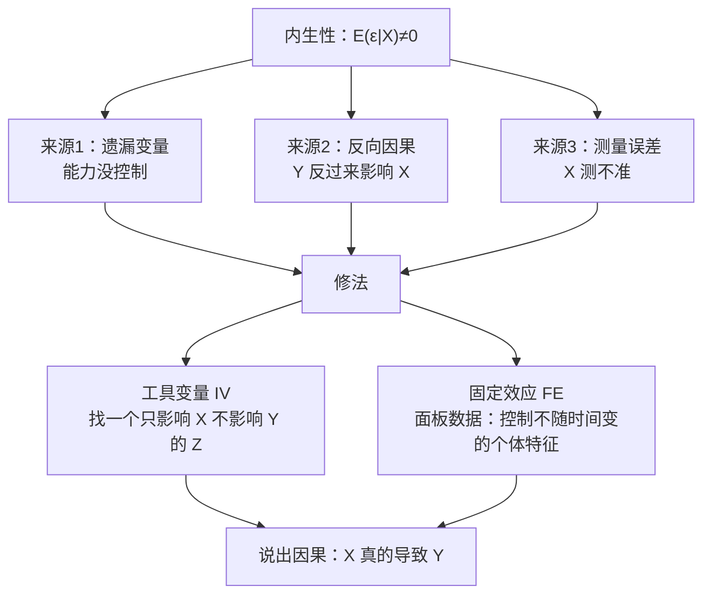

# 05 内生性与面板：怎么说出"X 真的导致了 Y"

> 上一章讲的三大问题，都不动系数——只是标准误算错了。
> 这一章讲一个真正让**系数本身错了**的病：内生性。
> 然后给你两把手术刀：**[[03_工具变量IV|工具变量]] IV** 和**[[06_固定效应FE|固定效应]] FE**。

---

## 这一章解决什么痛点？

你写论文，想证明："上一年学，工资涨 500 元。"

你跑 [[04_OLS截距和拟合值|OLS]]，得到 $\hat{\beta}_{edu}=500$，兴冲冲写进结论。

导师问你三个致命问题：

1. **"能力呢？"** 能力高的人既爱上学，工资又高。你看到的 500 元，有多少是教育的功劳，有多少是能力的功劳？（**[[02_遗漏变量偏误|遗漏变量偏误]]**）
2. **"是上学涨工资，还是涨工资了才去上学？"**（**反向因果**）
3. **"你怎么证明是教育导致工资，而不是别的？"**

这三个问题的共同根源：**E(ε|X) ≠ 0**——解释变量 X 和误差项相关了。这就是**内生性**。

---

## 这一章你会学到什么？

| 文件 | 核心问题 | 一句话答案 |
|------|----------|-----------|
| [[01_什么是内生性]] | 内生性到底是什么？ | X 和 ε 相关，OLS 系数有偏 |
| [[02_遗漏变量偏误]] | 漏了能力会偏多少？ | 偏误 = β_z × Cov(X,Z)/Var(X) |
| [[03_工具变量IV]] | 怎么找一个"干净"的 X？ | 找 Z：相关 X，外生于 Y |
| [[04_两阶段最小二乘2SLS]] | IV 怎么算？ | 第一阶段用 Z 预测 X，第二阶段用预测值回归 Y |
| [[05_面板数据是什么]] | 面板数据好在哪？ | N 个人 × T 年，能控制个体不变特征 |
| [[06_固定效应FE]] | 怎么控制"天生能力"？ | 每个人自己和自己比，去掉个体均值 |
| [[07_随机效应RE与Hausman检验]] | FE 和 RE 选哪个？ | Hausman 检验：p<0.05 用 FE |
| [[00_章节总结]] | 考前复习 | 方法选择图 + 自测题 |

---

## 为什么这一章是论文核心？

本科毕业论文的实证部分，90% 的工作量在解决内生性。

- 审稿人看你的论文，第一眼看什么？**模型有没有内生性问题。**
- 答辩老师问你最多的是什么？**"你这系数是因果吗？"**
- 想发好期刊，门槛是什么？**有没有用 IV / FE / DID。**

学会这一章，你就从"会跑回归"升级到"会做实证研究"。

---

上一篇：[[../04_回归三大问题/README|04 回归三大问题]] ｜ 下一篇：[[01_什么是内生性]]

---

## 📖 配套教材笔记
- [[../../教材笔记/02_计量经济学/09_工具变量法/00_章节总结|计量经济学·第9章 工具变量法]]
- [[../../教材笔记/02_计量经济学/11_面板数据/00_章节总结|计量经济学·第11章 面板数据]]

## 📚 配套原书
- [[../../原文件/计量经济学/陈强_计量经济学及Stata应用_全书|陈强《计量经济学及Stata应用》第9-10章]]

## 延伸阅读
- 📖 统计学原理配套：[[../../教材笔记/05_统计学原理/06_抽样与参数估计/知识点/KP03_参数与统计量|参数与统计量]]、[[../../教材笔记/05_统计学原理/07_假设检验/知识点/KP01_假设检验的逻辑|假设检验逻辑]]
  - 做因果推断（IV / FE / DID）的本质，就是在**控制两类错误**：别把"相关"误判成"因果"（弃真），也别把真因果漏掉（取伪）→ [[../../教材笔记/05_统计学原理/07_假设检验/知识点/KP03_两类错误|KP03 两类错误]]
  - 面板数据 = N 个个体 × T 个时间点，其中的"时间维度"就是[[../../教材笔记/05_统计学原理/09_时间序列分析/知识点/KP01_时间数列两个基本要素|时间数列两个基本要素]]（时间 + 指标值），理解它有助于看懂固定效应为什么能"去均值"
