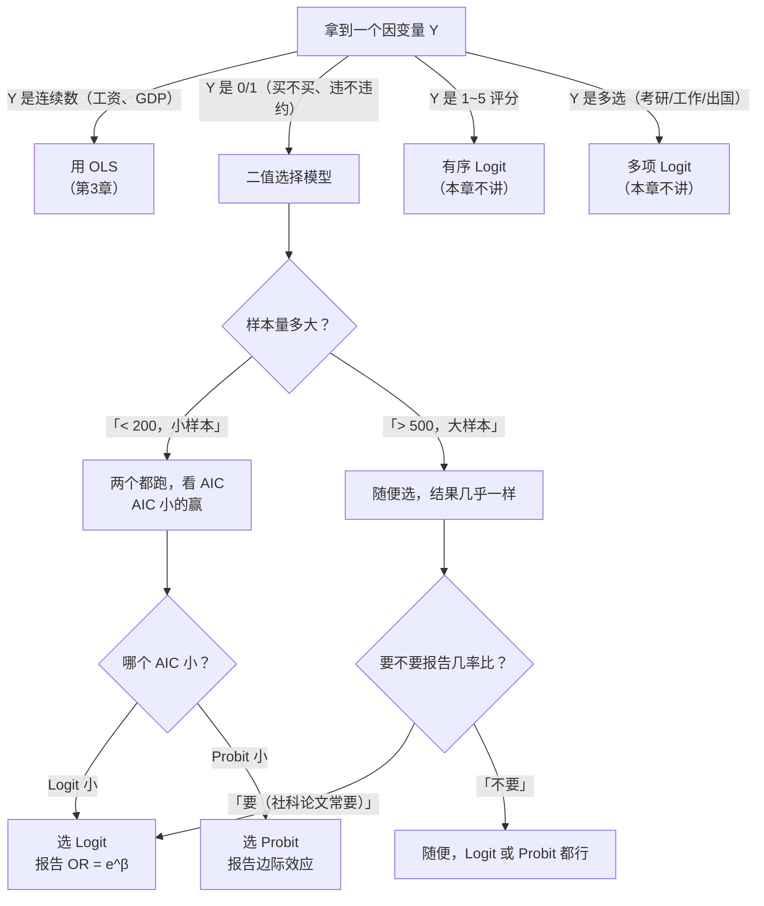

# 06 受限因变量 · 章节总结

> 学完这一章，你应该能回答：Y 是 0/1 时该怎么办？为什么不能直接 [[04_OLS截距和拟合值|OLS]]？Logit 和 Probit 怎么选？

---

## 一、四种方法对比表

| 维度 | OLS（直接套） | LPM（OLS 套 0/1） | Logit | Probit |
|------|---------------|--------------------|-------|--------|
| **概率范围** | 任意实数 | **可能跑出 [0,1]** | 永远 (0,1) | 永远 (0,1) |
| **函数形状** | 直线 | 直线 | S 形 | S 形 |
| **系数解释** | Y 平均变化 | X 涨1，P 涨多少（线性） | log odds 涨多少，要转 OR | 无直观解释 |
| **几率比 OR** | 没有 | 没有 | **有，$e^\beta$** | 没有 |
| **边际效应** | 常数 | 常数 | 要算 $\beta P(1-P)$ | 要算 $\phi(z)\beta$ |
| **[[02_异方差|异方差]]** | 假设同方差 | **必然异方差** | 极大似然估计，不依赖同方差 | 同 Logit |
| **[[06_拟合优度R²|拟合优度]]** | R² | R² 没意义 | Pseudo R²、AUC | Pseudo R²、AUC |
| **计算难度** | 最小二乘，快 | 快 | 极大似然，略慢 | 极大似然+数值积分 |
| **适用场景** | Y 连续 | 大样本+X 集中在中间 | **默认选择** | 理论假设误差正态 |

---

## 二、核心公式清单

### 1. LPM
$$P(Y=1) = \beta_0 + \beta_1 X$$
问题：会跑出 [0,1]。

### 2. Logit
$$P(Y=1) = \frac{1}{1+e^{-(\beta_0+\beta_1 X)}}$$
$$\text{odds} = \frac{P}{1-P} = e^{\beta_0+\beta_1 X}$$
$$\text{OR} = e^{\beta_1} \quad (\text{X 涨 1，odds 乘多少})$$

### 3. Probit
$$P(Y=1) = \Phi\left(\frac{\beta_0+\beta_1 X}{1.6}\right)$$
$\Phi$ 是标准正态 CDF。

### 4. 平均边际效应 AME
$$\text{AME}_{\text{Logit}} = \frac{1}{n}\sum \beta_1 P_i(1-P_i)$$

---

## 三、方法选择决策图



---

## 四、本科论文最常用套路

```
主回归：Logit y x1 x2 x3, robust
报告：系数表 + 几率比 OR + 平均边际效应
稳健性：换成 Probit 再跑一遍，结论方向一致
```

Stata 模板：
```stata
logit y x1 x2 x3, robust
estimates store m1
logit y x1 x2 x3, or          // 报告 OR
margins, dydx(x1 x2 x3)       // 报告 AME
probit y x1 x2 x3, robust      // 稳健性
estimates store m2
estimates table m1 m2, b(%9.4f)
```

---

## 五、自测题（考前扫一眼）

1. Y 是 0/1，直接跑 OLS 有哪三个问题？
   - 答：概率越界、扰动项必然异方差、R² 没意义。

2. Logit 的系数 $\beta_1=0.2$，怎么解释？
   - 答：X 涨 1，log odds 涨 0.2；等价于 odds 乘 $e^{0.2}=1.22$，即几率提高 22%。**不是概率涨 22%**。

3. Logit 和 Probit 结果什么时候几乎一样？
   - 答：大样本下，尤其是 X 集中在均值附近时。

4. Probit 能不能报告几率比？
   - 答：不能。Probit 没有 odds ratio，只能报告边际效应。

5. 样本 150 个，Logit 的 AIC=240，Probit 的 AIC=235，选哪个？
   - 答：选 Probit（AIC 小的好）。

---

## 本章方法答辩速查

1. **问：Y 是 0/1，论文里选方法的完整决策流程是什么？** 答：先确认 Y 是真二值（不是 1~5 评分硬砍成 0/1）；样本 >500 直接选 Logit，报告几率比 OR=$e^\beta$ 和平均边际效应，再跑 Probit 做稳健性；样本 <200 时两个都跑，看 AIC 小的用哪个；只有样本大、X 挤在均值附近、且跑完后 90% 以上预测值落在 [0,1]，才允许用 LPM 加[[KP03_稳健标准误|稳健标准误]]。
2. **问：OR=1.2 是不是等于"概率提高 20%"？** 答：不是，这是答辩最常挖的坑。OR=1.2 指**几率** odds 乘 1.2：若基准 P=0.1，odds 从 0.111 涨到 0.133，P 只从 0.10 涨到约 0.118（约 1.8 个百分点）；若基准 P=0.5，P 从 0.5 涨到约 0.545（约 4.5 个百分点）。所以报告时必须分清"几率涨了几成"和"概率涨了几个百分点"。
3. **问：二值模型的结果好不好，到底看什么数？** 答：显著性看 z 值/p 值和置信区间（判断方法同 OLS）；拟合优度不看 OLS 的 R²，看 McFadden Pseudo R²（一般 0.2~0.4 算不错）和 AUC（>0.7 算有解释力）。另外统计显著不等于经济显著，还要用平均边际效应判断"X 涨 1，概率实际动几个百分点"。

---

## 六、下一步去哪？

- 想给多个城市打分排名 → [[../07_综合评价方法/README|07 综合评价方法]]
- 想搞因果推断（X 真的导致 Y 吗） → [[../05_内生性与面板/README|05 内生性与面板]]
- 想降维（变量太多） → [[../08_降维与分类/README|08 降维与分类]]

---

下一篇：[[../07_综合评价方法/README]]


---

## 📖 配套教材笔记
- [[../../教材笔记/02_计量经济学/10_二值选择模型/00_章节总结|计量经济学·第10章 二值选择模型]]

## 📚 配套原书
- [[../../原文件/计量经济学/陈强_计量经济学及Stata应用_全书|陈强《计量经济学及Stata应用》第11章]]
