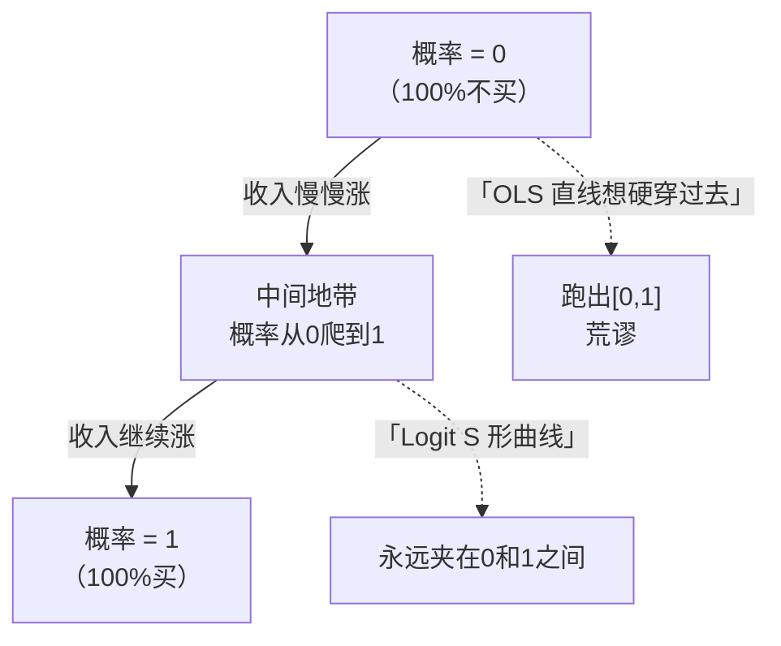

# 01 什么时候用 Logit？（Y 是 0/1 的时候）

## 一、为什么要学这个？

**生活里到处都是"是/否"问题：**

- 银行放贷：这个客户**会不会违约**？（违约=1，不违约=0）
- 房产中介：这个家庭**买不买得起房**？（买=1，不买=0）
- 研究生院：这个本科生**会不会上研**？（上=1，不上=0）
- 医院：这个病人**会不会得糖尿病**？（得病=1，不得=0）
- 电商：这个用户**会不会点击广告**？（点=1，不点=0）

这些问题的共同点是：**答案只有两个值，0 或者 1。**

**不学会怎样？**
- 你兴冲冲跑了 `reg y x`（[[04_OLS截距和拟合值|OLS]]），结果老师问："你这预测出来的概率，怎么有 1.17？概率能大于 1 吗？"
- 你论文写"收入每涨 1 万，买房概率提高 0.012"，答辩老师追问："收入 100 万时概率不就 1.17 了？你家概率大于 1？"
- 你连"几率比"是什么都不知道，文献综述里别人写 OR=2.3，你一脸懵。

这一章就是来堵这些窟窿的。

---

## 二、是什么？（先打比方）

### 生活比喻：开车过收费站

想象一条高速公路，从左到右：
- 左边：穷人区（收入低）→ 几乎没人买房；
- 中间：中等收入 → 有人买有人不买；
- 右边：富人区（收入高）→ 几乎人人买房。

你想画一条曲线，描述"收入越高，买房概率怎么变"。

**OLS 想画的是一条直线**：收入每涨 1 万，概率涨固定的 0.012。问题是——直线会一直涨下去，涨到最后概率变成 2、3、10，**概率怎么可能大于 1？**

**Logit 想画的是一条 S 形曲线**：
- 左边（穷人）：概率贴着 0，涨不动；
- 中间（中产）：概率陡升；
- 右边（富人）：概率贴着 1，涨不动。

这条 S 曲线永远夹在 0 和 1 之间，**这就是我们要的。**



### 严格定义

> **二值因变量模型**：当因变量 Y 只取 0 和 1 两个值时，我们要建模的不是 Y 本身，而是 **Y=1 的概率**：
> $$P(Y=1 \mid X) = f(X)$$
> 其中 $f$ 必须满足 $0 \le f(X) \le 1$。

---

## 三、公式怎么来的？（从 OLS 到 LPM）

### 第一步：先试着用 OLS

假设我们有 5 个人的数据：

| 人 | 年收入 X（万） | 是否买房 Y |
|----|----------------|------------|
| 张三 | 5 | 0 |
| 李四 | 10 | 0 |
| 王五 | 20 | 0 |
| 赵六 | 50 | 1 |
| 钱七 | 100 | 1 |

直接套 OLS：$Y = \beta_0 + \beta_1 X + \varepsilon$。

用第 3 章教的最小二乘法算（Python 验证过）：

$$\hat{\beta}_0 = -0.055, \quad \hat{\beta}_1 = 0.0123$$

**这就是线性概率模型（Linear Probability Model, LPM）**：
$$\hat{P}(Y=1) = -0.055 + 0.0123 X$$

### 第二步：代入不同 X，看会发生什么

| 年收入 X | LPM 预测概率 $\hat{P}$ | 合理吗？ |
|----------|------------------------|----------|
| 5 万 | 0.007 | 合理（0.7%） |
| 10 万 | 0.068 | 合理（6.8%） |
| 20 万 | 0.191 | 合理（19%） |
| 50 万 | 0.560 | 合理（56%） |
| 100 万 | **1.175** | **❌ 概率大于 1！** |
| 200 万 | **2.405** | **❌ 完全荒谬！** |

**看到问题了吗？** 收入越高，LPM 预测的概率会冲破 1，甚至变成 2.4——**概率不可能大于 1，也不可能小于 0。**

### 第三步：LPM 还有别的毛病

1. **扰动项必然[[02_异方差|异方差]]**。Y 只能取 0/1，所以 $\varepsilon = Y - (\beta_0 + \beta_1 X)$ 也只能取两个值，方差随 X 变化——违反 OLS 的同方差假设。
2. **[[06_拟合优度R²|拟合优度]] R² 没意义**。Y 是 0/1，预测值是 0~1 之间的小数，你算出来的 R² 可能只有 0.1，根本不能像连续变量那样解读。
3. **边际效应恒定不现实**。"收入从 5 万涨到 6 万，买房概率涨 0.012"；"收入从 500 万涨到 501 万，买房概率也涨 0.012"？现实中富人已经 100% 买了，再涨收入也不会涨概率。

### 第四步：那怎么办？

把直线换成 S 形曲线，让它**永远夹在 0 和 1 之间**。这条 S 曲线背后有一个"看不见的倾向"（潜变量 $Y^*$）——比如你心里买房的冲动够不够强，超过门槛就买（Y=1），不够就不买（Y=0）。这就是下一篇要讲的 Logit。

---

## 四、每个符号是什么？

| 符号 | 怎么读 | 是什么 | 生活类比 |
|------|--------|--------|----------|
| $Y$ | "y" | 因变量，0 或 1 | 买没买房 |
| $X$ | "x" | 解释变量（可以有多个） | 收入、学历、年龄 |
| $\beta_0$ | "beta 零" | 截距 | X=0 时的概率 |
| $\beta_1$ | "beta 一" | 斜率（LPM 里） | X 每加 1，概率涨多少 |
| $P(Y=1\mid X)$ | "Y 等于 1 的概率，给定 X" | 我们真正要建模的东西 | "这个收入水平的人，买房的概率" |
| LPM | "L-P-M" | 线性概率模型 | 直接 OLS 套 0/1 |

---

## 五、一个完整的数字例子

**问题**：用上面 5 个人的数据，跑 LPM，预测年收入 30 万的人买房概率。

**第一步**：算均值
- $\bar{X} = (5+10+20+50+100)/5 = 37$
- $\bar{Y} = (0+0+0+1+1)/5 = 0.4$

**第二步**：算斜率 $\hat{\beta}_1$
$$\hat{\beta}_1 = \frac{\sum (X_i-\bar{X})(Y_i-\bar{Y})}{\sum (X_i-\bar{X})^2}$$

分子：
- $(5-37)(0-0.4) = (-32)(-0.4) = 12.8$
- $(10-37)(0-0.4) = (-27)(-0.4) = 10.8$
- $(20-37)(0-0.4) = (-17)(-0.4) = 6.8$
- $(50-37)(1-0.4) = (13)(0.6) = 7.8$
- $(100-37)(1-0.4) = (63)(0.6) = 37.8$
- 合计 = $12.8+10.8+6.8+7.8+37.8 = 76.0$

分母：
- $(-32)^2 + (-27)^2 + (-17)^2 + 13^2 + 63^2$
- $= 1024 + 729 + 289 + 169 + 3969 = 6180$

$$\hat{\beta}_1 = 76/6180 = 0.0123$$

**第三步**：算截距
$$\hat{\beta}_0 = \bar{Y} - \hat{\beta}_1 \bar{X} = 0.4 - 0.0123 \times 37 = 0.4 - 0.455 = -0.055$$

**第四步**：预测 X=30 万时的概率
$$\hat{P} = -0.055 + 0.0123 \times 30 = -0.055 + 0.369 = 0.314$$

答：年收入 30 万的人，LPM 预测买房概率约 **31.4%**。

**第五步**：但试一下 X=200 万
$$\hat{P} = -0.055 + 0.0123 \times 200 = 2.405$$

**240.5%？概率大于 100%？这就是 LPM 的死穴。**

---

## 六、前提假设（LPM 能用的条件）

严格说，LPM **几乎没有能用的场景**。但如果非要用，导师可能会接受以下妥协：

1. **X 取值范围不能太宽**。只在样本均值附近预测，别外推太远。比如你样本里 X 从 5 到 100 万，你就别拿这个模型去预测"亿万富翁买房概率"。
2. **预测值落在 [0,1] 之间的比例要高**。跑回归后做个预测，看看有多少个 $\hat{P}$ 跑出 [0,1]。如果 90% 以上都在里面，勉强能用；如果 20% 以上跑出去了，赶紧换 Logit。
3. **必须用[[KP03_稳健标准误|稳健标准误]]**。因为异方差是必然的，用 `reg y x, robust`。

---

## 七、易错点

1. **把 LPM 的系数直接当"概率变化"读**。$\hat{\beta}_1 = 0.0123$ 的意思是"X 加 1，概率加 0.0123"——但这是**线性假设下的平均效应**，在 X 很小时和 X 很大时都不准。
2. **用 R² 判断模型好坏**。二值因变量的 R² 天然偏低，0.1 已经算不错了，别跟连续变量的 R² 比。
3. **样本里 Y=1 或 Y=0 太少**。如果 100 个人里只有 2 个买房，Logit 会极不稳定，LPM 也救不了。这叫"稀有事件偏差"，需要专门的方法（本章不讲）。
4. **外推到样本外**。你用收入 5~100 万估的模型，去预测收入 1000 万的人，LPM 会给出荒谬的概率。

---

## 八、Stata / Python 代码

### Stata：先跑 LPM，看看概率跑没跑出 [0,1]

```stata
-- 输入数据
clear
input income buy
5   0
10  0
20  0
50  1
100 1
end

-- 跑 LPM（加稳健标准误）
reg buy income, robust

-- 预测每个样本的概率
predict phat

-- 看 phat 的分布：有没有跑出 [0,1]
summarize phat
list phat if phat < 0 | phat > 1   // 列出越界的观测
```

**输出怎么读**：
- `reg` 表里 `income` 那行的系数就是 $\hat{\beta}_1$，这里约 0.0123；
- `phat` 的最小值如果 <0 或最大值 >1，说明 LPM 出问题了。

### Python：先看一眼

```python
import numpy as np
X = np.array([5,10,20,50,100])
Y = np.array([0,0,0,1,1])
# 手算的结果验证
b1 = np.sum((X-X.mean())*(Y-Y.mean())) / np.sum((X-X.mean())**2)
b0 = Y.mean() - b1*X.mean()
print(f"b0={b0:.4f}, b1={b1:.4f}")
for x in [5,30,100,200]:
    print(f"X={x}: P={b0+b1*x:.3f}")
```

输出：
```
b0=-0.0550, b1=0.0123
X=5: P=0.007
X=30: P=0.314
X=100: P=1.175   <- 越界
X=200: P=2.405   <- 越界
```

---

## 九、和别的方法对比

| 方法 | Y 是 0/1 时能不能用 | 概率会不会越界 | 系数好不好解释 |
|------|---------------------|----------------|----------------|
| OLS（连续变量那套） | ❌ | 必然越界 | 直接当概率读，但错 |
| **LPM**（OLS 套 0/1） | ⚠️ 勉强 | **会越界** | 系数=概率变化，但只在中间区准 |
| **Logit**（下一篇） | ✅ | 不会，永远在 (0,1) | 系数要换成几率比读 |
| **Probit**（再下一篇） | ✅ | 不会 | 系数没有直观解释，要看边际效应 |

**一句话**：Y 是 0/1 时，**默认用 Logit**。除非你样本特别大、X 都挤在中间、预测值全都在 [0,1] 里，才可以勉强用 LPM。

---

## 十、为什么不用别的方法？

- **为什么不用直接跑 OLS（把 Y 当连续变量，什么都不处理）？** 这样跑出来的就是 LPM，预测概率会跑出 [0,1]——本文件 5 个人的例子里，X=200 万时直接给出 2.405，即 240.5%，概率大于 1 在数学上不成立；同时扰动项必然异方差，R² 也失去连续变量的解读意义。
- **为什么不干脆一直用 LPM 糊弄过去？** 因为它的"边际效应恒定"假设不现实："收入从 5 万涨到 6 万概率涨 0.012"和"从 500 万涨到 501 万也涨 0.012"是同一条直线给的，但现实中富人早已 100% 买房，再涨收入概率也贴在 1 上不动。只有样本大、X 挤在均值附近、90% 以上预测值落在 [0,1] 三个条件同时满足时，才勉强可用 LPM。
- **为什么不用有序 Logit / 多项 Logit？** 因为 Y 只有 0 和 1 两个取值，既不是 1~5 的评分（没有顺序），也不是考研/工作/出国这类多个类别，不存在"等级"或"多选"结构，强行换有序/多项模型属于过度复杂，反而更难解释。

---

## 十一、答辩常问（直接背）

1. **问：Y 是 0/1，为什么不能直接跑 `reg y x`？** 答：直接跑就是线性概率模型 LPM，三个毛病——预测概率会越界（本例 X=200 万时给出 2.405，即 240.5%）、扰动项必然异方差、R² 无法按连续变量解读。正确做法是用把概率压在 (0,1) 之间的 S 形模型，也就是 Logit。
2. **问：LPM 什么时候可以勉强用？** 答：三条同时满足才勉强用——样本大、X 取值集中在均值附近不做远距离外推、跑完回归后预测值 90% 以上落在 [0,1]；并且必须加稳健标准误 `reg y x, robust`。只要有 20% 以上预测值越界，立刻换 Logit。
3. **问：你那个"X 涨 1 万，概率涨 0.0123"到底怎么读？** 答：这是 LPM 的常数边际效应，只在样本均值附近准。本例子 X̄=37 万，均值附近预测概率约 0.31~0.56 还算合理；但在 X 很小和很大的两端都不准——这也是为什么最终要换成 Logit，让两头的概率自动压平。

---

## 十二、速记卡

> **Y 是 0/1 时，直接跑 OLS = LPM。**
> LPM 的死穴：**概率会跑出 [0,1]**，而且扰动项必然异方差。
> 记住那个数字：5 个人的例子里，X=200 万时 LPM 给出概率 2.405——荒谬。
> 所以我们需要一条 S 形曲线，把概率永远压在 0 和 1 之间。
> 这条 S 曲线，就是下一篇要讲的 **Logit**。

---

下一篇：[[02_Logit模型]]


---

## 📖 配套教材笔记
- [[../../教材笔记/02_计量经济学/10_二值选择模型/知识点/KP01_Logit与Probit|计量经济学·KP01 Logit与Probit]]

## 📚 配套原书
- [[../../原文件/计量经济学/陈强_计量经济学及Stata应用_全书|陈强《计量经济学及Stata应用》第11章]]
