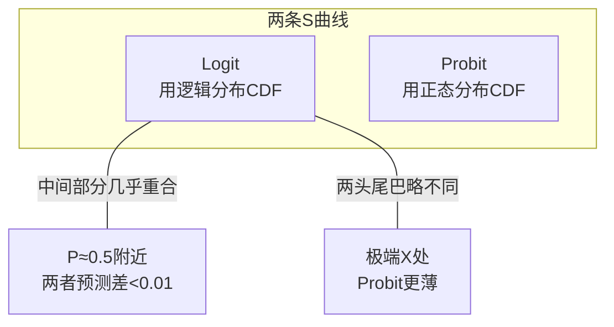

# 03 Probit 与 Logit 对比：两条长得几乎一样的 S 曲线

## 一、为什么要学这个？

你在文献里会看到两种模型：
- 有人写"我们用 Logit 模型……"；
- 有人写"我们用 Probit 模型……"；
- 还有大佬写"我们同时报告 Logit 和 Probit 结果，二者一致……"。

**他们到底在干嘛？有什么区别？我论文里该用哪个？**

**不学会怎样？**
- 答辩老师问"你为什么用 Logit 不用 Probit"，你答"因为 Logit 好写"——这理由会被骂；
- 你跑了 Probit，想报告几率比，突然发现 Probit 没有 odds ratio 这个东西；
- 你不知道两个模型结果"几乎一样"这件事，在结果稳健性部分少写了一段加分项。

---

## 二、是什么？（先打比方）

### 生活比喻：两个厨师做同一道麻婆豆腐

Logit 和 Probit 就像两个厨师做麻婆豆腐：
- 厨师 A（Logit）：用的是**逻辑分布**的 CDF；
- 厨师 B（Probit）：用的是**[[07_正态分布|正态分布]]**的 CDF；
- 两道菜端上来，**95% 的尝不出区别**；
- 只有在极端辣（概率接近 0 或 1）的地方，味道才略不一样。

**它们的目标完全一样**：把一条直线"压"进 0 和 1 之间，变成 S 形。区别只是"用什么函数压"。

### 严格定义

| 模型 | 假设 | 公式 |
|------|------|------|
| **Logit** | 误差服从逻辑分布 | $P(Y=1) = \dfrac{1}{1+e^{-(\beta_0+\beta_1 X)}}$ |
| **Probit** | 误差服从标准正态分布 | $P(Y=1) = \Phi\left(\dfrac{\beta_0+\beta_1 X}{1.6}\right)$ |

其中 $\Phi(\cdot)$ 是标准正态分布的累积分布函数（CDF）。那个 1.6 是个标度常数，用来让两条曲线在中间部分尽量重合。

---

## 三、公式怎么来的？

### Logit 的思路回顾

Logit 假设存在一个**潜变量** $Y^*$：
$$Y^* = \beta_0 + \beta_1 X + \varepsilon, \quad \varepsilon \sim \text{逻辑分布}$$

我们观察到的 Y 是：
$$Y = \begin{cases} 1, & Y^* > 0 \\ 0, & Y^* \le 0 \end{cases}$$

于是 $P(Y=1) = P(Y^*>0) = P(\varepsilon > -(\beta_0+\beta_1 X))$。

逻辑分布是对称的，所以：
$$P(Y=1) = \Lambda(\beta_0+\beta_1 X) = \frac{1}{1+e^{-(\beta_0+\beta_1 X)}}$$

### Probit 的思路

**只换一件事**：假设 $\varepsilon \sim N(0,1)$（标准正态）。

那么：
$$P(Y=1) = P(\varepsilon > -z) = \Phi(z)$$

其中 $z = \beta_0+\beta_1 X$，$\Phi(\cdot)$ 是标准正态 CDF。

**为什么除以 1.6？** 逻辑分布的方差是 $\pi^2/3 \approx 3.29$，标准差约 1.81；标准正态的标准差是 1。两者标准差不同，所以如果不调一下，两条 S 曲线的"胖瘦"不一样。乘上 $1/1.6$ 是个经验调整，让中间部分重合。

### 两条曲线长什么样？



---

## 四、每个符号是什么？

| 符号 | 怎么读 | 是什么 |
|------|--------|--------|
| $\Phi(\cdot)$ | "phi" | 标准正态分布的累积函数 |
| $\Lambda(\cdot)$ | "lambda" | logistic 函数 |
| $Y^*$ | "y 星" | 潜变量（看不见的真实倾向） |
| $\varepsilon$ | "epsilon" | 误差项 |
| 1.6 | —— | 标度常数（只在对比时用） |

---

## 五、一个完整的数字例子

**问题**：同样的 $z = -4 + 0.1 X$，用 Logit 和 Probit 分别算 P，看差多少。

**Logit**：$P_L = 1/(1+e^{-z})$

**Probit**：$P_P = \Phi(z/1.6)$（用了 1.6 标度）

| X（万） | z | Logit P | Probit P | 差 |
|---------|---|---------|----------|-----|
| 5  | -3.5 | 0.0293 | 0.0144 | 0.015 |
| 20 | -2.0 | 0.1192 | 0.1056 | 0.014 |
| 50 | +1.0 | 0.7311 | 0.7340 | 0.003 |
| 100 | +6.0 | 0.9975 | 0.9999 | 0.002 |

（Python 验证过：用 $0.5(1+\text{erf}(z/\sqrt{2}))$ 算正态 CDF。）

**结论**：
- 在中间区（P≈0.5），两者预测几乎一模一样；
- 在尾巴处（P<0.05 或 P>0.95），Probit 给出的概率更"极端"一些；
- 但**排序结果完全一样**——谁该排前面谁该排后面，两个模型给出一模一样的顺序。

---

## 六、前提假设

| 假设 | Logit | Probit |
|------|-------|--------|
| Y 是 0/1 | ✅ | ✅ |
| 误差分布 | 逻辑分布 | 正态分布 |
| 不存在完全分离 | ✅ | ✅ |
| 样本独立 | ✅ | ✅ |

**关键差别**：误差分布的假设。但现实中，误差到底是逻辑分布还是正态分布？**没人知道**。这就是为什么两个结果几乎一样——因为大部分经济数据的误差，你说不清它是哪种。

---

## 七、易错点

1. **Probit 也报告几率比**。错！Probit 没有 odds ratio 这个概念（因为 $e^\beta$ 没有概率解释）。Probit 只能报告**边际效应**。
2. **用 Probit 的系数和 Logit 直接比大小**。错！Probit 的系数要乘 1.6 才能和 Logit 比。比如 Probit 的 $\beta_1=0.06$，相当于 Logit 的 $0.06 \times 1.6 = 0.096$。
3. **样本很小的时候乱用**。样本 < 100 时，两个模型都不稳。这时候看 AIC：哪个 AIC 小用哪个。
4. **以为两个模型结果必须一样**。大样本下方向、显著性几乎一样；但小样本或极端值多的时候，Probit 和 Logit 可能给出略不同的标准误。
5. **忘记做稳健性对比**。论文里最好两个都跑一遍，写"Logit 与 Probit 结果一致，结论稳健"。

---

## 八、Stata / Python 代码

### Stata：同时跑 Logit 和 Probit

```stata
-- 输入数据
clear
input income buy
5   0
10  0
20  0
50  1
100 1
end

-- 1. Logit
logit buy income
estimates store L

-- 2. Probit
probit buy income
estimates store P

-- 3. 对比系数（Probit系数乘1.6后应接近Logit）
estimates table L P, b(%9.4f)

-- 4. 报告两者的平均边际效应
margins, dydx(income)
estimates store P_me

-- 5. AIC 比大小
estat ic
```

**输出怎么读**：
- Logit 表里的 `Odds Ratio` 列 = $e^\beta$；
- Probit 表里没有 OR，只有 Coef.；
- `estat ic` 输出 AIC 和 BIC，**越小越好**。

### Python

```python
import numpy as np
from math import erf

def sigmoid(z):
    return 1/(1+np.exp(-z))
def norm_cdf(z):
    return 0.5*(1+erf(z/np.sqrt(2)))

beta0, beta1 = -4.0, 0.1
X = [5, 20, 50, 100]
print("X    Logit   Probit")
for x in X:
    z = beta0 + beta1*x
    pL = sigmoid(z)
    pP = norm_cdf(z/1.6)
    print(f"{x:>3}  {pL:.4f}   {pP:.4f}")
```

---

## 九、和别的方法对比

| 维度 | Logit | Probit |
|------|-------|--------|
| 误差分布 | 逻辑分布 | 正态分布 |
| 概率公式 | $1/(1+e^{-z})$ | $\Phi(z/1.6)$ |
| 系数解释 | **有几率比 OR** | 没有直观解释 |
| 边际效应 | 都能算 | 都能算 |
| 大样本结果 | 几乎一样 | 几乎一样 |
| 小样本 | 看 AIC | 看 AIC |
| 计算难度 | 简单（有解析解） | 要数值积分 |
| 论文常用度 | **更高** | 也常用 |
| 适用场景 | 一般二值选择 | 理论假设误差正态 |

**怎么选？**
- **样本大（>500）**：随便选，结果一样，导师不挑；
- **样本小（<200）**：两个都跑，哪个 AIC 小用哪个；
- **要报告几率比**：必须 Logit；
- **理论文献里都用 Probit**：跟文献保持一致。

---

## 十、为什么不用别的方法？

- **为什么不用 LPM？** 本文件是在 Logit、Probit 两个正经二值模型之间二选一；LPM 连"概率越界"这个死穴都没解决（上一章 X=200 万给出 240.5%），在规范的二值模型比较里根本没有它的位置。
- **为什么不主回归只跑 Logit、不碰 Probit？** 单跑 Logit 无法证明结论不是"恰好假设了逻辑分布"造出来的；答辩时评委问"换个误差分布你的结论还成立吗"就会卡住。[[06_稳健性检验|稳健性检验]]里加跑 Probit，用"两者方向、显著性一致"堵这个漏洞，多跑一条命令成本极低、加分明显。
- **为什么不用非参数/核估计（不假设任何分布）？** 非参数方法没有分布假设，但样本小（<500）时方差极大，而且给不出 OR、AIC 这些能写进论文的统计量，本科论文里既难实现也交不出干净的系数表。

---

## 十一、答辩常问（直接背）

1. **问：你为什么用 Logit 不用 Probit？** 答：大样本下两者结果几乎一样——本例中间区预测差 <0.01，排序完全一致；选 Logit 是因为它有几率比 OR=$e^{\beta_1}$ 可直接报告，符合社科论文惯例。同时我已跑 Probit 做稳健性检验，两者方向和显著性一致，结论稳健。
2. **问：Logit 和 Probit 的系数能直接比大小吗？** 答：不能直接比。两者误差分布标准差不同（逻辑分布约 1.81，标准正态为 1），Probit 系数要乘 1.6 才能换算到 Logit 尺度：比如 Probit 的 $\beta_1=0.06$，相当于 Logit 的 $0.06\times1.6\approx0.096$。
3. **问：样本只有 150 个，到底选哪个？** 答：两个都跑，看 AIC，哪个小用哪个（AIC 越小代表拟合越好且惩罚模型复杂度）。本章决策图也是这么走的：小样本不凭名字选，凭 AIC 选。
4. **问：两者什么时候会出现明显分歧？** 答：样本小（<200）或 Y=1 占比极端（如只有 3%）时，尾巴概率的差异被放大——本例 X=5 万处 Logit=0.029 vs Probit=0.014，差了一倍。这时必须看 AIC 做决定，不能凭感觉。

---

## 十二、速记卡

> **Logit 和 Probit 是双胞胎**：目标都是把直线压成 S 形，差别只是用逻辑分布还是正态分布。
> **大样本结果几乎一样**，排序完全一致。
> **Logit 有几率比 OR，Probit 没有**——这是选 Logit 最大的理由。
> **论文套路**：主表用 Logit，稳健性检验里加一列 Probit，写"二者结论一致"。
> 样本小就看 AIC，哪个小用哪个。

---

## 💡 经济学视角：两个模型在经济学实证里怎么取舍

**这个方法是为了解决什么经济学问题？**
写论文时导师问你："为什么用 Logit 不用 Probit？"你得能答上来。两个模型都是把直线压成 S 形，差别只在那个"看不见的潜变量"服从什么分布——逻辑分布（Logit）还是正态分布（Probit）。大样本下结论几乎一样，但小样本和系数解读上有讲究。

**经济学实证里的取舍逻辑：**

| 维度 | Logit | Probit |
|---|---|---|
| 系数解读 | 有几率比 $OR=e^\beta$，好讲故事 | 系数没直观含义，只能算边际效应 |
| 潜变量分布 | 逻辑斯蒂（厚尾） | 正态（薄尾） |
| 大样本 | 结论与 Probit 一致 | 结论与 Logit 一致 |
| 小样本 | AIC 常更小 | — |
| 计算 | 简单，有解析解 | 需要数值积分 |
| 贝叶斯框架 | 共轭麻烦 | 正态先验+Probit 友好 |

经济学顶刊里两种都用：**微观实证（劳动、健康）Probit 略多**，因为结构模型里潜变量天然是正态；**应用微观/政策评估 Logit 略多**，因为 OR 好写进政策报告。

**举个实证论文的例子：**
《小微企业贷款违约风险研究》主表跑 Logit，报告 OR："负债率每上升 1 个百分点，违约 odds 上升 1.03 倍"。稳健性检验列里加一列 Probit，写"Probit 估计的边际效应方向与显著性与 Logit 一致"——这就是标准操作，两个都放，证明结论不挑模型。

**📚 配套经济学笔记：**
- [[../../教材笔记/06_西方经济学/06_生产要素市场与收入分配/知识点/KP03_劳动供给与工资决定|原KP·劳动供给与工资决定]]

---


下一篇：[[00_章节总结]]


---

## 📖 配套教材笔记
- [[../../教材笔记/02_计量经济学/10_二值选择模型/知识点/KP01_Logit与Probit|计量经济学·KP01 Probit与Logit对比]]

## 📚 配套原书
- [[../../原文件/计量经济学/陈强_计量经济学及Stata应用_全书|陈强《计量经济学及Stata应用》第11章]]
