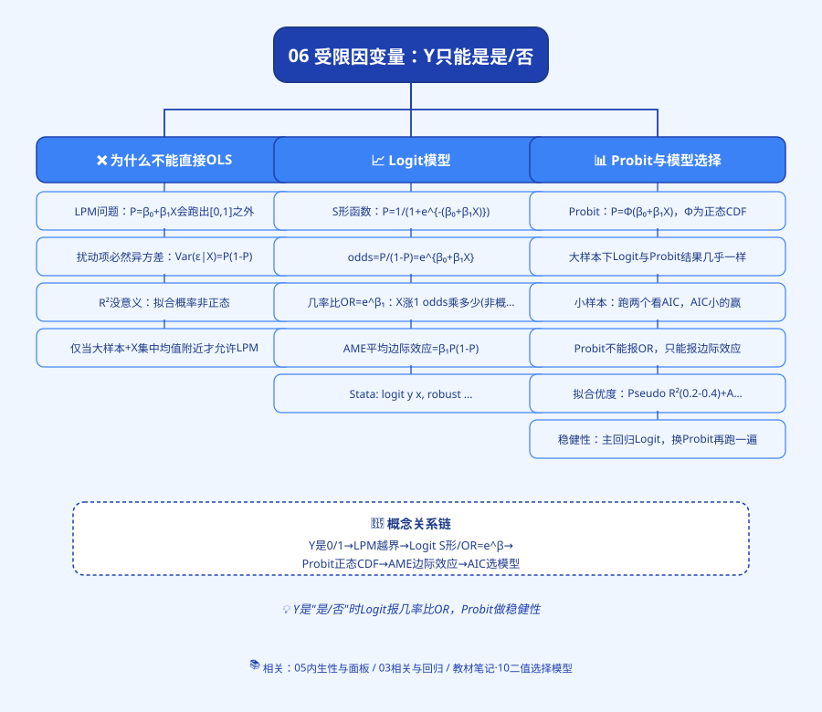
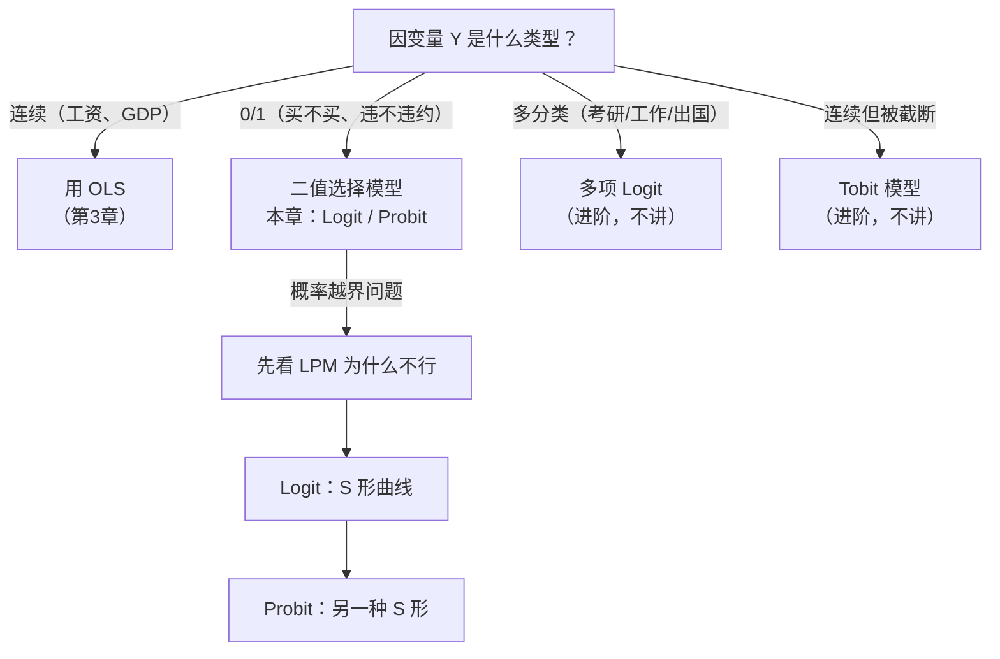

# 思维导图

---

# 06 受限因变量：当答案只能是"是/否"

> 前面第 3 章我们学的 [[04_OLS截距和拟合值|OLS]]，因变量 Y 可以是任意数：工资、GDP、销量、温度……
> 但现实中大量问题的答案**只有两个值**：买不买房？违不违约？上不上研？有没有生病？
> 这时候直接套 OLS 会出大问题——这一章就教你怎么修。

---

## 这一章解决什么问题？

| 你想问的问题 | Y 的取值 | 能不能用 OLS？ |
|--------------|----------|----------------|
| 收入每涨 1 万，工资涨多少？ | 连续（元） | ✅ OLS |
| 收入每涨 1 万，**买房概率**涨多少？ | 0/1（买=1，没买=0） | ⚠️ 直接套会出问题 |
| 学历每高一级，**违约概率**降多少？ | 0/1（违约=1） | ⚠️ 同上 |
| 考研还是工作？ | 多选（3 个以上） | ❌ 需要多项 Logit（本章不讲） |
| 工资被截断在最低工资以上 | 受限连续 | ❌ 需要 Tobit（本章不讲） |

**本章聚焦最常用的一种：Y 是 0/1（二值因变量）。**

---

## 这一章的路线

1. [`[[01_什么时候用Logit]].md`]([[01_什么时候用Logit]].md) —— Y 是 0/1 时，为什么不能直接 OLS？
2. [`[[02_Logit模型]].md`]([[02_Logit模型]].md) —— S 形 logistic 函数、几率比 odds ratio、Stata 输出怎么读
3. [`[[03_Probit与Logit对比]].md`]([[03_Probit与Logit对比]].md) —— Probit 用[[07_正态分布|正态分布]]，两者怎么选
4. [`00_章节总结.md`](00_章节总结.md) —— OLS vs LPM vs Logit vs Probit 对比表

---

## 学完这一章你会

- 拿到一份"是/否"型数据，知道**不能**直接跑 `reg y x`；
- 会用 Stata 跑 `logit y x`，并把输出里的系数翻译成"每多 1 万收入，买房几率提高百分之多少"；
- 能解释什么是**几率比（odds ratio）**，这是答辩老师最爱问的；
- 看到别人论文里写"LPM 结果显示……"，知道该提醒他概率跑出 [0,1] 了。

---

上一篇：[[../05_内生性与面板/README|05 内生性与面板]] ｜ 下一篇：[[01_什么时候用Logit]]

---

## 📖 配套教材笔记
- [[../../教材笔记/02_计量经济学/10_二值选择模型/00_章节总结|计量经济学·第10章 二值选择模型]]

## 📚 配套原书
- [[../../原文件/计量经济学/陈强_计量经济学及Stata应用_全书|陈强《计量经济学及Stata应用》第11章]]

## 延伸阅读
- 📖 统计学原理配套：[[../../教材笔记/05_统计学原理/06_抽样与参数估计/知识点/KP08_样本成数的抽样分布|样本成数分布]]、[[../../教材笔记/05_统计学原理/07_假设检验/知识点/KP09_总体比例检验|总体比例检验]]
  - 二元选择模型（Logit / Probit）背后就是**概率思想**：Y=1 的概率 p 服从什么分布，是抽样成数问题的延伸 → [[../../教材笔记/05_统计学原理/06_抽样与参数估计/知识点/KP08_样本成数的抽样分布|KP08 样本成数的抽样分布]]
  - Stata 输出里每个系数后面那个 P>|z| 就是 **p 值**，p<0.05 才说明这个 X 真的影响了"买/不买"的概率 → [[../../教材笔记/05_统计学原理/07_假设检验/知识点/KP06_P值|KP06 P 值]]
