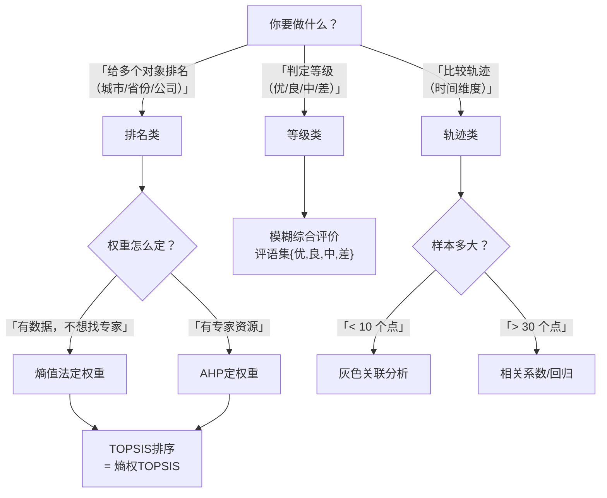

# 07 综合评价方法 · 章节总结

> 学完这一章，你应该能：拿到多指标数据，独立完成从原始数据到排名的完整流程。

---

## 一、五种方法对比表

| 方法 | 数据要求 | 核心思想 | 优点 | 缺点 | 适用场景 |
|------|----------|----------|------|------|----------|
| **[[06_熵值法-TOPSIS组合|熵值法]]** | 截面客观数据，n>m | 差异大的指标权重高 | 客观、可复现 | 只反映区分度，不反映重要性 | [[KP11_主观赋权vs客观赋权|客观赋权]] |
| **[[04_AHP层次分析法|AHP]]** | 专家打分 | 两两比较求权重 | 反映专家经验 | 主观、要 CR<0.1 | [[KP11_主观赋权vs客观赋权|主观赋权]]、专家可达 |
| **[[05_TOPSIS法|TOPSIS]]** | 加权后的数据 | 到最优最劣的距离 | 识别不均衡、高级感 | 对极端值敏感 | 对象排名 |
| **模糊综合** | 主观评价/问卷 | 评语集+隶属度 | 处理模糊概念 | 隶属度怎么来的要论证 | 满意度、教学质量、风险 |
| **灰色关联** | 时间序列小样本 | 和参考轨迹的相似度 | 小样本可用 | 参考序列要合理 | 轨迹对比、影响因素排序 |

---

## 二、方法选择决策图



---

## 三、本科论文最常见套路

### 套路 1：城市/省份排名（90% 的题目）

```
数据：30 省份 × 12 指标
流程：
  ① 正向化（负向指标翻过来）
  ② 极差归一化
  ③ 熵值法算权重 w
  ④ 向量归一化
  ⑤ TOPSIS 算 C_i
  ⑥ 按 C_i 排名 + 动态分析
```

**论文题目模板**：
- "基于熵权 TOPSIS 的 X 省 Y 市高质量发展评价"
- "数字经济发展水平测度——基于熵权 TOPSIS 的 30 省面板数据"

### 套路 2：满意度/风险评价

```
数据：问卷 N=300，4 个指标，评语集{优,良,中,差}
流程：
  ① AHP 定权重 W
  ② 问卷汇总隶属度矩阵 R
  ③ B = W·R
  ④ 最大隶属度定级
```

### 套路 3：影响因素排序

```
数据：因变量 + 5 个影响因素，时间序列 10 年
流程：
  ① 初值化
  ② 算每个因素和因变量的灰色关联度
  ③ 关联度从大到小排序 = 影响程度排序
```

---

## 四、核心公式清单

### 1. 无量纲化

正向：$r = (x - \min)/(\max - \min)$
负向：$r = (\max - x)/(\max - \min)$
向量归一化：$v_{ij} = x_{ij}/\sqrt{\sum x_{ij}^2}$

### 2. 熵值法

$p_{ij} = r_{ij}/\sum_i r_{ij}$
$e_j = -1/\ln n \sum p_{ij}\ln p_{ij}$
$w_j = (1-e_j)/\sum(1-e_k)$

### 3. AHP

几何平均 $\bar{w}_i = (\prod_j a_{ij})^{1/n}$
权重 $w_i = \bar{w}_i/\sum \bar{w}_k$
$CI = (\lambda_{\max} - n)/(n-1)$，$CR = CI/RI < 0.1$

### 4. TOPSIS

$D_i^+ = \sqrt{\sum (z_{ij}-V_j^+)^2}$
$D_i^- = \sqrt{\sum (z_{ij}-V_j^-)^2}$
$C_i = D_i^-/(D_i^+ + D_i^-)$

### 5. 模糊综合

$B = W \cdot R$，按最大隶属度定级。

### 6. 灰色关联

$\xi_i(k) = (\Delta_{\min} + \rho \Delta_{\max})/(\Delta_i(k) + \rho \Delta_{\max})$
$r_i = \frac{1}{n}\sum \xi_i(k)$

---

## 五、论文里要报告的东西

1. **[[KP02_指标体系|指标体系]]表**：一级指标、二级指标、指标方向（正向/负向）、单位、数据来源；
2. **权重表**：每个指标的权重 w_j，加起来=1；
3. **排名表**：每个对象的 D⁺、D⁻、C_i、排名；
4. **[[06_稳健性检验|稳健性检验]]**：换一种权重方法（如 AHP 权重），排名差不多；
5. **结果分析**：谁排第一、为什么、动态趋势、政策建议。

---

## 六、自测题

1. GDP（万亿）和失业率（%）为什么不能直接加？
   - 答：量纲不同，GDP 量级碾压失业率，加权求和会被 GDP 主导。

2. 熵值法给一个指标权重=0，说明什么？
   - 答：这个指标在样本间完全没差异，区分度为 0，不代表它不重要。

3. AHP 里 CR=0.15，怎么办？
   - 答：不通过，回去改判断矩阵，不能硬上。

4. TOPSIS 里 C_i=0.8 和 C_i=0.3，谁好？
   - 答：0.8 好，C_i 越大越接近正理想解。

5. 什么时候用模糊综合不用 TOPSIS？
   - 答：评价对象是"满意度、教学质量、风险等级"这种模糊概念，不是客观排名。

6. 灰色关联为什么适合小样本？
   - 答：它不假设分布，只比较轨迹形状，4~10 个点就能算。

---

## 本章方法答辩速查

1. **问：主观赋权（AHP）和客观赋权（熵值法）什么时候选哪个？** 答：有完整客观数据、且不想找专家→熵值法（按数据区分度定权）；能请到合格专家、且指标的"重要性"数据体现不出来（如"共享发展"）→AHP（必须做 CR<0.1 [[KP05_AHP一致性检验|一致性检验]]）。想加分就组合赋权（如 $0.5\times\text{AHP}+0.5\times\text{熵值}$）。
2. **问：横向排名、等级判定、轨迹相似，分别用什么方法？** 答：横向排名（给城市/省份打分排序）→熵值法定权重 + TOPSIS 贴近度排名，这是 90% 综评论文的模板；等级判定（优/良/中/差，如满意度）→模糊综合评价；纵向轨迹（4~10 个点，谁和理想轨迹最像）→灰色关联分析。
3. **问：熵值法、AHP、TOPSIS、模糊综合、灰色关联，各自的硬约束是什么？** 答：熵值法要求 n≥3m 且负向指标先正向化；AHP 要求指标数≤9 且 CR<0.1；TOPSIS 要求向量归一化、先归一化再加权、指标不全相关；模糊综合要求评语集有序、每行隶属度和为 1；灰色关联要求参考序列合理、所有序列用同一种初值化。

---

## 七、下一步去哪？

- 想降维（指标太多） → [[../08_降维与分类/README|08 降维与分类]]
- 想做因果（X 影响 Y） → [[../03_相关与回归/README|03 相关与回归]]
- 想预测未来 → [[../09_时间序列/README|09 时间序列]]

---

上一篇：[[08_灰色关联分析]]｜下一篇：[[../08_降维与分类/README]]

---

## 📖 配套教材笔记

- [[../../教材笔记/01_综合评价/README|教材笔记·综合评价全课程]]

## 📚 配套原书

- [[../../原文件/综合评价/陈正伟_综合评价技术及应用_全书|《综合评价技术及应用》陈正伟（西南财经大学出版社）]]
