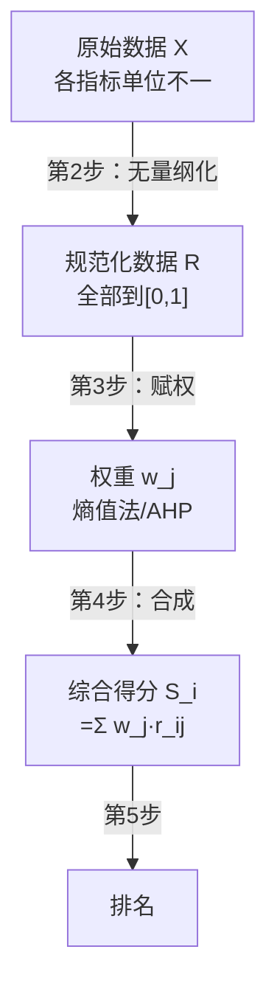

# 01 综合评价是什么？（鸟瞰整个流水线）

## 一、为什么要学这个？

**生活里的综合评价无处不在：**
- 高考录取：看总分（语数外+理综加权）；
- 大众点评：口味、环境、服务打分；
- 世界大学排名：教学、研究、引用、产业收入、国际化，五大类几十个指标；
- 统计局：给各省算"高质量发展指数"。

**你论文里最常见的题目：**
- "基于熵权 [[05_TOPSIS法|TOPSIS]] 的重庆市各区县经济发展质量评价"
- "成渝地区双城经济圈绿色发展水平综合评价"
- "数字经济对高质量发展的影响——基于 30 个省份的实证"

**不学会怎样？**
- 你拿到数据直接 `总分 = GDP + 失业率 + 收入`——GDP 是万亿、失业率是个位数、收入是万元，**这仨加起来有意义吗？**
- 老师问"你权重怎么来的"，你答"我拍的"——直接被打回；
- 论文方法部分写了一堆名词，但不知道它们之间是串起来用的。

---

## 二、是什么？（先打比方）

### 生活比喻：选大学

你高考完要从 10 所大学里选一所。你手里有这些信息：

| 大学 | 分数线 | 校园面积 | 就业率 | 食堂评分 |
|------|--------|----------|--------|----------|
| A    | 650    | 3000 亩  | 95%    | 4.5/5    |
| B    | 620    | 5000 亩  | 88%    | 3.8/5    |
| C    | 600    | 2000 亩  | 92%    | 4.7/5    |

**怎么选？**
1. **先统一单位**：分数线 600+、面积几千亩、就业率 90% 上下、食堂 4 分——单位完全不一样，不能直接加。这一步叫**无量纲化**。
2. **再定权重**：你觉得分数线最重要（权重 0.4），就业率其次（0.3），食堂 0.2，面积 0.1。这一步叫**赋权**。
3. **然后加权求和**：每所大学算一个总分，比大小。这一步叫**合成**。
4. **最后排名**：谁总分高谁排前面。

**综合评价 = 把多指标揉成一个总分的整套流水线。**

### 严格定义

> **[[../../教材笔记/01_综合评价/00_绪论/知识点/KP04_综合评价的定义与特点|综合评价]]**：使用比较系统的、规范的方法，对**多个指标、多个单位同时进行评价**，把反映被评价对象各侧面的信息综合成一个综合指标，凭此反映整体状况并排序。
>
> 💡 想看最简洁的教科书定义？翻到 [[../../教材笔记/01_综合评价/00_绪论/知识点/KP04_综合评价的定义与特点|KP04 综合评价的定义与特点]]——一句话讲清"什么是综合评价、什么时候用"。

### 从"评价"到"综合评价"的三级跳

很多人以为"综合评价"就是"打个分"。其实它在学术上是从简单到复杂的三级跳：

| 级别 | 叫什么 | 怎么干 | 像什么 |
|------|--------|--------|--------|
| 第一级 | **一般评价** | 凭感觉、凭经验，定性判断"好不好" | 凭吃相判断一家餐厅好不好吃 |
| 第二级 | **[[../../教材笔记/01_综合评价/00_绪论/知识点/KP01_评价与统计评价|统计评价]]** | 用一个统计指标（数据），跟参照系比大小 | 看大众点评上这家餐厅的"口味分"是 4.5 还是 3.2 |
| 第三级 | **综合评价** | 用多个指标、多个对象同时加权合成一个总分 | 综合口味、环境、服务、性价比四项，给全城餐厅排名 |

**关键直觉**：统计评价的本质特征是**数量性**——它不凭感觉，而是用数据从"度"上反映对象状态。历史开端是威廉·配第在《政治算术》里用人口、土地、产业数据对比英法荷国情国力。

### 为什么单指标不够？（盲人摸象）

[[../../教材笔记/01_综合评价/00_绪论/知识点/KP03_单指标评价及其局限|单指标评价]]有两大局限：

1. **指标间互相矛盾**：比较甲乙两地区，从劳动生产率看甲 > 乙，从增加值率看乙 > 甲——你说谁好？
2. **多单位多指标时直接瘫痪**：30 个省份、10 个指标，你一个指标一个指标地比，比到最后自己都乱了。

**出路**：把多指标信息综合成一个总分。这就是综合评价的诞生理由。

### 三项关键技术（全书主线）

[[../../教材笔记/01_综合评价/00_绪论/知识点/KP05_综合评价的关键技术与作用|综合评价有三项关键技术]]，任何一环掉链子整道菜就废：

| 关键技术 | 干什么 | 出问题会怎样 |
|----------|--------|--------------|
| **① 指标选择** | 选哪些指标来评 | 指标漏了或选偏了，结果不客观 |
| **② 权数确定** | 每个指标占多少比重 | 权重错了，排名直接翻转（后面详讲） |
| **③ 方法适宜** | 用什么合成方法 | 加法/乘法/TOPSIS 选错，补偿逻辑就变了 |

> 🍳 **做菜比方**：选食材（指标）→ 各放多少盐（权数）→ 炒还是炖（合成方法）。三步缺一不可。

---

## 三、公式怎么来的？

### 最简单的合成：加权求和

假设 n 个对象，m 个指标，原始数据矩阵 $X = (x_{ij})$，i=1..n 是对象，j=1..m 是指标。

经过无量纲化得到 $R = (r_{ij})$，每个 $r_{ij} \in [0,1]$。

再给每个指标一个权重 $w_j$，满足 $\sum w_j = 1$。

**综合得分**：
$$S_i = \sum_{j=1}^m w_j r_{ij}$$

**排名**：$S_i$ 越大，对象 i 越好。

### 为什么需要这三步？

1. **不无量纲化**：GDP（万亿）加失业率（%），GDP 直接把失业率淹没了；
2. **不赋权**：所有指标等权，等于默认它们一样重要，但现实中 GDP 的重要性远大于"绿地面积"；
3. **不合成就不能比**：你不能说"A 的 GDP 高、B 的失业率低"，必须给一个数。

### 数学直觉：为什么必须"先无量纲化、再合成"？

[[../../教材笔记/01_综合评价/01_综合评价的一般问题/知识点/KP16_综合评价即两次空间投影|综合评价的数学实质是两次空间投影]]：

- **第一次投影（无量纲化）**：把 P 维空间 A（各指标量纲不同）映射到同量纲的 P 维空间 B——量纲统一了，但还是 P 维，比不出大小；
- **第二次投影（加权合成）**：把 P 维空间 B 投影到一维直线（综合得分轴）——只有压到一条直线上，才能排先后。

> 🏃 **跑道比方**：先把所有选手放到同一起跑线（无量纲化），再让他们沿着同一条跑道跑（合成）。只做第一步不做第二步，大家还站在原地没法比；只做第二步不做第一步，等于让短跑选手和游泳选手在同一条跑道上比——单位都不一样。



---

## 四、每个符号是什么？

| 符号 | 怎么读 | 是什么 |
|------|--------|--------|
| n | "n" | 被评价对象个数（城市数、省份数） |
| m | "m" | 指标个数 |
| $x_{ij}$ | "x i j" | 第 i 个对象的第 j 个指标原始值 |
| $r_{ij}$ | "r i j" | 无量纲化后的值 |
| $w_j$ | "w j" | 第 j 个指标的权重 |
| $S_i$ | "S i" | 第 i 个对象的综合得分 |
| 正向指标 | —— | 越大越好（GDP、收入） |
| 负向指标 | —— | 越小越好（失业率、房价） |

---

## 五、一个完整的数字例子（先感受流程）

**问题**：给 A、B、C 三个城市排名，两个指标：GDP（万亿，越大越好）、失业率（%，越小越好）。

原始数据：

| 城市 | GDP（万亿） | 失业率（%） |
|------|-------------|-------------|
| A    | 2.5         | 4.5         |
| B    | 1.8         | 3.8         |
| C    | 3.2         | 5.2         |

**第 1 步：无量纲化（极差归一化，下一篇详讲）**

对 GDP（正向）：$r = (x - \min)/(\max - \min)$
- min=1.8, max=3.2, 极差=1.4
- A: (2.5-1.8)/1.4 = 0.5
- B: (1.8-1.8)/1.4 = 0
- C: (3.2-1.8)/1.4 = 1.0

对失业率（负向）：$r = (\max - x)/(\max - \min)$
- min=3.8, max=5.2, 极差=1.4
- A: (5.2-4.5)/1.4 = 0.5
- B: (5.2-3.8)/1.4 = 1.0
- C: (5.2-5.2)/1.4 = 0

规范化后：

| 城市 | r_GDP | r_失业率 |
|------|-------|----------|
| A    | 0.5   | 0.5      |
| B    | 0.0   | 1.0      |
| C    | 1.0   | 0.0      |

**第 2 步：赋权（先假设等权，下下一篇讲[[06_熵值法-TOPSIS组合|熵值法]]）**
- $w_{GDP} = 0.5,\ w_{失业率} = 0.5$

**第 3 步：合成（加权求和）**
- A: $S_A = 0.5 \times 0.5 + 0.5 \times 0.5 = 0.5$
- B: $S_B = 0.5 \times 0.0 + 0.5 \times 1.0 = 0.5$
- C: $S_C = 0.5 \times 1.0 + 0.5 \times 0.0 = 0.5$

**哎？三个城市并列第一？**

这就是等权的问题——它掩盖了差异。所以下一篇我们要学**熵值法**，让数据自己说话，哪个指标区分度大，权重就高。

---

## 六、指标体系怎么建：三层次结构 + 八项原则

### 6.1 三层次结构（公司组织架构）

[[../../教材笔记/01_综合评价/01_综合评价的一般问题/知识点/KP04_指标体系三层次结构|评价指标体系一般分三层]]：

| 层次 | 是什么 | 公司比方 | 社会发展评价例 |
|------|--------|----------|----------------|
| **总目标层** | 最终要评价什么 | 总经理 | 某地区社会发展水平 |
| **中间层（准则层）** | 把总目标分解成几大类 | 各部门经理 | 人口素质、生活质量、公益服务、社会保护、社会结构 |
| **指标层** | 每大类下面的具体统计指标 | 基层员工 | 人均居住面积、平均工资、改水受益率…… |

> 💡 **要不要中间层？** 如果只是算个总分排个名，可以省略中间层直接罗列指标；但如果要分析"哪个大类拖了后腿"（因素影响分析），就必须保留中间层。

### 6.2 指标选择八项原则

[[../../教材笔记/01_综合评价/01_综合评价的一般问题/知识点/KP05_指标选择八项原则|建指标体系要守八条规矩]]，像组一支球队：

| 原则 | 意思 | 球队比方 |
|------|------|----------|
| ① 目的性 | 扣题，评什么选什么 | 选前锋就别选只会守门的 |
| ② 系统性 | 指标间有有机联系 | 前后中场要配合 |
| ③ 一贯性 | 口径、年份前后一致 | 不能这场用这套规则、下一场换一套 |
| ④ 独立性 | 指标间别重叠、别高度相关 | 别同时上两个位置一样的人 |
| ⑤ **同向性** | 全部正向，或全部反向 | 大家都朝一个方向使劲 |
| ⑥ 全面性 | 初选尽量多选，留筛选余地 | 各个位置都要有备选 |
| ⑦ 可比性 | 横比竖比口径一致 | 客场主场标准一样 |
| ⑧ **可操作性** | 数据拿得到才行 | 再强的球星请不来也白搭 |

**最容易踩的两个坑**：
- **可操作性最易被忽视**：指标再完美，数据查不到，体系就是空中楼阁；
- **同向性最易出错**：正向指标（越大越好）和逆向指标（越小越好）混在一起不加转换，会出现"坏指标被当成好贡献"的方向抵消。

### 6.3 正向、逆向、中性（适度）指标

[[../../教材笔记/01_综合评价/02_指标体系建立/知识点/KP03_评价指标与正逆中性指标|指标按方向分三类]]：

| 类型 | 方向 | 例子 | 怎么处理 |
|------|------|------|----------|
| **正指标（+）** | 越大越好 | GDP、人均收入、医师数 | 直接正向归一化 |
| **逆指标（−）** | 越小越好 | 失业率、出生率、发病率 | 先反向，再正向归一化 |
| **中性指标（适度）** | 逼近某值最好 | 经济增速（太高通胀、太低失业）、体温 37℃ | 用适度公式，不能简单按正/逆处理 |

> 🌡️ **体温比方**：37℃ 左右最好，40℃ 和 35℃ 都不好——这就是中性指标。不能说"体温越高越好"或"越低越好"。

### 6.4 指标怎么选出来：定性 vs 定量

[[../../教材笔记/01_综合评价/02_指标体系建立/知识点/KP06_定性选择法|定性选择法]]（靠经验）有四种：

| 方法 | 依据 | 规范化程度 |
|------|------|------------|
| 专家评价 | 专家知识经验 | 一般 |
| **德尔菲法** | 专家 + 多轮函询反馈 | **最规范** |
| 经验判断 | 组织者个人经验 | 依个人 |
| 惯例标准 | 行业/国家/国际标准 | 有章可循 |

[[../../教材笔记/01_综合评价/02_指标体系建立/知识点/KP07_定量选择法概述|定量选择法]]（靠数学）的思路：指标太多时，算指标间的相似度/相关性，把相似的归为一类，每类留一个代表。最常用的是**系统聚类法**和**主成分分析法**。

> ✅ **最佳实践**：先按全面性原则初选一大堆指标 → 用定量方法筛掉冗余 → 再用经验法定最终代表。定量筛、定性定，两者结合。

---

## 七、权数为什么敏感？加法还是乘法？

### 7.1 权数的敏感性

[[../../教材笔记/01_综合评价/01_综合评价的一般问题/知识点/KP11_权数概念与敏感性|权数是衡量各指标相对重要程度的数值]]。它为什么"敏感"？

> 🎯 **因为权数一变，排名就可能翻转。**

举个例子：两个城市 A、B。
- 权数方案 1（GDP 占 70%）：A 靠 GDP 高排第一；
- 权数方案 2（民生指标占 70%）：B 靠民生好排第一。

**两个方案都是"合理"的，但结论完全相反。** 所以权数不能拍脑袋，必须用科学方法定——这就是后面要学熵值法（客观）和 AHP（主观）的原因。

### 7.2 合成方式：加法 vs 乘法

[[../../教材笔记/01_综合评价/01_综合评价的一般问题/知识点/KP07_汇总综合方法|把各指标评价值综合成一个总分，有四种方式]]：

| 合成方式 | 公式 | 补偿性 | 适用场景 |
|----------|------|--------|----------|
| **加法合成** | $S = \sum w_j r_j$ | **强**（一俊可以遮百丑） | 综合水平评价，指标间可互补 |
| **乘法合成** | $S = \prod r_j^{w_j}$ | **弱**（短板被成倍放大） | 强调均衡、缺一不可的门槛 |
| 加乘混合 | 和 + 积结合 | 部分 | 两类场景并存 |
| 模型综合 | TOPSIS/灰色/模糊…… | 视模型 | 复杂非线性关系 |

> 🪵 **木桶比方**：
> - 加法合成 = 比总水量，一块板特别长能弥补其他板的短板；
> - 乘法合成 = 比最短板，一块板特别短直接拖死整个桶。

**选错会怎样？** 该强调均衡的安全考核用了加法，短板企业会被高分项掩盖；该允许补偿的综合水平评价用了乘法，单项突出的企业会被过度惩罚。

### 7.3 加分/扣分：汇总指标修正

算出基础总分 $I_0$ 后，还可以做**修正**：

| 修正方式 | 公式 | 用途 | 例子 |
|----------|------|------|------|
| **常数修正** | $I = I_0 + K$ | 等额奖惩 | 世界名牌企业 +2 分 |
| **乘数修正** | $I = I_0 \times K$ | 比例缩放/一票否决 | 重大安全事故 $K=0$，直接归零 |

> ⚠️ 修正只是锦上添花或底线约束，不能替代正常合成；修正因子一般不大于 1，滥用会破坏客观排序。

---

## 八、前提假设

综合评价方法本身不假设数据分布，但有几个基本要求：

1. **指标要能反映评价目标**。你评价"经济发展"，就不能选"医院数量"当主指标（那是民生）；
2. **指标之间相关性不能太强**。GDP 和人均 GDP 高度相关，选一个就行；
3. **样本量 > 指标数**。你不能 3 个城市 10 个指标，权重根本算不稳；
4. **正向/负向指标要分清楚**。失业率是负向，不能直接往正向公式里套。

---

## 九、易错点

1. **不区分正向负向**。把失业率直接正向归一化，结果失业率越高的城市得分越高——荒谬。
2. **量纲不统一就加总**。GDP 万亿加失业率百分比，GDP 直接霸榜。
3. **权重拍脑袋**。论文里写"根据专家经验，GDP 权重 0.4……"但专家是谁？几个？有没有[[KP05_AHP一致性检验|一致性检验]]？答不上来就用熵值法（客观）。
4. **只排名不分析**。论文最后要解释"为什么 C 排第一"，不能光给个表。
5. **样本太少**。5 个城市 10 个指标，熵值法算出来权重会很不稳。

---

## 十、Stata / Python 代码（先看个热闹）

```python
import numpy as np

# 原始数据：3城市 x 2指标
X = np.array([
    [2.5, 4.5],
    [1.8, 3.8],
    [3.2, 5.2]
])
# 第1列正向，第2列负向
R = np.zeros_like(X)
# 正向
R[:,0] = (X[:,0]-X[:,0].min())/(X[:,0].max()-X[:,0].min())
# 负向
R[:,1] = (X[:,1].max()-X[:,1])/(X[:,1].max()-X[:,1].min())
print("规范化 R:")
print(R)
# 等权合成
w = np.array([0.5, 0.5])
S = R @ w
print(f"得分: {S}")
```

输出：
```
规范化 R:
[[0.5 0.5]
 [0.  1. ]
 [1.  0. ]]
得分: [0.5 0.5 0.5]
```

（后面几篇会教你怎么用熵值法算出不"平分"的权重。）

---

## 十一、和别的方法对比

| 你想问的 | 用什么 |
|----------|--------|
| X 对 Y 有没有影响？ | 回归（第 3 章） |
| 明年 GDP 多少？ | 时间序列（第 9 章） |
| **哪个城市综合实力最强？** | **本章：综合评价** |
| 变量太多怎么压？ | 主成分（第 8 章） |

---

## 十二、为什么不用别的方法？

- **为什么不用直接加权求和（不做无量纲化）？** GDP 是万亿量级、失业率是个位数百分比、收入是万元，三者量级差几十万倍，直接相加后 GDP 一项就把其他指标淹没，排名只跟 GDP 有关，其他指标等于白加。
- **为什么不用等权（每个指标 1/m）？** 本文件的例子里，三个城市等权算出来全是 0.5，并列第一——等权默认所有指标同等重要，等于默认"GDP 和绿化覆盖率一样重要"，把"重要性"这层信息整个放弃了。
- **为什么不用回归或主成分来做评价？** 回归研究的是"X 对 Y 有没有影响"，主成分是给变量降维，它们都回答不了"A、B、C 三个城市谁综合实力最强"；综评要的是一个可排名的总分，不是因果系数或几个主成分。

---

## 十三、算完总分之后做什么？（五项深化分析）

很多同学算完排名表就交差了——这在论文里只完成了一半。[[../../教材笔记/01_综合评价/01_综合评价的一般问题/知识点/KP13_综合评价分析五项内容|原书要求做完综合评价后还要做五项分析]]，把"排名表"升级成"诊断报告"：

| 分析内容 | 回答什么问题 | 用什么 |
|----------|--------------|--------|
| ① **排序分析** | 谁优谁劣？ | 综合得分直接排 |
| ② **因素/指标影响分析** | 哪个大类拖了后腿？哪个指标在拉分？ | 分层算贡献率 |
| ③ **类型分析** | 可以分成哪几类城市？ | 聚类分析 |
| ④ **动态分析** | 比去年进步了还是退步了？ | 多期数据对比 |
| ⑤ **分布分析** | 得分是集中还是分散？ | 看各指标得分分布 |

> 📊 **考完试比方**：只看总分排名不知道谁偏科、谁进步、全班分数是正态还是两极分化。五项分析就是把"成绩单"变成"学情诊断报告"。

**注意前提**：因素影响分析需要指标体系保留了中间层（三层次结构）；动态分析需要至少两期数据——单期截面数据做不了动态分析。

### 附：评价标准有哪四类？

[[../../教材笔记/01_综合评价/00_绪论/知识点/KP02_评价标准|做任何比较前，先想清楚"跟谁比"]]：

| 标准 | 跟谁比 | 回答什么 | 例子 |
|------|--------|----------|------|
| **时间标准** | 自己的过去 | 进步了吗？ | 今年 vs 去年（同比） |
| **空间标准** | 别人（其他地区/国家） | 排第几？差距多大？ | 重庆 vs 全国平均 |
| **经验/理论标准** | 规律值 | 合理吗？ | 恩格尔系数 30% 算富裕 |
| **计划/目标标准** | 规划目标 | 达标了吗？ | "十四五"规划完成度 |

> 💡 实际分析中要多标准交叉验证，只比一种容易片面。

---

## 十四、答辩常问（直接背）

1. **问：综合评价的完整流程是什么？** 答：五步——选指标（分清正向/负向）→ 无量纲化（极差归一化）→ 赋权（熵值法客观 / [[04_AHP层次分析法|AHP]] 主观）→ 合成（加权求和或 TOPSIS）→ 按总分排名。最大的坑是不区分正负向、量纲不统一就加总。
2. **问：权重怎么来才不算"拍脑袋"？** 答：两条路——有完整客观数据就用熵值法（按数据区分度自动定权）；有专家资源就用 AHP（两两比较 + CR<0.1 一致性检验）。只写"根据专家经验"却不交代专家人数、不做一致性检验，就是拍脑袋。
3. **问：样本量和指标数有什么讲究？** 答：样本量 n 必须明显大于指标数 m，一般 n ≥ 3m（如 30 个省份配 10 个指标）；3 个城市配 10 个指标这种结构，权重根本算不稳，排名没有说服力。

---

## 十五、速记卡

> **综合评价 = 无量纲化 + 赋权 + 合成 = 一个总分 + 排名。**
> 五步法：选指标 → 无量纲化 → 赋权 → 合成 → 排名。
> **三层次结构**：总目标层 → 准则层 → 指标层。
> **八项原则**：目的、系统、一贯、独立、同向、全面、可比、可操作。
> **三类指标**：正向（越大越好）、逆向（越小越好）、中性（逼近某值最好）。
> **权数敏感**：权重一变，排名可能翻转。
> **加法 vs 乘法**：加法允许"一俊遮百丑"，乘法惩罚短板。
> 最常用组合：**熵值法（客观赋权）+ TOPSIS（距离合成）**。
> 最大的坑：不区分正向负向、量纲不统一就加总。

---

## 💡 经济学视角：区域经济竞争力、高质量发展评价——没有"标准答案"时怎么排名

**这个方法是为了解决什么经济学问题？**
全国 31 个省，谁发展得好？100 个城市，谁营商环境最优？这些问题没有一个单一指标能回答——GDP 高但环境污染重？人均收入高但产业结构单一？你得把经济、社会、生态、创新一堆指标揉成一个总分再排名。这就是综合评价：**没有金标准的时候，人为构造一个评价体系**。

**经济学里哪些经典问题就是综合评价？**

| 评价对象 | 典型指标 | 想回答什么 |
|---|---|---|
| 高质量发展 | 创新、协调、绿色、开放、共享 5 维度 | 哪个省真正转型成功了？ |
| 营商环境 | 政务服务、融资、税费、法治 | 投资者该去哪？ |
| 区域竞争力 | GDP、产业、基建、人才 | 城市间谁在虹吸资源？ |
| 共同富裕 | 收入、公共服务、城乡差距 | 发展成果谁享受到了？ |

新发展理念（创新、协调、绿色、开放、共享）本身就是一个**多维评价框架**——不是一个数能概括的。

**举个实证论文的例子：**
《中国省域高质量发展水平测度与时空差异》建了 5 个一级指标、22 个二级指标，用熵值法赋权+TOPSIS 排名，发现：京沪津苏浙粤稳居前 6，西部 12 省整体滞后但增速更快（**收敛趋势**）。这个排名直接被发改委引用做政策参考。

**📚 配套经济学笔记：**
- [[../../教材笔记/07_政治经济学/06_社会主义市场经济与发展/知识点/KP02_新发展理念与高质量发展|原KP·新发展理念与高质量发展]]

---


下一篇：[[02_指标无量纲化]]

---

## 📖 配套教材笔记

- [[../../教材笔记/01_综合评价/00_绪论/00_章节总结|教材笔记·绪论（评价与综合评价概念）]]
- [[../../教材笔记/01_综合评价/01_综合评价的一般问题/00_章节总结|教材笔记·第一章 综合评价的一般问题]]

## 📚 配套原书

- [[../../原文件/综合评价/陈正伟_综合评价技术及应用_全书|《综合评价技术及应用》陈正伟（西南财经大学出版社）]]
