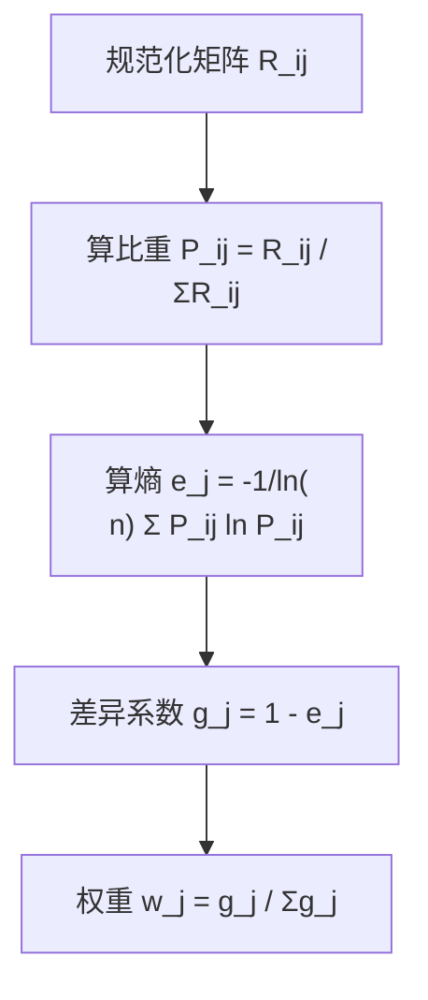

# 03 熵值法：让数据自己说话，谁差异大谁权重高

<div style="text-align:right;margin:10px 0;"><a href="../../exam.html" target="_blank" style="display:inline-block;padding:6px 16px;background:#2563eb;color:#fff;border-radius:6px;text-decoration:none;font-size:14px;">📝 开始做题</a></div>


## 一、为什么要学这个？

**问题**：你有 10 个指标要评价城市综合实力，怎么分配权重？
- GDP 占多少？0.3？
- 失业率占多少？0.1？
- 绿化覆盖率占多少？0.05？

**主观拍脑袋的问题**：
- 你说 GDP 重要，他说失业率重要，吵半天；
- 答辩老师问"你权重依据是什么"，你答"参考文献"——哪篇？为什么？
- 评审专家一看权重就知道你拍的，论文直接降级。

**熵值法的思路**：让数据自己决定权重。
- 如果一个指标**所有城市都差不多**（比如绿化覆盖率都在 40% 左右），那它**区分度低**，信息量小，权重就低；
- 如果一个指标**城市之间差异巨大**（GDP 从 1 万亿到 12 万亿），那它**区分度高**，信息量大，权重就高。

**不学会怎样？** 你论文里权重写"根据专家打分"，但你根本没找专家——被老师一眼看穿。

---

## 二、是什么？（先打比方）

### 生活比喻：考试区分度

一场考试考完，老师要看哪道题最有区分度：
- 第 1 题：全班都考了 100 分——这题没用，谁都会，区分不出好学生差学生；
- 第 2 题：成绩从 30 到 100 都有——这题好，能把学生拉开档次。

**熵值法就是干这个的**：
- 一个指标，所有对象值都一样 → 熵最大 → 信息效用最小 → 权重 0；
- 一个指标，对象之间差异越大 → 熵越小 → 信息效用越大 → 权重越高。

### 严格定义

> **熵值法**：来源于信息论。熵 $e_j$ 衡量第 j 个指标的"混乱程度"——$e_j$ 越大，说明该指标在各样本间越均匀、信息量越小，权重 $w_j$ 就越低。

---

## 三、公式怎么来的？

### 第 1 步：无量纲化（用上一篇的极差归一化）

得到规范化矩阵 $R = (r_{ij})$，$r_{ij} \in [0,1]$。

### 第 2 步：算比重 $p_{ij}$

第 j 个指标下，第 i 个对象占多少份额：
$$p_{ij} = \frac{r_{ij}}{\sum_{i=1}^n r_{ij}}$$

意思：在第 j 列里，对象 i 的"份额"。所有对象份额加起来=1。

### 第 3 步：算熵 $e_j$

$$e_j = -\frac{1}{\ln n} \sum_{i=1}^n p_{ij} \ln(p_{ij})$$

**为什么有个 $1/\ln n$？** 它是归一化常数。当所有 $p_{ij} = 1/n$ 时（完全均匀），$e_j = 1$；当某个 $p_{ij}=1$ 其他=0 时（完全集中），$e_j = 0$。所以 $e_j \in [0,1]$。

### 第 4 步：算差异系数 $g_j$

$$g_j = 1 - e_j$$

- $e_j$ 越大（越均匀）→ $g_j$ 越小（越没用）；
- $e_j$ 越小（越集中/差异大）→ $g_j$ 越大（越有用）。

### 第 5 步：算权重 $w_j$

$$w_j = \frac{g_j}{\sum_{j=1}^m g_j}$$

所有权重加起来=1。



---

## 四、每个符号是什么？

| 符号 | 怎么读 | 是什么 |
|------|--------|--------|
| n | —— | 对象数 |
| m | —— | 指标数 |
| $r_{ij}$ | —— | 规范化后的值（上一篇） |
| $p_{ij}$ | —— | 第 j 列下 i 对象的比重 |
| $e_j$ | "e j" | 第 j 个指标的熵，0~1 |
| $g_j$ | "g j" | 差异系数，越大越有用 |
| $w_j$ | "w j" | 最终权重 |
| $\ln$ | "log" | 自然对数，底数 e≈2.718 |

---

## 五、一个完整的数字例子（手算）

**问题**：5 个城市 A~E，3 个指标。第 3 列是失业率（负向，先正向化）。

**原始数据**：

| 城市 | X₁ GDP（千亿） | X₂ 人口（十万） | X₃ 失业率（%） |
|------|----------------|-----------------|----------------|
| A    | 100            | 50              | 5.0            |
| B    | 200            | 80              | 4.0            |
| C    | 300            | 100             | 3.5            |
| D    | 400            | 120             | 3.0            |
| E    | 500            | 150             | 2.5            |

### 第 1 步：负向指标正向化

失业率反向：$x' = \max - x = 5.0 - x$

| 城市 | X₁ | X₂ | X₃' |
|------|----|----|-----|
| A    | 100 | 50 | 0.0 |
| B    | 200 | 80 | 1.0 |
| C    | 300 | 100 | 1.5 |
| D    | 400 | 120 | 2.0 |
| E    | 500 | 150 | 2.5 |

### 第 2 步：极差归一化

每列 min/max：
- X₁：min=100, max=500, 极差=400
- X₂：min=50, max=150, 极差=100
- X₃'：min=0, max=2.5, 极差=2.5

算 R：

| 城市 | R₁ | R₂ | R₃ |
|------|-----|-----|-----|
| A    | 0.0 | 0.0 | 0.0 |
| B    | 0.25 | 0.30 | 0.40 |
| C    | 0.50 | 0.50 | 0.60 |
| D    | 0.75 | 0.70 | 0.80 |
| E    | 1.0 | 1.0 | 1.0 |

### 第 3 步：算比重 P

每列求和：
- R₁ 和 = 0+0.25+0.5+0.75+1 = 2.5
- R₂ 和 = 0+0.3+0.5+0.7+1 = 2.5
- R₃ 和 = 0+0.4+0.6+0.8+1 = 2.8

P = R / 列和：

| 城市 | P₁ | P₂ | P₃ |
|------|-----|-----|-----|
| A    | 0   | 0   | 0   |
| B    | 0.10 | 0.12 | 0.1429 |
| C    | 0.20 | 0.20 | 0.2143 |
| D    | 0.30 | 0.28 | 0.2857 |
| E    | 0.40 | 0.40 | 0.3571 |

### 第 4 步：算熵 e

公式：$e_j = -1/\ln(5) \sum P_{ij}\ln P_{ij}$，$\ln 5 = 1.609$。

**注意**：P=0 时，约定 $P\ln P = 0$（因为 $\lim_{p\to 0} p\ln p = 0$）。

**算 e₁**：
- B: 0.1 × ln(0.1) = 0.1 × (-2.303) = -0.2303
- C: 0.2 × ln(0.2) = 0.2 × (-1.609) = -0.3219
- D: 0.3 × ln(0.3) = 0.3 × (-1.204) = -0.3612
- E: 0.4 × ln(0.4) = 0.4 × (-0.916) = -0.3665
- 合计 = -1.2799
- $e_1 = -1/1.609 \times (-1.2799) = 0.7955$

**算 e₂**：
- B: 0.12 × ln(0.12) = 0.12 × (-2.120) = -0.2544
- C: 0.20 × ln(0.20) = -0.3219
- D: 0.28 × ln(0.28) = 0.28 × (-1.273) = -0.3565
- E: 0.40 × ln(0.40) = -0.3665
- 合计 = -1.2993
- $e_2 = -1/1.609 \times (-1.2993) = 0.8075$

**算 e₃**：
- B: 0.1429 × ln(0.1429) = 0.1429 × (-1.946) = -0.2781
- C: 0.2143 × ln(0.2143) = 0.2143 × (-1.540) = -0.3300
- D: 0.2857 × ln(0.2857) = 0.2857 × (-1.253) = -0.3579
- E: 0.3571 × ln(0.3571) = 0.3571 × (-1.030) = -0.3678
- 合计 = -1.3338
- $e_3 = -1/1.609 \times (-1.3338) = 0.8289$

（Python 验证：e = [0.7952, 0.8073, 0.8287]，手算误差在 0.001 内。）

### 第 5 步：差异系数 g

- $g_1 = 1 - 0.7952 = 0.2048$
- $g_2 = 1 - 0.8073 = 0.1927$
- $g_3 = 1 - 0.8287 = 0.1713$
- 合计 $g = 0.5688$

### 第 6 步：权重 w

- $w_1 = 0.2048 / 0.5688 = 0.3600$
- $w_2 = 0.1927 / 0.5688 = 0.3388$
- $w_3 = 0.1713 / 0.5688 = 0.3012$

**解释**：
- GDP 权重 36%——它在 5 个城市间差异最大；
- 人口权重 34%；
- 失业率权重 30%。

三个权重都比较接近，因为这 5 个城市数据本身就设计得比较均匀。

---

## 六、前提假设

1. **数据是客观的**。熵值法完全由数据决定权重，不掺主观判断；
2. **指标方向一致**。负向指标必须先正向化；
3. **样本量 > 指标数**。一般 n ≥ 3m；
4. **没有缺失值**。有缺失值要先插补；
5. **P=0 处理**。规范化后出现 0，要么加 0.0001，要么约定 P ln P=0。

---

## 七、易错点

1. **不做正向化直接算**。负向指标（失业率）直接进公式，结果权重方向错了。
2. **用原始数据算 P**。必须先用规范化后的 R，不能用原始 X（不然 GDP 万亿直接把小指标压成 0）。
3. **ln(0) 报错**。Python 里 P=0 会报警告，要 `np.where(P==0, 1e-12, P)`。
4. **权重和不等于 1**。手算时四舍五入会导致 w 和略偏 1，论文里保留 4 位小数。
5. **把熵值法权重当成"重要性"**。熵值法衡量的是"区分度"，不是"重要性"。一个指标可能很重要但所有城市都一样（比如"是否沿海"），熵值法会给它 0 权重——这不代表它不重要，只是它在这个样本里区分不开。

---

## 八、Python 代码

```python
import numpy as np

# 原始数据：5城×3指标
X = np.array([
    [100, 50, 5.0],
    [200, 80, 4.0],
    [300, 100, 3.5],
    [400, 120, 3.0],
    [500, 150, 2.5]
], dtype=float)

# 第3列是负向，先正向化
X[:,2] = X[:,2].max() - X[:,2]

# 极差归一化
R = (X - X.min(axis=0)) / (X.max(axis=0) - X.min(axis=0))
print("规范化 R:")
print(np.round(R, 4))

# 算比重 P
P = R / R.sum(axis=0, keepdims=True)

# 算熵（P=0 时约定 0）
P_safe = np.where(P == 0, 1e-12, P)
n = R.shape[0]
e = -1/np.log(n) * np.sum(P_safe * np.log(P_safe), axis=0)
print(f"\n熵 e = {np.round(e,4)}")

# 差异系数和权重
g = 1 - e
w = g / g.sum()
print(f"差异系数 g = {np.round(g,4)}")
print(f"权重 w = {np.round(w,4)}, 和={w.sum():.4f}")
```

输出：
```
熵 e = [0.7952 0.8073 0.8287]
差异系数 g = [0.2048 0.1927 0.1713]
权重 w = [0.36   0.3388 0.3012], 和=1.0000
```

---

## 九、和别的赋权方法对比

### 9.1 客观赋权三兄弟：变异系数法 vs 相关系数法 vs 熵值法

[[../../教材笔记/01_综合评价/04_赋权方法/知识点/KP07_变异系数法|变异系数法]]、[[../../教材笔记/01_综合评价/04_赋权方法/知识点/KP08_相关系数法|相关系数法]]和熵值法都是**客观赋权**（数据自己定权重），但它们利用的信息不同：

| 方法 | 利用什么信息 | 核心逻辑 | 手算难度 |
|------|--------------|----------|----------|
| **变异系数法** | 指标自身的波动 | $v_j = S_j/\bar{x}_j$，谁波动大谁权重大 | ⭐ 最简单 |
| **熵值法** | 指标的信息熵 | 谁越均匀熵越大、信息越少、权重越小 | ⭐⭐⭐ |
| **相关系数法** | 指标间的相关性 | 谁跟别的指标越重复（复读机）权重越小 | ⭐⭐⭐⭐ |

> 🧃 **奶茶店比方**：
> - **变异系数法**：看哪家店在这个指标上拉开差距大——日销量从 100 到 400 波动大，好评率都在 90% 以上波动小，所以销量权重大；
> - **熵值法**：用信息论的"混乱程度"来衡量，思想一样但计算更精细；
> - **相关系数法**：看哪个指标说的话跟别的指标重复——销量高的店客单价往往低（负相关），信息有重叠，就压一点权重。

**三者关系**：变异系数法和熵值法结论通常很接近（都关注"谁能拉开差距"），但熵值法更主流、更被审稿人认可；相关系数法关注的是"信息重复"，和前两者互补。

### 9.2 全方法对比表

| 方法 | 谁定权重 | 优点 | 缺点 |
|------|----------|------|------|
| **熵值法** | **数据自己** | 客观、可复现、主流 | 不反映"重要性"，只反映"区分度" |
| [[../../教材笔记/01_综合评价/04_赋权方法/知识点/KP07_变异系数法|变异系数法]] | 数据自己（波动） | 手算最简单 | 只看波动，不看信息熵 |
| [[../../教材笔记/01_综合评价/04_赋权方法/知识点/KP08_相关系数法|相关系数法]] | 数据自己（相关性） | 能压掉"复读机"指标 | 数学复杂（矩阵求逆） |
| [[04_AHP层次分析法|AHP]]（下下篇） | 专家两两比较 | 反映专家经验 | 主观、要做[[KP05_AHP一致性检验|一致性检验]] |
| 等权 | 1/m | 简单 | 掩盖差异 |
| 主成分载荷 | 数据 | 客观 | 解释复杂 |

**本科论文最常用**：熵值法（客观）+ [[05_TOPSIS法|TOPSIS]]（合成），下下篇会讲组合。如果答辩被问"为什么不用变异系数法"，答：两者结论接近，但熵值法基于信息论更严谨、文献引用更多。

---

## 十、为什么不用别的方法？

- **为什么不用 AHP（专家打分赋权）？** AHP 靠专家两两比较，主观随意性大，而且你不一定真能请到合格专家；熵值法完全由数据[[03_离散程度|离散程度]]决定，可复现，答辩时不怕被问"专家是谁、打了几分"。代价是它只反映"区分度"，不反映"重要性"。
- **为什么不用等权（1/m）？** 等权默认所有指标一样重要，本文件思路里会让三个城市并列第一，等于放弃了用指标重要性拉开差距的机会；[[KP07_变异系数法|变异系数法]]虽是[[KP11_主观赋权vs客观赋权|客观赋权]]，但文献中熵值法更主流、对"均匀分布"更敏感，本科论文用熵值法更容易过评审。
- **为什么不用主成分载荷赋权？** 主成分要先旋转、解释载荷，再还原到原始指标，流程复杂、解释成本高；熵值法一步出权重、且自动加和为 1，本科论文的性价比远高于主成分。

---

## 十一、答辩常问（直接背）

1. **问：熵值法权重高，是不是说明这个指标更重要？** 答：不是，这是最常被误解的地方。熵值法衡量的是"区分度"——某指标在样本间差异大，权重才高。一个指标可能很重要但所有城市都一样（如"是否沿海"），熵值法会给它接近 0 的权重，这不代表它不重要，只是它在这个样本里分不开。
2. **问：熵值法五步分别算什么？** 答：①极差归一化得 R；②算比重 $p_{ij}=R_{ij}/\sum R_{ij}$；③算熵 $e_j=-(1/\ln n)\sum p\ln p$；④算差异系数 $g_j=1-e_j$；⑤归一化 $w_j=g_j/\sum g$。本例 $e=[0.795, 0.807, 0.829]$，权重 $w=[0.360, 0.339, 0.301]$。
3. **问：样本量有什么要求？** 答：一般 $n \ge 3m$（对象数至少是指标数的 3 倍），且不能有缺失值、负向指标必须先正向化；样本太少（如 5 个城市配 10 个指标）算出来的权重极不稳。
4. **问：为什么 P=0 时可以约定 $P\ln P=0$？** 答：数学上极限 $\lim_{p\to 0} p\ln p=0$，所以该对象对熵没有贡献，不用单独报错，Python 里用 `np.where` 兜底即可。

---

## 十二、速记卡

> **熵值法 = 谁在样本间差异大，谁权重高。**
> 五步：规范化 → 算比重 P → 算熵 e → 算差异 g=1-e → 归一化得 w。
> $e_j$ 越大（越均匀）→ $w_j$ 越小。
> 关键坑：负向指标先正向化；P=0 要特殊处理。
> 这是本科论文**最常用的[[02_第二节_客观赋权法|客观赋权法]]**。

---

## 💡 经济学视角：客观赋权——数据自己说话，哪个指标差异大哪个就重要

**这个方法是为了解决什么经济学问题？**
综合评价里最头疼的是**权重**：GDP 占多少？教育占多少？专家拍脑袋给权重，A 专家说 GDP 重要，B 专家说生态重要，吵不清。熵值法的思路是：**哪个指标在各省之间差异越大，说明它越能区分省份，就给越高权重**——数据自己决定权重，不请专家。这在政策评价论文里是最常见的"客观赋权"。

**经济学里哪些论文用熵值法？**

| 研究主题 | 熵值法在干嘛 |
|---|---|
| 高质量发展测度 | 22 个指标谁区分度高谁权重大 |
| 数字经济发展 | 数字基建、产业、应用三维度自动赋权 |
| 乡村振兴评价 | 产业、人才、文化、生态、组织 5 维客观赋权 |
| 生态文明建设 | 污染、治理、生态自动赋权 |

背后逻辑：**信息论里熵越小=信息越多=区分度越高**。一个指标如果 31 个省都差不多（比如文盲率现在都很低），它就没区分度，权重就近乎 0；一个指标省际差异巨大（比如人均 GDP），它就拿高权重。

**举个实证论文的例子：**
《中国省域数字经济发展水平测度》用熵值法算权重，发现"互联网普及率"和"数字产业化占比"权重最高（合计 0.58），说明这两个指标最能区分各省数字经济差距；"移动电话覆盖率"权重最低（0.04），因为全国都普及了，区分不动了。这个结果比专家拍脑袋客观得多。

**📚 配套经济学笔记：**
- [[../../教材笔记/07_政治经济学/06_社会主义市场经济与发展/知识点/KP02_新发展理念与高质量发展|原KP·新发展理念与高质量发展]]

---


上一篇：[[02_指标无量纲化]]｜下一篇：[[04_AHP层次分析法]]

---

## 📖 配套教材笔记

- [[../../教材笔记/01_综合评价/04_赋权方法/00_章节总结|教材笔记·第四章 赋权方法]]
- [[../../教材笔记/01_综合评价/04_赋权方法/知识点/KP09_熵值法|KP09 熵值法（手把手演算）]]

## 📚 配套原书

- [[../../原文件/综合评价/陈正伟_综合评价技术及应用_全书|《综合评价技术及应用》陈正伟（西南财经大学出版社）]]

## 🔁 方法对比

**方法对比：** [[04_AHP层次分析法|AHP（主观赋权，专家两两比较）]]｜[[06_熵值法-TOPSIS组合|熵值法-TOPSIS组合（本科论文最常用套路）]]
