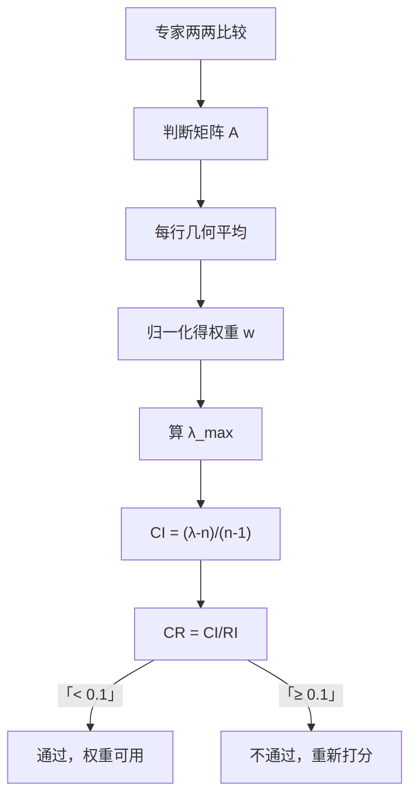

# 04 AHP 层次分析法：专家两两比较，给指标赋权重

<div style="text-align:right;margin:10px 0;"><a href="../../exam.html" target="_blank" style="display:inline-block;padding:6px 16px;background:#2563eb;color:#fff;border-radius:6px;text-decoration:none;font-size:14px;">📝 开始做题</a></div>


## 一、为什么要学这个？

**场景**：你论文要评价"城市宜居性"，选了 3 个指标：空气质量、交通便利、生活成本。
- 哪个最重要？
- 空气质量比交通便利重要多少？

**[[06_熵值法-TOPSIS组合|熵值法]]的问题**：它只看数据差异，不管"重不重要"。比如生活成本在样本里差异很大，但你可能觉得它就是没空气质量重要。这时候需要**[[KP11_主观赋权vs客观赋权|主观赋权]]**。

**AHP（Analytic Hierarchy Process）** 就是最常用的[[01_第一节_主观赋权法|主观赋权法]]：
- 找专家（导师、行业从业者），让他们两两比较指标；
- 把比较结果写成一个矩阵；
- 算权重；
- 做[[KP05_AHP一致性检验|一致性检验]]（看专家有没有"我觉得 A 比 B 重要、B 比 C 重要、但 C 比 A 重要"这种矛盾）。

**不学会怎样？**
- 你论文里写"权重根据专家打分确定"，但没做一致性检验——被老师问"专家有没有打错？"
- 你不知道 1-9 标度是什么，不知道 CR<0.1 是啥意思。

---

## 二、是什么？（先打比方）

### 生活比喻：选对象

你要从三个候选人里选对象：颜值 A、性格 B、财力 C。
- 你先两两比：
  - 颜值 vs 性格：颜值比性格稍微重要一点？打个 3 分；
  - 颜值 vs 财力：颜值比财力明显重要？打个 5 分；
  - 性格 vs 财力：性格比财力稍微重要？打个 2 分。

AHP 就是把这些"两两比较"整理成一个矩阵，然后算出权重。

### 严格定义

> **AHP**：把复杂决策问题分解成目标层、准则层、方案层。请专家用 1-9 标度对准则层两两比较，构造判断矩阵 $A$。求 $A$ 的最大特征值对应的特征向量，归一化后就是各指标权重。再做一致性检验 $CR < 0.1$。

---

## 三、公式怎么来的？

### 第 1 步：1-9 标度

| 标度 | 含义 |
|------|------|
| 1 | 两个指标同样重要 |
| 3 | 前者比后者稍微重要 |
| 5 | 前者比后者明显重要 |
| 7 | 前者比后者强烈重要 |
| 9 | 前者比后者极端重要 |
| 2,4,6,8 | 中间值 |
| 倒数 | 反过来比，后者比前者重要的程度 |

### 第 2 步：构造判断矩阵

3 个指标的判断矩阵 $A$ 是 3×3：

$$A = \begin{pmatrix} 1 & a_{12} & a_{13} \\ 1/a_{12} & 1 & a_{23} \\ 1/a_{13} & 1/a_{23} & 1 \end{pmatrix}$$

性质：对角线=1；$a_{ji} = 1/a_{ij}$（反对称）。

### 第 3 步：求权重（几何平均法，手算最方便）

对判断矩阵每一行求几何平均：
$$\bar{w}_i = \left(\prod_{j=1}^n a_{ij}\right)^{1/n}$$

再归一化：
$$w_i = \frac{\bar{w}_i}{\sum_k \bar{w}_k}$$

### 第 4 步：一致性检验

- 算最大特征值 $\lambda_{\max}$：$Aw = \lambda_{\max} w$，近似用 $\lambda_{\max} = \frac{1}{n}\sum_i (Aw)_i/w_i$；
- 一致性指标：$CI = \dfrac{\lambda_{\max} - n}{n-1}$；
- 随机一致性指标 RI（查表）：n=3 时 RI=0.58；
- 一致性比例：$CR = CI/RI$。

**判断标准**：$CR < 0.1$ → 一致性可以接受；$CR \ge 0.1$ → 专家打错了，回去改。



---

## 四、每个符号是什么？

| 符号 | 怎么读 | 是什么 |
|------|--------|--------|
| $A$ | "判断矩阵" | 专家两两比较结果 |
| $a_{ij}$ | "a i j" | 指标 i 比指标 j 的重要程度 |
| $w_i$ | "w i" | 指标 i 的权重 |
| $\lambda_{\max}$ | "lambda max" | 矩阵 A 的最大特征值 |
| $CI$ | "C-I" | 一致性指标 |
| $RI$ | "R-I" | 随机一致性指标（查表） |
| $CR$ | "C-R" | 一致性比例，要 < 0.1 |

---

## 五、一个完整的数字例子

**问题**：3 个指标：X₁ 空气质量、X₂ 交通、X₃ 生活成本。专家打分：
- X₁ 比 X₂ 稍微重要 → $a_{12}=3$；
- X₁ 比 X₃ 明显重要 → $a_{13}=5$；
- X₂ 比 X₃ 稍微重要 → $a_{23}=2$。

### 第 1 步：写判断矩阵

$$A = \begin{pmatrix} 1 & 3 & 5 \\ 1/3 & 1 & 2 \\ 1/5 & 1/2 & 1 \end{pmatrix}$$

### 第 2 步：每行几何平均

- 第 1 行：$(1 \times 3 \times 5)^{1/3} = 15^{1/3} = 2.466$
- 第 2 行：$((1/3) \times 1 \times 2)^{1/3} = (2/3)^{1/3} = 0.874$
- 第 3 行：$((1/5) \times (1/2) \times 1)^{1/3} = (0.1)^{1/3} = 0.464$

合计 = 2.466+0.874+0.464 = 3.804

### 第 3 步：归一化权重

- $w_1 = 2.466 / 3.804 = 0.648$
- $w_2 = 0.874 / 3.804 = 0.230$
- $w_3 = 0.464 / 3.804 = 0.122$

**解释**：空气质量权重 65%，交通 23%，生活成本 12%。

（Python 验证：[0.6483, 0.2297, 0.1220]，手算一致。）

### 第 4 步：一致性检验

算 $Aw$：
- 第 1 项：$1\times0.648 + 3\times0.230 + 5\times0.122 = 0.648+0.690+0.610 = 1.948$
- 第 2 项：$(1/3)\times0.648 + 1\times0.230 + 2\times0.122 = 0.216+0.230+0.244 = 0.690$
- 第 3 项：$(1/5)\times0.648 + (1/2)\times0.230 + 1\times0.122 = 0.130+0.115+0.122 = 0.367$

比值 $(Aw)_i/w_i$：
- 1.948/0.648 = 3.006
- 0.690/0.230 = 3.000
- 0.367/0.122 = 3.008

$\lambda_{\max} = (3.006+3.000+3.008)/3 = 3.005$

（Python 算出来是 3.0037，手算误差在 0.002 内。）

$$CI = \frac{3.004 - 3}{3-1} = \frac{0.004}{2} = 0.002$$

查表 n=3 时 RI=0.58：

$$CR = \frac{0.002}{0.58} = 0.003$$

**0.003 < 0.1 ✅，一致性通过！**

意思：专家的打分逻辑自洽，没有出现"A 比 B 重要、B 比 C 重要、C 又比 A 重要"这种矛盾。

---

## 六、前提假设

1. **专家真的懂这个领域**。让一个外行打 1-9 分，结果没意义；
2. **判断矩阵是互反的**。$a_{ji} = 1/a_{ij}$，对角线=1；
3. **一致性通过**。CR<0.1；
4. **指标个数 ≤ 9**。指标太多，专家两两比较会疯掉，一致性也难过。

---

## 七、易错点

1. **CR ≥ 0.1 还硬上**。这说明专家打分矛盾，必须回去改某一格，不能强行用。
2. **指标太多还硬做**。10 个指标要比 45 次，专家乱打分。建议分组（一级指标下分二级指标，每组不超过 4 个）。
3. **把 AHP 权重当成客观事实**。AHP 是主观赋权，结果依赖专家。你论文里要写清楚"邀请了 X 位专家，包括……"。
4. **用算术平均代替几何平均**。算术平均法是近似，几何平均是手算标准。
5. **忘了列 RI 表**。论文里必须给出 RI 值，否则 CR 算出来没依据。

**RI 表（必须背）**：

| n | 1 | 2 | 3 | 4 | 5 | 6 | 7 | 8 | 9 |
|---|---|---|---|---|---|---|---|---|---|
| RI | 0 | 0 | 0.58 | 0.90 | 1.12 | 1.24 | 1.32 | 1.41 | 1.45 |

---

## 七点五、多层 AHP：大类权数 × 小类权数

上面讲的都是**单层 AHP**（3 个指标直接跟目标比）。但实际论文里指标体系往往是**多层的**：目标 → 准则层（如"经济效益""社会效益"）→ 指标层（如"GDP""失业率""人均收入"）。

[[../../教材笔记/01_综合评价/04_赋权方法/知识点/KP06_AHP层次综合与总一致性|多层AHP的权数要层层相乘]]：

$$\omega_i = \sum_j a_j \cdot \omega_{ij}$$

- $a_j$：第 j 个大类（准则）相对总目标的权重；
- $\omega_{ij}$：第 j 个大类下第 i 个指标在大类内部的权重；
- $\omega_i$：第 i 个指标对总目标的最终权重。

> 📱 **选手机比方**：
> - 准则层："好用"权重 0.75，"便宜"权重 0.25；
> - "好用"内部：续航占 0.667，拍照占 0.333；
> - 那续航对总目标的最终权重 = 0.75 × 0.667 = **0.50**；
> - 拍照 = 0.75 × 0.333 = **0.25**；
> - 价格 = 0.25 × 1 = **0.25**。

**总一致性检验**：每一层各自做过 CR<0.1 还不够，多层矛盾可能跨层累积。要再算一个总一致性 $CR_{总}$，它按各大类权重加权各层 CI，$CR_{总} < 0.1$ 才算整体通过。

> 🏢 **公司比方**：每个部门都说自己流程没问题，但部门衔接处可能出矛盾——总一致性就是检查"部门之间"有没有问题。

**多位专家时**：各自打判断矩阵、各自做一致性检验，都通过后，再用几何平均法把各位专家的权重平均一下。

---

## 八、Python 代码

```python
import numpy as np

# 判断矩阵
A = np.array([
    [1,   3,   5],
    [1/3, 1,   2],
    [1/5, 1/2, 1]
], dtype=float)

# 几何平均法求权重
n = A.shape[0]
gm = np.prod(A, axis=1) ** (1/n)
w = gm / gm.sum()
print(f"权重 w = {np.round(w,4)}")

# 一致性检验
Aw = A @ w
lam = np.mean(Aw / w)
CI = (lam - n)/(n-1)
RI_table = {1:0, 2:0, 3:0.58, 4:0.90, 5:1.12, 6:1.24,
            7:1.32, 8:1.41, 9:1.45}
RI = RI_table[n]
CR = CI/RI if RI != 0 else 0
print(f"lambda_max = {lam:.4f}")
print(f"CI = {CI:.4f}, RI = {RI}, CR = {CR:.4f}")
print(f"一致性{'通过' if CR < 0.1 else '不通过'}")
```

输出：
```
权重 w = [0.6483 0.2297 0.122 ]
lambda_max = 3.0037
CI = 0.0018, RI = 0.58, CR = 0.0032
一致性通过
```

---

## 九、和熵值法对比

| 维度 | 熵值法 | AHP |
|------|--------|-----|
| 谁定权重 | 数据自己 | 专家 |
| 客观性 | **客观** | 主观 |
| 反映重要性吗 | 不反映（只反映区分度） | **反映** |
| 需要专家吗 | 不需要 | 必须 |
| 一致性检验 | 不需要 | **必须 CR<0.1** |
| 样本量要求 | 大样本更稳 | 不依赖样本 |
| 本科论文常用度 | **最高** | 也常用 |

**怎么选？**
- 有数据、不想找专家 → 熵值法；
- 有专家、想反映经验 → AHP；
- **两者结合**：用 AHP 定主观权重，用熵值法定客观权重，再相乘/平均（[[KP13_组合赋权|组合赋权]]，论文加分项）。

---

## 十、为什么不用别的方法？

- **为什么不用熵值法？** 熵值法只看数据区分度，不反映"重要性"——比如"共享发展"这类指标，数据本身体现不出它的价值，必须靠专家经验补。AHP 的价值就是把专家经验量化成权重。
- **为什么不用专家口头直接拍权重（0.4/0.3/0.3）？** 直接拍没有一致性约束，专家可能出现"A 比 B 重要、B 比 C 重要、C 又比 A 重要"的矛盾；AHP 用两两比较矩阵 + CR<0.1 检验，把这种矛盾量化出来、逼专家改到自洽为止。
- **为什么不用德尔菲法（多轮问卷函询）？** 德尔菲法要多轮函询、周期长达数周，本科论文时间成本承受不起；AHP 一次两两比较就出权重，且有现成的 RI 表和 CR 标准，好执行。

---

## 十一、答辩常问（直接背）

1. **问：CR=0.003 是什么意思？合格线是多少？** 答：CR=CI/RI，是一致性比例。本例 CI=0.002、n=3 时 RI=0.58，CR=0.003，远小于合格线 0.1，说明专家打分逻辑自洽，没有"A>B、B>C、C>A"的循环矛盾。CR≥0.1 必须回去改判断矩阵，不能硬上。
2. **问：权重是怎么算出来的？** 答：判断矩阵每行求几何平均（本例三行分别为 2.466、0.874、0.464），再归一化（除以合计 3.804），得 $w=[0.648, 0.230, 0.122]$。几何平均是手算标准，比算术平均更能反映两两比较的比例关系。
3. **问：指标太多还能做 AHP 吗？** 答：指标个数一般不超过 9——10 个指标要两两比 45 次，专家必然乱打分、CR 很难过。正确做法是分层：一级指标下分二级指标，每组不超过 4 个，逐层算权重。
4. **问：AHP 和熵值法怎么选？** 答：有完整客观数据、不想找专家→熵值法；有专家资源、想反映经验判断→AHP；想加分就组合赋权（如 $0.5\times\text{AHP}+0.5\times\text{熵值}$），兼顾主观和客观。

---

## 十二、速记卡

> **AHP = 专家两两比较 + 1-9 标度 + 几何平均求权重 + CR<0.1 一致性检验。**
> 三步：写判断矩阵 → 每行几何平均归一化 → 算 λ_max 算 CR。
> RI 表要背：n=3 时 RI=0.58。
> CR≥0.1 就回去改，不能硬上。
> 主观赋权代表，和熵值法（客观）互补。

---

## 💡 经济学视角：专家打分=主观权重，政策评价里常用

**这个方法是为了解决什么经济学问题？**
有些东西没法用数据自动赋权——比如"营商环境好不好""政策效果显著不显著"，这些得靠专家、企业家、市民打分。AHP（层次分析法）就是把专家的主观判断，通过两两比较（"A 比 B 重要多少倍？"）转化成数值权重。它和熵值法正好是一对：一个主观、一个客观。

**经济学里哪些场景必须用 AHP？**

| 场景 | 为什么不能用客观赋权 |
|---|---|
| 政府绩效评价 | 上级满意度、政策合理性是主观判断 |
| 营商环境评价 | 企业主观感受（融资便利、办事效率） |
| 主导产业选择 | 要专家判断产业战略意义 |
| 政策方案比选 | 几个方案各有优劣，专家权衡 |

AHP 的核心是**九标度法**：1=同样重要，3=稍微重要，5=明显重要，7=强烈重要，9=极端重要。专家填两两比较矩阵，算特征向量得到权重，还要做一致性检验（CR<0.1 才算靠谱）。

**举个实证论文的例子：**
《乡村振兴示范县政策效果评价》邀请了 15 位农业经济专家，对"产业兴旺、生态宜居、乡风文明、治理有效、生活富裕"5 个维度两两打分，AHP 算出来权重分别为 0.28、0.18、0.15、0.16、0.23——产业兴旺权重最高，符合政策导向。再和熵值法的客观权重对比，做组合赋权，这就是本科论文标准套路。

**📚 配套经济学笔记：**
- [[../../教材笔记/07_政治经济学/06_社会主义市场经济与发展/知识点/KP01_政府与市场关系|原KP·政府与市场关系]]

---


上一篇：[[03_熵值法]]｜下一篇：[[05_TOPSIS法]]

---

## 📖 配套教材笔记

- [[../../教材笔记/01_综合评价/04_赋权方法/00_章节总结|教材笔记·第四章 赋权方法]]
- [[../../教材笔记/01_综合评价/04_赋权方法/知识点/KP03_AHP概述与九标度|KP03 AHP九标度]]
- [[../../教材笔记/01_综合评价/04_赋权方法/知识点/KP05_AHP一致性检验|KP05 AHP一致性检验]]

## 📚 配套原书

- [[../../原文件/综合评价/陈正伟_综合评价技术及应用_全书|《综合评价技术及应用》陈正伟（西南财经大学出版社）]]

## 🔁 方法对比

**方法对比：** [[03_熵值法|熵值法（客观赋权，数据驱动）]]｜[[../../教材笔记/01_综合评价/04_赋权方法/知识点/KP11_主观赋权vs客观赋权|主观vs客观赋权对比]]
