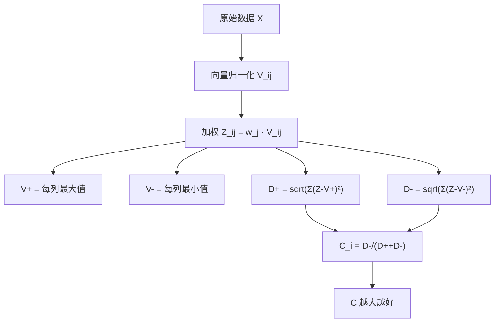

# 05 TOPSIS 法：找最优最劣，算距离排名

## 一、为什么要学这个？

**问题**：你已经无量纲化、已经赋权了，怎么把它们合成一个总分？

最笨的办法是加权求和：$S_i = \sum w_j r_{ij}$。但这个方法有个问题——

**例子**：假设有两个城市：
- A：所有指标都中等；
- B：有的指标极好，有的指标极差。

加权求和可能给 A 和 B 一样的分，但 B 的发展极不均衡。TOPSIS 能识别这种问题。

**TOPSIS 的思路**：
1. 先找一个"理想最优解" V⁺——每个指标都取最好的值；
2. 再找一个"最劣解" V⁻——每个指标都取最差的值；
3. 每个城市算它到 V⁺ 的距离 D⁺，和到 V⁻ 的距离 D⁻；
4. **谁离 V⁺ 近、离 V⁻ 远，谁就好**。

**不学会怎样？** 你论文里只用加权求和，被老师说"方法太老，别人都用熵权 TOPSIS 了"。

---

## 二、是什么？（先打比方）

### 生活比喻：高考填志愿

填志愿时你心里有个"梦校"（V⁺）和一个"保底校"（V⁻）：
- 你的分数离梦校越近、离保底校越远 → 你越厉害；
- 你的分数离梦校远、离保底校近 → 你越差。

**TOPSIS 就是干这个**：每个城市都是一个"考生"，V⁺ 是梦中情城（每个指标都取到样本里最好的），V⁻ 是最烂城市（每个指标都取到最差的）。

### 严格定义

> **TOPSIS**（Technique for Order Preference by Similarity to Ideal Solution）：
> 1. 向量归一化；
> 2. 加权；
> 3. 找正理想解 V⁺ 和负理想解 V⁻；
> 4. 算每个对象到 V⁺ 和 V⁻ 的欧氏距离 D⁺、D⁻；
> 5. 算相对贴近度 $C_i = D_i^- / (D_i^+ + D_i^-)$；
> 6. C_i 越大越好。

---

## 三、公式怎么来的？

### 第 1 步：向量归一化

$$v_{ij} = \frac{x_{ij}}{\sqrt{\sum_{i=1}^n x_{ij}^2}}$$

### 第 2 步：加权

$$z_{ij} = w_j \cdot v_{ij}$$

$w_j$ 是[[06_熵值法-TOPSIS组合|熵值法]]或 [[04_AHP层次分析法|AHP]] 算出的权重。

### 第 3 步：找正负理想解

因为所有指标都已经正向化（越大越好），所以：
- **正理想解**：$V_j^+ = \max_i z_{ij}$（每列最大值）
- **负理想解**：$V_j^- = \min_i z_{ij}$（每列最小值）

### 第 4 步：算欧氏距离

$$D_i^+ = \sqrt{\sum_{j=1}^m (z_{ij} - V_j^+)^2}$$
$$D_i^- = \sqrt{\sum_{j=1}^m (z_{ij} - V_j^-)^2}$$

### 第 5 步：算相对贴近度

$$C_i = \frac{D_i^-}{D_i^+ + D_i^-}$$

- $C_i = 1$：对象 i 就是最优解本身；
- $C_i = 0$：对象 i 就是最劣解本身；
- $0 < C_i < 1$：离最优越近越好。



---

## 四、每个符号是什么？

| 符号 | 怎么读 | 是什么 |
|------|--------|--------|
| $v_{ij}$ | —— | 向量归一化后的值 |
| $z_{ij}$ | —— | 加权后的值 |
| $V^+$ | "V 正" | 正理想解（每个指标最好值） |
| $V^-$ | "V 负" | 负理想解（每个指标最差值） |
| $D_i^+$ | "D 正" | 到正理想解的距离 |
| $D_i^-$ | "D 负" | 到负理想解的距离 |
| $C_i$ | "C i" | 相对贴近度，0~1 |

---

## 五、一个完整的数字例子

**问题**：用上一篇熵值法的数据（5 城×3 指标），权重 $w = [0.3600, 0.3388, 0.3012]$。

### 第 1 步：向量归一化

（失业率已正向化为 $x' = 5.0 - x$）

| 城市 | X₁ | X₂ | X₃' |
|------|----|----|-----|
| A    | 100 | 50 | 0   |
| B    | 200 | 80 | 1   |
| C    | 300 | 100 | 1.5 |
| D    | 400 | 120 | 2   |
| E    | 500 | 150 | 2.5 |

每列平方和：
- X₁：100²+200²+300²+400²+500² = 10000+40000+90000+160000+250000 = 550000，√ = 741.62
- X₂：2500+6400+10000+14400+22500 = 55800，√ = 236.22
- X₃：0+1+2.25+4+6.25 = 13.5，√ = 3.674

向量归一化 V：

| 城市 | V₁ | V₂ | V₃ |
|------|-------|-------|-------|
| A    | 0.1348 | 0.2117 | 0.0000 |
| B    | 0.2697 | 0.3387 | 0.2722 |
| C    | 0.4045 | 0.4233 | 0.4082 |
| D    | 0.5394 | 0.5080 | 0.5443 |
| E    | 0.6742 | 0.6350 | 0.6804 |

### 第 2 步：加权 Z = V × w

w = [0.3600, 0.3388, 0.3012]

| 城市 | Z₁ | Z₂ | Z₃ |
|------|--------|--------|--------|
| A    | 0.0485 | 0.0717 | 0.0000 |
| B    | 0.0971 | 0.1147 | 0.0820 |
| C    | 0.1456 | 0.1434 | 0.1229 |
| D    | 0.1942 | 0.1721 | 0.1639 |
| E    | 0.2427 | 0.2151 | 0.2049 |

### 第 3 步：找正负理想解

- $V^+ = [0.2427, 0.2151, 0.2049]$（每列最大值，就是 E 那行）
- $V^- = [0.0485, 0.0717, 0.0000]$（每列最小值，就是 A 那行）

### 第 4 步：算距离

**城市 A**：
- $D_A^+ = \sqrt{(0.0485-0.2427)^2 + (0.0717-0.2151)^2 + (0-0.2049)^2}$
  $= \sqrt{0.0377 + 0.0206 + 0.0420} = \sqrt{0.1003} = 0.3167$
- $D_A^- = \sqrt{(0.0485-0.0485)^2 + (0.0717-0.0717)^2 + (0-0)^2} = 0$

**城市 E**：
- $D_E^+ = 0$（E 就是 V⁺ 本身）
- $D_E^- = 0.3167$

**城市 B、C、D**（Python 算）：

| 城市 | D⁺ | D⁻ |
|------|--------|--------|
| A    | 0.3167 | 0.0000 |
| B    | 0.2154 | 0.1045 |
| C    | 0.1459 | 0.1723 |
| D    | 0.0767 | 0.2412 |
| E    | 0.0000 | 0.3167 |

### 第 5 步：算贴近度 C

$C_i = D_i^- / (D_i^+ + D_i^-)$

| 城市 | D⁺ | D⁻ | C_i | 排名 |
|------|--------|--------|--------|------|
| A    | 0.3167 | 0.0000 | **0.0000** | 5 |
| B    | 0.2154 | 0.1045 | **0.3267** | 4 |
| C    | 0.1459 | 0.1723 | **0.5415** | 3 |
| D    | 0.0767 | 0.2412 | **0.7586** | 2 |
| E    | 0.0000 | 0.3167 | **1.0000** | **1** |

**结论**：E > D > C > B > A。E 就是最优解本身，得满分 1.0；A 是最劣解，得 0。

---

## 六、前提假设

1. **所有指标都已经正向化**。负向指标必须先翻过来；
2. **用向量归一化，不是极差归一化**。TOPSIS 里惯例是向量归一化；
3. **权重已经算好**（来自熵值法或 AHP）；
4. **指标之间不能完全相关**。两个指标一模一样，距离会重复计算。

---

## 七、易错点

1. **用错归一化方法**。TOPSIS 里必须用向量归一化，用极差归一化结果会不一样。
2. **忘了加权**。先归一化再加权，顺序不能反。
3. **负向指标没反向**。直接拿失业率去算 V⁺，结果 V⁺ 是失业率最大那个城市——错。
4. **C_i 公式记反**。$C_i = D^-/(D^++D^-)$，分子是到负理想解的距离（越远越好）。写反了就排名倒过来。
5. **和加权求和比，说谁"对"**。TOPSIS 不是"更对"，是"考虑了距离结构"。两个方法结果一般差不多，但 TOPSIS 更高级。

---

## 八、Python 代码

```python
import numpy as np

X = np.array([
    [100, 50, 0.0],
    [200, 80, 1.0],
    [300, 100, 1.5],
    [400, 120, 2.0],
    [500, 150, 2.5]
], dtype=float)
w = np.array([0.3600, 0.3388, 0.3012])

# 向量归一化
V = X / np.sqrt((X**2).sum(axis=0))
# 加权
Z = V * w
# 正负理想解
V_pos = Z.max(axis=0)
V_neg = Z.min(axis=0)
# 距离
D_pos = np.sqrt(((Z - V_pos)**2).sum(axis=1))
D_neg = np.sqrt(((Z - V_neg)**2).sum(axis=1))
# 贴近度
C = D_neg / (D_pos + D_neg)
# 排名
order = np.argsort(-C)
ranks = np.empty(len(C), dtype=int)
ranks[order] = np.arange(1, len(C)+1)

names = ['A','B','C','D','E']
print("城市  D+      D-      C       排名")
for i,n in enumerate(names):
    print(f" {n}   {D_pos[i]:.4f}  {D_neg[i]:.4f}  {C[i]:.4f}   第{ranks[i]}名")
```

---

## 九、和加权求和对比

| 维度 | 加权求和 | TOPSIS |
|------|----------|--------|
| 思路 | 直接加权平均 | 到最优最劣的距离 |
| 对极端值敏感 | 一般 | 高（V⁺/V⁻ 由极端值定） |
| 识别不均衡 | 不能 | 能（离 V⁻ 近会被惩罚） |
| 计算难度 | 简单 | 中等 |
| 论文高级感 | 老 | **新，本科论文最爱** |

**结论**：要"看起来高级"，用 TOPSIS；要"简单粗暴"，用加权求和。本科论文建议**两者都算，结论一致就写稳健**。

---

## 九点五、距离度量怎么选：欧式 vs 曼哈顿 vs 切比雪夫

[[../../教材笔记/01_综合评价/05_数值综合方法/知识点/KP07_空间距离评价法|TOPSIS里算"距离"，距离本身也有不同的算法]]。最常用的是欧氏距离，但还有曼哈顿距离和切比雪夫距离：

| 距离类型 | 公式 | 像什么 | 什么时候用 |
|----------|------|--------|------------|
| **欧氏距离** | $\sqrt{\sum (z_{ij}-V_j)^2}$ | 直线距离（鸽飞过的路） | **最常用**，指标独立且已标准化 |
| **曼哈顿距离** | $\sum \|z_{ij}-V_j\|$ | 街区距离（开车走路要拐直角） | 指标间可加、不考虑交叉项时 |
| **切比雪夫距离** | $\max_j \|z_{ij}-V_j\|$ | 只看最大短板 | 强调"木桶最短板"决定成败时 |

> 🚗 **地图比方**：
> - 你在重庆要去解放碑，"直线距离 3 公里"是欧氏距离；
> - 但你开车得绕立交桥、穿隧道，实际开了 8 公里，这是曼哈顿距离；
> - 如果只看"最远那个岔路口还有多远"，那就是切比雪夫距离。

**怎么选？**
- 本科论文 95% 用**欧氏距离**就行——这是 TOPSIS 的标准做法；
- 指标间有较强相关性时，理论上应该用**马氏距离**（扣除协方差影响），但计算复杂，本科论文一般不要求；
- 想强调"不能有明显短板"时，可以试试切比雪夫距离。

> ⚠️ **注意**：不管用哪种距离，前提都是指标已经标准化/无量纲化了——否则 GDP（万亿）那一项会直接主导距离结果。

---

## 十、为什么不用别的方法？

- **为什么不用加权求和（$S=\sum w_j r_{ij}$）？** 加权求和无法识别"发展不均衡"——一个城市有的指标极好、有的极差，可能和"样样中等"的城市同分。TOPSIS 通过离负理想解的距离 $D^-$ 惩罚偏科：离最劣解近会被扣分。
- **为什么不用[[KP06_秩和比RSR评价法|秩和比]]法（[[KP06_秩和比RSR评价法|RSR]]）或模糊综合？** 秩和比只按排名位次算，丢失了指标的绝对差距信息；模糊综合输出的是"优良中差"等级，不适合给 30 个省份做精确排名。TOPSIS 输出 [0,1] 连续的贴近度，排名粒度最细。
- **为什么不用等权重跑 TOPSIS？** 等权重默认指标同样重要，等于没利用"GDP 比绿化覆盖率重要"的先验；TOPSIS 的权重必须由熵值法或 AHP 先定好再代入——这就是下一篇"熵权 TOPSIS"成为标准模板的原因。

---

## 十一、答辩常问（直接背）

1. **问：$C_i=0.7586$ 怎么解释？** 答：$C_i=D^-/(D^++D^-)$，在 0~1 之间。本例 D 城 $D^+=0.077$（离理想解很近）、$D^-=0.241$（离最劣解很远），C=0.759 说明综合水平很高；C=1 就是理想解本身（本例 E），C=0 就是最劣解本身（本例 A）。
2. **问：TOPSIS 用什么归一化？为什么？** 答：用向量归一化 $v_{ij}=x_{ij}/\sqrt{\sum x_{ij}^2}$，把每列变成单位长度。这是 TOPSIS 的惯例——后面要算欧氏距离，单位长度让距离不受指标量级影响。注意不要和熵值法的极差归一化搞混。
3. **问：V⁺ 和 V⁻ 怎么取？** 答：所有指标已正向化后，V⁺ 取加权矩阵每列的最大值（本例=[0.243, 0.215, 0.205]，就是 E 那行），V⁻ 取每列最小值（本例=A 那行）。负向指标没先反向的话，V⁺ 会变成最差值，整个排名就反了。
4. **问：TOPSIS 结果和加权求和差很多，以哪个为准？** 答：两者结论一般接近；论文做法是都算一遍，排名基本一致就写"结论稳健"。如果差很多，说明存在明显偏科对象，应在结果分析里专门解释，而不是只报一个方法。

---

## 十二、速记卡

> **TOPSIS = 找 V⁺（最优）和 V⁻（最劣），算每个对象到两者的距离。**
> $C_i = D^-/(D^++D^-)$，越大越好。
> 五步：向量归一化 → 加权 → 找 V⁺/V⁻ → 算距离 → 算 C。
> **本科论文最常见组合：熵值法定权重 × TOPSIS 排序**，下一篇完整讲。

---

上一篇：[[04_AHP层次分析法]]｜下一篇：[[06_熵值法-TOPSIS组合]]

---

## 📖 配套教材笔记

- [[../../教材笔记/01_综合评价/05_数值综合方法/00_章节总结|教材笔记·第五章 数值综合方法]]
- [[../../教材笔记/01_综合评价/05_数值综合方法/知识点/KP07_空间距离评价法|KP07 空间距离评价法]]

## 📚 配套原书

- [[../../原文件/综合评价/陈正伟_综合评价技术及应用_全书|《综合评价技术及应用》陈正伟（西南财经大学出版社）]]

## 🔁 方法对比

**方法对比：** [[06_熵值法-TOPSIS组合|熵值法-TOPSIS组合]]｜[[10_距离方法选择指南|距离方法选择指南（欧氏/马氏/曼哈顿）]]
