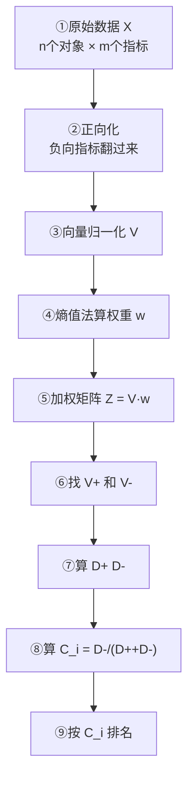

# 06 熵值法-TOPSIS 组合：本科论文最常用套路

## 一、为什么要学这个？

**这是你论文里最可能直接用的一章。**

标题通常是这样的：
> "基于熵权 TOPSIS 法的成渝地区双城经济圈城市高质量发展评价"
> "数字经济发展水平测度——基于熵权 TOPSIS 的 30 省面板数据"

**套路就是**：
1. 用**熵值法**从数据里算出客观权重 $w_j$；
2. 用这个权重跑 **TOPSIS**，算出每个对象的贴近度 $C_i$；
3. 按 $C_i$ 排名。

**为什么要组合？**
- 单独熵值法：只能出权重，不能出排名；
- 单独 TOPSIS：权重是拍的，被老师骂；
- **组合**：权重客观 + 排名高级，两全其美。

---

## 二、是什么？（先打比方）

### 生活比喻：餐厅选菜

你要从 10 道菜里挑最好的：
- **熵值法**：看 10 道菜在"辣度、价格、分量"三个维度上差异大不大，差异大的维度权重高；
- **TOPSIS**：在加权后的三维空间里，找一道"样样都最好"的菜 V⁺，找一道"样样都最差"的菜 V⁻，算每道菜离 V⁺ 多远。

组合起来 = 客观权重 + 距离排名 = 一篇论文。

### 严格定义

> **熵权 TOPSIS**：先用熵值法算权重 $w_j$，再代入 TOPSIS 公式算 $C_i$，最后按 $C_i$ 排名。是综合评价类本科论文的标准模板。

---

## 三、公式怎么来的？（五步流水线）



**注意一个细节**：熵值法内部用**极差归一化**算权重，但 TOPSIS 主体用**向量归一化**。这是两个不同的归一化步骤，别搞混。

---

## 四、每个符号是什么？

（同前两篇，不重复列。）

---

## 五、一个完整的数字例子（从头到尾）

**问题**：5 个城市 A~E，3 个指标。评价哪个城市综合实力最强。

### 原始数据

| 城市 | X₁ GDP（千亿） | X₂ 人口（十万） | X₃ 失业率（%，负向） |
|------|----------------|-----------------|----------------------|
| A    | 100            | 50              | 5.0                  |
| B    | 200            | 80              | 4.0                  |
| C    | 300            | 100             | 3.5                  |
| D    | 400            | 120             | 3.0                  |
| E    | 500            | 150             | 2.5                  |

### 步骤 1：正向化（失业率反向）

$x_3' = 5.0 - x_3$

| 城市 | X₁ | X₂ | X₃' |
|------|----|----|-----|
| A    | 100 | 50 | 0.0 |
| B    | 200 | 80 | 1.0 |
| C    | 300 | 100 | 1.5 |
| D    | 400 | 120 | 2.0 |
| E    | 500 | 150 | 2.5 |

### 步骤 2：用极差归一化算熵值法权重

（手算过程在 03 篇已完整演示，这里直接给结果）

规范化矩阵 R：

| 城市 | R₁ | R₂ | R₃ |
|------|-----|-----|-----|
| A    | 0   | 0   | 0   |
| B    | 0.25 | 0.30 | 0.40 |
| C    | 0.50 | 0.50 | 0.60 |
| D    | 0.75 | 0.70 | 0.80 |
| E    | 1.0 | 1.0 | 1.0 |

熵值法结果：
- $e = [0.7952, 0.8073, 0.8287]$
- $g = [0.2048, 0.1927, 0.1713]$
- **权重 w = [0.3600, 0.3388, 0.3012]**

### 步骤 3：向量归一化（TOPSIS 专用）

对正向化后的原始数据做向量归一化：

| 城市 | V₁ | V₂ | V₃ |
|------|-------|-------|-------|
| A    | 0.1348 | 0.2117 | 0.0000 |
| B    | 0.2697 | 0.3387 | 0.2722 |
| C    | 0.4045 | 0.4233 | 0.4082 |
| D    | 0.5394 | 0.5080 | 0.5443 |
| E    | 0.6742 | 0.6350 | 0.6804 |

### 步骤 4：加权 Z = V × w

| 城市 | Z₁ | Z₂ | Z₃ |
|------|--------|--------|--------|
| A    | 0.0485 | 0.0717 | 0.0000 |
| B    | 0.0971 | 0.1147 | 0.0820 |
| C    | 0.1456 | 0.1434 | 0.1229 |
| D    | 0.1942 | 0.1721 | 0.1639 |
| E    | 0.2427 | 0.2151 | 0.2049 |

### 步骤 5：找正负理想解

- $V^+ = [0.2427, 0.2151, 0.2049]$（E 那行）
- $V^- = [0.0485, 0.0717, 0.0000]$（A 那行）

### 步骤 6：算距离和贴近度

| 城市 | D⁺ | D⁻ | C_i | 排名 |
|------|--------|--------|--------|------|
| A    | 0.3167 | 0.0000 | 0.0000 | 5 |
| B    | 0.2154 | 0.1045 | 0.3267 | 4 |
| C    | 0.1459 | 0.1723 | 0.5415 | 3 |
| D    | 0.0767 | 0.2412 | 0.7586 | 2 |
| E    | 0.0000 | 0.3167 | 1.0000 | **1** |

### 最终结论

> **综合实力排名：E > D > C > B > A。**
> E 城市在 GDP、人口、就业三方面都最优，得满分 1.0；
> A 城市三项都最差，得 0；
> D 离最优很近（D⁺=0.077），离最劣很远（D⁻=0.241），排第二。

---

## 六、前提假设

1. **数据完整、方向正确**。负向指标先翻；
2. **样本量 ≥ 指标数的 3 倍**；
3. **权重算出来和为 1**；
4. **C_i 在 [0,1] 之间**。

---

## 七、易错点（论文里最常见的错）

1. **归一化方法用混**：熵值法里用极差归一化，TOPSIS 里用向量归一化。有人从头到尾只用一种，结果权重或距离错了。
2. **先加权再归一化**：顺序错了。必须先归一化，再加权。
3. **V⁺/V⁻ 找反**：负向指标没反向，导致 V⁺ 变成最差值。
4. **C_i 公式分子分母写反**：写成 $D^+/(D^++D^-)$，排名全倒。
5. **结果不分析**：论文最后要解释"为什么 E 排第一"，不能光给表。
6. **不做[[06_稳健性检验|稳健性检验]]**：换一种权重（比如 [[04_AHP层次分析法|AHP]] 权重）再跑一遍 TOPSIS，如果排名差不多，说明结果稳。

---

## 八、Python 完整代码（论文可直接抄）

```python
import numpy as np
import pandas as pd

# ============ 1. 读数据 ============
# X: n个对象 × m个指标，列1~列m
# pos_neg: 列表，+1表示正向，-1表示负向
X = np.array([
    [100, 50, 5.0],
    [200, 80, 4.0],
    [300, 100, 3.5],
    [400, 120, 3.0],
    [500, 150, 2.5]
], dtype=float)
pos_neg = [+1, +1, -1]   # 失业率负向
names = ['A','B','C','D','E']
n, m = X.shape

# ============ 2. 正向化 ============
X_pos = X.copy()
for j in range(m):
    if pos_neg[j] == -1:
        X_pos[:, j] = X[:, j].max() - X[:, j]

# ============ 3. 熵值法算权重（用极差归一化）============
R = (X_pos - X_pos.min(axis=0)) / (X_pos.max(axis=0) - X_pos.min(axis=0))
P = R / R.sum(axis=0, keepdims=True)
P_safe = np.where(P == 0, 1e-12, P)
e = -1/np.log(n) * np.sum(P_safe * np.log(P_safe), axis=0)
g = 1 - e
w = g / g.sum()
print(f"权重 w = {np.round(w,4)}")

# ============ 4. TOPSIS（向量归一化）============
V = X_pos / np.sqrt((X_pos**2).sum(axis=0))
Z = V * w
V_pos = Z.max(axis=0)
V_neg = Z.min(axis=0)
D_pos = np.sqrt(((Z - V_pos)**2).sum(axis=1))
D_neg = np.sqrt(((Z - V_neg)**2).sum(axis=1))
C = D_neg / (D_pos + D_neg)

# ============ 5. 输出排名 ============
result = pd.DataFrame({
    '城市': names,
    'D+': np.round(D_pos,4),
    'D-': np.round(D_neg,4),
    'C_i': np.round(C,4)
})
result['排名'] = result['C_i'].rank(ascending=False).astype(int)
print(result.sort_values('排名'))
```

输出：
```
权重 w = [0.36   0.3388 0.3012]
  城市     D+      D-     C_i  排名
4  E  0.0000  0.3167  1.0000   1
3  D  0.0767  0.2412  0.7586   2
2  C  0.1459  0.1723  0.5415   3
1  B  0.2154  0.1045  0.3267   4
0  A  0.3167  0.0000  0.0000   5
```

---

## 九、论文里怎么写这段？

**方法部分模板**：

> 本文采用熵权 TOPSIS 法对 X 个城市的高质量发展水平进行综合评价。具体步骤如下：
>
> （1）指标正向化：对逆向指标采用极差变换法进行正向化处理；
> （2）权重确定：采用熵值法，计算得到各指标权重为 w = (w₁, w₂, w₃)；
> （3）向量归一化：$v_{ij} = x_{ij}/\sqrt{\sum x_{ij}^2}$；
> （4）构造加权矩阵 $Z = (z_{ij}) = w_j v_{ij}$；
> （5）确定正负理想解 $V^+$ 和 $V^-$；
> （6）计算各城市到正负理想解的欧氏距离 $D_i^+$、$D_i^-$；
> （7）计算相对贴近度 $C_i = D_i^-/(D_i^+ + D_i^-)$，并据此排名。

**结果部分模板**：

> 表 X 报告了各城市的贴近度及排名。E 城市贴近度最高（C=1.000），综合实力最强；A 城市贴近度最低（C=0.000）。从动态趋势看，……（再分析时间维度）。

---

## 十、为什么不用别的方法？

- **为什么不用单一熵值法？** 熵值法只能出权重 $w_j$，出不了排名——评委看完你的权重表还是不知道 A、B、C 谁强。必须再接一个合成步骤（TOPSIS），把权重变成贴近度排名，论文才完整。
- **为什么不用单一 TOPSIS（权重自己拍）？** 权重如果自己拍 0.4/0.3/0.3，答辩一问"依据是什么"就卡壳；用熵值法先把权重客观化，方法部分才有"可复现"的底气。
- **为什么不用 AHP-TOPSIS 组合？** AHP 组合需要真请到专家、还得过 CR<0.1，本科论文往往没有这个条件；熵值法-TOPSIS 只靠数据就能跑通，是性价比最高、文献最常用的模板。

---

## 十点五、进阶：什么时候要组合赋权？（KP11~14 速览）

上面的流程用的是**纯客观赋权**（熵值法）。但答辩时老师可能问："你这个权重是数据算的，万一数据没反映指标的实际重要性呢？"——这就要了解组合赋权。

### 10.5.1 主观赋权 vs 客观赋权

| 维度 | 主观赋权（AHP/专家） | 客观赋权（熵值法/变异系数） |
|---|---|---|
| 权重来源 | 专家经验、专业判断 | 数据本身的信息量/差异 |
| 优点 | 体现专业导向、安全类指标不会被低估 | 排除主观随意、可复算 |
| 缺点 | 受专家水平影响、无统一标准 | 换样本权重就变、可能违背常识 |
| 适合 | 缺数据、需政策导向 | 有充足数据、想让数据说话 |

**原书态度**：既不迷信数学方法（纯客观），也不完全依赖专家（纯主观）。两者都有偏时，组合赋权最稳。

### 10.5.2 赋权四原则

不管用哪种赋权法，权重必须满足：
1. **差异性**：权重要突出指标间差异，否则退化成等权；
2. **归一性**：$\sum w_i = 1$；
3. **特征性**：可按研究目的对计算权重做导向修正；
4. **定性定量结合**：主客观结合，不能只靠一种。

### 10.5.3 两种组合赋权方式

假设主观权重 $a_i$（AHP 算的）和客观权重 $\beta_i$（熵值法算的）都有了：

**① 乘法合成（乘积归一化）**：

$$\omega_i = \frac{a_i \beta_i}{\sum_j a_j \beta_j}$$

特点：**双高才高**——专家觉得重要 *并且* 数据也觉得重要的指标，权重被放大；只要一头低，就被压下去。有"一票否决"效应。

**② 线性综合（加权折中）**：

$$\omega_i = \lambda \cdot a_i + (1-\lambda) \cdot \beta_i$$

$\lambda$ 是主观权重占比。特点：更温和，不会把某指标直接压到 0。

| 方式 | 特点 | 适合 |
|---|---|---|
| 乘法合成 | 共识放大、一票否决 | 主客观方向一致、想突出共识 |
| 线性综合 | 温和折中 | 主客观有分歧、想各让一步 |

### 10.5.4 λ 怎么定？

- 本科论文最稳：**$\lambda = 0.5$（等权）**，最好解释；
- 题目重经验/政策导向：$\lambda = 0.6\sim0.7$；
- 题目重数据/实证：$\lambda = 0.3\sim0.4$；
- ⚠️ 不能拍脑袋定 λ 又不说明理由，答辩会被问。

### 10.5.5 组合赋权 ≠ 组合评价

别搞混两个概念：
- **组合赋权**：合的是各种方法算出的**权重**（本文讲的）；
- **组合评价**：合的是各种方法算出的**最终得分/排名**（如 Borda 法、Kendall W 检验）。

> 💡 **本科论文建议**：纯熵权 TOPSIS 已经够用。如果想加分，可以在稳健性检验里加一段"用 AHP-熵值组合权重再跑一遍，排名基本一致"，这就是组合赋权的实战应用。

---

## 十一、答辩常问（直接背）

1. **问：你的流程里出现了两种归一化，是不是搞错了？** 答：不是搞错，是两个独立步骤——熵值法算权重时用极差归一化（结果要落在 [0,1] 算比重）；TOPSIS 算距离时用向量归一化（列向量变单位长度）。本例 R 矩阵和 V 矩阵是两套，顺序是：正向化→极差归一化算熵值权重→向量归一化→加权→找 V⁺/V⁻。
2. **问：最终排名 E>D>C>B>A 是怎么来的？** 答：算贴近度 $C_i=D^-/(D^++D^-)$：E 就是 V⁺ 本身，C=1.0 排第一；A 就是 V⁻ 本身，C=0 垫底；D 的 $D^+=0.077$、$D^-=0.241$，C=0.759 排第二。
3. **问：权重 $w=[0.360, 0.339, 0.301]$ 说明什么？** 答：GDP 在 5 城间区分度最大（权重 36%），失业率区分度最小（30%）。注意这是"区分度"不是"重要性"——三个数接近，是因为本数据本身设计得比较均匀。
4. **问：稳健性检验[[08_答辩PPT怎么做|怎么做]]？** 答：换一种权重再跑一遍 TOPSIS（比如换成 AHP 权重或等权），如果排名基本不变，就在论文里写"结果稳健"；如果排名大改，要分析是哪个对象偏科导致的。

---

## 十二、速记卡

> **熵权 TOPSIS = 熵值法定权重 × TOPSIS 排序。**
> 完整流程：原始数据 → 正向化 → 极差归一化（算权重）→ 向量归一化（算距离）→ 加权 → V⁺/V⁻ → D⁺/D⁻ → C_i → 排名。
> **本科论文综合评价类题目，直接套这个模板。**
> 最大坑：归一化方法用混、C_i 公式写反、负向指标没翻。

---

上一篇：[[05_TOPSIS法]]｜下一篇：[[07_模糊综合评价]]

---

## 📖 配套教材笔记

- [[../../教材笔记/01_综合评价/04_赋权方法/知识点/KP11_主观赋权vs客观赋权|KP11 主观赋权 vs 客观赋权]]
- [[../../教材笔记/01_综合评价/04_赋权方法/知识点/KP12_赋权原则与方法选择|KP12 赋权原则与方法选择]]
- [[../../教材笔记/01_综合评价/04_赋权方法/知识点/KP13_组合赋权|KP13 组合赋权（乘法合成 vs 线性综合）]]
- [[../../教材笔记/01_综合评价/04_赋权方法/知识点/KP14_组合赋权深化|KP14 组合赋权深化（λ 怎么定）]]
- [[../../教材笔记/01_综合评价/05_数值综合方法/知识点/KP12_组合评价法|KP12 组合评价法]]

## 📚 配套原书

- [[../../原文件/综合评价/陈正伟_综合评价技术及应用_全书|《综合评价技术及应用》陈正伟（西南财经大学出版社）]]

## 🔁 方法对比

**方法对比：** [[03_熵值法|熵值法（只算权重）]]｜[[05_TOPSIS法|TOPSIS（只算排序）]]——本文档是两者组合
