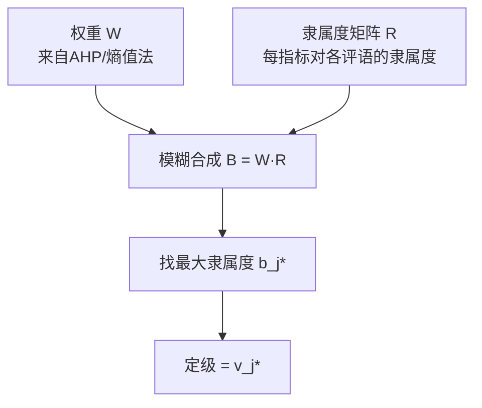

# 07 模糊综合评价：用{优,良,中,差}给对象打分

## 一、为什么要学这个？

**问题**：你要评价一门课的教学质量。指标是"老师讲课清楚吗？"
- 让学生打 1~5 分？太粗；
- 让学生打百分制？学生打分随意，5 分和 4 分的区别说不清；
- 让学生选"优/良/中/差"？这本身就是模糊的——"良"和"中"的边界在哪？

**模糊数学的思路**：不强迫学生给一个确定答案，而是让他说：
- "这位老师 70% 像优，20% 像良，10% 像中，0% 像差。"

这就是**隶属度**。把多个指标的隶属度合起来，就是**模糊综合评价**。

**不学会怎样？**
- 你论文研究"智慧城市市民满意度"，用了一个明确的满意度分数，但市民满意度本来就是模糊的；
- 老师问你"为什么用模糊评价不用 [[05_TOPSIS法|TOPSIS]]"，你答不上来。

---

## 二、是什么？（先打比方）

### 生活比喻：相亲

相亲回来朋友问你："这个人怎么样？"
你不能直接说"好"或"不好"，你会说：
- 长相：80% 满意，20% 一般；
- 性格：50% 满意，40% 一般，10% 不喜欢；
- 收入：30% 满意，50% 一般，20% 不满意。

把这三行合起来，朋友就能判断"这个人整体怎么样"。

**模糊综合评价**就是这个过程：
- 评语集 = {优, 良, 中, 差}；
- 每个指标打一个隶属度向量（加起来=1）；
- 权重把多个指标的隶属度向量合成一个。

### 严格定义

> **模糊综合评价**：给定评语集 $V = \{v_1, v_2, \ldots, v_k\}$（如{优,良,中,差}），n 个指标。每个指标在各评语上的隶属度组成一个行向量 $R_i = (r_{i1}, \ldots, r_{ik})$，所有指标叠成隶属度矩阵 $R$。再给定权重向量 $W = (w_1, \ldots, w_n)$，做模糊合成 $B = W \circ R$，$B$ 就是综合评价结果，按最大隶属度原则定级。

---

## 三、公式怎么来的？

### 第 0 步：定两个集合——因素集 U 和评语集 V

模糊综合评价一上来就要摆两个集合，缺一不可：

- **因素集 $U = \{u_1, u_2, \ldots, u_n\}$**：你要评价哪几个维度？比如教学质量评价，因素集就是 {讲课清楚, 作业合理, 考试公平, 课后答疑}。这就是后面权重向量 $W$ 和隶属度矩阵 $R$ 的"行标题"。
- **评语集 $V = \{v_1, v_2, \ldots, v_k\}$**：你要把对象分成几档？比如 {优, 良, 中, 差}，k=4。这是后面隶属度矩阵 $R$ 的"列标题"。

> 💡 **小白别搞混**：$U$ 是"从哪几个方面评"（行），$V$ 是"评出什么等级"（列）。因素集来自指标体系，评语集来自业务需要（满意度分5档、风险分4档都行）。

### 第 1 步：定评语集

$$V = \{v_1, v_2, \ldots, v_k\}$$

比如 $V = \{\text{优}, \text{良}, \text{中}, \text{差}\}$，k=4。评语集一般 3~5 档，太少没区分度，太多隶属度会很散。

### 第 2 步：定权重向量 W

来自 [[04_AHP层次分析法|AHP]] 或[[06_熵值法-TOPSIS组合|熵值法]]，$W = (w_1, w_2, \ldots, w_n)$，$\sum w_i = 1$。

### 第 3 步：构造隶属度矩阵 R

每个指标打一个行向量（隶属度）：

$$R = \begin{pmatrix} r_{11} & r_{12} & \cdots & r_{1k} \\ r_{21} & r_{22} & \cdots & r_{2k} \\ \vdots & & \ddots & \vdots \\ r_{n1} & r_{n2} & \cdots & r_{nk} \end{pmatrix}$$

每行加起来=1。$r_{ij}$ 表示"第 i 个指标被评为 $v_j$ 的程度"。

> 💡 **隶属度到底是什么？** 传统数学说一个东西"是 A"或"不是 A"（0 或 1）；模糊数学说一个东西"多大程度上是 A"（0~1 之间的小数）。比如一个人"年轻"的隶属度：20 岁=1.0，30 岁=0.5，40 岁=0.1。这就是隶属度——不是"是/不是"，而是"多大程度上是"。

**$r_{ij}$ 怎么来的？三种途径**：

1. **问卷统计法**（最常用）：让 N 个被试对指标 $u_i$ 选一个评语，$r_{ij}$ = 选 $v_j$ 的人数/N。每行自然加起来=1。
2. **专家打分法**：请几位专家直接给 $r_{ij}$ 赋值，再平均。
3. **隶属函数法**：如果指标有连续数值（比如"满意度分数 0~100"），用一个函数把数值映射到各评语的隶属度。常用的隶属函数形状：

| 函数形状 | 长什么样 | 适用 |
|---|---|---|
| 矩形（区间型） | 落在区间内=1，外面=0 | 硬分级（如面积≥100平=大户型） |
| 三角形 | 中间最高、两边线性降到0 | 中间档评语（如"中等满意度"） |
| 梯形 | 中间一段平顶、两边斜降 | 有模糊过渡带的指标 |
| 正态型 | 钟形曲线 | 连续数值的自然分布 |

本科论文用**问卷统计法**就够了，不用自己造隶属函数。

### 第 4 步：模糊合成

$$B = W \circ R$$

$\circ$ 是模糊合成算子，不是普通乘法。本科论文最常用两种：

**① $M(\cdot, +)$ 加权平均型（推荐）**——就是普通矩阵乘法：

$$b_j = \sum_{i=1}^{n} w_i \cdot r_{ij}$$

每个指标的隶属度都按权重贡献到总分，信息损失小。**本科论文首选这个**，结果直观、好解释。

**② $M(\wedge, \vee)$ 主因素决定型**——先取小再取大：

$$b_j = \bigvee_{i=1}^{n} \big(w_i \wedge r_{ij}\big)$$

意思是：每个指标先取 $w_i$ 和 $r_{ij}$ 的较小值，再在所有指标里取最大的那个。结果只由权重最大的那个指标决定，其他指标被"淹没"了。适合只关心最关键因素的场合，但信息损失大。

| 算子 | 公式 | 特点 | 什么时候用 |
|---|---|---|---|
| $M(\cdot,+)$ | $b_j=\sum w_i r_{ij}$ | 所有指标都参与，信息保留全 | **本科论文默认**，综合评价 |
| $M(\wedge,\vee)$ | $b_j=\max_i\min(w_i,r_{ij})$ | 只突出主因素，其他被忽略 | 主因素明确、次要指标可忽略 |

> ⚠️ **易错**：传统模糊数学教材喜欢讲 $M(\wedge,\vee)$，但本科论文用 $M(\cdot,+)$ 就够了。如果你写论文用了 max-min 算子，答辩时老师可能问"为什么不用加权平均？"——提前准备好答案。

这就是普通的矩阵乘法（加权平均），结果是一个 k 维向量：

$$B = (b_1, b_2, \ldots, b_k)$$

### 第 5 步：按最大隶属度定级

$$\text{评价结果} = v_{j^*}, \quad j^* = \arg\max_j b_j$$

意思：哪个评语的隶属度最大，就定哪一级。



---

## 四、每个符号是什么？

| 符号 | 是什么 |
|------|--------|
| $U$ | 因素集，即评价的维度集合 {讲课清楚, 作业合理, ...} |
| $V$ | 评语集，如{优,良,中,差} |
| $k$ | 评语个数 |
| $n$ | 因素（指标）个数 |
| $W$ | 权重行向量 |
| $R$ | 隶属度矩阵 n×k |
| $r_{ij}$ | 第 i 指标对第 j 评语的隶属度 |
| $B$ | 综合评价结果行向量 |
| $\circ$ | 模糊合成算子（$M(\cdot,+)$ 或 $M(\wedge,\vee)$） |

---

## 五、一个完整的数字例子

**问题**：评价一门课的教学质量，4 个指标：讲课清楚、作业合理、考试公平、课后答疑。评语集{优,良,中,差}。

### 第 1 步：权重 W（假设来自 AHP）

$$W = (0.4, 0.3, 0.2, 0.1)$$

### 第 2 步：隶属度矩阵 R（问卷结果汇总）

| 指标 | 优 | 良 | 中 | 差 |
|------|-----|-----|-----|-----|
| 讲课清楚 | 0.7 | 0.2 | 0.1 | 0.0 |
| 作业合理 | 0.3 | 0.5 | 0.2 | 0.0 |
| 考试公平 | 0.1 | 0.4 | 0.4 | 0.1 |
| 课后答疑 | 0.0 | 0.3 | 0.5 | 0.2 |

### 第 3 步：模糊合成 B = W·R

算 b₁（"优"的总隶属度）：
$$b_1 = 0.4\times0.7 + 0.3\times0.3 + 0.2\times0.1 + 0.1\times0.0$$
$$= 0.28 + 0.09 + 0.02 + 0 = 0.39$$

算 b₂（"良"）：
$$b_2 = 0.4\times0.2 + 0.3\times0.5 + 0.2\times0.4 + 0.1\times0.3$$
$$= 0.08 + 0.15 + 0.08 + 0.03 = 0.34$$

算 b₃（"中"）：
$$b_3 = 0.4\times0.1 + 0.3\times0.2 + 0.2\times0.4 + 0.1\times0.5$$
$$= 0.04 + 0.06 + 0.08 + 0.05 = 0.23$$

算 b₄（"差"）：
$$b_4 = 0.4\times0.0 + 0.3\times0.0 + 0.2\times0.1 + 0.1\times0.2$$
$$= 0 + 0 + 0.02 + 0.02 = 0.04$$

（Python 验证：B = [0.39, 0.34, 0.23, 0.04]，和为 1.0。手算一致。）

### 第 4 步：定级

$$B = (0.39, 0.34, 0.23, 0.04)$$

最大隶属度是 b₁=0.39，对应"优"。

**结论：这门课综合评价为"优"。**

（虽然"良"也有 0.34，差一点就是"良"了。论文里要同时报告 B 向量，不能只说"优"。）

---

## 五点五、B 向量出来后，怎么定级？（三种方法）

算出 $B=(b_1, b_2, \ldots, b_k)$ 之后，怎么从这个向量读出最终等级？三种方法，按适用场景选：

### 方法一：最大隶属度原则（最常用）

$$j^* = \arg\max_j b_j, \quad \text{定级} = v_{j^*}$$

就取 $B$ 里最大的那个数对应的评语。**缺点**：如果 $b_1=0.35, b_2=0.34$，差 0.01 就硬说"优"，太武断。

### 方法二：加权平均打分（论文推荐）

给每个评语赋一个分数，再用 $B$ 加权平均：

$$S = \sum_{j=1}^{k} b_j \cdot s_j$$

比如优=90、良=80、中=70、差=60。本例 $S = 0.39\times90 + 0.34\times80 + 0.23\times70 + 0.04\times60 = 80.8$ 分。这样即使"优"和"良"差不多，你也有一个连续分数（80.8）可以横向比较不同对象。

### 方法三：置信度识别模型（最大隶属度不突出时用）

当最大隶属度不占绝对优势（比如 $b_1=0.35, b_2=0.34, b_3=0.20, b_4=0.11$），最大隶属度原则不可靠。用置信度模型：

设置信水平 $\alpha$（一般取 0.5~0.7），从最高评语往下累加隶属度，第一次超过 $\alpha$ 时的评语就是定级：

$$\beta = \min\left\{j \;\middle|\; \sum_{t=1}^{j} b_t \geq \alpha\right\}$$

本例按优→良→中→差累加：$0.39 < 0.5$，$0.39+0.34=0.73 \geq 0.5$ → 定到"良"。意思是"有 73% 的把握认为在良及以上，所以定良更稳妥"，而不是硬说"优"。

> 💡 **一句话选法**：$B$ 里最大的数明显领先第二名（差距 > 0.1）→ 最大隶属度原则；要横向排名 → 加权打分；最大隶属度不突出 → 置信度模型。

---

## 五点六、简化模型：舍去评语集的模糊综合评价

有些场景不需要"优/良/中/差"这种离散评语，直接给每个指标打一个 0~1 的隶属度（比如"满意度 0.85"），加权求和就是综合得分。

$$S = \sum_{i=1}^{n} w_i \cdot r_i$$

其中 $r_i$ 是第 $i$ 个指标的隶属度（0~1），$w_i$ 是权重。这本质上就是"带模糊度的线性加权"，适合指标本身就是连续评分（满意度、认可度）的场合。省去了构造评语集和 $R$ 矩阵的步骤，但也就没有了"定级"功能，只能出一个连续分。

---

## 五点七、完整论文级例子：主导产业选择

**背景**：某省要在 5 个备选产业里选出"主导产业"。评价指标（因素集 $U$）有 4 个：产业规模、增长潜力、就业带动、技术密集度。评语集 $V=\{$主导产业, 重要产业, 一般产业$\}$。

**权重 $W$**（AHP 得出）：(0.35, 0.25, 0.20, 0.20)

**隶属度矩阵 $R$**（专家打分汇总）：

| 指标 | 主导 | 重要 | 一般 |
|---|---|---|---|
| 产业规模 | 0.6 | 0.3 | 0.1 |
| 增长潜力 | 0.5 | 0.4 | 0.1 |
| 就业带动 | 0.3 | 0.5 | 0.2 |
| 技术密集 | 0.2 | 0.5 | 0.3 |

**模糊合成 $B = W \cdot R$**（用 $M(\cdot,+)$）：

- $b_1 = 0.35\times0.6 + 0.25\times0.5 + 0.20\times0.3 + 0.20\times0.2 = 0.21+0.125+0.06+0.04 = 0.435$
- $b_2 = 0.35\times0.3 + 0.25\times0.4 + 0.20\times0.5 + 0.20\times0.5 = 0.105+0.10+0.10+0.10 = 0.405$
- $b_3 = 0.35\times0.1 + 0.25\times0.1 + 0.20\times0.2 + 0.20\times0.3 = 0.035+0.025+0.04+0.06 = 0.160$

**$B = (0.435, 0.405, 0.160)$**

**定级**：最大隶属度是 0.435（主导产业），但和第二名 0.405 只差 0.03。用置信度模型（$\alpha=0.5$）：$0.435 < 0.5$，$0.435+0.405=0.84 \geq 0.5$ → 定到"重要产业"。

**论文结论写法**：
> 该产业综合评价向量为 (0.435, 0.405, 0.160)。按最大隶属度原则可定为"主导产业"，但"主导"与"重要"隶属度仅差 0.03，区分度不足；经置信度模型（α=0.5）识别，定为"重要产业"更为稳妥。建议在产业规模和增长潜力上进一步培育，争取跃升为主导产业。

> 💡 这种写法既报告了 $B$ 向量，又用了置信度模型修正武断定级，还给出了政策建议——这就是本科论文模糊综合评价的完整闭环。

---

## 六、前提假设

1. **评语集是离散的、有序的**。比如{优,良,中,差}，不能是{红,黄,蓝}这种无序的；
2. **每行隶属度加起来=1**。可以归一化；
3. **权重合理**（来自 AHP 或熵值法）；
4. **隶属度怎么来的要说清楚**。问卷打分？专家打分？函数隶属？

---

## 七、易错点

1. **隶属度矩阵行不加总**。每行应该=1，不然合出来的 B 不对。
2. **最大隶属度原则太粗**。如果 b₁=0.35, b₂=0.34，差一点点，硬说"优"就太武断。论文里要报告 B 向量，或者用加权平均法（给优=90分、良=80分……算一个总分），最大隶属度不突出时用置信度模型。
3. **模糊合成用了 max-min 算子**。传统模糊数学有 $(\vee, \wedge)$ 算子，但本科论文用 $M(\cdot,+)$ 加权平均就够了，更直观；用 max-min 会被主因素垄断、信息损失大。
4. **指标太多**。超过 10 个指标，隶属度矩阵会很大，合成结果模糊。
5. **评语集太少**。只有{好,不好}两档，没区分度。一般 4~5 档。
6. **忘了因素集 U**。只写评语集 V 不写因素集 U，等于没说清"从哪几个方面评"。U 来自指标体系，V 来自业务分级，两个集合都要在论文里明确列出。
7. **隶属度来源不交代**。R 矩阵里的数是问卷统计的？专家打的？隶属函数算的？论文里必须写清楚，否则 R 就是空中楼阁。

---

## 八、Python 代码

```python
import numpy as np

W = np.array([0.4, 0.3, 0.2, 0.1])
R = np.array([
    [0.7, 0.2, 0.1, 0.0],
    [0.3, 0.5, 0.2, 0.0],
    [0.1, 0.4, 0.4, 0.1],
    [0.0, 0.3, 0.5, 0.2]
])

B = W @ R
print(f"B = {np.round(B,4)}, 和={B.sum():.2f}")
print(f"归一化 = {np.round(B/B.sum(),4)}")
labels = ['优','良','中','差']
print(f"最大隶属度: {labels[np.argmax(B)]}")

# 加权平均打分（优=90,良=80,中=70,差=60）
scores = np.array([90, 80, 70, 60])
final = B @ scores
print(f"综合得分: {final:.1f}")
```

输出：
```
B = [0.39 0.34 0.23 0.04], 和=1.00
归一化 = [0.39 0.34 0.23 0.04]
最大隶属度: 优
综合得分: 80.8
```

---

## 九、和别的方法对比

| 维度 | 熵权 TOPSIS | 模糊综合评价 |
|------|-------------|--------------|
| 数据类型 | 客观数值 | 主观评价/模糊概念 |
| 输出 | 连续分 C_i∈[0,1] | 等级{优,良,中,差} |
| 适用 | 城市、省份、公司排名 | 满意度、教学质量、风险评估 |
| 是否需要问卷 | 不需要 | **需要**（隶属度从问卷来） |
| 客观性 | 客观 | 偏主观 |

**怎么选？**
- 评价城市/公司/省份 → 熵权 TOPSIS；
- 评价"满意度""教学质量""风险等级" → 模糊综合。

---

## 十、为什么不用别的方法？

- **为什么不用熵权 TOPSIS？** TOPSIS 处理的是客观数值（GDP、失业率），输出 [0,1] 连续分；但"讲课清不清楚""市民满不满意"这种概念本身没有客观数，只能用{优,良,中,差}的隶属度表达，这正是模糊综合的主场。
- **为什么不用 AHP（直接定一个等级）？** AHP 只能给指标定权重，给不出"这门课整体算优还是良"的判定；模糊综合用 $B=W\cdot R$ 把各指标的隶属度向量合成一个等级向量，再按最大隶属度定级，是完整的评价闭环。
- **为什么不用问卷平均分（5 分制直接取均值）？** 直接取均值把"优=90、良=80"这种硬换算藏在背后，且不报告隶属度分布——本例 B=[0.39, 0.34, 0.23, 0.04]，"优"0.39 只比"良"0.34 高一点点，硬说"优"很武断；模糊综合要求报告完整 B 向量，必要时用加权得分 80.8 补充。

---

## 十一、答辩常问（直接背）

1. **问：B=[0.39, 0.34, 0.23, 0.04] 怎么读？最后定几级？** 答：四个数分别对应优、良、中、差的综合隶属度，加起来=1。最大的是"优"0.39，按最大隶属度原则定级为"优"；但"良"也有 0.34，很接近，所以论文里必须同时报告 B 向量，或用加权得分（优=90/良=80/中=70/差=60）算 80.8 分，不能只甩一句"优"。
2. **问：隶属度矩阵 R 怎么来的？** 答：从问卷汇总——本例 4 个指标，每个指标把被试的{优,良,中,差}选择比例填进去（如"讲课清楚"70% 选优）。每行加起来=1。隶属度来源（问卷/专家/隶属函数）必须在论文里写清楚。
3. **问：权重 W 哪来的？** 答：本例假设来自 AHP（W=[0.4, 0.3, 0.2, 0.1]）。也可以用熵值法从客观数据定，但模糊综合的权重多数还是主观的，要和 AHP 配套。
4. **问：什么时候别用模糊综合？** 答：给城市/省份/公司做客观排名时别用——那些有完整数值数据，用熵权 TOPSIS。模糊综合只适合满意度、教学质量、风险等级这类"边界模糊"的概念评价。

---

## 十二、速记卡

> **模糊综合评价 = 因素集 U × 评语集 V → 权重 W × 隶属度矩阵 R → 综合等级 B。**
> 两个集合：U 是"从哪几方面评"（行），V 是"评出什么等级"（列）。
> 合成算子：本科论文用 $M(\cdot,+)$ 加权平均（推荐），别用 $M(\wedge,\vee)$ max-min。
> $B = W \circ R$，定级三法：最大隶属度 / 加权打分 / 置信度模型（最大隶属不突出时用）。
> 适合：满意度、教学质量、风险评估、主导产业选择这种"边界模糊"的概念。
> 不适合：城市排名、省份发展（那些用 TOPSIS）。

---

上一篇：[[06_熵值法-TOPSIS组合]]｜下一篇：[[08_灰色关联分析]]

---

## 📖 配套教材笔记

- [[../../教材笔记/01_综合评价/08_模糊综合评价/00_章节总结|教材笔记·第八章 模糊综合评价]]
- [[../../教材笔记/01_综合评价/08_模糊综合评价/知识点/KP01_模糊现象与模糊综合评价法|KP01 模糊现象与模糊综合评价法]]
- [[../../教材笔记/01_综合评价/08_模糊综合评价/知识点/KP02_模糊综合评价基本概念体系|KP02 基本概念体系]]
- [[../../教材笔记/01_综合评价/08_模糊综合评价/知识点/KP03_隶属函数与隶属度|KP03 隶属函数与隶属度]]
- [[../../教材笔记/01_综合评价/08_模糊综合评价/知识点/KP04_因素集U与评语等级集V|KP04 因素集U与评语集V]]
- [[../../教材笔记/01_综合评价/08_模糊综合评价/知识点/KP05_模糊关系矩阵R与单因素评价|KP05 模糊关系矩阵R与单因素评价]]
- [[../../教材笔记/01_综合评价/08_模糊综合评价/知识点/KP06_模糊合成算子|KP06 模糊合成算子 M(∧,∨) vs M(·,+)]]
- [[../../教材笔记/01_综合评价/08_模糊综合评价/知识点/KP07_最大隶属原则与评价结果处理|KP07 最大隶属原则与结果处理]]
- [[../../教材笔记/01_综合评价/08_模糊综合评价/知识点/KP08_置信度模糊评价模型|KP08 置信度模糊评价模型]]
- [[../../教材笔记/01_综合评价/08_模糊综合评价/知识点/KP09_舍去评语等级集的模糊综合评价|KP09 舍去评语等级集的模糊综合评价]]
- [[../../教材笔记/01_综合评价/08_模糊综合评价/知识点/KP10_主导产业选择_模糊综合应用|KP10 主导产业选择（完整论文级例子）]]

## 📚 配套原书

- [[../../原文件/综合评价/陈正伟_综合评价技术及应用_全书|《综合评价技术及应用》陈正伟（西南财经大学出版社）]]

## 🔁 方法对比

**方法对比：** [[08_灰色关联分析|灰色关联分析（小样本曲线相似）]]——同属非精确评价方法族
