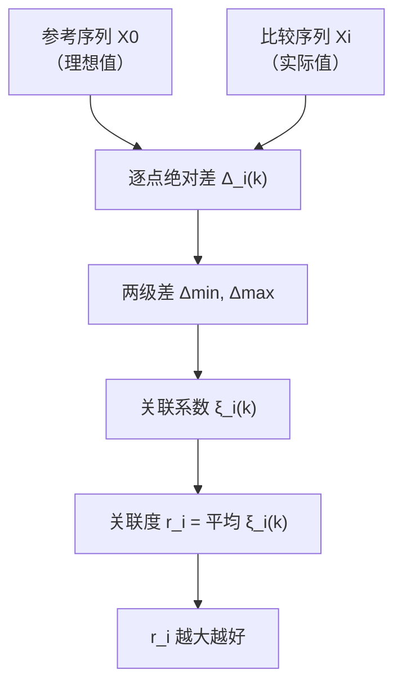

# 08 灰色关联分析：小样本下，谁和"理想"最像

## 一、为什么要学这个？

### 先搞懂：什么叫"灰色"？

控制论里常用颜色形容信息多少：
- **黑色系统**：内部信息完全未知，只知道输入输出（像一个黑盒子）；
- **白色系统**：内部结构完全清楚，能用精确数学模型描述（像牛顿力学）；
- **灰色系统**：介于两者之间，**部分信息已知、部分信息未知**。

现实经济系统大多是灰色的——你知道 GDP 数据，但不知道"政策怎么影响 GDP"的完整机制；你有 5 年数据，但不知道未来怎么变。灰色系统理论就是为这种"信息不完全、小样本"的系统设计的。

### 回到问题

**问题**：你只有 5 年数据，想知道哪个城市的发展轨迹最接近"理想轨迹"。

- 回归分析？样本量 5，参数都估不稳；
- [[05_TOPSIS法|TOPSIS]]？它是横向排名，不是纵向比较轨迹；
- **灰色关联分析**？专门为这种"小样本、信息不完全"的场景设计。

**它能干什么？**
- 给你一个**参考序列**（最理想的那条曲线）；
- 给你几条**比较序列**（各个城市的实际曲线）；
- 算每条比较序列和参考序列的**关联度**；
- 关联度越大，说明这条曲线和理想曲线越像。

**不学会怎样？** 你论文研究"小样本下哪个城市发展和国家战略最契合"，只能用 TOPSIS 硬算，但 TOPSIS 是截面比较，不是轨迹比较。

---

## 二、是什么？（先打比方）

### 生活比喻：选秀节目

选秀节目里：
- 参考序列 = 导师心中的"完美歌手"范本（高音稳、节奏准、感情真）；
- 比较序列 = 每个选手在 5 个考核项上的表现；
- [[KP10_灰色关联度vs模糊综合评价|灰色关联度]] = 这个选手和"完美歌手"的相似度。

谁关联度高，谁就是冠军。

### 严格定义

> **灰色关联分析**：对两个系统之间因素随时间变化的相似程度进行量化比较。给定参考序列 $X_0$（理想值）和若干比较序列 $X_1, X_2, \ldots, X_m$，先无量纲化，再逐点算关联系数 $\xi_i(k)$，最后求平均得到关联度 $r_i$。$r_i$ 越大，说明 $X_i$ 和 $X_0$ 越相关。

**几何直觉**：把每条序列画成一条折线，画在同一张图上。两条折线越平行（形状越像），关联度越大；折线交叉得越厉害，关联度越小。它比的不是"数值大小"，而是"曲线形状像不像"——这就是为什么 5 个点也能算，因为形状相似不需要大样本。

---

## 三、公式怎么来的？

### 第 1 步：无量纲化（初值化 vs 均值化）

不同序列量纲不同（GDP 是万亿、增速是百分比），必须先拉到同一尺度。两种常用方法：

**① 初值化**（最常用）：每个序列除以自己第一个值：

$$x_i'(k) = \frac{x_i(k)}{x_i(1)}$$

- 所有序列第 1 个点都变成 1，后面各点表示"相对于起点的倍数"；
- 适合**时间序列**（看发展趋势），本例用这个。

**② 均值化**：每个序列除以自己的平均值：

$$x_i'(k) = \frac{x_i(k)}{\bar{x}_i}, \quad \bar{x}_i = \frac{1}{n}\sum_{k=1}^{n} x_i(k)$$

- 所有序列均值变成 1，各点表示"相对于平均水平的偏离"；
- 适合**截面数据**（同一时点上多个指标比较），或序列首年数据异常（首年值太小会导致初值化后后面爆炸）。

| 方法 | 除以什么 | 第1点变成 | 适合场景 |
|---|---|---|---|
| 初值化 | 第1个值 $x_i(1)$ | 1.0 | 时间序列、趋势分析 |
| 均值化 | 平均值 $\bar{x}_i$ | $x_i(1)/\bar{x}_i$ | 截面数据、首年异常 |

> ⚠️ 所有序列必须用**同一种**无量纲化方法，不能混用。

（也可以用[[02_指标无量纲化|极差归一化]]，初值化最常用。）

### 第 2 步：算绝对差

$$\Delta_i(k) = |x_0'(k) - x_i'(k)|$$

这是参考序列和比较序列在第 k 个点上的距离。

### 第 3 步：找两级最大差和最小差

$$\Delta_{\min} = \min_i \min_k \Delta_i(k)$$
$$\Delta_{\max} = \max_i \max_k \Delta_i(k)$$

### 第 4 步：算关联系数

$$\xi_i(k) = \frac{\Delta_{\min} + \rho \Delta_{\max}}{\Delta_i(k) + \rho \Delta_{\max}}$$

其中 $\rho$ 是分辨系数，一般取 0.5。

**为什么 ρ 取 0.5？** 这不是拍脑袋，是有讲究的：

- $\rho$ 越大，关联系数的区分度越小（$\rho \to \infty$ 时所有 $\xi \to 1$，谁和谁都"很像"）；
- $\rho$ 越小，区分度越大，但太敏感（$\rho \to 0$ 时只有最近的点才算像，稍微远点就 0）；
- 邓聚龙（灰色系统理论创始人）经过大量模拟发现，$\rho=0.5$ 时关联系数的分辨率最适中，**既能拉开差距又不至于太敏感**；
- 数学上，$\rho=0.5$ 时 $\xi$ 的取值范围大约在 [0.33, 1]，不会全部挤在 1 附近。

> 💡 改 ρ 行不行？可以，但必须在论文里说明理由。一般 ρ 取 0.1~0.5，结果排序基本不变，只是数值整体平移。本科论文默认 0.5 就好。

**直觉**：
- 当 $\Delta_i(k)$ 小（两点接近）→ $\xi_i(k)$ 大（接近 1）；
- 当 $\Delta_i(k)$ 大（两点远离）→ $\xi_i(k)$ 小（接近 0）。

### 第 5 步：算关联度

$$r_i = \frac{1}{n}\sum_{k=1}^n \xi_i(k)$$

把每个点的关联系数平均一下，得到这条比较序列和参考序列的整体关联度。



---

## 四、每个符号是什么？

| 符号 | 是什么 |
|------|--------|
| $X_0$ | 参考序列（理想值） |
| $X_i$ | 第 i 条比较序列 |
| $k$ | 时间点/指标点编号 |
| $x_i'(k)$ | 无量纲化后的值（初值化或均值化） |
| $\bar{x}_i$ | 第 i 条序列的均值（均值化用） |
| $\Delta_i(k)$ | 绝对差 |
| $\Delta_{\min}, \Delta_{\max}$ | 两级最小差、最大差 |
| $\rho$ | 分辨系数，一般 0.5 |
| $\xi_i(k)$ | 关联系数，0~1 |
| $r_i$ | 关联度（等权平均）或加权综合评价系数 |
| $w_k$ | 各点/各指标权重（加权关联度用） |

---

## 五、一个完整的数字例子

**问题**：3 个城市 X₁、X₂、X₃，5 年的 GDP 增速数据。参考序列 X₀ 是"理想增速"（每年匀速增长）。哪个城市增长轨迹最像理想？

### 原始数据（5 年）

| 年 | X₀（理想） | X₁（城市1） | X₂（城市2） | X₃（城市3） |
|----|-----------|-------------|-------------|-------------|
| 1  | 10        | 8           | 5           | 12          |
| 2  | 20        | 18          | 15          | 22          |
| 3  | 30        | 28          | 25          | 32          |
| 4  | 40        | 38          | 35          | 42          |
| 5  | 50        | 48          | 45          | 52          |

### 第 1 步：初值化（除以第 1 年）

| 年 | X₀' | X₁' | X₂' | X₃' |
|----|-----|-----|-----|-----|
| 1  | 1.0 | 1.0 | 1.0 | 1.0 |
| 2  | 2.0 | 2.25 | 3.0 | 1.833 |
| 3  | 3.0 | 3.5 | 5.0 | 2.667 |
| 4  | 4.0 | 4.75 | 7.0 | 3.5 |
| 5  | 5.0 | 6.0 | 9.0 | 4.333 |

（Python 验证过。）

### 第 2 步：算绝对差

**X₁ vs X₀**：
- k=1: |1-1| = 0
- k=2: |2-2.25| = 0.25
- k=3: |3-3.5| = 0.5
- k=4: |4-4.75| = 0.75
- k=5: |5-6| = 1.0

**X₂ vs X₀**：
- k=1: 0
- k=2: |2-3| = 1.0
- k=3: |3-5| = 2.0
- k=4: |4-7| = 3.0
- k=5: |5-9| = 4.0

**X₃ vs X₀**：
- k=1: 0
- k=2: |2-1.833| = 0.167
- k=3: |3-2.667| = 0.333
- k=4: |4-3.5| = 0.5
- k=5: |5-4.333| = 0.667

### 第 3 步：两级差

所有绝对差里：
- 最小 $\Delta_{\min} = 0$（k=1 时，所有序列初值化后都=1）
- 最大 $\Delta_{\max} = 4.0$（X₂ 在 k=5 时）

### 第 4 步：算关联系数（ρ=0.5）

公式：$\xi(k) = (0 + 0.5 \times 4) / (\Delta(k) + 0.5 \times 4) = 2 / (\Delta(k) + 2)$

**X₁ 的关联系数**：
- k=1: 2/(0+2) = 1.000
- k=2: 2/(0.25+2) = 0.889
- k=3: 2/(0.5+2) = 0.800
- k=4: 2/(0.75+2) = 0.727
- k=5: 2/(1.0+2) = 0.667

**X₂ 的关联系数**：
- k=1: 1.000
- k=2: 2/(1+2) = 0.667
- k=3: 2/(2+2) = 0.500
- k=4: 2/(3+2) = 0.400
- k=5: 2/(4+2) = 0.333

**X₃ 的关联系数**：
- k=1: 1.000
- k=2: 2/(0.167+2) = 0.923
- k=3: 2/(0.333+2) = 0.857
- k=4: 2/(0.5+2) = 0.800
- k=5: 2/(0.667+2) = 0.750

### 第 5 步：算关联度（平均）

- $r_1 = (1.000+0.889+0.800+0.727+0.667)/5 = 4.083/5 = 0.817$
- $r_2 = (1.000+0.667+0.500+0.400+0.333)/5 = 2.900/5 = 0.580$
- $r_3 = (1.000+0.923+0.857+0.800+0.750)/5 = 4.330/5 = 0.866$

（Python 验证：[0.817, 0.580, 0.866]，手算一致。）

### 结论

**关联度排名：X₃ (0.866) > X₁ (0.817) > X₂ (0.580)**

- 城市 3 的发展轨迹和理想轨迹最像；
- 城市 2 偏离最大（它增速太快了，离"理想匀速"越来越远）。

---

## 五点五、参考序列 X₀ 怎么构造？（三种取法）

参考序列是"理想值"，它怎么来直接决定评价意义：

| 取法 | 做法 | 适用场景 |
|---|---|---|
| **样本最优法** | 每个指标取所有对象中最优值，拼成 $X_0$ | 横向评价（谁离最优最近） |
| **规划目标法** | 取规划目标值/国家标准值 | 政策评价（谁离目标最近） |
| **理论理想法** | 按理论构造理想轨迹（如匀速增长、最优曲线） | 趋势评价（谁的轨迹最理想） |

**横向综合评价时最常用的是"样本最优法"**：如果你要评价 n 个对象、p 个指标（注意这时候"序列"不是时间点，而是指标），参考序列就是每列取最优：

$$X_0 = (\max_1, \max_2, \ldots, \max_p)$$

其中 $\max_j$ 是第 j 列（第 j 个指标）所有对象里的最优值（正向指标取最大，逆向指标取最小）。然后每个对象 $X_i$ 和 $X_0$ 算关联度，关联度大的就是"离最优最近"的。

> 💡 **别搞混两种用法**：
> - **时间序列用法**（本例）：$X_0$ 是一条理想时间曲线，$X_i$ 是各城市的实际时间曲线，比的是"轨迹像不像"；
> - **截面评价用法**：$X_0$ 是各指标最优值拼成的"理想对象"，$X_i$ 是各城市的指标向量，比的是"谁离理想对象近"。
> 两种用法公式完全一样，只是序列的含义不同。

---

## 五点六、加权关联度：灰色关联综合评价系数

上面例子里每个时间点等权平均。但实际评价中，不同指标（或不同时间点）重要性不同，可以给关联系数加权：

$$r_i = \sum_{k=1}^{n} w_k \cdot \xi_i(k), \quad \sum w_k = 1$$

$w_k$ 是第 k 个指标（或时间点）的权重，来自 AHP 或熵值法。这样得到的 $r_i$ 叫**综合评价系数**，越大说明该对象越接近理想。这就是灰色关联从"轨迹相似性"升级为"综合评价"的关键一步。

---

## 五点七、灰色关联 vs 模糊综合评价：什么时候用哪个？

这两个都是"非精确"评价方法，容易搞混。核心区别：

| 维度 | 灰色关联分析 | 模糊综合评价 |
|---|---|---|
| **处理的"灰色"是什么** | 信息不完全（数据少、机制不明） | 概念边界模糊（"满意"到底是多少分） |
| **数据要求** | 小样本数值（4~10 个点） | 主观评价/问卷隶属度 |
| **输出** | 关联度 $r_i \in [0,1]$（连续分） | 等级向量 $B$ → {优,良,中,差} |
| **核心操作** | 逐点比曲线形状相似度 | 隶属度矩阵 × 权重做模糊合成 |
| **需要问卷吗** | 不需要（只要数值数据） | 需要（隶属度从问卷/专家来） |
| **适合场景** | 小样本趋势分析、影响因素排序 | 满意度、教学质量、风险等级 |

**一句话选法**：
- 有数值数据但样本少，想知道"谁和理想轨迹最像" → **灰色关联**；
- 评价对象是主观感受（满意度、认可度），需要分等级 → **模糊综合**。

---

## 六、前提假设

1. **样本量小但完整**。一般 4~10 个点最合适；
2. **参考序列要合理**。理想值怎么来的？可以是最优样本、规划目标、理论最优；
3. **无量纲化统一**。所有序列用同一种方法（初值化/均值化）；
4. **分辨系数 ρ=0.5**，一般不用改。

---

## 七、易错点

1. **参考序列乱选**。参考序列应该是"理想值"，不能随便拿一个城市当参考。
2. **无量纲化方法不统一**。有的用初值化有的用极差归一化，结果错。
3. **ρ 乱改**。一般 0.5，改了要在论文里说明理由。
4. **把关联度当因果**。关联度高只说明"轨迹像"，不说明 X 导致 Y。
5. **样本太大反而不好**。灰色关联本来就是小样本方法，样本几百个时不如直接算[[01_相关系数|相关系数]]。

---

## 八、Python 代码

```python
import numpy as np

X0 = np.array([10,20,30,40,50], dtype=float)
X1 = np.array([8,18,28,38,48], dtype=float)
X2 = np.array([5,15,25,35,45], dtype=float)
X3 = np.array([12,22,32,42,52], dtype=float)

# 初值化
X0n = X0/X0[0]
X1n = X1/X1[0]
X2n = X2/X2[0]
X3n = X3/X3[0]

# 绝对差
d1 = np.abs(X0n-X1n)
d2 = np.abs(X0n-X2n)
d3 = np.abs(X0n-X3n)

all_diff = np.concatenate([d1,d2,d3])
dmin, dmax = all_diff.min(), all_diff.max()
rho = 0.5

xi1 = (dmin+rho*dmax)/(d1+rho*dmax)
xi2 = (dmin+rho*dmax)/(d2+rho*dmax)
xi3 = (dmin+rho*dmax)/(d3+rho*dmax)

print(f"r1 = {xi1.mean():.4f}")
print(f"r2 = {xi2.mean():.4f}")
print(f"r3 = {xi3.mean():.4f}")
```

---

## 九、和别的方法对比

| 维度 | 熵权 TOPSIS | 模糊综合 | 灰色关联 |
|------|-------------|----------|----------|
| 数据类型 | 截面（不同对象同一时间） | 主观评价 | **时间序列/小样本** |
| 用途 | 对象排名 | 等级判定 | 轨迹相似性 |
| 需要样本量 | 大 | 中 | **小（4~10）** |
| 客观性 | 客观 | 偏主观 | 客观 |

**怎么选？**
- 横向排名（哪个城市强）→ TOPSIS；
- 等级判定（优/良/中/差）→ 模糊综合；
- 纵向轨迹（谁和理想最像）→ 灰色关联。

---

## 十、为什么不用别的方法？

- **为什么不用回归分析？** 回归要求样本量足够（一般每个自变量至少 10 个样本），本例只有 5 年数据，参数根本估不稳；灰色关联不假设分布、不估参数，4~10 个点就能算。
- **为什么不用 TOPSIS？** TOPSIS 是横向截面比较（同一时间点上 A、B、C 谁强），回答不了"谁的发展轨迹最接近理想轨迹"这个纵向问题；灰色关联逐点比两条曲线的形状，比的是轨迹相似性。
- **为什么不用普通相关系数？** 相关系数一般要求样本较大（30 个点以上），且只反映线性同步程度；本例 5 个点，相关系数极不稳。灰色关联用两级最大差 $\Delta_{\max}$ 做分母，对小样本、非线性轨迹都更稳。

---

## 十一、答辩常问（直接背）

1. **问：关联度 r=[0.817, 0.580, 0.866] 怎么解释？** 答：r 越大，说明该城市轨迹和参考序列（理想匀速增长）越像。本例城市 3（r=0.866）最接近理想，城市 2（r=0.580）偏离最大——它增速越来越快，离"理想匀速"越来越远。
2. **问：分辨系数 ρ=0.5 是什么？能改吗？** 答：ρ 控制关联系数的分辨力度，一般取 0.5，改动对结果影响不大但必须在论文里说明理由。本例 $\xi(k)=2/(\Delta(k)+2)$ 就是按 ρ=0.5、Δmax=4 推出来的。
3. **问：参考序列 X₀ 怎么定？** 答：三种常见取法——样本中最优对象、规划目标值、理论理想值（本例是"每年匀速增长"的理想增速）。不能随便拿一个现实城市当参考，否则"和它像"没有评价意义。
4. **问：关联度高是不是说明有因果关系？** 答：不是。灰色关联只说明两条曲线形状相似，不说明一个导致另一个。要做因果还是得回归，而且需要更大样本。

---

## 十二、速记卡

> **灰色关联 = 参考序列和比较序列逐点比曲线形状相似度，平均得关联度。**
> 灰色系统 = 信息不完全（部分已知、部分未知），不是黑盒也不是白盒。
> 五步：无量纲化（初值化/均值化）→ 算绝对差 → 找 Δmin/Δmax → 算关联系数 ξ → 平均得 r。
> ρ=0.5 是邓聚龙定的最佳分辨系数，别乱改。
> 参考序列三种取法：样本最优 / 规划目标 / 理论理想；加权后叫综合评价系数。
> $r_i$ 越大，轨迹越像理想。
> **专门为小样本（4~10 个点）设计**。
> 和模糊综合的区别：灰色关联比曲线形状（数值数据），模糊综合比隶属度（主观评价）。

---

上一篇：[[07_模糊综合评价]]｜下一篇：[[00_章节总结]]

---

## 📖 配套教材笔记

- [[../../教材笔记/01_综合评价/07_灰色关联度/00_章节总结|教材笔记·第七章 灰色关联度]]
- [[../../教材笔记/01_综合评价/07_灰色关联度/知识点/KP01_灰色系统与灰色要素|KP01 灰色系统与灰色要素]]
- [[../../教材笔记/01_综合评价/07_灰色关联度/知识点/KP02_灰色关联度的定义与几何意义|KP02 定义与几何意义]]
- [[../../教材笔记/01_综合评价/07_灰色关联度/知识点/KP03_原始数据无量纲化_初值化与均值化|KP03 初值化与均值化]]
- [[../../教材笔记/01_综合评价/07_灰色关联度/知识点/KP04_参考序列与比较序列|KP04 参考序列与比较序列]]
- [[../../教材笔记/01_综合评价/07_灰色关联度/知识点/KP05_两级最大差与最小差|KP05 两级最大差与最小差]]
- [[../../教材笔记/01_综合评价/07_灰色关联度/知识点/KP06_关联系数与分辨系数|KP06 关联系数与分辨系数 ρ=0.5]]
- [[../../教材笔记/01_综合评价/07_灰色关联度/知识点/KP07_关联度与关联序|KP07 关联度与关联序]]
- [[../../教材笔记/01_综合评价/07_灰色关联度/知识点/KP08_理想最优参考序列构造|KP08 理想最优参考序列构造]]
- [[../../教材笔记/01_综合评价/07_灰色关联度/知识点/KP09_灰色关联综合评价步骤与评价系数|KP09 综合评价步骤与评价系数]]
- [[../../教材笔记/01_综合评价/07_灰色关联度/知识点/KP10_灰色关联度vs模糊综合评价|KP10 灰色关联度 vs 模糊综合评价]]

## 📚 配套原书

- [[../../原文件/综合评价/陈正伟_综合评价技术及应用_全书|《综合评价技术及应用》陈正伟（西南财经大学出版社）]]

## 🔁 方法对比

**方法对比：** [[07_模糊综合评价|模糊综合评价（评语集隶属度）]]——同属非精确评价方法族
