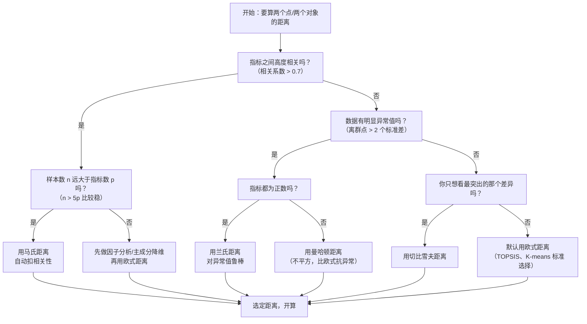

# 10 距离方法选择指南：欧式、马氏、曼哈顿、切比雪夫、兰氏到底用哪个

## 一、为什么要学这个？

**问题**：你已经会用 TOPSIS 了（[[05_TOPSIS法|05_TOPSIS法]]），会用熵值法了（[[03_熵值法|03_熵值法]]）。但只要你算"两个点之间有多远"，背后就藏着一个选择——**用哪种距离？**

- TOPSIS 默认用**欧氏距离**；
- K-means 聚类默认用**欧氏距离**；
- 层次聚类可以选**曼哈顿**；
- 判别分析里常出现**马氏距离**；
- 数据有异常值时，有人改用**兰氏距离**。

**选错距离会怎样？** 排名可能直接颠倒。同一组数据，用欧氏距离排出来 A>B>C，换曼哈顿可能排出来 B>A>C。答辩时老师一句"你为什么用这个距离？"你答不上来，这一页 PPT 就废了。

**不学会怎样？** 论文里只会写"采用欧氏距离计算 D⁺ 和 D⁻"，但老师问"为什么不用马氏？指标之间明明高度相关"——你卡壳。

---

## 二、一句话直觉（先打比方）

想象两个城市在地图上，你要量它们之间有多远：

| 距离 | 生活比喻 | 一句话解释 |
|------|----------|------------|
| **欧式 Euclidean** | 飞机直线飞行距离 | 两点之间直线最短，直接连一条线 |
| **曼哈顿（杨氏）Manhattan** | 开车穿棋盘格城市（纽约曼哈顿） | 不能斜穿大楼，只能沿马路横平竖直地走 |
| **切比雪夫 Chebyshev** | 国际象棋里王走一步 | 横走、竖走、斜走都算 1 步，看你最多走几格 |
| **马氏 Mahalanobis** | 戴了近视眼镜量距离 | 先把指标之间的"拉扯关系"（协方差）扣掉再量 |
| **兰氏 Lance-Williams** | 带了放大镜量小差异 | 差异除以两者之和，小数值指标也能公平比较 |
| **闵可夫斯基 Minkowski** | 一个万能遥控器 | p=1 是曼哈顿，p=2 是欧式，p→∞ 是切比雪夫 |

---

## 三、公式怎么来的？

### 3.1 先定义两个点

假设有两个对象 $x$ 和 $y$，每个对象都有 $p$ 个指标（在 $p$ 维空间里）：

$$x = (x_1, x_2, \dots, x_p), \quad y = (y_1, y_2, \dots, y_p)$$

例如 $x$ 是 A 城（GDP、教育、医疗），$y$ 是 B 城，$p=3$。

### 3.2 欧式距离（Euclidean）

**二维情况**：直角三角形斜边。

$$d_E(x, y) = \sqrt{(x_1 - y_1)^2 + (x_2 - y_2)^2}$$

**推广到 p 维**：

$$d_E(x, y) = \sqrt{\sum_{j=1}^{p} (x_j - y_j)^2}$$

- 每个维度的差值先平方、再加起来、再开方；
- 平方是为了消掉正负号（不然东差 5 西差 -5 就抵消了）；
- 开方是为了让距离和原指标同量纲。

### 3.3 曼哈顿距离（Manhattan / 杨氏距离）

不平方、不开方，直接把每个维度的绝对差加起来：

$$d_M(x, y) = \sum_{j=1}^{p} |x_j - y_j|$$

- 二维例子：东差 5、北差 3 → 曼哈顿距离 = 5+3 = 8；
- 为什么叫"杨氏"？因为 1880 年代英国数学家 Hermann Minkowski 最早把它写成通用形式，后来国内教材习惯叫"杨氏距离"（实际是 Manhattan 的中文别名，别和闵可夫斯基搞混）。

### 3.4 切比雪夫距离（Chebyshev）

只看最大的那个维度差值：

$$d_C(x, y) = \max_{j=1}^{p} |x_j - y_j|$$

- 二维例子：东差 5、北差 3 → 切比雪夫距离 = max(5, 3) = 5；
- 国际象棋里王可以横走、竖走、斜走，所以从 (0,0) 到 (5,3) 只要 5 步。

### 3.5 兰氏距离（Lance-Williams）

每个维度的差值除以两者之和，再加总：

$$d_L(x, y) = \sum_{j=1}^{p} \frac{|x_j - y_j|}{|x_j| + |y_j|}$$

- 关键：分母是 $|x_j| + |y_j|$，不是固定数；
- 当 $x_j$ 和 $y_j$ 都很大时，同样的差值 5，被大分母一除就变小了；
- 当 $x_j$ 和 $y_j$ 都很小时，差值 1 也会被认真对待；
- **对异常值不敏感**：一个点突然跳到 1000，分母也跟着变大，距离不会爆炸。

### 3.6 马氏距离（Mahalanobis）

欧式距离假设所有维度"各自独立、量纲相同"。但现实中 GDP 和人均 GDP 高度相关，直接算欧式距离等于把同一份信息算了两遍。马氏距离用协方差矩阵 $\Sigma$ 把这种相关性扣掉：

$$d_{Mah}(x, y) = \sqrt{(x - y)^T \Sigma^{-1} (x - y)}$$

- $\Sigma$ 是 $p \times p$ 的协方差矩阵（用全部样本估计）；
- $\Sigma^{-1}$ 是它的逆矩阵；
- 直观理解：先把数据"旋转、缩放"成各维度不相关、方差为 1，再算欧式距离。

### 3.7 闵可夫斯基距离（Minkowski）—— 通式

$$d_{p}(x, y) = \left( \sum_{j=1}^{p} |x_j - y_j|^{p} \right)^{1/p}$$

- $p=1$ → 曼哈顿距离；
- $p=2$ → 欧式距离；
- $p \to \infty$ → 切比雪夫距离（数学上可以证明，$p$ 越大，最大那一项越主导整个求和）。

---

## 四、核心对比表

| 距离 | 公式 | 对量纲敏感度 | 对异常值敏感度 | 指标相关性处理 | 适用场景 | 不适用场景 |
|------|------|--------------|----------------|----------------|----------|------------|
| **欧式** | $\sqrt{\sum \Delta_j^2}$ | 高（量纲不统一直接错） | 中高（平方放大） | 不处理（相关指标被重复计数） | 指标已无量纲化、近似独立 | 量纲差异大、有极端值 |
| **曼哈顿** | $\sum \lvert \Delta_j \rvert$ | 高 | 中（不平方） | 不处理 | 城市网格、指标偏粗 | 需要强调大差异时 |
| **切比雪夫** | $\max \lvert \Delta_j \rvert$ | 高 | 低（只看最大一项） | 不处理 | 只关心最突出差异 | 多指标综合评价（丢失其他维度信息） |
| **马氏** | $\sqrt{\Delta^T \Sigma^{-1} \Delta}$ | 低（协方差自动缩放） | 中 | **自动扣掉相关性** | 指标高度相关、样本充足 | 样本数 n ≤ 维度数 p（协方差奇异） |
| **兰氏** | $\sum \frac{\lvert \Delta_j \rvert}{\lvert x_j \rvert + \lvert y_j \rvert}$ | 低（自带归一化） | **低** | 不处理 | 数据有异常值、尺度差异大 | 指标可正可负、含 0（分母为 0） |
| **闵可夫斯基** | $(\sum \lvert \Delta_j \rvert^p)^{1/p}$ | 取决于 p | p 越大越敏感 | 不处理 | 想调 p 做敏感性分析 | 论文里很少直接用，多为通式 |

---

## 五、什么时候用哪种？（决策树）



**一句话总结**：90% 的本科论文，直接用**欧氏距离** + 先把指标无量纲化，就够了。只有指标高度相关、或数据很脏时，才换马氏 / 兰氏。

---

## 六、和综合评价的关系

> 💡 忘了综合评价是怎么回事？先回 [[../../教材笔记/05_统计学原理/11_统计分析/知识点/KP01_综合评价法总览|KP01 综合评价法总览]] 复习一下"选指标→无量纲化→赋权→合成→排名"五步流水线，再回来看距离这一步为什么重要。

### 6.1 TOPSIS 默认用欧氏距离

[[05_TOPSIS法|05_TOPSIS法]] 里算 $D_i^+$、$D_i^-$ 用的就是欧式距离：

$$D_i^+ = \sqrt{\sum_{j=1}^{m} (z_{ij} - V_j^+)^2}$$

**为什么是欧氏？** 因为 TOPSIS 已经做了向量归一化（把每列变成单位长度），量纲问题已经解决，剩下的就该用最经典的欧氏距离。

### 6.2 什么时候该换马氏距离？

- 指标之间**高度相关**（比如"人均 GDP"和"人均可支配收入"相关系数 0.9）；
- 此时欧式距离等于把同一份信息算了两遍，距离被"重复放大"；
- 马氏距离通过 $\Sigma^{-1}$ 自动给相关指标降权。

**但有个硬约束**：马氏距离要求 $n > p$（样本数大于指标数），否则协方差矩阵 $\Sigma$ 不可逆。本科论文 31 个省份 × 20 个指标，$n=31, p=20$，勉强能算；如果只剩 10 个城市，就别用马氏了。

### 6.3 聚类分析中的距离

- **K-means**：默认欧氏距离（它的目标函数就是最小化欧式距离平方和）；
- **层次聚类（系统聚类）**：scipy 里可以选 `method='cityblock'`（曼哈顿）、`'euclidean'`（欧式）；
- 指标有明显偏态 / 异常值时，层次聚类用曼哈顿更稳。

### 6.4 灰色关联分析不是距离

[[08_灰色关联分析|08_灰色关联分析]] 算的是"关联系数"，不是欧式距离。别混。

---

## 六点五、其他数值综合方法（Ch05 + Ch06 速览）

距离只是"合成"的一种方式。除了距离，数值综合还有两大类：**加权聚合**（线性/几何）和**传统常规方法**（评分法/指数法/RSR/功效系数法）。这里一张表帮你定位。

### 6.5.1 线性综合法 vs 几何综合法

| 维度 | 线性综合法 | 几何综合法 |
|---|---|---|
| 公式 | $S = \sum w_i x_i$ | $S = \prod x_i^{w_i}$ |
| 直觉 | 各指标加权求和，短板可被长板补 | 各指标加权相乘，一个太差全盘崩 |
| 可替代性 | **完全可替代**（GDP 高可以补失业率高） | **不可替代**（一个指标接近 0，总分接近 0） |
| 适用 | 指标间可互补、允许"偏科" | 各指标都重要、不能有短板 |
| 例子 | 综合评分法、综合指数法 | 多目标规划、产品综合评分 |

> 💡 **一句话**：线性是"木桶能装多少水看最长板"，几何是"木桶能装多少水看最短板"。

### 6.5.2 马田系统 MTS（Mahalanobis-Taguchi System）

马氏距离的工业应用版，由田口玄一提出。核心思路：
1. 用"正常组"样本估计协方差矩阵 $\Sigma$；
2. 算每个待判对象到正常组中心的马氏距离；
3. 距离超过阈值 = 异常。

适合**缺陷检测、故障诊断**类问题。本科综合评价论文一般用不到，但答辩时老师可能问"马氏距离除了 TOPSIS 还能用在哪"——答 MTS 即可。

### 6.5.3 DEA 数据包络分析（Data Envelopment Analysis）

不预设权重，用线性规划**同时算出每个对象的最优权重**和效率得分。适合评价多投入多产出的效率（如高校科研效率、银行经营效率）。

- **优点**：完全客观、不用定权重、适合多投入多产出；
- **缺点**：只能算相对效率，样本要多，不能做因果；
- **和熵权 TOPSIS 的区别**：DEA 不排序"谁好谁坏"，而是算"谁在生产前沿面上"。

> 💡 本科论文如果做"效率评价"类题目（高校、银行、医院），DEA 是比熵权 TOPSIS 更对口的方法。

### 6.5.4 四种常规综合评价方法对比（Ch06 核心）

这是最传统的四种"打分→加总"方法，数学简单但论文里仍常见：

| 方法 | 数值→分数方式 | 基准 | 结果方向 | 抗异常值 | 保留数值差异 |
|---|---|---|---|---|---|
| **综合评分法** | 查评分表打 1~5 分 | 人为分级 | 越大越好 | 弱 | 弱（粗） |
| **综合指数法** | 实际值/标准值 | 标准值 $x_{i0}$ | 越大越好 | 弱 | 强 |
| **秩和比 RSR** | 排秩位次 | 无（只看名次） | **越小越好** | **强** | 无（只看名次） |
| **功效系数法** | 功效函数映射到 60~100 | 满意值+不允许值 | 越大越好 | 中 | 中 |

**怎么选？**
- 要最朴素、人人能懂的分级 → 综合评分法；
- 要保留"实际比标准高多少"的相对差异 → 综合指数法；
- 数据有极端值、只关心名次 → RSR（注意结果越小越好）；
- 要把结果落在"及格 60、满意 100"区间 → 功效系数法。

> ⚠️ **共同局限**：四种方法都不能消除指标间相关性，使用前指标须已相互独立。RSR 是唯一"越小越好"的，别搞反方向。

---

## 七、Python 完整代码（手算 5 种距离）

### 7.1 例子

3 个城市（已归一化），3 个指标：

| 城市 | 指标 1 | 指标 2 | 指标 3 |
|------|--------|--------|--------|
| A | 0.2 | 0.5 | 0.8 |
| B | 0.7 | 0.3 | 0.1 |
| C | 0.5 | 0.5 | 0.5 |

我们要算 **A-B、A-C、B-C** 三对距离，看排序结果是否一致。

### 7.2 代码

```python
import numpy as np

# 三个城市（已归一化）
A = np.array([0.2, 0.5, 0.8])
B = np.array([0.7, 0.3, 0.1])
C = np.array([0.5, 0.5, 0.5])

# ---------- 1. 欧式距离 ----------
def euclidean(x, y):
    return np.sqrt(np.sum((x - y) ** 2))

# ---------- 2. 曼哈顿距离 ----------
def manhattan(x, y):
    return np.sum(np.abs(x - y))

# ---------- 3. 切比雪夫距离 ----------
def chebyshev(x, y):
    return np.max(np.abs(x - y))

# ---------- 4. 兰氏距离 ----------
def lance_williams(x, y):
    # 每个维度：差值绝对值 / (|x_j| + |y_j|)
    return np.sum(np.abs(x - y) / (np.abs(x) + np.abs(y)))

# ---------- 5. 闵可夫斯基距离（通式） ----------
def minkowski(x, y, p=2):
    return np.sum(np.abs(x - y) ** p) ** (1/p)

# ---------- 6. 马氏距离 ----------
# 注意：马氏距离需要用全部样本估计协方差矩阵
X = np.vstack([A, B, C])           # 3×3
cov = np.cov(X.T, bias=False)       # 3×3 协方差矩阵
# 本例只有 3 个样本、3 个指标，协方差矩阵秩亏（奇异）
# 真实研究中 n 必须远大于 p，这里仅作演示
cov_inv = np.linalg.pinv(cov)      # 用伪逆避免报错

def mahalanobis(x, y, cov_inv):
    d = x - y
    return np.sqrt(d @ cov_inv @ d)

# ---------- 计算所有配对 ----------
pairs = [("A-B", A, B), ("A-C", A, C), ("B-C", B, C)]

print(f"{'配对':<6}{'欧式':<10}{'曼哈顿':<10}{'切比雪夫':<10}{'兰氏':<10}{'马氏(演示)':<12}")
for name, x, y in pairs:
    e = euclidean(x, y)
    m = manhattan(x, y)
    c = chebyshev(x, y)
    l = lance_williams(x, y)
    mah = mahalanobis(x, y, cov_inv)
    print(f"{name:<6}{e:<10.4f}{m:<10.4f}{c:<10.4f}{l:<10.4f}{mah:<12.4f}")
```

### 7.3 实际运行结果

```
配对    欧式       曼哈顿     切比雪夫    兰氏       马氏(演示)
A-B    0.8832    1.4000    0.7000    1.5833    1.5232
A-C    0.4243    0.6000    0.3000    0.6593    1.8974
B-C    0.4899    0.8000    0.4000    1.0833    1.9596
```

### 7.4 结果解读

**前 4 种距离（欧式、曼哈顿、切比雪夫、兰氏）的排序完全一致**：

$$d(A, C) < d(B, C) < d(A, B)$$

也就是：A 和 C 最近，B 和 C 次之，A 和 B 最远。这符合直觉——C 是 (0.5, 0.5, 0.5) 中心点，A 和 B 都偏离它，且 A、B 之间差异最大。

**马氏距离那一行不能用来排序**——因为本例只有 3 个样本、3 个指标，协方差矩阵奇异（秩最多 2），上面的数字是用伪逆算出来的，不具备实际意义。这正是下一节"易错点"要讲的。

---

## 八、易错点

1. **量纲不统一直接算欧式距离**。GDP 是万亿、教育是百分比、医疗是千人床位——直接套公式，GDP 的"万"会把其他维度全压死。**必须先无量纲化**（[[02_指标无量纲化|02_指标无量纲化]]）。
2. **马氏距离要求 n > p**。30 个省份、20 个指标勉强能算；10 个城市、20 个指标就算不动。本科论文常见错误：样本只有 20 个、指标选了 25 个，硬上马氏，协方差矩阵不可逆。
3. **切比雪夫距离只看最大差异维度**。它会把其他维度的信息全丢掉——A 和 B 只差在 GDP 上，其他 19 个指标完全一样，切比雪夫距离和"GDP 差多少"没区别。这不是综合评价，是单指标比较。
4. **兰氏距离不能处理负数和零**。分母是 $|x_j| + |y_j|$，如果两个值都是 0，分母为 0，除法报错。用之前必须确认指标全为正。
5. **曼哈顿和欧式的排序不一定总一致**。本例刚好一致，但指标分布不均匀时可能颠倒。论文里如果排名很关键，可以**多种距离都算一遍**做敏感性分析——这是加分项。
6. **马氏距离 ≠ 自动更好**。它只是"扣掉了指标相关性"，如果指标本来就独立（比如熵值法筛过的指标），上马氏反而画蛇添足。

---

## 九、速记卡

> **90% 的论文：欧式距离 + 先无量纲化，就够了。**
>
> | 距离 | 一句话 | 什么时候用 |
> |------|--------|------------|
> | 欧式 | 直线飞行距离 | 默认（TOPSIS、K-means） |
> | 曼哈顿 | 开车穿城 | 指标有异常值、偏粗 |
> | 切比雪夫 | 王走一步 | 只看最大差异 |
> | 马氏 | 扣掉相关性再量 | 指标高度相关 + n 远大于 p |
> | 兰氏 | 除以两者之和 | 指标全为正 + 有异常值 |
> | 闵可夫斯基 | p 范数通式 | 做敏感性分析用 |
>
> **决策口诀**：先看相关 → 再看异常 → 最后默认欧式。

---

## 💡 经济学视角：综合评价方法怎么选——一篇论文的方法论取舍

**这个方法是为了解决什么经济学问题？**
开题报告里导师必问："你这篇为什么用这个方法？"综合评价方法一大堆（加权综合、TOPSIS、模糊、灰色、熵值-AHP 组合），选哪个取决于三件事：**样本量多大？指标是定量还是定性？权重是主观还是客观？** 这张决策图就是给你选方法用的。

**经济学论文里的方法选择逻辑：**

| 你的情况 | 推荐方法 |
|---|---|
| 大样本+定量指标+客观权重 | 熵值法-TOPSIS 组合（主流） |
| 样本少（<10 年）+找影响因素 | 灰色关联分析 |
| 有问卷打分+定性评语 | 模糊综合评价 |
| 需要专家判断战略价值 | AHP 层次分析法 |
| 既要客观又要专家意见 | 熵值法+AHP 组合赋权 |

经济学论文里，纯排名类文章（高质量发展、营商环境）首选熵值-TOPSIS；政策效果评价类文章选模糊综合；小样本探索性研究用灰色关联。方法要匹配问题，不能为了炫技而上复杂方法。

**举个实证论文的例子：**
写《数字经济对高质量发展的影响》，如果你是**测度排名**（各省数字经济水平）→ 熵值-TOPSIS；如果你是**影响因素分析**（数字经济各维度哪个对 GDP 拉动大）→ 灰色关联或回归；如果你是**政策效果评价**（数字经济试点城市好不好）→ 模糊综合或 DID。方法选错，结论再漂亮也站不住。

**📚 配套经济学笔记：**
- [[../../教材笔记/07_政治经济学/06_社会主义市场经济与发展/知识点/KP02_新发展理念与高质量发展|原KP·新发展理念与高质量发展]]

---


上一篇：[[05_TOPSIS法]]｜下一篇：[[00_章节总结]]

---

### 延伸阅读

- 📚 教材笔记：[[../../教材笔记/05_统计学原理/11_统计分析/知识点/KP01_综合评价法总览|统计学原理·综合评价法总览]]
- 📖 关联方法：[[05_TOPSIS法|TOPSIS法（欧氏距离的典型应用）]]、[[08_灰色关联分析|灰色关联分析]]
- 📖 降维分类：[[../08_降维与分类/README|08_降维与分类（聚类分析中的距离）]]

---

## 📖 配套教材笔记

**Ch05 数值综合方法：**
- [[../../教材笔记/01_综合评价/05_数值综合方法/知识点/KP01_线性综合法|KP01 线性综合法]]
- [[../../教材笔记/01_综合评价/05_数值综合方法/知识点/KP02_几何综合法|KP02 几何综合法]]
- [[../../教材笔记/01_综合评价/05_数值综合方法/知识点/KP07_空间距离评价法|KP07 空间距离评价法]]
- [[../../教材笔记/01_综合评价/05_数值综合方法/知识点/KP08_马田系统MTS|KP08 马田系统MTS]]
- [[../../教材笔记/01_综合评价/05_数值综合方法/知识点/KP09_数据包络分析DEA|KP09 数据包络分析DEA]]

**Ch06 常规综合评价方法：**
- [[../../教材笔记/01_综合评价/06_常规综合评价方法/知识点/KP01_综合评分法|KP01 综合评分法]]
- [[../../教材笔记/01_综合评价/06_常规综合评价方法/知识点/KP02_区间打分法|KP02 区间打分法]]
- [[../../教材笔记/01_综合评价/06_常规综合评价方法/知识点/KP03_区间增量法|KP03 区间增量法]]
- [[../../教材笔记/01_综合评价/06_常规综合评价方法/知识点/KP04_综合指数评价法|KP04 综合指数评价法]]
- [[../../教材笔记/01_综合评价/06_常规综合评价方法/知识点/KP05_评价标准值xi0的选择|KP05 评价标准值 xi0 的选择]]
- [[../../教材笔记/01_综合评价/06_常规综合评价方法/知识点/KP06_秩和比RSR评价法|KP06 秩和比 RSR 评价法]]
- [[../../教材笔记/01_综合评价/06_常规综合评价方法/知识点/KP07_等级化处理|KP07 等级化处理]]
- [[../../教材笔记/01_综合评价/06_常规综合评价方法/知识点/KP08_功效系数评价法|KP08 功效系数评价法]]
- [[../../教材笔记/01_综合评价/06_常规综合评价方法/知识点/KP09_功效函数|KP09 功效函数]]
- [[../../教材笔记/01_综合评价/06_常规综合评价方法/知识点/KP10_四种常规综合评价方法对比|KP10 四种常规方法对比]]

## 📚 配套原书

- [[../../原文件/综合评价/陈正伟_综合评价技术及应用_全书|《综合评价技术及应用》陈正伟（西南财经大学出版社）]]
