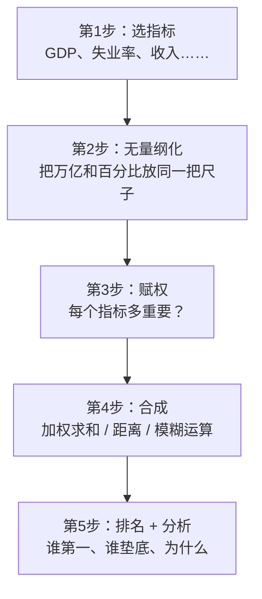

# 07 综合评价方法：给城市/公司/省份打分排名

> **这是经济统计学专业本科论文用得最多的一章。**
> 题目通常长这样：
> - "成渝双城经济圈城市宜居水平综合评价"
> - "长三角上市公司高质量发展评价"
> - "31 省份数字经济发展水平测度"
> - "基于熵权 [[05_TOPSIS法|TOPSIS]] 的重庆市各区县经济活力评价"
>
> 本章教你一整套从"一堆指标"到"一个排名"的流水线。

---

## 这一章解决什么问题？

你手上有这样一张表：

| 城市 | GDP（万亿） | 人口（万） | 失业率（%） | 人均可支配收入（元） |
|------|-------------|-----------|-------------|----------------------|
| A    | 2.5         | 1500      | 4.5         | 45000                |
| B    | 1.8         | 900       | 3.8         | 52000                |
| C    | 3.2         | 2000      | 5.2         | 38000                |

**问题：哪个城市综合实力最强？**

- 只看 GDP：C 最强；
- 只看人均收入：B 最强；
- 只看失业率（越低越好）：B 最强；
- 综合呢？？？

**这就是综合评价要解决的事：把多个指标揉成一个总分，然后排名。**

---

## 一般流程（五步法）

每一步都有很多方法可选：

| 步骤 | 可选方法 | 本章讲 |
|------|----------|--------|
| 1. 选指标 | 文献法、德尔菲法、主成分筛选 | 一笔带过 |
| 2. 无量纲化 | Z-score、极差归一化、[[KP11_标准化_ZScore|标准化]] | ✅ 讲 |
| 3. 赋权 | [[06_熵值法-TOPSIS组合|熵值法]]（客观）、[[04_AHP层次分析法|AHP]]（主观）、主成分 | ✅ 讲 |
| 4. 合成 | 加权求和、TOPSIS、模糊综合、灰色关联 | ✅ 讲 |
| 5. 排名 | 直接比总分 | —— |

---

## 这一章的路线

1. [`[[01_综合评价是什么]].md`]([[01_综合评价是什么]].md) —— 鸟瞰整个流程
2. [`[[02_指标无量纲化]].md`]([[02_指标无量纲化]].md) —— 为什么 GDP 万亿和失业率%不能直接加
3. [`[[03_熵值法]].md`]([[03_熵值法]].md) —— 数据驱动的[[KP11_主观赋权vs客观赋权|客观赋权]]（本科论文最常用）
4. [`[[04_AHP层次分析法]].md`]([[04_AHP层次分析法]].md) —— 专家打分的[[KP11_主观赋权vs客观赋权|主观赋权]]
5. [`[[05_TOPSIS法]].md`]([[05_TOPSIS法]].md) —— 找最优最劣解，算距离排名
6. [`[[06_熵值法-TOPSIS组合]].md`]([[06_熵值法-TOPSIS组合]].md) —— **本科论文最常用套路，完整数字例子**
7. [`[[07_模糊综合评价]].md`]([[07_模糊综合评价]].md) —— 评语集{优,良,中,差}
8. [`[[08_灰色关联分析]].md`]([[08_灰色关联分析]].md) —— 小样本下比较序列和参考序列
9. [`[[09_Excel熵值法计算]].md`]([[09_Excel熵值法计算]].md) —— 不用软件，Excel 一格一格写公式算权重和得分
10. [[10_距离方法选择指南]].md —— 欧式/马氏/曼哈顿/切比雪夫/兰氏，数据分析时到底用哪种距离
11. [`00_章节总结.md`](00_章节总结.md) —— 五种方法对比 + 选择决策图

---

## 学完这一章你会

- 拿到"30 个城市 × 10 个指标"的数据，能独立跑出一个排名；
- 知道熵值法、AHP、TOPSIS 各自的原理和手算步骤；
- 论文里能写"基于熵权 TOPSIS 法，对 X 个样本进行综合评价……"；
- 被老师问"你为什么用熵值法不用 AHP"，能说出区别。

---

下一篇：[[01_综合评价是什么]]

---

## 延伸阅读
- 📚 教材笔记：[[../../教材笔记/01_综合评价/README|综合评价教材笔记]]
- 📖 原书：[[../../原文件/综合评价/陈正伟_综合评价技术及应用_全书|陈正伟《综合评价技术及应用》封面]]
- 📖 原书：[[../../原文件/综合评价/陈正伟_综合评价技术及应用_全书|陈正伟教材·应用案例篇]]
- 📐 距离方法选择：[[10_距离方法选择指南|欧式/马氏/曼哈顿/切比雪夫/兰氏对比指南]]

---

## 📖 配套统计学原理

> 综合评价不是空中楼阁——它的"地基"是你在统计学原理前几章学过的东西。

### Ch11 统计分析

- [[../../教材笔记/05_统计学原理/11_统计分析/知识点/KP01_综合评价法总览|KP01 综合评价法总览]] — 综合评价的一句话定义、加权合成公式、三步流程（选指标→无量纲化→赋权→合成→排名）。**本章所有方法的"祖宗"就是这个公式。**

### Ch04 总量与相对指标（基础概念）

- **综合评价里的"指标选择"，本质上就是选哪些相对指标来打分。** 结构相对数（三产比重）、强度相对数（人均 GDP、人口密度）是综合评价指标体系里最常见的两类。
- 📖 [[../../教材笔记/05_统计学原理/04_总量与相对指标/知识点/KP08_六种相对数对比|六种相对数对比]] — 结构、比例、比较、强度、动态、计划完成，六种相对数各是什么、什么时候用。选指标前先搞清楚你手里的数是哪一种。

### 关于权重

- **权重确定方法背后，是"指标重要性"的主观或客观判断。**
  - 主观赋权（AHP）：靠专家经验两两比较，判断"GDP 比失业率重要多少"；
  - 客观赋权（熵值法）：靠数据本身的区分度，"哪个指标把样本拉开的差距大，哪个权重就高"。
- 两种方法的详细对比见 [[03_熵值法]] 和 [[04_AHP层次分析法]]。

---

## 📖 配套教材笔记（陈正伟《综合评价技术及应用》精读版）

> 本模块是论文实战速通版；下表把每篇教程对应到教材笔记中逐行精读的章节，想深入推导/小白演算时按表跳转。

| 大牛库教程 | 教材笔记对应章节 |
|---|---|
| [01 综合评价是什么](01_综合评价是什么.md) | [[../../教材笔记/01_综合评价/00_绪论/00_章节总结|绪论]]｜[[../../教材笔记/01_综合评价/01_综合评价的一般问题/00_章节总结|第一章 一般问题]] |
| [02 指标无量纲化](02_指标无量纲化.md) | [[../../教材笔记/01_综合评价/03_指标无量纲化/00_章节总结|第三章 指标无量纲化]] |
| [03 熵值法](03_熵值法.md) | [[../../教材笔记/01_综合评价/04_赋权方法/00_章节总结|第四章 赋权方法]]（[[../../教材笔记/01_综合评价/04_赋权方法/知识点/KP09_熵值法|KP09 熵值法]]） |
| [04 AHP层次分析法](04_AHP层次分析法.md) | [[../../教材笔记/01_综合评价/04_赋权方法/00_章节总结|第四章 赋权方法]]（[[../../教材笔记/01_综合评价/04_赋权方法/知识点/KP03_AHP概述与九标度|KP03 九标度]]） |
| [05 TOPSIS法](05_TOPSIS法.md) | [[../../教材笔记/01_综合评价/05_数值综合方法/00_章节总结|第五章 数值综合]]（[[../../教材笔记/01_综合评价/05_数值综合方法/知识点/KP07_空间距离评价法|KP07 空间距离]]） |
| [06 熵值法-TOPSIS组合](06_熵值法-TOPSIS组合.md) | [[../../教材笔记/01_综合评价/04_赋权方法/知识点/KP13_组合赋权|KP13 组合赋权]]｜[[../../教材笔记/01_综合评价/05_数值综合方法/知识点/KP12_组合评价法|KP12 组合评价]] |
| [07 模糊综合评价](07_模糊综合评价.md) | [[../../教材笔记/01_综合评价/08_模糊综合评价/00_章节总结|第八章 模糊综合评价]] |
| [08 灰色关联分析](08_灰色关联分析.md) | [[../../教材笔记/01_综合评价/07_灰色关联度/00_章节总结|第七章 灰色关联度]] |
| [09 Excel熵值法计算](09_Excel熵值法计算.md) | [[../../教材笔记/01_综合评价/04_赋权方法/知识点/KP09_熵值法|KP09 熵值法]] |
| [10 距离方法选择指南](10_距离方法选择指南.md) | [[../../教材笔记/01_综合评价/05_数值综合方法/知识点/KP07_空间距离评价法|KP07 空间距离]] |

## 📚 配套原书教材

- 教材总入口：[[../../教材笔记/01_综合评价/README|《综合评价技术及应用》学习笔记库]]（128个知识点、3个实战案例）
- 原书全文：[[../../原文件/综合评价/陈正伟_综合评价技术及应用_全书|陈正伟《综合评价技术及应用》全书]]（西南财经大学出版社，2013）
- 案例实战：[[../../教材笔记/01_综合评价/11_案例/案例一_企业入驻条件综合评价|案例一 企业入驻条件]]｜[[../../教材笔记/01_综合评价/11_案例/案例二_城市竞争力与房地产价格|案例二 城市竞争力与房价]]｜[[../../教材笔记/01_综合评价/11_案例/案例三_社会发展水平综合评价|案例三 社会发展水平]]
