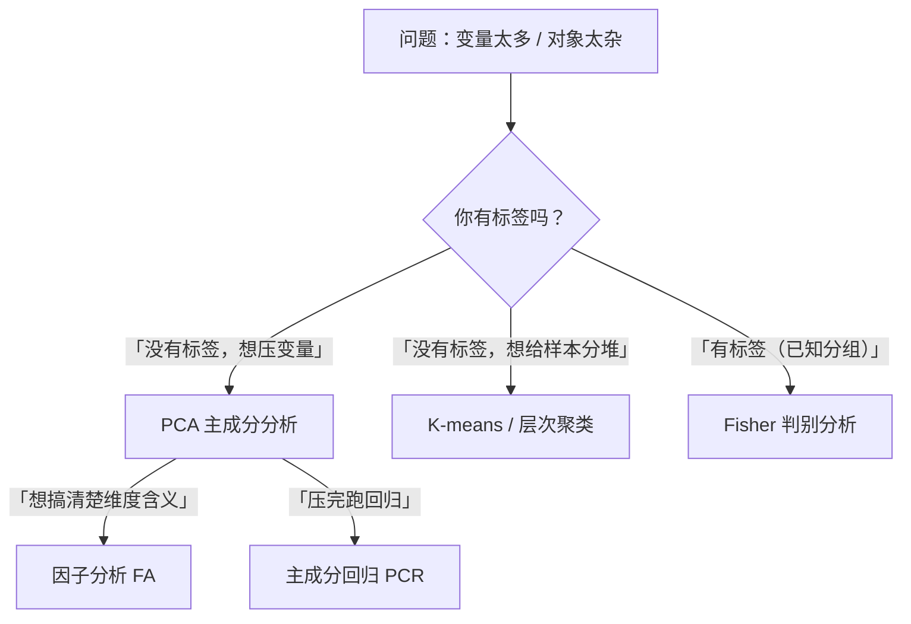

# 00 第 08 章总结：降维与分类四种方法对比

## 一、本章核心知识地图

---

## 二、四种方法对比总表

| 方法 | 操作对象 | 核心目标 | 有没有因变量 | 输出 | 典型场景 |
|------|---------|---------|-------------|------|---------|
| **[[02_主成分分析PCA|PCA]]** | 变量（p维 → k维） | 找方差最大方向 | 无 | 主成分得分、载荷 | 25个经济指标压成3个综合指标 |
| **[[03_因子分析|因子分析]]** | 变量 | 找潜在因子 | 无（探索性） | 因子载荷、[[KP03_因子得分|因子得分]] | 问卷20题背后有3个潜变量 |
| **[[04_聚类分析|聚类分析]]** | 样本（n个） | 类内相似、类间差异大 | 无（无监督） | 每个样本属于哪类 | 1000个消费者分5类 |
| **[[05_判别分析|判别分析]]** | 样本 | 找两类之间的分界线 | 有（已知分组） | 判别函数、新样本分类 | ST公司 vs 正常公司预警 |

---

## 三、关键公式速查

| 方法 | 核心公式 | 一句话理解 |
|------|---------|-----------|
| PCA | $\Sigma \mathbf{a} = \lambda \mathbf{a}$ | 对协方差矩阵做特征值分解 |
| 因子分析 | $X_j = \sum a_{ji}F_i + \varepsilon_j$ | 指标 = 公共因子加权 + 独有噪音 |
| K-means | $\min \sum_{k}\sum_{i\in C_k}\|x_i - \mu_k\|^2$ | 最小化类内距离平方和 |
| Fisher 判别 | $\mathbf{w} \propto S_w^{-1}(\bar{X}_1 - \bar{X}_2)$ | 类间差异除以类内差异最大 |

---

## 四、[[01_方法选择决策树|方法选择决策树]]

**拿到一个题目，先问三个问题：**

1. **你是要处理"变量太多"还是"样本太杂"？**
   - 变量太多 → PCA / 因子分析；
   - 样本太杂 → 聚类 / 判别。

2. **你知道每类是谁吗？**
   - 知道（有标签）→ 判别分析；
   - 不知道（无标签）→ 聚类分析。

3. **你是想"压完就跑回归"，还是想"搞清楚维度结构"？**
   - 压完就跑回归 → PCA；
   - 搞清楚维度结构 → 因子分析（旋转后解释）。

---

## 五、常见论文套路

### 套路一：区域经济发展水平评价
1. 找 25 个指标（GDP、消费、教育、医疗……）；
2. 跑 KMO 检验（> 0.6 才适合）；
3. 因子分析提取 3 个公共因子；
4. 给因子命名："经济水平""公共服务""创新能力"；
5. 算因子得分，加权综合排名。

### 套路二：消费者市场细分
1. 1000 个消费者问卷数据；
2. K-means 聚类，用肘部法则定 K=4；
3. 解释 4 类消费者画像；
4. 对每类做差异化营销建议。

### 套路三：财务困境预警
1. 500 家公司，ST 50 家 / 正常 450 家；
2. 用 Fisher 判别 + Logit 回归双重验证；
3. 回判准确率 > 80%；
4. 输出"新公司预警模型"。

---

## 六、自测题（复习用）

**选择题**：
1. 你有 30 个经济指标，跑回归发现 VIF 很高，你应该先？
   - A. 换个因变量
   - B. 跑 PCA 压维度
   - C. 删除一半指标

2. K-means 聚类时，K 值怎么定？
   - A. 随便定
   - B. 肘部法则
   - C. 看导师喜好

3. 因子分析和 PCA 的核心区别是？
   - A. 因子分析更快
   - B. 因子分析多了特殊因子假设和旋转
   - C. 没区别

**简答题**：
4. 为什么 PCA 之前一定要[[KP11_标准化_ZScore|标准化]]？
5. Fisher 判别的两个核心前提假设是什么？
6. 聚类分析和判别分析的根本区别是什么？

**答案**：
1. B（PCA 压维度去共线性）
2. B（肘部法则/轮廓系数）
3. B
4. 因为不同变量量纲差太远（GDP万亿 vs 百分比），不标准化方差大的变量会主导主成分。
5. 每类服从[[KP03_多元正态分布|多元正态分布]]；两类协方差矩阵相等。
6. 聚类是无监督（不知道有几类），判别是有监督（已知历史分组，找分界线）。

---

## 七、下一章预告

下一章进入 **09 时间序列**——处理"按时间排好的"数据（GDP、CPI、股价），解决"预测未来"的问题。

- 平稳性：为什么非平稳数据不能直接回归（伪回归）；
- ARIMA：Box-Jenkins 五步建模法；
- GARCH：金融数据的波动聚集；
- 协整：两个非平稳序列能不能一起回归。

---

## 本章方法答辩速查

1. **问：PCA、因子分析、聚类、判别这四个方法，一句话怎么区分？** 答：看"操作谁"和"有没有标签"。PCA 和因子分析压的是变量（p 维压成 k 维），都没有因变量；聚类和判别分的是样本。其中 PCA、因子分析、聚类都是无监督（不需要标签），判别是有监督（历史类别已知）。
2. **问：写论文时，什么时候该降维、什么时候该分类？** 答：先问"你头疼的是指标太多，还是样本太杂"。指标太多、回归 VIF 爆表 → 先 PCA/因子分析压维度；样本太杂想分组 → 聚类（不知道分几类）或判别（已知分组做预警）。实际论文经常组合用：先 PCA 压维度消除共线性，再拿主成分得分去做聚类或判别。
3. **问：无监督和有监督在答辩时怎么一句话讲清楚？** 答：无监督（PCA、因子分析、聚类）是"老师只给题不给答案"，方法自己在数据里找结构；有监督（判别、Logit）是"老师给了历年标准答案"，方法学一条规则去判断新卷子。判断标准就是：你的样本有没有事先标好的类别标签。

---

上一篇：[[05_判别分析]]
下一篇：[[../09_时间序列/README]]

---

## 📖 配套教材笔记
- [[../../教材笔记/04_多元统计/README|多元统计笔记总目录]]
- [[../../教材笔记/01_综合评价/09_主成分分析/00_章节总结|综合评价·PCA]]
- [[../../教材笔记/01_综合评价/10_因子分析/00_章节总结|综合评价·因子分析]]

## 📚 配套原书
- [[../../原文件/多元统计分析/何晓群_多元统计分析_全书|何晓群《多元统计分析》]]
