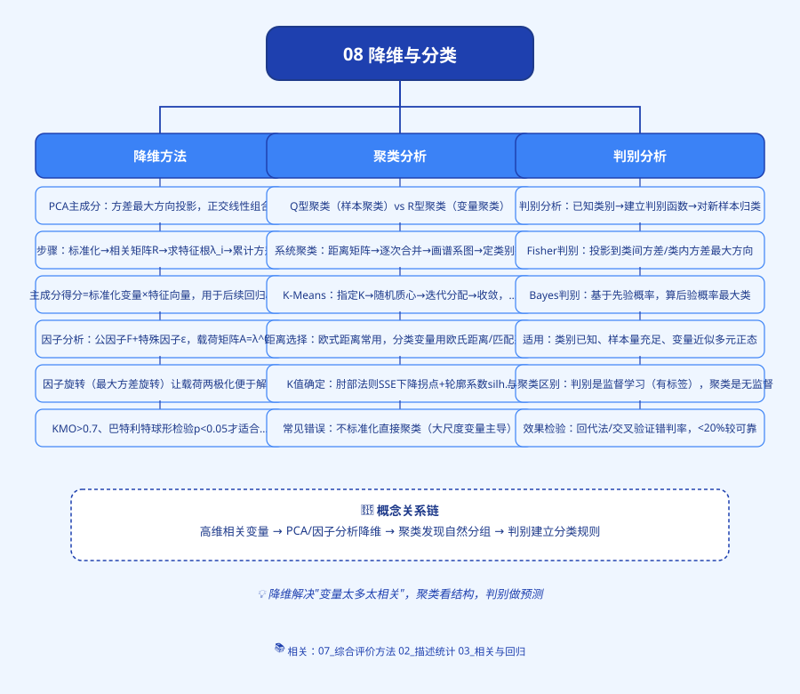
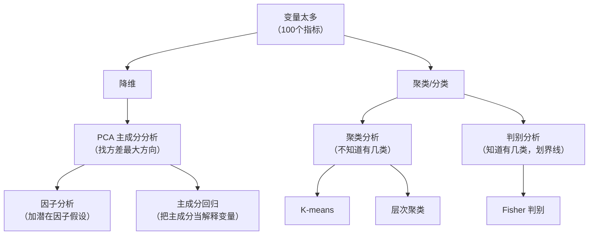

# 思维导图

---

# 08 降维与分类：变量太多、对象太杂时怎么办

> 这一章解决两个头疼的问题：
> 1. **变量太多**——你收集了 100 个指标，回归时互相打架（[[04_多重共线性|多重共线性]]），怎么办？
> 2. **对象太杂**——31 个省份、200 家公司，哪些长得像、哪些不一样？哪些该归成一类？

---

## 这一章你会学到什么

| 文件 | 解决什么问题 | 一句话 |
|------|-------------|--------|
| [01_为什么要降维](01_为什么要降维.md) | 100 个指标怎么压成 3 个？ | 给学生打分：德智体美劳压成总分 |
| [02_主成分分析PCA](02_主成分分析PCA.md) | 怎么压？ | 找方差最大的方向，把数据投影过去 |
| [03_因子分析](03_因子分析.md) | 压出来的东西能解释吗？ | [[02_主成分分析PCA|PCA]] 再加一层"潜在因子"假设 |
| [04_聚类分析](04_聚类分析.md) | 对象怎么分堆？ | K-means 把点分成 K 堆 |
| [05_判别分析](05_判别分析.md) | 已知分组，新样本归哪类？ | Fisher 找一条分界线 |
| [00_章节总结](00_章节总结.md) | 四种方法怎么选？ | 对比表 + 自测题 |

---

## 什么时候会用到这一章？

**场景一：毕业论文做"区域经济发展水平评价"**
你找了 31 个省份，每个省份测了 GDP、人均收入、消费、教育、医疗、科技……一共 20 个指标。
- 直接回归？20 个指标之间高度相关（GDP 高的省份，消费、教育通常也高），系数全乱。
- 用[[06_熵值法-TOPSIS组合|熵值法]]？可以，但熵值法是第 7 章的综合评价，这一章教你另一条路：**先 PCA 压成 3 个主成分，再排名**。

**场景二：做"上市公司财务困境预警"**
你有 500 家公司，其中 50 家已经 ST（被特别处理），450 家正常。你想知道：一家新公司，根据它的财务指标，会不会变成 ST？
- 这就是**[[05_判别分析|判别分析]]**——已知分组（ST/正常），找分界线。

**场景三：做"消费者市场细分"**
你有 1000 个消费者的问卷，问了 20 个问题（年龄、收入、偏好、频率……）。你想把消费者分成几类，每类推不同的产品。
- 这就是**[[04_聚类分析|聚类分析]]**——不知道有几类，让数据自己分堆。

---

## 方法关系图

---

## 前置知识

读这一章，你需要先会：
- 矩阵乘法（第 1 章基础数学）；
- 方差、协方差、[[01_相关系数|相关系数]]（第 2 章描述统计）；
- [[05_多元线性回归|多元线性回归]]（第 3 章）——PCA 输出的主成分，要放回回归里用。

---

下一篇：[[01_为什么要降维]]

---

## 延伸阅读
- 📚 教材笔记：[[../../教材笔记/04_多元统计/README|多元统计教材笔记]]
- ⭐ **核心交叉点（同一方法在两门课的不同视角）：**
  - PCA：[[../../教材笔记/04_多元统计/05_主成分分析/00_章节总结|多元统计·PCA（理论3KP）]] ↔ [[../../教材笔记/01_综合评价/09_主成分分析/00_章节总结|综合评价·PCA（应用13KP）]]
  - 因子分析：[[../../教材笔记/04_多元统计/06_因子分析/00_章节总结|多元统计·FA（理论4KP）]] ↔ [[../../教材笔记/01_综合评价/10_因子分析/00_章节总结|综合评价·FA（应用12KP）]]
  - 聚类：[[../../教材笔记/04_多元统计/03_聚类分析/00_章节总结|多元统计·聚类（理论）]] ↔ [[../../教材笔记/01_综合评价/06_常规综合评价方法/00_章节总结|综合评价·06常规方法（应用）]]
- 📖 原书：[[../../原文件/多元统计分析/何晓群_多元统计分析_全书|何晓群《多元统计分析》封面]]
- 📖 原书：[[../../原文件/多元统计分析/何晓群_多元统计分析_全书|何晓群教材·典型相关分析篇]]
- 📖 统计学原理配套：[[../../教材笔记/05_统计学原理/05_平均与变异指标/知识点/KP10_偏态与峰度|偏态与峰度]]、[[../../教材笔记/05_统计学原理/03_统计数据整理/知识点/KP02_统计分组|统计分组思想]]
  - 降维（PCA / 因子分析）的目的，是把一堆杂乱变量压成少数几个主成分后，**更好地看清数据在低维空间里的分布形态**——这本质上就是在做高维版本的[[../../教材笔记/05_统计学原理/03_统计数据整理/知识点/KP05_频数分布数列|KP05 频数分布数列]]：原来 100 个指标画不出直方图，压成 2 个主成分就能画散点图看分布了
- 📐 距离选择：[[../07_综合评价方法/10_距离方法选择指南|距离方法选择指南（聚类分析中的距离选择）]]
