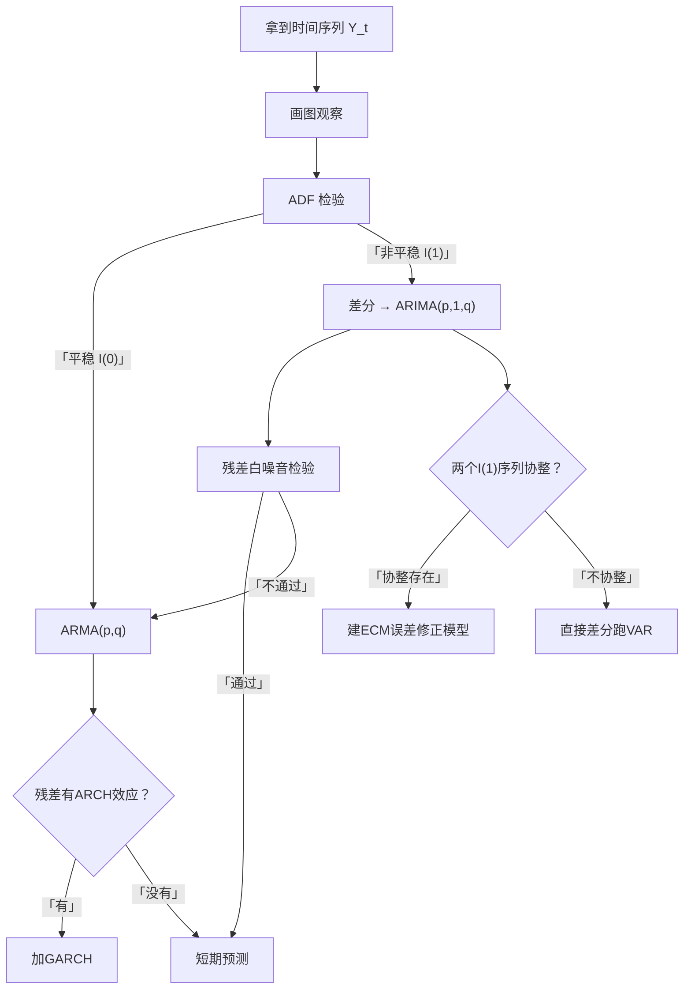

# 00 第 09 章总结：时间序列方法选择决策图 + 自测题

## 一、本章知识地图

---

## 二、八种方法对比总表

| 方法 | 解决什么问题 | 前提 | 输出 |
|------|-------------|------|------|
| **[[02_平稳性|平稳性]]** | 数据能不能直接用 | [[06_ADF单位根检验|ADF]] p < 0.05 | 平稳/非平稳 |
| **[[03_自相关与ACF|ACF]]/[[KP04_PACF偏自相关|PACF]]** | 序列的时间结构 | 序列平稳 | 截尾/拖尾 → 定p,q |
| **AR(p)** | 用过去Y预测现在 | 平稳 | 自回归系数 |
| **MA(q)** | 用过去冲击修正现在 | 平稳 | 移动平均系数 |
| **[[05_ARIMA建模流程|ARIMA]](p,d,q)** | 非平稳序列建模预测 | 差分后平稳 | 预测值 |
| **ADF检验** | 判断是否有单位根 | — | p值 |
| **协整/[[07_协整与误差修正ECM|ECM]]** | 两个非平稳序列的长期关系 | 同阶单整 | 长期β + 短期γ |
| **[[08_GARCH模型|GARCH]]** | 方差随时间变（波动聚集） | [[KP04_ARCH模型|ARCH]]效应存在 | 条件波动率 |

---

## 三、关键公式速查

| 方法 | 核心公式 |
|------|---------|
| 白噪音 | $Y_t = \varepsilon_t$，$\varepsilon_t \sim (0, \sigma^2)$ |
| AR(1) | $Y_t = c + \phi_1 Y_{t-1} + \varepsilon_t$，$|\phi_1|<1$ |
| MA(1) | $Y_t = \mu + \varepsilon_t + \theta_1 \varepsilon_{t-1}$ |
| ARMA(p,q) | $Y_t = c + \sum\phi_i Y_{t-i} + \varepsilon_t + \sum\theta_j \varepsilon_{t-j}$ |
| ARIMA(p,d,q) | ARMA 用差分 $d$ 次后的数据 |
| ADF 检验 | $\Delta Y_t = \delta Y_{t-1} + \sum\gamma_i \Delta Y_{t-i} + \varepsilon_t$，$H_0: \delta=0$ |
| GARCH(1,1) | $\sigma_t^2 = \omega + \alpha_1 \varepsilon_{t-1}^2 + \beta_1 \sigma_{t-1}^2$ |
| ECM | $\Delta Y_t = \alpha_1 \Delta X_t + \gamma e_{t-1}$，$\gamma<0$ |

---

## 三·补、传统时序指标速查（写论文算增速时用）

现代 ARIMA 管预测，但论文里描述数据、做现状分析时，绕不开传统的"水平—速度"指标。完整推导见 [[09_基期报告期与指数方法选择|09 基期/报告期与指数方法选择]]。

| 指标 | 公式 | 一句话 |
|------|------|--------|
| 发展速度 | $\dfrac{a_t}{a_0}$（定基）或 $\dfrac{a_t}{a_{t-1}}$（环比） | 报告期是基期的百分之几 |
| 增长速度 | $\dfrac{a_t - a_0}{a_0} = \text{发展速度} - 1$ | 发展速度减 100% |
| 增长量 | $a_t - a_0$（累计）或 $a_t - a_{t-1}$（逐期） | 绝对增量，带单位 |
| 平均增长量 | $\dfrac{a_n - a_0}{n}$ | 逐期增长量的算术平均 |
| 平均发展速度（几何平均法） | $\bar{x} = \sqrt[n]{\dfrac{a_n}{a_0}}$ | 关心期末水平，GDP/人口用这个 |
| 平均发展速度（方程法） | 解 $a_0\bar{x}+a_0\bar{x}^2+\cdots+a_0\bar{x}^n = \sum a_t$ | 关心累计总量，投资用这个 |
| 增长 1% 绝对值 | $\dfrac{a_0}{100}$ | 高速度未必高增量，必须同时看 |
| 首末折半法（时点数列） | $\bar{a} = \dfrac{a_1/2 + a_2 + \cdots + a_{n-1} + a_n/2}{n-1}$ | 时点数列序时平均 |

> ⚠️ **易错**：定基发展速度 = 各期环比发展速度**连乘**；但定基增长速度**不能**由环比增长速度连乘得到——必须先把增长速度还原成发展速度（+100%），连乘后再减 100%。

---

## 四、方法选择决策树

**拿到一个时序题目，按顺序问自己：**

1. **数据平稳吗？**
   - 不平稳 → 差分，建 ARIMA；
   - 平稳 → 直接 ARMA。

2. **残差有自相关吗？**
   - 有 → 加 AR 或 MA 项；
   - 没有 → 模型够了。

3. **残差的平方有自相关吗（ARCH 效应）？**
   - 有 → 加 GARCH；
   - 没有 → 普通 ARIMA 就行。

4. **有两个以上变量，它们长期有关系吗？**
   - 协整 → ECM；
   - 不协整 → 差分后跑 VAR。

---

## 五、常见论文套路

### 套路一：GDP 预测
1. 拿年度 GDP 数据 1978-2024；
2. ADF 检验：非平稳；
3. 取对数 + 差分：平稳；
4. 画 ACF/PACF：AR(1)；
5. 建 ARIMA(1,1,0)；
6. 残差白噪音检验通过；
7. 预测未来 3 年 GDP。

### 套路二：CPI 与货币供应量
1. CPI、M2 月度数据 20 年；
2. ADF：都是 I(1)；
3. 跑长期回归：CPI = α + β×M2 + e；
4. 检验残差：平稳 → 协整存在；
5. 建 ECM：短期效应 + 长期均衡；
6. 结论：M2 对 CPI 有长期传导，但时滞 6-12 个月。

### 套路三：股票波动率研究
1. 某股票日收益率 5 年；
2. 均值方程：收益率 = 常数（无自相关）；
3. ARCH-LM 检验：p < 0.05，有 ARCH 效应；
4. 建 GARCH(1,1)，t 分布；
5. 输出 $\alpha_1 + \beta_1 \approx 0.97$（波动持续性强）；
6. 预测未来 10 天的波动率，用于 VaR 计算。

---

## 六、自测题

**选择题**：
1. ADF 检验的原假设是？
   - A. 序列平稳
   - B. 序列有单位根（非平稳）
   - C. 序列没有自相关

2. 非平稳序列直接回归会导致？
   - A. 系数偏小
   - B. 伪回归（R² 很高但假显著）
   - C. 没问题

3. GARCH 模型主要预测什么？
   - A. 收益率均值
   - B. 波动率（方差）
   - C. 长期趋势

4. ECM 模型中误差修正系数 γ 应该是？
   - A. 正的
   - B. 负的
   - C. 零

**简答题**：
5. AR(p) 和 MA(q) 的 ACF/PACF 特征分别是什么？
6. Box-Jenkins 五步流程是什么？
7. 协整的定义是什么？两个 I(1) 序列满足什么条件才算协整？

**答案**：
1. B（原假设：有单位根 = 非平稳）
2. B（伪回归）
3. B（波动率）
4. B（负的，往均衡拉回）
5. AR(p)：ACF 拖尾，PACF 截尾在 p；MA(q)：ACF 截尾在 q，PACF 拖尾。
6. 平稳化 → 定阶 p,q → 估计参数 → 残差白噪音诊断 → 预测。
7. 两个 I(1) 序列的线性组合是 I(0)（平稳），则它们协整。长期均衡关系存在。

---

## 七、下一章预告

下一章进入 **10 论文写作全流程**——从选题、文献、数据、实证、稳健性到结论，把前面学的所有方法串成一篇完整的本科毕业论文。

---

## 八、本章方法答辩速查

1. **问：拿到一组时间序列，为什么第一步必须做平稳性检验？** 答：非平稳序列直接跑 OLS 会伪回归——两个八竿子打不着的变量（结婚数和养老院数）都随时间涨，也能跑出 R²=0.92、t=8.5。所以先跑 ADF：p < 0.05（平稳）直接建 ARMA；p > 0.05 必须先差分定 d，再画 ACF/PACF 定 p、q。
2. **问：什么时候用 ARIMA、什么时候用协整 ECM、什么时候用 GARCH？** 答：单变量预测均值走势→ARIMA；两个 I(1) 序列要研究长期关系→先对长期回归残差跑 ADF，残差平稳（协整存在）建 ECM，不协整才差分跑 VAR；均值方程残差的平方自相关（ARCH-LM p < 0.05）、要预测波动率→在均值方程上加 GARCH。
3. **问：模型建完凭什么算合格？** 答：残差必须是白噪音——残差 ACF/PACF 全部掉进置信带、Ljung-Box 检验 p > 0.05；GARCH 还要满足 α₁+β₁ < 1、方差平稳。残差不白噪音说明信息没榨干，退回定阶步加 p 或 q，不能硬着头皮预测。

---

上一篇：[[08_GARCH模型]]
下一篇：[[../10_论文写作全流程/README]]

---

## 📖 配套教材笔记

- [[../../教材笔记/03_时间序列/README|时序课程总览]]
- [[../../教材笔记/05_统计学原理/09_时间序列分析/00_章节总结|统计原理·第9章 时序分析]]

## 📚 配套原书

- [[../../原文件/时间序列分析/王燕_时间序列分析基于R_全书|王燕教材全书]]
