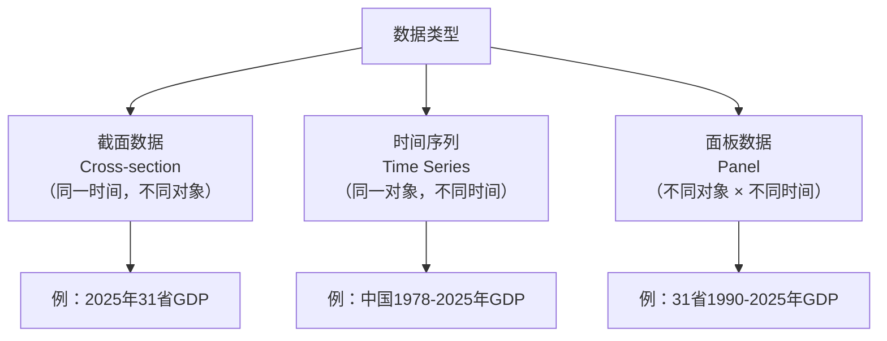

# 01 时间序列是什么？

## 一、为什么要学这个？

你每天都在接触时间序列，只是不知道它叫这个名字：

- 央行每个月公布的 CPI（居民消费价格指数）——1 月、2 月、3 月……排成一列；
- 你手机里的股价曲线——昨天涨、今天跌、明天又涨；
- 国家统计局每年公布的 GDP——1990 年、1991 年……一直到 2025 年。

**这些数据的共同点：按时间顺序排好，而且相邻的观测值之间有关系。**

和第 2 章讲的"截面数据"（某一年 31 个省份的 GDP）不一样，时间序列里**时间顺序很重要**。你不能把 2020 年的数据和 2000 年的数据随便换位置——换了就全乱了。

**为什么要单独拿一章讲？**
因为时间序列数据有个独特的问题：**同一个变量，自己跟自己滞后一期是相关的**。今年的 GDP 和去年的 GDP 高度相关——这在截面数据里不存在（张三的身高不会和李四的身高自动相关）。

这个"[[03_自相关|自相关]]"特性，让前面学的普通回归不能直接用。直接用会出"伪回归"（spurious regression）——两个毫不相关的时间序列，回归出来 R² 很高、t 值很大，但其实它们啥关系都没有，只是都随时间涨而已。

**不学会怎样？**
- 毕业论文做"广告投入对销量的影响"，直接拿 10 年数据跑 [[04_OLS截距和拟合值|OLS]]，结果显著得不得了；
- 答辩时导师问"你这数据平稳吗？做[[06_ADF单位根检验|单位根检验]]了吗？"，你一脸懵；
- 你的 R² = 0.98，看起来很漂亮，但其实是伪回归——广告和销量都在涨，不代表广告导致了销量涨。

---

## 二、是什么？（先打比方）

### 生活比喻：你每天的体重

你每天早上称一次体重，记下来：

| 日期 | 体重（kg） |
|------|-----------|
| 周一 | 65.0 |
| 周二 | 65.2 |
| 周三 | 65.1 |
| 周四 | 65.5 |
| 周五 | 65.3 |

这就是一个时间序列：**按时间顺序排好的一列观测值**。

**它和截面数据的区别**：
- 截面数据：你周一同时称 10 个朋友的体重——这是"某一个时间点上，不同对象的对比"；
- 时间序列：你连续 5 天称自己的体重——这是"同一个对象，随时间的变化"。

**时间序列的关键特点**：今天的体重和昨天的体重高度相关（你不可能一天从 65 变到 80）。这种"自己跟自己相关"，就是时间序列的核心。

### 严格定义

> **时间序列（Time Series）**：对同一现象，按时间先后顺序取得的一列观测值，记为
> $$Y_1, Y_2, \dots, Y_t, \dots, Y_T$$
> 其中下标 $t$ 表示时间（可以是年、季度、月、日，甚至秒）。

> 📖 **统计学原理对接**：一个时间数列由两个基本要素构成——**现象所属的时间**和**对应时间上的指标数值**，详见 [[../../教材笔记/05_统计学原理/09_时间序列分析/知识点/KP01_时间数列两个基本要素|KP01 时间数列两个基本要素]]。按指标性质，时间数列又分为[[../../教材笔记/05_统计学原理/09_时间序列分析/知识点/KP02_时期数列与时点数列|KP02 时期数列（可加，如各月 GDP）vs 时点数列（不可加，如月末人口）]]，这决定了你后面怎么算平均水平。编制时间数列时要保证各期指标**可比性**（口径、价格、行政区划一致），详见 [[../../教材笔记/05_统计学原理/09_时间序列分析/知识点/KP03_时间数列编制原则|KP03 时间数列编制原则]]。

**经济中常见的时间序列**：

| 类型 | 频率 | 例子 |
|------|------|------|
| 年度 | 1 年 1 个 | GDP、财政收入 |
| 季度 | 1 年 4 个 | 季度 GDP、失业率 |
| 月度 | 1 年 12 个 | CPI、PPI、货币供应量 M2 |
| 日度 | 1 年 ~250 个交易日 | 股价、汇率 |
| 高频 | 分钟/秒 | 逐笔交易数据 |

---

## 三、时间序列的四个组成部分

任何一个时间序列，都可以拆成 4 个部分：

$$Y_t = T_t + S_t + C_t + I_t$$

| 成分 | 符号 | 是什么 | 例子 |
|------|------|--------|------|
| 长期趋势 | $T_t$ | 长期往一个方向走 | GDP 逐年上涨 |
| 季节波动 | $S_t$ | 固定周期重复 | 羽绒服销量冬天高、夏天低 |
| 循环波动 | $C_t$ | 经济周期（繁荣/衰退） | 金融危机 2008、疫情 2020 |
| 随机扰动 | $I_t$ | 剩下的噪音 | 某天突发新闻导致股价波动 |

**画图理解**：
- 一条总体向上的斜线 = 趋势 $T_t$；
- 斜线周围上下波动的波浪 = 循环 $C_t$；
- 波浪里固定周期的峰谷 = 季节 $S_t$；
- 更细小的毛刺 = 随机扰动 $I_t$。

---

## 四、截面数据 vs 时间序列 vs 面板数据



**回归方法的区别**：
- 截面数据 → 普通 OLS（第 3 章）；
- 时间序列 → [[05_ARIMA建模流程|ARIMA]]、[[08_GARCH模型|GARCH]]（本章）；
- 面板数据 → [[06_固定效应FE|固定效应]]/[[07_随机效应RE与Hausman检验|随机效应]]（第 5 章）。

---

## 五、一个数字例子（迷你时间序列）

**数据**：中国某城市 2015-2024 年的社会消费品零售总额（单位：亿元）

| 年份 | 零售总额 $Y_t$ |
|------|------|
| 2015 | 100 |
| 2016 | 112 |
| 2017 | 125 |
| 2018 | 140 |
| 2019 | 158 |
| 2020 | 145 |
| 2021 | 170 |
| 2022 | 185 |
| 2023 | 205 |
| 2024 | 228 |

**观察**：
1. **长期趋势**：整体在涨（从 100 涨到 228）——这是 $T_t$；
2. **2020 年下跌**：疫情冲击——这是循环/随机扰动 $C_t + I_t$；
3. **相邻年份高度相关**：2016 年 112 和 2015 年 100 差 12，2017 年 125 和 2016 年 112 差 13——变化很平滑，不是从 100 跳到 200。

**问题**：2025 年大概多少？
- 简单外推：过去 5 年平均每年涨 20 左右 → 228 + 20 = 248；
- 但这是拍脑袋。下一节我们会学"[[02_平稳性|平稳性]]"，学完才知道这种外推什么时候靠谱、什么时候会骗人。

---

## 六、发展水平与序时平均数：传统统计怎么算"一段时期的平均水平"

> 📖 **统计学原理对接**：以下内容对应 [[../../教材笔记/05_统计学原理/09_时间序列分析/知识点/KP04_发展水平与序时平均数|KP04 发展水平与序时平均数]]、[[../../教材笔记/05_统计学原理/09_时间序列分析/知识点/KP05_时期数列序时平均数|KP05 时期数列序时平均]]、[[../../教材笔记/05_统计学原理/09_时间序列分析/知识点/KP07_首末折半法|KP07 首末折半法]]、[[../../教材笔记/05_统计学原理/09_时间序列分析/知识点/KP08_间隔不等时点序列序时平均数|KP08 间隔不等时点]]、[[../../教材笔记/05_统计学原理/09_时间序列分析/知识点/KP09_相对数与平均数时间数列序时平均数|KP09 相对数时间数列]]。

### 7.1 什么是发展水平？什么是序时平均数？

时间数列里每一期的那个具体数，叫**发展水平**，记为 $a_0, a_1, \dots, a_n$。比如 2015 年零售总额 100 亿、2016 年 112 亿……每个数都是一个发展水平。

但你经常被问："2015—2024 年这十年，**平均每年**零售总额是多少？"这就不能拿某一年的数当代表，得把十年的发展水平平均一下——这叫**序时平均数**（也叫动态平均数）。

**它和第 2 章讲的一般平均数有什么区别？**

| | 一般平均数（第 2 章） | 序时平均数（本章） |
|---|---|---|
| 平均的对象 | 同一时期、不同个体（一个班 50 人成绩） | 同一个体、不同时间（某企业 10 年利润） |
| 数据来源 | 变量数列 | 时间数列 |
| 静态/动态 | 静态，反映某一刻的一般水平 | 动态，反映一段时间的一般水平 |
| 例子 | 某班同学平均身高 | 某企业 2015—2024 年平均年产值 |

一句话：一般平均是"横切一片人求平均"，序时平均是"纵切一根时间轴求平均"。

### 7.2 序时平均数怎么算？取决于数列类型

关键区别：**时期数列各项可加，时点数列各项不可加**。所以公式不一样。

#### 情况一：时期数列（可加）——直接算术平均

$$\bar{a} = \frac{a_1 + a_2 + \cdots + a_n}{n}$$

**手算例子**：某企业 2015—2020 年利润分别为 4516、5734、6519、7316、7919、8464 万元。

$$\bar{a} = \frac{4516+5734+6519+7316+7919+8464}{6} = \frac{40468}{6} = 6745 \text{（万元）}$$

这是六年的平均年利润。

#### 情况二：连续登记时点数列（每天都有数据）——也直接算术平均

如果你每天都登记了库存、人口（连续时点），那就简单相加除以天数。但经济数据很少每天都记，所以更常见的是下面两种。

#### 情况三：间隔相等的时点数列（每月末/每季末登记一次）——首末折半法

**生活比喻**：你只在每个月**月初**拍了一张库存"照片"（1 月 1 日 20 万、2 月 1 日 16 万、3 月 1 日 18 万、4 月 1 日 17.6 万）。你想算第一季度（1—3 月）**平均每月**库存。

7 月份……不对，1 月份的库存从 20 慢慢变到 16，那 1 月份的**月平均库存**大概就是 (20+16)/2 = 18。同理 2 月 = (16+18)/2 = 17，3 月 = (18+17.6)/2 = 17.8。三个月再平均：(18+17+17.8)/3 = 17.6。

把这个两步合并，发现：**第一张照片和最后一张照片只算一半，中间各张照算**——这就是"首末折半法"。

$$\bar{a} = \frac{\frac{a_1}{2} + a_2 + a_3 + \cdots + a_{n-1} + \frac{a_n}{2}}{n - 1}$$

**手算验证**：$a_1=20, a_2=16, a_3=18, a_4=17.6, n=4$。

$$\bar{a} = \frac{20/2 + 16 + 18 + 17.6/2}{4-1} = \frac{10+16+18+8.8}{3} = \frac{52.8}{3} = 17.6 \text{（万元）}$$

> **为什么分母是 $n-1$ 不是 $n$？** 4 张月初照片（1/1、2/1、3/1、4/1）只覆盖了 1、2、3 三个月，所以分母是 3 = 4−1。**这是考试最爱挖坑的地方**：时点数列 $n$ 个数据点，分母一定是 $n-1$；时期数列 $n$ 个时期，分母是 $n$。

**口诀：首末折半、中间照算、分母是 $n-1$。**

#### 情况四：间隔不等的时点数列——加权首末折半

如果时点不是每隔一个月出现一次，而是"1 月 1 日、4 月 1 日、7 月 1 日、11 月 1 日、12 月 31 日"——间隔分别是 3、3、4、2 个月。这时候每段时间的长度不一样，**那段时间对应的平均水平要按它持续的月数加权**。

$$\bar{a} = \frac{\frac{a_1+a_2}{2}f_1 + \frac{a_2+a_3}{2}f_2 + \cdots + \frac{a_{n-1}+a_n}{2}f_{n-1}}{\sum f_i}$$

**手算例子**：某镇人口——1/1：14.35 万、4/1：15.20 万、7/1：16.10 万、11/1：17.50 万、12/31：18.77 万。

| 时段 | 月数 $f_i$ | 段平均 $(a_i+a_{i+1})/2$ | 贡献（段平均×月数） |
|---|---|---|---|
| 1—3 月 | 3 | (14.35+15.20)/2 = 14.775 | 44.325 |
| 4—6 月 | 3 | (15.20+16.10)/2 = 15.65 | 46.95 |
| 7—10 月 | 4 | (16.10+17.50)/2 = 16.80 | 67.20 |
| 11—12 月 | 2 | (17.50+18.77)/2 = 18.135 | 36.27 |

$$\bar{a} = \frac{44.325+46.95+67.20+36.27}{3+3+4+2} = \frac{194.745}{12} = 16.23 \text{（万人）}$$

#### 情况五：相对数/平均数时间数列——分子分母分别平均再相除

第三产业比重、失业率、人均 GDP 这种"比值型"数列，**不能直接把每年的比重加起来除以年数**——因为每年比重的分母都不一样。

$$\bar{c} = \frac{\bar{a}}{\bar{b}}$$

其中 $\bar{a}$ 是分子数列的序时平均，$\bar{b}$ 是分母数列的序时平均。

**反例**：第 1 年三产产值 100 / GDP 500 = 20%；第 2 年三产产值 300 / GDP 1000 = 30%。
- ❌ 直接平均：(20%+30%)/2 = 25%
- ✅ 正确做法：(100+300)/(500+1000) = 400/1500 = 26.67%

两年结果不同，因为第 2 年的 GDP（分母）权重更大。直接平均比重相当于给两年相同权重，是错的。

### 7.3 五种情况一张表总结

| 数列类型 | 数据特点 | 序时平均公式 | 分母 |
|---|---|---|---|
| 时期数列 | 各月 GDP、销售额（可加） | 简单算术平均 | $n$ |
| 连续时点数列 | 每天都登记 | 简单算术平均 | $n$ |
| 间隔相等时点 | 每月末/季末登记 | **首末折半法** | $n-1$ |
| 间隔不等时点 | 1/1、4/1、7/1 不规则 | **加权首末折半** | $\sum f_i$ |
| 相对数/平均数数列 | 比重、人均值 | 分子平均÷分母平均 | — |

> 这部分传统统计的内容，在论文里主要出现在"描述性统计"部分（"十一五期间平均年 GDP 为……"）。它和后面 [[05_ARIMA建模流程|ARIMA]] 的关系是：**序时平均是用手算方式把趋势 $T_t$ 平滑出来的最朴素方法**，现代时序用差分和 ARIMA 替代了它，但考试和描述统计部分仍然考。

---

## 七、什么时候用时间序列方法？

- 你有同一对象、跨时间的数据（比如中国 30 年 GDP）；
- 你想**预测未来**（明年 GDP 多少）；
- 你想研究**两个变量的动态关系**（货币供应量变化后，CPI 过几个月才反应）；
- 你想研究**波动**（股价什么时候暴涨暴跌）。

---

## 八、易错点

1. **把截面数据当时序数据**：你有 31 个省 2024 年的 GDP，这是截面数据，不是时间序列。时间序列必须是"同一个对象、不同时间"。
2. **不画图直接跑模型**：拿到时序数据第一件事是画折线图，看趋势、看季节、看异常值。不画图等于闭眼开车。
3. **把两个非平稳序列直接回归**：这是下一节要讲的"伪回归"，是时序论文最常见的错误。
4. **数据频率混了**：你有年度 GDP 和月度 CPI，不能直接放一起回归。要统一频率（比如把月度 CPI 加总成年度）。
5. **样本期太短**：10 年的年度数据只有 10 个观测，跑 ARIMA 根本不够。至少要 30 个以上。

---

## 九、Python 代码（画时序图）

```python
import pandas as pd
import matplotlib.pyplot as plt

# 构造上面的零售总额数据
years = list(range(2015, 2025))
retail = [100, 112, 125, 140, 158, 145, 170, 185, 205, 228]

# 画时序图
plt.figure(figsize=(10, 5))
plt.plot(years, retail, 'o-', linewidth=2, markersize=8)
plt.xlabel('年份')
plt.ylabel('社会消费品零售总额（亿元）')
plt.title('某城市 2015-2024 年零售总额时间序列')
plt.grid(alpha=0.3)
# 标出疫情
plt.annotate('疫情冲击', xy=(2020, 145), xytext=(2018, 120),
             arrowprops=dict(arrowstyle='->'))
plt.savefig('timeseries_demo.png', dpi=150)
plt.show()
```

**输出怎么读**：
- 整体向上 = 长期趋势；
- 2020 年那个坑 = 随机/循环冲击；
- 相邻点连线平滑 = 自相关强。

---

## 十、时间序列 vs 截面数据回归的区别

| | 截面回归 | 时间序列回归 |
|---|---------|-------------|
| 数据结构 | N 个对象，1 个时间 | 1 个对象，T 个时间 |
| 关键假设 | 随机抽样、独立 | 序列相关（相邻观测有关） |
| 核心问题 | 异方差、内生性 | 非平稳、伪回归 |
| 典型方法 | OLS、IV、固定效应 | ARIMA、GARCH、协整 |
| 样本量 | N（几百几千都行） | T（至少 30 才有意义） |

---

## 十一、为什么不用别的方法？

- **为什么不直接拿时间序列跑 OLS？** OLS 的前提是观测值相互独立，但时间序列相邻观测自相关（今年 GDP 和去年 GDP 高度相关），t 值、R² 全失真，跑出来就是"结婚数对养老院数 R²=0.92"那种伪回归。
- **为什么不用面板固定效应 FE？** FE 需要 N 个截面个体（31 个省）在多期上的变化；你手上只有"中国"这一个对象跨 30 年，没有第二个个体可比，根本估计不出个体固定效应。
- **为什么不直接拍脑袋线性外推？** 非平稳序列的均值本身在漂移，过去 5 年每年涨 20 不代表明年还涨（2020 年疫情直接拐头）；而且年度数据只有 10 个观测时，连 ARIMA 的参数都估不准，时序样本至少要 30 个观测才有意义。

## 十二、答辩常问（直接背）

1. **问：时间序列和截面数据的根本区别是什么？** 答：截面数据是同一时间点上 N 个不同对象（2024 年 31 个省的 GDP），观测之间独立抽样；时间序列是同一个对象跨 T 个时间点（中国 1978-2024 年 GDP），相邻观测自相关。所以截面用 OLS，时序要先过平稳性这关。
2. **问：为什么说直接对 10 年 GDP 跑 OLS 是伪回归？** 答：OLS 假设解释变量和误差项平稳、独立；GDP 逐年漂移且自相关，R² 再高也只是因为两个变量都随时间涨。判断标准是：找两个八竿子打不着的变量（医生人数和啤酒销量）一起涨，回归照样 R²≈0.9——这就是假显著。
3. **问：时间序列样本量多少才算够？** 答：年度数据至少 30 个观测（T>30）才谈得上建模；月度、日度数据天然点多（一年 12 个月度、约 250 个交易日）。只有 10 年年度数据时，ARIMA 参数估计的标准误很大，预测不可信。

## 十三、速记卡

> **时间序列 = 同一对象按时间顺序排好的一列观测值。**
> 四大成分：趋势 $T_t$ + 季节 $S_t$ + 循环 $C_t$ + 随机 $I_t$。
> 核心特点：相邻观测值自相关——今年和去年有关系。
> 最大的坑：非平稳数据直接回归 = 伪回归（下一节讲）。
> 拿到数据先画图！先画图！先画图！

---

## 💡 经济学视角：宏观经济学研究的 GDP、CPI、股价，全是时间序列

**这个方法是为了解决什么经济学问题？**
翻开任何一本宏观经济学教材，你会发现 GDP、CPI、失业率、利率、货币供应量、股价指数——几乎所有核心变量都是按"年/季/月"排出来的一串数字。它们和截面数据（同一时点上 31 个省的 GDP）最大的不同：**前后观测值之间是有关系的**，今年的 GDP 高，明年往往也低不了。把这种"时间上的前后依赖"单独拎出来研究，就是时间序列分析。

**经济学里哪些经典模型本质上就是时间序列？**
国民经济核算体系（SNA）按季度发布 GDP、CPI、PPI，这就是官方时间序列。宏观经济学的增长理论、周期理论、货币理论，全部建立在时间序列数据之上——不理解时间序列，就读不懂宏观数据发布。

**举个实证论文的例子：**
《中国经济周期波动的测度》收集 1978—2023 年季度 GDP 同比增速，画时间序列图后能清晰看到：1998 亚洲金融危机、2008 次贷危机、2020 疫情冲击三个深坑，以及 2010 年后增速换挡的趋势——这就是时间序列最朴素也最有力的用法：先画图，再说话。

**📚 配套经济学笔记：**
- [[../../教材笔记/06_西方经济学/09_宏观经济基本指标/知识点/KP01_GDP的含义与核算|原KP·GDP的含义与核算]]
- [[../../教材笔记/06_西方经济学/09_宏观经济基本指标/知识点/KP03_CPI消费价格指数|原KP·CPI消费价格指数]]

---

下一篇：[[02_平稳性]]

---

## 📖 配套教材笔记

- [[../../教材笔记/03_时间序列/01_时序分析简介/00_章节总结|时序课程·第1章 简介]]
- [[../../教材笔记/05_统计学原理/09_时间序列分析/知识点/KP01_时间数列两个基本要素|统计原理·KP01 时间数列要素]]
- [[../../教材笔记/05_统计学原理/09_时间序列分析/知识点/KP04_发展水平与序时平均数|统计原理·KP04 发展水平与序时平均]]
- [[../../教材笔记/05_统计学原理/09_时间序列分析/知识点/KP07_首末折半法|统计原理·KP07 首末折半法]]
- [[../../教材笔记/05_统计学原理/09_时间序列分析/知识点/KP09_相对数与平均数时间数列序时平均数|统计原理·KP09 相对数时间数列]]

## 📚 配套原书

- [[../../原文件/时间序列分析/王燕_时间序列分析基于R_全书|王燕教材·第1章 简介]]
