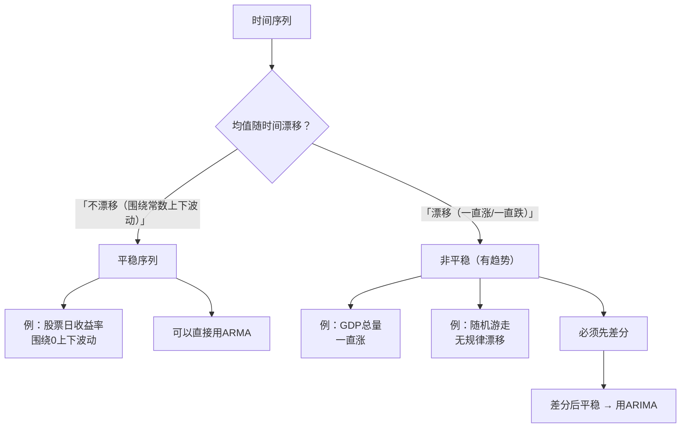
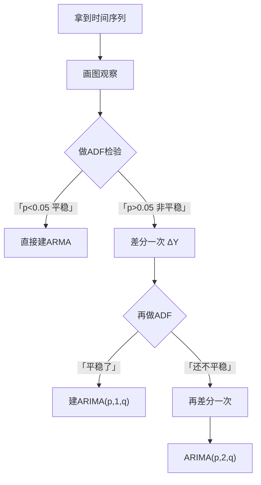

# 02 平稳性：为什么非平稳数据不能直接回归

## 一、为什么要学这个？

先看一个著名的"伪回归"（spurious regression）例子：

你拿中国 1990-2020 年的两个数据：
- 变量 $X$：某地结婚登记数量；
- 变量 $Y$：某地养老院数量。

你跑 [[04_OLS截距和拟合值|OLS]]：
$$Y_t = \alpha + \beta X_t + \varepsilon_t$$

结果出来你吓一跳：
- $\beta$ 的 t 值 = 8.5，p < 0.001，显著得不得了；
- $R^2 = 0.92$，拟合好到爆炸；
- 回归方程说：每多 100 对结婚，养老院多盖 5 家。

**这是什么鬼结论？结婚的人越多，养老院越多？八竿子打不着。**

但数据就是显示强相关。原因是：**这 30 年，结婚数在涨，养老院数也在涨**。它们都随时间增长，所以画在图上两条线一起往上走，[[01_相关系数|相关系数]]自然很高。但这不代表它们有因果关系——把"医生人数"和"啤酒销量"放一起回归，也会得到 R²=0.9 的结果，因为它们都在涨。

**这就是伪回归**：两个非平稳的时间序列直接回归，表面上显著，实际上什么关系都没有。

**平稳性**这个概念，就是用来识别这种骗局的。如果数据不平稳，你就不能直接跑 OLS，得先处理（差分）。

**不学会怎样？**
- 论文里把 GDP 和货币供应量直接回归，R² 很高，导师一眼看穿："你这是伪回归，做[[06_ADF单位根检验|单位根检验]]了吗？"
- 不知道为什么要差分，照着教程 `diff()` 操作，但不理解原理。

---

## 二、是什么？（先打比方）

### 生活比喻：泳池里的浮标

想象你在一个泳池里放了一个浮标。

**平稳的情况**：
- 浮标在一个固定位置上下波动；
- 早上看它在中心偏左，中午看它还在中心偏左附近，下午看它还是中心偏左附近；
- 它的**平均位置不变**，**波动幅度不变**。

这就是**平稳时间序列**：均值不随时间变，方差也不随时间变。

**非平稳的情况**：
- 浮标被水流冲着，越漂越远；
- 早上在起点，中午漂到池中央，下午快到对岸了；
- 它的**平均位置在变**（一直在移动）；
- 或者它刚开始小幅波动，后来浪越来越大，**波动幅度也在变**。

这就是**非平稳时间序列**：均值或方差随时间漂移。

### 严格定义

> **严平稳（strictly stationary）**：时间序列的联合分布，不随时间平移而改变。
> 意思是：取任意一段和取另一段，它们的概率分布完全一样。

> **宽平稳（weakly stationary，实际用这个）**：满足三个条件：
> 1. 均值 $\mu_t = E(Y_t) = \mu$，是常数，不随 $t$ 变；
> 2. 方差 $\text{Var}(Y_t) = \sigma^2$，是常数，不随 $t$ 变；
> 3. 自协方差 $\gamma_k = \text{Cov}(Y_t, Y_{t-k})$ 只和滞后阶数 $k$ 有关，和时间 $t$ 无关。

**人话翻译**：
- 均值不变：序列在一个固定水平上下波动，不会越漂越远；
- 方差不变：波动幅度不随时间变大变小；
- 自协方差只和间隔有关："今年和去年的关系" = "明年和后年的关系"，不随时间漂移。

---

## 三、为什么平稳这么重要？

### 原因一：平稳了，才能用过去预测未来

如果你的序列均值一直在变（比如 GDP 每年涨 10%），那过去的均值对未来没有参考价值。

只有平稳序列，它的"平均位置"和"波动幅度"是稳定的，你才能用过去的规律预测未来。

### 原因二：不平稳会导致伪回归

第 1 章讲的 OLS 假设里有一条：解释变量和误差项是平稳的、独立的。如果你的变量本身就在随时间漂移，OLS 的 t 检验、R² 全都是假的。

### 原因三：经典时序模型（[[04_ARMA模型|ARMA]]）只适用于平稳序列

ARMA 模型的前提就是"序列是平稳的"。非平稳的序列要先差分，变成平稳的，才能用 ARMA。

---

## 四、平稳 vs 非平稳（散点图对比）



**随机游走（random walk）**：最典型的非平稳序列。
$$Y_t = Y_{t-1} + \varepsilon_t$$
意思是：今天的值 = 昨天的值 + 一个随机冲击。
它没有固定均值，今天在 100，明天可能 98，后天可能 103——永远在漂移，没有回归到某个均值的趋势。

股价（不考虑趋势时）就很接近随机游走。

---

## 五、一个数字例子

**例子一：平稳序列**

```
Y_t = 0.5 + ε_t  （ε_t 是均值为0、方差为1的噪音）
```

| t | Y_t |
|---|-----|
| 1 | 0.3 |
| 2 | 0.6 |
| 3 | 0.4 |
| 4 | 0.7 |
| 5 | 0.5 |

均值大概在 0.5 附近晃，没有越漂越远。**这是平稳的。**

**例子二：非平稳序列（有趋势）**

```
Y_t = 0.5 + 0.1 t + ε_t
```

| t | Y_t |
|---|-----|
| 1 | 0.6 |
| 2 | 0.7 |
| 3 | 0.9 |
| 4 | 1.0 |
| 5 | 1.1 |

均值随 $t$ 线性增长。**这是非平稳的。**

**例子三：非平稳（随机游走）**

```
Y_t = Y_{t-1} + ε_t，Y_0 = 0
```

| t | Y_t |
|---|-----|
| 1 | 0.2 |
| 2 | 0.1 |
| 3 | 0.4 |
| 4 | 0.3 |
| 5 | 0.6 |

它不往一个固定方向走，但也不会回归到某个常数。**这也是非平稳的（叫单位根过程）。**

**怎么处理？**：
- 有线性趋势 → 先减去趋势（detrend）；
- 随机游走（单位根）→ 先差分：$\Delta Y_t = Y_t - Y_{t-1} = \varepsilon_t$，差分后变成白噪音，平稳了。

> 📖 **统计学原理对接**：这里说的"减去趋势"，就是传统统计里的[[../../教材笔记/05_统计学原理/09_时间序列分析/知识点/KP15_长期趋势测定|KP15 长期趋势测定]]——用移动平均法或最小二乘法把长期趋势 $T_t$ 从 $Y_t$ 里单独拎出来，剩下的残差（围绕趋势的波动）才是平稳的。现代时序里把"趋势"分成两种：**确定性趋势**（$Y_t = a + bt + \varepsilon_t$，减 $bt$ 就平稳，叫趋势平稳）和**随机性趋势**（$Y_t = Y_{t-1} + \varepsilon_t$，必须差分，叫单位根过程）。前者 detrend 就行，后者必须差分——这就是下一节 [[06_ADF单位根检验|ADF 检验]] 要判别的东西。

---

## 六、严平稳 vs 宽平稳：为什么我们只需要宽平稳？

> 📖 对应 [[../../教材笔记/03_时间序列/02_平稳时间序列/知识点/KP01_严平稳与宽平稳|时序·KP01 严平稳与宽平稳]]。

### 7.1 两者到底差在哪？

| | 严平稳 | 宽平稳（二阶平稳） |
|---|---|---|
| 管什么 | **整个概率分布**不随时间平移 | **均值、方差、自协方差**不随时间平移 |
| 条件严格度 | 极严 | 宽松 |
| 实践可验证吗 | 几乎不可验证（每个时刻只有一个观测值） | 可以（画图 + ADF 检验） |
| 关系 | 有二阶矩的严平稳 → 一定宽平稳 | 宽平稳 → 不一定严平稳 |
| 特例 | — | **正态序列中两者等价** |

### 7.2 为什么实际只要求宽平稳？

**一句话：因为 ARMA 模型只需要二阶矩（均值、方差、自相关），不需要完整分布。**

更深层的原因：时间序列在每个时刻 $t$ 只有**一个**观测值，你根本没法估计"每个时刻的概率分布长什么样"。严平稳要求"任意一段的联合分布完全一样"，这个条件在实践中**无法检验**——你拿 100 个数据点，没法画出 100 个分布来比较。

宽平稳聪明得多：它只要求三个东西不变——均值是常数、方差是常数、自协方差只跟间隔有关。这三个东西用样本均值、样本方差、样本自相关系数就能估计。

**所以本科阶段说"平稳"，一律指宽平稳。** 这也是为什么前面给你三个条件（均值常数、方差常数、自协方差只看间隔），而不是让你去证明联合分布不变。

---

## 七、白噪声：最"没用"但最重要的平稳序列

> 📖 对应 [[../../教材笔记/03_时间序列/02_平稳时间序列/知识点/KP03_白噪声与纯随机性检验|时序·KP03 白噪声与纯随机性检验]]。

### 8.1 什么是白噪声？

**白噪声（White Noise）** 是最简单的平稳序列：

$$Y_t = \varepsilon_t, \quad \varepsilon_t \sim WN(0, \sigma^2)$$

三个条件：
1. **均值为 0**；
2. **方差为常数 $\sigma^2$**；
3. **任意两期不相关**：$\text{Cov}(Y_t, Y_{t-k}) = 0$，对所有 $k \neq 0$。

**生活比喻**：白噪声就像抛硬币的结果——前一次抛什么完全不影响后一次。如果你的销量序列是白噪声，那历史销量对预测未来销量**毫无帮助**，不如直接猜均值。

### 8.2 为什么白噪声序列不用建模？

因为它没有任何"记忆"——ACF 在所有滞后阶都不显著（全部掉进置信带）。你建 ARMA 模型，建出来的系数全是 0，预测值就是均值，跟直接报均值没区别。

**所以拿到一个平稳序列，第一件事不是建模，而是先做白噪声检验**：
- 如果是白噪声 → 停止，不值得建模；
- 如果不是白噪声（有自相关）→ 才进入 ARMA 建模流程。

### 8.3 怎么检验？Ljung-Box 检验

**原假设 $H_0$**：序列是白噪声（$\rho_1 = \rho_2 = \dots = \rho_m = 0$）。
**备择 $H_1$**：至少有某阶自相关非零（不是白噪声）。

**判断**：
- p > 0.05 → 不拒绝 $H_0$ → **是白噪声** → 停止分析；
- p < 0.05 → 拒绝 $H_0$ → **不是白噪声** → 有信息可挖，值得建模。

> **口诀：p 大没戏，p 小有戏。**（p 大 = 白噪声 = 没戏；p 小 = 有自相关 = 有戏可挖）

**Python 代码**：
```python
from statsmodels.stats.diagnostic import acorr_ljungbox
# Y 是你的平稳序列
result = acorr_ljungbox(Y, lags=[6, 12], return_df=True)
print(result)
# lb_pvalue > 0.05 → 白噪声，不用建模
# lb_pvalue < 0.05 → 非白噪声，可以建模
```

**注意**：模型建好后，还要对**残差**再做一次白噪声检验——残差是白噪声 = 模型把信息榨干了，模型合格；残差不是白噪声 = 还有自相关没被捕捉，要回去加阶数。

---

## 八、VAR 模型：多个变量互相影响的时序

> 📖 对应 [[../../教材笔记/02_计量经济学/12_平稳时间序列/知识点/KP01_VAR模型|计量·KP01 VAR 模型]]。

### 9.1 一句话直觉

前面讲的 ARMA 是**单个变量**自己跟自己玩。但现实里 GDP、利率、CPI 是**互相影响**的——利率变了影响 GDP，GDP 变了又影响 CPI。

**VAR（Vector Autoregression，向量自回归）** 就是把 AR 推广到多个变量：**每个变量都是自己和别人滞后值的函数**，不区分谁是解释谁是被解释，大家互相影响。

### 9.2 双变量 VAR(1) 长什么样

$$y_{1t} = \beta_{10} + \beta_{11} y_{1,t-1} + \beta_{12} y_{2,t-1} + \varepsilon_{1t}$$
$$y_{2t} = \beta_{20} + \beta_{21} y_{1,t-1} + \beta_{22} y_{2,t-1} + \varepsilon_{2t}$$

- 每个方程的解释变量都一样（所有变量的滞后值）；
- 滞后值相对于当期扰动是外生的，所以可以用 OLS 逐方程估计；
- 本科论文里用得不多，但答辩时导师可能问"为什么不用 VAR"——你要知道它是什么。

### 9.3 VAR 的两个核心产出

1. **脉冲响应函数（IRF）**：给 $y_1$ 一个冲击，$y_2$ 在未来各期怎么变？比如"利率上升 1 个百分点，GDP 增长率在 2 个季度后下降 0.5%，一年后消失"。
2. **格兰杰因果检验**：$x$ 的滞后值能不能帮助预测 $y$？
   > **重要警告：格兰杰因果 ≠ 真正的因果！** 公鸡打鸣格兰杰引起太阳升起（打鸣在先、太阳在后），但显然不是公鸡导致太阳升起。格兰杰因果只是"时间先后上的预测力"。

### 9.4 什么时候用 VAR？

- 你有两个以上**平稳**的变量，且它们之间有双向影响；
- 你想研究"一个政策冲击传导多久、影响多大"（脉冲响应）；
- 本科论文一般用 [[04_ARMA模型|ARMA]] 或 [[07_协整与误差修正ECM|协整ECM]] 就够了，VAR 是进阶内容。

---

## 九、前提假设（宽平稳三条件）

1. **均值为常数**，不随时间变化；
2. **方差为常数**，不随时间变化（没有[[02_异方差|异方差]]）；
3. **自协方差只和滞后阶数有关**，和时间起点无关。

实际中我们很少严格验证这三个，而是用**单位根检验**（下下节的 [[06_ADF单位根检验|ADF]] 检验）来判断"是不是平稳"。

---

## 十、易错点

1. **把"有趋势"当"非平稳"的唯一情况**：很多人以为只有一直涨的序列才非平稳。错！随机游走（没趋势但漂移）也是非平稳的，而且更常见。
2. **看图觉得平稳就直接用**：肉眼看不出来的。必须用 ADF 检验，p < 0.05 才能说平稳。
3. **差分过度**：差 1 次不平稳再差 1 次，但差太多会损失信息。经济数据一般差 1 次就够（叫 I(1)）。
4. **季节趋势不处理**：月度数据有季节性（羽绒服冬天卖得多），光差分不够，还要做季节差分 $\Delta_{12} Y_t$。
5. **把收益率和价格搞混**：股票价格通常是非平稳的（随机游走），但**收益率**（价格的对数差分）通常是平稳的。做金融时序，一般用收益率而不是价格。

---

## 十一、Python 代码（平稳 vs 非平稳画图对比）

```python
import numpy as np
import matplotlib.pyplot as plt

np.random.seed(42)
n = 100

# 1. 平稳序列：白噪音 + 固定均值
stationary = 0.5 + np.random.normal(0, 1, n)

# 2. 非平稳：有线性趋势
t = np.arange(n)
trending = 0.5 + 0.1 * t + np.random.normal(0, 1, n)

# 3. 非平稳：随机游走（单位根）
random_walk = np.zeros(n)
for i in range(1, n):
    random_walk[i] = random_walk[i-1] + np.random.normal(0, 1)

# 画三个图对比
fig, axes = plt.subplots(3, 1, figsize=(10, 8))
axes[0].plot(stationary); axes[0].set_title('平稳：围绕常数波动')
axes[1].plot(trending); axes[1].set_title('非平稳：有线性趋势')
axes[2].plot(random_walk); axes[2].set_title('非平稳：随机游走（单位根）')
plt.tight_layout()
plt.savefig('stationary_vs_not.png', dpi=150)
plt.show()
```

**输出怎么读**：
- 上图：在一条水平带里上下晃 → 平稳；
- 中图：整体斜着往上跑 → 非平稳（趋势）；
- 下图：没方向但越漂越远 → 非平稳（单位根）。

---

## 十二、平稳性在模型链里的位置



---

## 十三、为什么不用别的方法？

- **为什么不直接对非平稳序列跑 OLS？** 非平稳序列均值随时间漂移，两个都在涨的变量回归出 R²=0.92、t=8.5 全是假的——这就是伪回归；不先平稳化，后面所有系数都不能解释。
- **为什么不用"减去趋势"代替差分？** detrend 只能去掉确定性的线性趋势，对随机游走（单位根过程）无效；单位根序列必须差分 $\Delta Y_t = Y_t - Y_{t-1}$ 才能变平稳。GDP、价格这类含单位根的数据，减完趋势残差还是[[03_自相关|自相关]]。
- **为什么不画图肉眼判断平不平稳？** 随机游走的图看着也像在一个区间里晃，肉眼分不清"趋势平稳"和"单位根漂移"；必须 ADF 检验 p < 0.05 才能下平稳结论。

## 十四、答辩常问（直接背）

1. **问：平稳性的三个条件是什么？** 答：宽平稳=均值是常数（不随 t 变）、方差是常数（不随 t 变）、自协方差只和滞后阶 k 有关而和时间起点无关。直觉就是泳池浮标：一直在固定位置附近晃，而不是被水流冲走。
2. **问：股价研究为什么用收益率而不用价格？** 答：股价接近随机游走（单位根、非平稳），直接对价格建模必伪回归；对数差分后的收益率围绕 0 上下波动，通常是平稳的，所以金融时序一律用收益率建模。
3. **问：差分次数 d 怎么定？** 答：原序列 ADF p > 0.05（非平稳）→ 差一次再检，p < 0.05 则 d=1，即 I(1)，绝大多数经济数据差一次就够；差两次（d=2）会损失信息，一般不超过 2。

## 十五、速记卡

> **平稳 = 均值不变 + 方差不变 + 自协方差只和滞后有关。**
> 非平稳直接回归 = 伪回归（R² 很高但啥关系没有）。
> 非平稳两种：有趋势（减去趋势）、单位根（差分）。
> 判断平稳性：不能靠肉眼，要 ADF 检验（下下节讲）。
> 股票价格非平稳，收益率（对数差分）通常平稳。

---

## 💡 经济学视角：为什么宏观经济数据一直在涨，不能直接拿来回归？

**这个方法是为了解决什么经济学问题？**
把 1990—2023 年中国 GDP 和 1990—2023 年某某医院的门诊人数两条曲线画出来，你会发现它们都在涨——回归一下 R² 高达 0.95！但这俩八竿子打不着。原因：两个变量都在随时间"单边往上走"（非平稳），它们的相关性不是经济关系，而是"共同趋势"造成的假象。这就是"伪回归"。所以宏观数据上机之前，第一步必须先检验平稳性。

**经济学里哪些经典模型必须先解决这个问题？**
增长核算方程告诉我们：GDP 随时间增长是常态（人口增长、技术进步、资本积累），所以 GDP、消费、收入这类宏观变量天生非平稳。直接拿它们回归，得到的"系数"毫无意义，必须先差分或找协整关系。

**举个实证论文的例子：**
《中国能源消费与经济增长关系》直接回归得到"GDP 每涨 1%，能源消费涨 0.7%"，看似显著；但 ADF 检验发现两个序列都是一阶单整，做协整检验后才发现它们确实有长期均衡关系——不做平稳性检验，这个结论就是空中楼阁。

**📚 配套经济学笔记：**
- [[../../教材笔记/06_西方经济学/16_经济增长/知识点/KP01_增长核算方程|原KP·增长核算方程]]

---

下一篇：[[03_自相关与ACF]]

---

## 📖 配套教材笔记

- [[../../教材笔记/03_时间序列/02_平稳时间序列/00_章节总结|时序课程·第2章 平稳]]
- [[../../教材笔记/03_时间序列/02_平稳时间序列/知识点/KP01_严平稳与宽平稳|时序·KP01 严平稳与宽平稳]]
- [[../../教材笔记/03_时间序列/02_平稳时间序列/知识点/KP03_白噪声与纯随机性检验|时序·KP03 白噪声与纯随机检验]]
- [[../../教材笔记/02_计量经济学/12_平稳时间序列/00_章节总结|计量·第12章 平稳时序]]
- [[../../教材笔记/02_计量经济学/12_平稳时间序列/知识点/KP01_VAR模型|计量·KP01 VAR模型]]

## 📚 配套原书

- [[../../原文件/时间序列分析/王燕_时间序列分析基于R_全书|王燕教材·第2章 预处理]]
