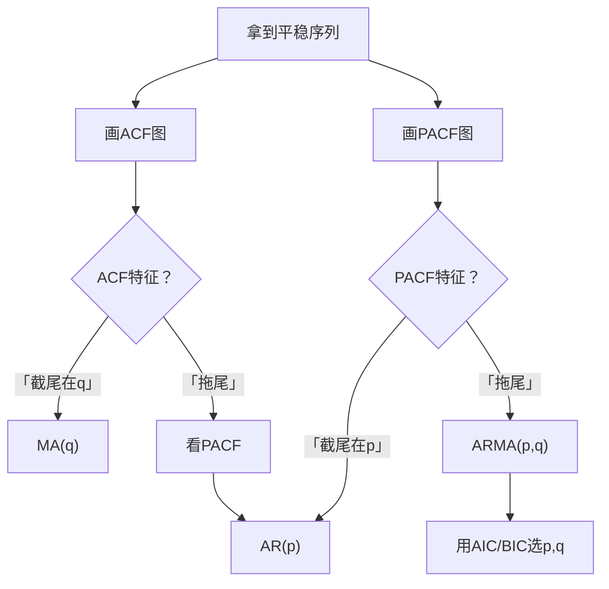

# 03 自相关与 ACF：怎么读时序图的"时间结构"

<div style="text-align:right;margin:10px 0;"><a href="../../exam.html" target="_blank" style="display:inline-block;padding:6px 16px;background:#2563eb;color:#fff;border-radius:6px;text-decoration:none;font-size:14px;">📝 开始做题</a></div>


## 一、为什么要学这个？

上一节我们知道"时间序列相邻观测值是相关的"。但到底有多相关？是滞后 1 期相关，还是滞后 5 期相关？是自己跟自己相关，还是过去的冲击在影响现在？

**自相关函数（ACF）** 和 **[[KP04_PACF偏自相关|偏自相关]]函数（[[KP04_PACF偏自相关|PACF]]）** 就是回答这个问题的工具。

它们画出来是两张图（ACF 图、PACF 图），你在论文里建 [[05_ARIMA建模流程|ARIMA]] 模型时，**必须**根据这两张图来定阶（决定 p 和 q 是多少）。

**不学会怎样？**
- 写论文时不知道怎么选 ARIMA 的 p 和 q，拍脑袋 p=2, q=1；
- 导师问"你怎么定的阶"，你答"试了几个，这个 AIC 最小"——这是被动的，你得能从 ACF/PACF 图上看出理论上 p 该是多少。

---

## 二、是什么？（先打比方）

### 生活比喻：今天的你和昨天的你

你问："我今天的体重，和我**昨天**的体重，有多大关系？"
- 答案：非常大（0.9 的相关）——因为体重不会一天大变。

"我今天的体重，和我**前天**的体重，有多大关系？"
- 直接看：相关也很高（0.85）。
- 但这里面有"间接影响"：前天 → 昨天 → 今天。前天通过昨天影响了今天。

**ACF（自相关函数）** 告诉你：今天的体重和第 k 天前的体重的**总相关**（直接 + 间接）。

**PACF（偏自相关函数）** 告诉你：去掉中间各期的影响后，今天的体重和第 k 天前的体重的**直接相关**。

### 严格定义

> **自[[01_相关系数|相关系数]] $\rho_k$**：
> $$\rho_k = \frac{\text{Cov}(Y_t, Y_{t-k})}{\text{Var}(Y_t)}$$
> 意思是：相隔 $k$ 期的两个观测值之间的相关系数（-1 到 1 之间）。

> **ACF 图**：把 $\rho_0, \rho_1, \rho_2, \dots$ 画成柱状图。横轴是滞后阶数 k，纵轴是自相关系数。

> **PACF（偏自相关）**：在控制了 $Y_{t-1}, Y_{t-2}, \dots, Y_{t-k+1}$ 的影响后，$Y_t$ 和 $Y_{t-k}$ 之间的纯相关。

---

## 三、怎么读 ACF / PACF 图？

**核心判断规则**：

| ACF 图表现 | PACF 图表现 | 模型类型 |
|-----------|-----------|---------|
| **拖尾**（缓慢衰减） | **截尾**（滞后 p 后突然变 0） | AR(p) |
| **截尾**（滞后 q 后突然变 0） | **拖尾**（缓慢衰减） | MA(q) |
| 两者都拖尾 | 两者都拖尾 | [[04_ARMA模型|ARMA]](p,q) |

**什么叫"截尾"和"拖尾"？**

- **截尾**：滞后到某一阶之后，柱子突然全部掉进两条虚线（95% 置信带）以内，变成不显著。比如 PACF 在滞后 1 阶后就不显著了 → 截尾在 p=1；
- **拖尾**：柱子按指数或正弦波的形式缓慢衰减，一直到滞后很多期还有显著的。比如 ACF 从 0.9、0.8、0.7……慢慢衰减 → 拖尾。

**怎么看图**：
- 图上每条竖线 = 一个滞后阶的自相关系数；
- 两条虚线 = 95% 置信区间；
- 竖线**超出虚线** = 这一阶显著相关；
- 竖线**掉进虚线里** = 不显著（可以认为是 0）。

---

## 四、数字例子（手算 ACF）

**数据**：一个平稳序列，5 个观测：

| t | 1 | 2 | 3 | 4 | 5 |
|---|---|---|---|---|---|
| $Y_t$ | 2 | 4 | 3 | 5 | 6 |

**第一步：算均值**

$$\bar{Y} = (2+4+3+5+6)/5 = 20/5 = 4$$

**第二步：算方差（滞后 0 期的自协方差）**

$$\gamma_0 = \frac{1}{5}\sum_{t=1}^{5}(Y_t - \bar{Y})^2$$

$$= \frac{1}{5}[(2-4)^2 + (4-4)^2 + (3-4)^2 + (5-4)^2 + (6-4)^2]$$

$$= \frac{1}{5}[4 + 0 + 1 + 1 + 4] = \frac{10}{5} = 2$$

**第三步：算滞后 1 期的自协方差**

$$\gamma_1 = \frac{1}{5}\sum_{t=2}^{5}(Y_t - \bar{Y})(Y_{t-1} - \bar{Y})$$

（注意：滞后 1 期只能从 t=2 开始算）

$$= \frac{1}{5}[(4-4)(2-4) + (3-4)(4-4) + (5-4)(3-4) + (6-4)(5-4)]$$

$$= \frac{1}{5}[0 + 0 + (1)(-1) + (2)(1)] = \frac{1}{5}[0 + 0 -1 + 2] = \frac{1}{5} = 0.2$$

**第四步：算滞后 1 期的自相关系数**

$$\rho_1 = \frac{\gamma_1}{\gamma_0} = \frac{0.2}{2} = 0.1$$

意思：这个序列滞后 1 期的自相关是 0.1，很弱。

**第五步：同理算 $\rho_2$**

$$\gamma_2 = \frac{1}{5}[(3-4)(2-4) + (5-4)(4-4) + (6-4)(3-4)]$$

$$= \frac{1}{5}[(-1)(-2) + 0 + (2)(-1)] = \frac{1}{5}[2 + 0 - 2] = 0$$

$$\rho_2 = 0/2 = 0$$

滞后 2 期完全不相关。

**结论**：这个序列的 ACF 在滞后 1 期后就接近 0 → MA(1) 的特征。

---

## 五、典型模型的 ACF/PACF 特征（必背）

| 模型 | ACF | PACF |
|------|-----|------|
| **AR(p)** | 拖尾（指数衰减） | 截尾在 p |
| **MA(q)** | 截尾在 q | 拖尾（指数衰减） |
| **ARMA(p,q)** | 拖尾 | 拖尾 |
| **白噪音** | 全部截尾（所有滞后都不显著） | 全部截尾 |

**白噪音**：所有 ACF、PACF 都不显著 = 序列没有可预测的结构，已经是平稳噪音了，不需要再建模型。

### 5.1 PACF 怎么手算？（Yule-Walker 前两步）

> 📖 对应 [[../../教材笔记/03_时间序列/02_平稳时间序列/知识点/KP04_PACF偏自相关|时序·KP04 PACF 偏自相关]]。

1 阶偏自相关恒等于 1 阶自相关（因为没有中间变量要扣除）：

$$\phi_{11} = \rho_1$$

2 阶偏自相关要扣除 1 阶的间接影响：

$$\phi_{22} = \frac{\rho_2 - \rho_1^2}{1 - \rho_1^2}$$

**手算例子**：已知某序列 $\rho_1 = 0.6, \rho_2 = 0.4$。

- $\phi_{11} = 0.6$（昨天对今天的直接影响很强）；
- $\phi_{22} = (0.4 - 0.6^2)/(1 - 0.6^2) = (0.4 - 0.36)/(1 - 0.36) = 0.04/0.64 = 0.0625$。

**解释**：前天对今天的 ACF = 0.4（看着不小），但扣除"前天→昨天→今天"这条间接通道后，净影响只有 0.06——几乎为零。这就是 AR(1) 的典型特征：PACF 在 1 阶后截尾。

### 5.2 ACF 图上的虚线到底是什么？

图上两条虚线不是随便画的，它是**白噪声假设下的 95% 置信带**：

$$\text{置信带} \approx \pm \frac{2}{\sqrt{T}}$$

其中 $T$ 是样本量。意思是：如果序列真是白噪声，样本自相关系数 $\hat\rho_k$ 有 95% 的概率落在这条带里。

- 样本 $T=100$ 时，置信带约 $\pm 0.2$；
- 样本 $T=400$ 时，置信带约 $\pm 0.1$（更窄，更容易识别显著相关）。

**竖线超出虚线** = 该阶自相关显著非零，序列有自相关结构；**竖线掉进虚线** = 不显著，可以认为是 0。

### 5.3 读图实战：三张图对应三种模型

| 你看到的图 | 结论 | 下一步 |
|---|---|---|
| ACF 从 0.8 缓慢衰减、PACF 1 阶后掉进虚线 | AR(1) | 建 AR(1) 模型 |
| ACF 1 阶后突然掉进虚线、PACF 缓慢衰减 | MA(1) | 建 MA(1) 模型 |
| ACF 和 PACF 都缓慢衰减 | ARMA(p,q) | 用 AIC/BIC 在 (1,1)、(2,1)、(1,2) 里选 |
| 所有竖线都在虚线里 | 白噪声 | 停止，不用建模 |

---

## 六、前提假设

1. 序列是**平稳的**（非平稳序列的 ACF 会缓慢衰减，看着像拖尾，其实是假的）；
2. 样本量足够大（T > 50，否则 ACF 估计不准）；
3. 没有严重的异常值。

---

## 七、易错点

1. **非平稳序列直接看 ACF**：非平稳序列的 ACF 会很慢地衰减，看起来像"拖尾"，你就会误判为 ARMA。**必须先做 [[06_ADF单位根检验|ADF]] 检验，确认平稳了再看 ACF/PACF。**
2. **把截尾的位置数错**：PACF 滞后 1、2 显著，滞后 3 不显著 → AR(2)，不是 AR(3)。截尾在"最后一个显著的阶数"。
3. **季节数据不看季节 ACF**：月度数据要额外看滞后 12、24 阶的 ACF（季节性）。
4. **ACF 和 PACF 都拖尾就放弃**：ARMA 的定阶更复杂，要用 AIC/BIC 信息准则，不是光看图。
5. **置信带看错**：95% 置信带大概是 $\pm 2/\sqrt{T}$。样本 T 小的时候，置信带宽，很多不显著；T 大的时候，很窄。

---

## 八、Python 代码（画 ACF/PACF 图）

```python
import numpy as np
import matplotlib.pyplot as plt
from statsmodels.graphics.tsaplots import plot_acf, plot_pacf
from statsmodels.tsa.stattools import acf, pacf

# 用上面的 5 个观测（实际中要用更长的序列，这里演示）
np.random.seed(42)
# 生成一个 AR(1) 过程：Y_t = 0.7 Y_{t-1} + ε_t
n = 100
Y = np.zeros(n)
for t in range(1, n):
    Y[t] = 0.7 * Y[t-1] + np.random.normal(0, 1)

# 画 ACF 和 PACF
fig, axes = plt.subplots(1, 2, figsize=(12, 4))
plot_acf(Y, lags=20, ax=axes[0])
plot_pacf(Y, lags=20, ax=axes[1])
axes[0].set_title('ACF（自相关图）')
axes[1].set_title('PACF（偏自相关图）')
plt.savefig('acf_pacf.png', dpi=150)
plt.show()

# 数字输出
print("前10阶自相关系数：", acf(Y, nlags=10))
print("前10阶偏自相关系数：", pacf(Y, nlags=10))
```

**输出怎么读**（这个 AR(1) 例子）：
- ACF：从 0.7 开始缓慢衰减（拖尾）；
- PACF：滞后 1 阶显著（0.7），滞后 2 阶后突然掉进置信带（截尾在 1）；
- 结论：PACF 截尾在 1 → **AR(1)**。这和我们生成数据时的系数 0.7 完全对上。

---

## 九、ACF/PACF 和模型定阶的关系



---

## 十、为什么不用别的方法？

- **为什么不让软件按 AIC 最小盲选 p、q？** 两个都拖尾时 ARMA(p,q) 有无数组合 AIC 很接近，盲选出来的模型讲不出"为什么是这个阶数"的道理；ACF/PACF 图给出结构依据，AIC/BIC 只是在候选组合里比选，不能替代看图。
- **为什么不对非平稳序列直接画 ACF 定阶？** 非平稳序列的 ACF 会极慢地衰减，看着像拖尾，会把你误判成高阶 ARMA；必须先 ADF 检验 p < 0.05 确认平稳，再看图定阶。
- **为什么不只截尾位置目测一下就定稿？** 图上滞后 2 显著、滞后 3 正好压在置信带上时，目测有歧义；要把 ACF/PACF 初判的两三个候选（如 (1,0)、(0,1)、(1,1)）都跑一遍，用 AIC/BIC 最小者定稿，图和信息准则互相印证。

## 十一、答辩常问（直接背）

1. **问：ACF 和 PACF 到底差在哪？** 答：ACF 是相隔 k 期的总相关（直接关系加中间各期传过去的间接关系）；PACF 是控制住中间各期之后剩下的纯直接相关。好比前天的体重通过昨天间接影响今天，算 PACF 时要把这条间接通道剥掉。
2. **问：怎么从图上判断是 AR 还是 MA？** 答：AR(p) 是 ACF 拖尾、PACF 截尾在 p；MA(q) 是 ACF 截尾在 q、PACF 拖尾；口诀"AR 看 PACF 截尾，MA 看 ACF 截尾"；两张图都拖尾就是 ARMA(p,q)。
3. **问：截尾和拖尾怎么认？** 答：截尾=滞后到某一阶后，柱子突然全部掉进 95% 置信带（约 ±2/√T）以内不再显著；拖尾=按指数缓慢衰减，很多阶仍超出虚线。所有阶都不显著=白噪音，序列没有可预测结构，不用建模。

## 十二、速记卡

> **ACF = 总自相关（直接 + 间接），PACF = 纯直接自相关。**
> 截尾：滞后到某阶后突然不显著；拖尾：缓慢衰减。
> 记忆口诀：**AR 看 PACF 截尾，MA 看 ACF 截尾**。
> 非平稳序列的 ACF 是假的，先 ADF 检验再看图。
> 全不显著 = 白噪音 = 不用建模。

---

## 💡 经济学视角：经济周期为什么有惯性？看自相关就懂了

**这个方法是为了解决什么经济学问题？**
今年 GDP 增速 5.2%，明年会是多少？没人能精确预测，但你敢拍胸脯说明年不会突然掉到 2%，也不会跳到 8%——它大概率就在 5% 上下。为什么？因为经济系统有"惯性"：企业今年扩的产能明年还在运转、消费者今年涨的工资明年还在花、银行今年放的贷款明年还要还。这种"今年的值和去年的值相关"就是自相关，画出来就是 ACF 图。

**经济学里哪些经典模型正好解释这个惯性？**
乘数—加速数模型就是经济周期惯性的理论版：投资增加 → 收入倍增 → 消费增加 → 又反过来刺激投资 → 一环扣一环，繁荣不会戛然而止，衰退也不会立刻反转。ACF 图上那根慢慢衰减的柱子，就是这种惯性的可视化。

**举个实证论文的例子：**
《中国 GDP 增长率的波动特征》画出 1992—2023 年季度增速的 ACF 图，发现滞后 1 期自相关系数 0.78、滞后 2 期 0.52、滞后 4 期 0.21——说明经济增长确实有强惯性，这也是政策制定者强调"逆周期调节"的统计依据。

**📚 配套经济学笔记：**
- [[../../教材笔记/06_西方经济学/13_失业通胀与经济周期/知识点/KP05_经济周期与乘数加速数|原KP·经济周期与乘数加速数]]

---

下一篇：[[04_ARMA模型]]

---

## 📖 配套教材笔记

- [[../../教材笔记/03_时间序列/02_平稳时间序列/知识点/KP02_自协方差与ACF|时序·KP02 ACF]]
- [[../../教材笔记/03_时间序列/02_平稳时间序列/知识点/KP04_PACF偏自相关|时序·KP04 PACF]]
- [[../../教材笔记/03_时间序列/02_平稳时间序列/知识点/KP03_白噪声与纯随机性检验|时序·KP03 白噪声检验]]

## 📚 配套原书

- [[../../原文件/时间序列分析/王燕_时间序列分析基于R_全书|王燕教材·2.2节 自相关图]]
