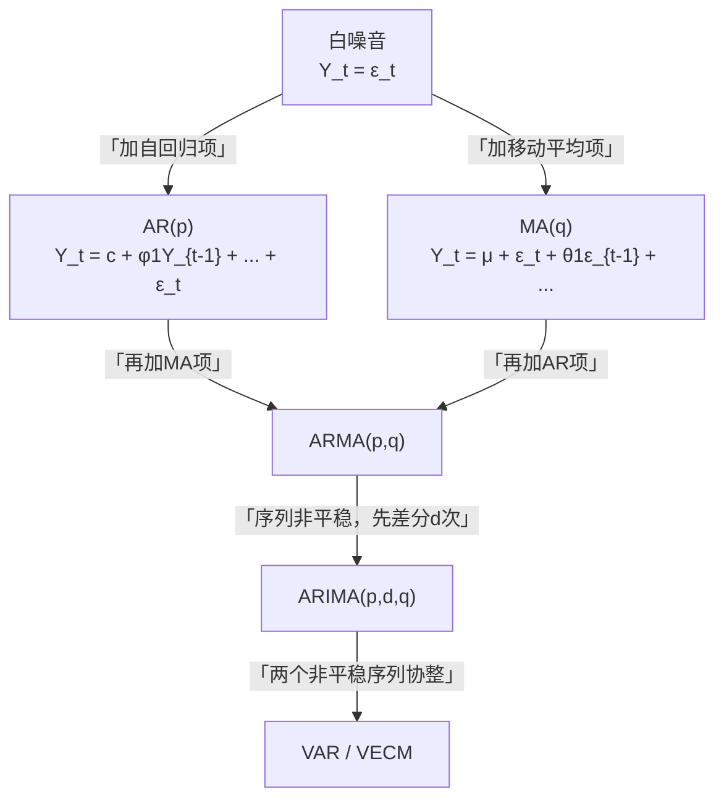

# 04 ARMA 模型：自回归 + 移动平均

<div style="text-align:right;margin:10px 0;"><a href="../../exam.html" target="_blank" style="display:inline-block;padding:6px 16px;background:#2563eb;color:#fff;border-radius:6px;text-decoration:none;font-size:14px;">📝 开始做题</a></div>


## 一、为什么要学这个？

你已经有一个平稳的时间序列了（比如股票日收益率、月度 CPI 同比增速），你想：
1. 用过去的值预测下一期；
2. 搞清楚这个序列是"自己跟自己相关"（AR），还是"过去的冲击在影响现在"（MA）。

**ARMA 模型**就是时间序列的标准回归方程。它把两种结构——自回归（AR）和移动平均（MA）——打包在一起。

**这是时间序列章节最核心的模型**。后面所有的 [[05_ARIMA建模流程|ARIMA]]、[[KP01_VAR模型|VAR]]、[[08_GARCH模型|GARCH]]，都是它的变体。

**不学会怎样？**
- 论文里写"用 ARIMA [[KP05_模型预测|模型预测]] GDP"，但你不知道 AR、MA 是什么，p、q 是什么意思；
- 看不懂 [[03_自相关与ACF|ACF]]/[[KP04_PACF偏自相关|PACF]] 图，定不了阶；
- Stata 命令 `arima` 跑出来一堆系数，不知道哪个是哪个。

---

## 二、是什么？（先打比方）

### 生活比喻：你的情绪

你今天的心情 $Y_t$ 由什么决定？

**两种力量**：
1. **惯性（AR 自回归）**：昨天心情好，今天通常也不错——$Y_t$ 受 $Y_{t-1}$ 影响；
2. **突发事件（MA 移动平均）**：今天被领导骂了（一个随机冲击 $\varepsilon_t$），这个坏情绪可能延续 1-2 天——今天的值受**过去的冲击**影响。

ARMA 模型就是把这两种力量都考虑进去：
$$Y_t = \text{惯性} + \text{过去的冲击} + \text{今天的新冲击}$$

### 严格定义

> **ARMA(p,q) 模型**：
> $$Y_t = c + \phi_1 Y_{t-1} + \phi_2 Y_{t-2} + \dots + \phi_p Y_{t-p} + \varepsilon_t + \theta_1 \varepsilon_{t-1} + \theta_2 \varepsilon_{t-2} + \dots + \theta_q \varepsilon_{t-q}$$

其中：
- **AR(p) 部分**：$\phi_1 Y_{t-1} + \dots + \phi_p Y_{t-p}$，用过去 $p$ 期的 $Y$ 本身解释现在；
- **MA(q) 部分**：$\theta_1 \varepsilon_{t-1} + \dots + \theta_q \varepsilon_{t-q}$，用过去 $q$ 期的随机冲击解释现在；
- $\varepsilon_t$：白噪音（均值为 0，方差固定，不相关）；
- $c$：常数项。

**特殊情况**：
- $q=0$：ARMA(p, 0) = **AR(p)**（纯自回归）；
- $p=0$：ARMA(0, q) = **MA(q)**（纯移动平均）；
- $p=q=0$：$Y_t = c + \varepsilon_t$ = 白噪音（没啥可预测的）。

---

## 三、公式怎么来的？

### AR(p) 的直觉

**AR(1)**：
$$Y_t = c + \phi_1 Y_{t-1} + \varepsilon_t$$

意思：今天的值 = 常数 + 昨天的值 × 系数 + 今天的新冲击。

**稳定性条件**：$|\phi_1| < 1$。
- 如果 $\phi_1 = 0.8$：今天受昨天 80% 的影响，但冲击会慢慢衰减（0.8, 0.64, 0.512...），序列平稳；
- 如果 $\phi_1 = 1.0$：今天完全等于昨天加冲击 = 随机游走，非平稳（这就是单位根）；
- 如果 $\phi_1 > 1.0$：冲击会放大，序列爆炸。

### MA(q) 的直觉

**MA(1)**：
$$Y_t = \mu + \varepsilon_t + \theta_1 \varepsilon_{t-1}$$

意思：今天的值 = 均值 + 今天的新冲击 + 昨天的冲击 × 系数。

**关键点**：MA(q) 里，冲击 $\varepsilon$ 只在 $q$ 期内起作用，超过 $q$ 期就完全没影响了。

比如 MA(1)：昨天的冲击 $\varepsilon_{t-1}$ 只影响今天和明天，后天就消失了。

---

## 四、符号表

| 符号 | 怎么读 | 是什么 |
|------|--------|--------|
| $p$ | "p" | AR 部分的滞后阶数 |
| $q$ | "q" | MA 部分的滞后阶数 |
| $\phi_i$ | "phi i" | AR 系数（过去 Y 对现在的影响） |
| $\theta_i$ | "theta i" | MA 系数（过去冲击对现在的影响） |
| $\varepsilon_t$ | "epsilon t" | 白噪音（今天的新冲击） |
| $c$ | "c" | 常数项（均值水平） |
| $Y_t$ | "Y t" | 时间序列在 t 期的值 |

---

## 五、一个数字例子（手算 AR(1)）

**模型**：$Y_t = 0.5 Y_{t-1} + \varepsilon_t$，其中 $\varepsilon_t$ 是均值为 0、方差为 1 的白噪音。

**初始**：$Y_0 = 0$。

**模拟 5 期**（假设随机冲击依次为 0.3, -0.2, 0.1, 0.4, -0.3）：

| t | $\varepsilon_t$ | 计算 | $Y_t$ |
|---|------|------|------|
| 1 | 0.3 | $0.5 \times 0 + 0.3$ | 0.30 |
| 2 | -0.2 | $0.5 \times 0.30 + (-0.2)$ | -0.05 |
| 3 | 0.1 | $0.5 \times (-0.05) + 0.1$ | 0.075 |
| 4 | 0.4 | $0.5 \times 0.075 + 0.4$ | 0.4375 |
| 5 | -0.3 | $0.5 \times 0.4375 + (-0.3)$ | -0.08125 |

**观察**：
- $Y_t$ 在 0 附近波动，没有越漂越远（因为 $|\phi_1|=0.5 < 1$，平稳）；
- 一个冲击的影响会慢慢衰减：t=4 那个 0.4 的冲击，到 t=5 只剩下 $0.5 \times 0.4 = 0.2$ 的影响。

---

## 六、AR 和 MA 的 ACF/PACF 长什么样？（看图识模型）

> 📖 对应 [[../../教材笔记/03_时间序列/03_ARMA模型/知识点/KP01_AR模型|时序·KP01 AR 模型]]、[[../../教材笔记/03_时间序列/03_ARMA模型/知识点/KP02_MA模型|时序·KP02 MA 模型]]。

### 6.1 AR(p) 的 ACF 和 PACF

**AR(1)** $Y_t = \phi_1 Y_{t-1} + \varepsilon_t$ 的 ACF 有个漂亮的公式：

$$\rho_k = \phi_1^k$$

- 如果 $\phi_1 = 0.7$：$\rho_1 = 0.7, \rho_2 = 0.49, \rho_3 = 0.343, \dots$ 指数衰减 → **ACF 拖尾**；
- PACF：$\phi_{11} = 0.7, \phi_{22} = 0, \phi_{33} = 0, \dots$ → **PACF 1 阶截尾**。

**直觉**：AR 模型的影响通过惯性无限传导（昨天→前天→大前天……），所以 ACF 永不精确为零（拖尾）；但"去掉中间各期后，第 $p+1$ 期对现在的直接影响"为零（PACF 截尾）。

### 6.2 MA(q) 的 ACF 和 PACF

**MA(1)** $Y_t = \varepsilon_t + \theta_1 \varepsilon_{t-1}$ 的 ACF：

$$\rho_1 = \frac{-\theta_1}{1+\theta_1^2}, \quad \rho_k = 0 \quad (k \ge 2)$$

→ **ACF 1 阶截尾**；PACF 拖尾。

**直觉**：MA 模型的冲击只影响 $q$ 期。超过 $q$ 期后，两期的序列值没有共同的冲击了，自相关精确为零。

**MA 模型有个特殊性质：永远平稳**。因为它就是白噪音的有限线性组合，不需要像 AR 那样满足 $|\phi| < 1$。但要满足**可逆性**（$|\theta| < 1$），否则同一个 ACF 会对应两个不同的 MA 模型（$\theta$ 和 $1/\theta$ 给出相同的 $\rho_1$）。

### 6.3 一张表记住

| | AR(p) | MA(q) | ARMA(p,q) |
|---|---|---|---|
| ACF | 拖尾（指数衰减） | **q 阶截尾** | 拖尾 |
| PACF | **p 阶截尾** | 拖尾（指数衰减） | 拖尾 |
| 平稳性 | 需 $|\phi|<1$ | **永远平稳** | 由 AR 部分决定 |
| 可逆性 | 自动满足 | 需 $|\theta|<1$ | 两边都要 |
| 影响持续 | 无限期（惯性传导） | 有限期（q 期后消失） | 两者都有 |

---

## 七、模型预测：预测值怎么收敛到均值？

> 📖 对应 [[../../教材笔记/03_时间序列/03_ARMA模型/知识点/KP05_模型预测|时序·KP05 模型预测]]。

### 7.1 AR(1) 多步预测的递推

已知 AR(1)：$Y_t = c + \phi_1 Y_{t-1} + \varepsilon_t$，均值 $\mu = c/(1-\phi_1)$。

**1 步预测**：$\hat{Y}_t(1) = c + \phi_1 Y_t$（用已知的 $Y_t$）。

**2 步预测**：$\hat{Y}_t(2) = c + \phi_1 \hat{Y}_t(1)$（用 1 步预测值代替）。

**$l$ 步预测**：$\hat{Y}_t(l) = \mu + \phi_1^l (Y_t - \mu)$。

**关键性质**：因为 $|\phi_1| < 1$，$\phi_1^l$ 随 $l$ 指数衰减到零，所以**预测值随步数增加逐渐收敛到均值 $\mu$**。

**手算例子**：$\phi_1 = 0.7$，均值 $\mu = 80$，今天 $Y_t = 90$。

| 预测步数 | 预测值 | 计算 |
|---|---|---|
| 明天 (l=1) | 87 | $80 + 0.7 \times (90-80) = 87$ |
| 后天 (l=2) | 84.9 | $80 + 0.7 \times (87-80) = 84.9$ |
| 大后天 (l=3) | 83.43 | $80 + 0.7 \times (84.9-80) = 83.43$ |
| 10 步后 | ≈ 80.06 | 几乎回到均值 |

### 7.2 为什么预测区间越远越宽？

预测 $l$ 步的误差方差是：

$$\text{Var}[e_t(l)] = (\text{常数} + \phi_1^2 + \phi_1^4 + \dots + \phi_1^{2(l-1)}) \sigma_\varepsilon^2$$

每多预测一步，就多叠一个未来新冲击的不确定性。所以：

- 1 步预测：区间窄（只含明天的未知冲击）；
- 10 步预测：区间宽（含未来 10 个冲击的累积不确定性）。

**这不是模型出错，而是"看得越远越没把握"的数学表达。** 所以 ARMA 只适合短期预测（1-5 步），预测 10 步以上区间宽到没有实际意义。

### 7.3 MA(q) 预测的特殊性

MA(q) 模型超过 $q$ 步后，预测值**直接等于均值**——因为所有已知冲击的影响在 $q$ 期后都消失了，更远的未来没有任何信息。这也是为什么 MA 模型只适合预测近期。

---

## 八、前提假设

1. **序列是平稳的**（ARMA 只能用于平稳序列）；
2. **$\varepsilon_t$ 是白噪音**：均值为 0、方差固定、无[[03_自相关|自相关]]；
3. **AR 部分满足平稳条件**：所有 $\phi_i$ 让特征方程的根在单位圆外；
4. **MA 部分满足可逆条件**：所有 $\theta_i$ 让 MA 可以表示成 AR 的形式（理论细节，用软件自动判断）。

---

## 九、易错点

1. **非平稳序列直接建 ARMA**：必须先 [[06_ADF单位根检验|ADF]] 检验，非平稳就差分。这是最常见错误。
2. **p、q 定得太大**：阶数越大参数越多，样本量小的话估计不准。经验法则：年度数据 p、q 不超过 2；月度数据不超过 3。
3. **不做残差检验**：模型跑完要检验残差是不是白噪音。如果残差还有自相关，说明模型没建够，要加阶数。
4. **把 AR 和 MA 搞混**：
   - AR = 用过去的 Y 预测现在的 Y；
   - MA = 用过去的"预测误差"修正现在。
5. **外推太远**：ARMA 适合短期预测（1-5 期）。预测 50 期以后，ARMA 会收敛到均值，跟你拍脑袋猜"均值"没区别。

---

## 十、Stata / Python 代码

```python
from statsmodels.tsa.arima.model import ARIMA
import numpy as np

# 假设 Y 是已经平稳的序列（一维数组）
# 以 AR(1) 为例（ARIMA(1,0,0) = AR(1)）
model = ARIMA(Y, order=(1, 0, 0))  # (p, d, q)
result = model.fit()

print(result.summary())
# 输出会给你：
# - AR 系数 phi1（应该接近 0.5，和我们生成的一样）
# - 常数项
# - 标准差
# - AIC、BIC 信息准则

# 预测未来 5 期
forecast = result.forecast(steps=5)
print("未来5期预测：", forecast)
```

Stata 版：
```stata
* 假设已经 set date，tsset
* AR(1) 模型
arima Y, ar(1)
* 预测
predict Y_hat, dynamic
```

---

## 十一、AR、MA、ARMA、ARIMA 的关系



**一句话记住**：
- AR = 过去的 $Y$ 影响现在；
- MA = 过去的 $\varepsilon$ 影响现在；
- ARMA = 两者都有；
- ARIMA = ARMA + 先差分。

---

## 十二、为什么不用别的方法？

- **为什么不只建纯 AR(p) 或纯 MA(q)？** 若 ACF、PACF 都拖尾，说明序列同时有"过去 Y 的惯性"和"过去冲击的延续"，单用 AR 或 MA 会导致残差仍自相关、Ljung-Box 检验 p < 0.05 通不过；ARMA 把两种结构都装进去。
- **为什么不用指数平滑？** 指数平滑给不出可检验的系数，也没有残差白噪音诊断这一步；论文实证部分需要报告系数显著性、AIC/BIC 和预测区间，ARMA 才能提供这些可答辩的结果。
- **为什么不对非平稳序列直接建 ARMA？** AR(1) 的平稳条件是 |φ₁| < 1，随机游走 φ₁=1 时模型根本不平稳、系数估计失真；非平稳序列必须先差分，变成 ARIMA(p,d,q) 再估计。

## 十三、答辩常问（直接背）

1. **问：AR 和 MA 分别是什么？** 答：AR(p)=用过去 p 期的 Y 本身解释现在（惯性）；MA(q)=用过去 q 期的预测误差 ε 修正现在（突发事件的延续，超过 q 期冲击就消失）；ARMA(p,q)=两部分相加。
2. **问：AR(1) 的平稳条件是什么？** 答：|φ₁| < 1；φ₁=1 就是随机游走（单位根、非平稳），φ₁ > 1 冲击会逐期放大、序列爆炸。
3. **问：p、q 阶数怎么定？** 答：先看 ACF/PACF 初判，再在 (0,1)、(1,0)、(1,1)、(2,1) 等组合里用 AIC/BIC 最小者定稿；样本小别贪大阶——年度数据 p、q 不超过 2，月度不超过 3，阶数太大小样本估计不准。

## 十四、速记卡

> **ARMA(p,q) = 过去p期Y + 过去q期冲击 + 今天的新冲击。**
> AR(1) 平稳条件：$|\phi_1| < 1$。
> ACF 拖尾 + PACF 截尾 → AR(p)；
> ACF 截尾 + PACF 拖尾 → MA(q)；
> 两个都拖尾 → ARMA(p,q)。
> 非平稳先差分（变 ARIMA），残差要白噪音。

---

## 💡 经济学视角：ARMA：拿过去几十年 GDP 数据猜下季度 GDP

**这个方法是为了解决什么经济学问题？**
各国央行、统计局、券商研究所每年都要发布"下季度 GDP 预测""下年通胀预测"。怎么测？最朴素的想法：既然 GDP 有惯性（上一节自相关很高），那今年的值就等于去年的值加一个随机扰动，ARMA 模型就是这个思路的升级版——不仅用去年的值（AR 部分），还用过去的扰动（MA 部分）一起预测。

**经济学里哪些经典模型用它？**
宏观预测是宏观经济学的核心应用。增长核算方程告诉你长期趋势由资本、劳动、技术决定，但短期季度波动怎么预测？ARMA、ARIMA 就是计量经济学家手里的短期预测工具，和 DSGE 模型互补——DSGE 讲故事，ARMA 出数字。

**举个实证论文的例子：**
《基于 ARIMA 模型的中国季度 GDP 预测》用 1995—2022 年季度 GDP 数据，识别出 ARIMA(1,1,1)，对 2023 年四个季度做样本外预测，预测值与官方公布值误差均在 0.3 个百分点以内——这就是时间序列模型在宏观预测里的标准用法。

**📚 配套经济学笔记：**
- [[../../教材笔记/06_西方经济学/16_经济增长/知识点/KP01_增长核算方程|原KP·增长核算方程]]

---

下一篇：[[05_ARIMA建模流程]]

---

## 📖 配套教材笔记

- [[../../教材笔记/03_时间序列/03_ARMA模型/00_章节总结|时序课程·第3章 ARMA]]
- [[../../教材笔记/03_时间序列/03_ARMA模型/知识点/KP01_AR模型|时序·KP01 AR模型]]
- [[../../教材笔记/03_时间序列/03_ARMA模型/知识点/KP02_MA模型|时序·KP02 MA模型]]
- [[../../教材笔记/03_时间序列/03_ARMA模型/知识点/KP03_ARMA模型|时序·KP03 ARMA]]
- [[../../教材笔记/03_时间序列/03_ARMA模型/知识点/KP05_模型预测|时序·KP05 模型预测]]
- [[../../教材笔记/02_计量经济学/12_平稳时间序列/知识点/KP02_ARMA模型|计量·ARMA模型]]

## 📚 配套原书

- [[../../原文件/时间序列分析/王燕_时间序列分析基于R_全书|王燕教材·第3章 ARMA]]
