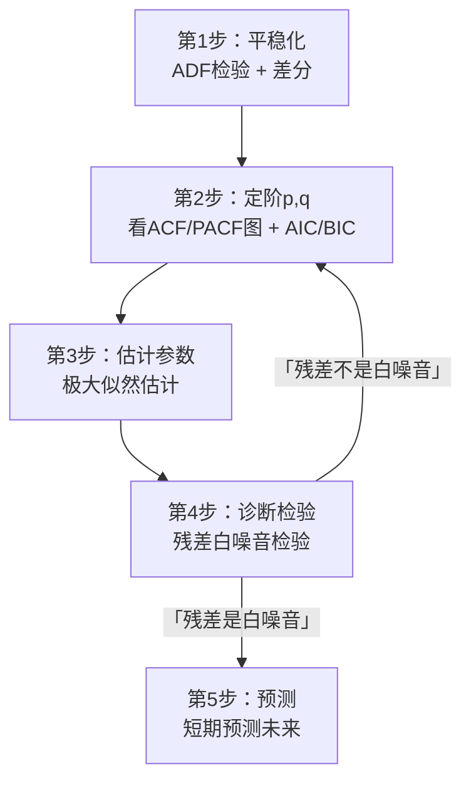
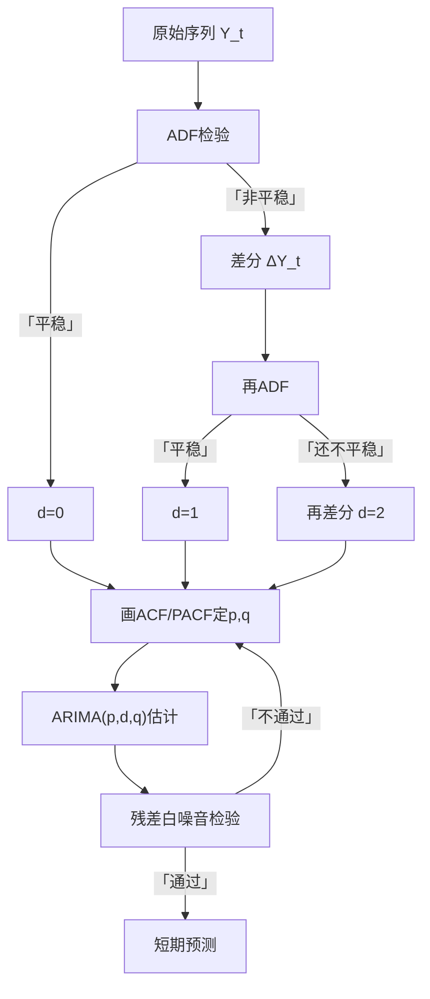

# 05 ARIMA 建模流程：Box-Jenkins 五步法

<div style="text-align:right;margin:10px 0;"><a href="../../exam.html" target="_blank" style="display:inline-block;padding:6px 16px;background:#2563eb;color:#fff;border-radius:6px;text-decoration:none;font-size:14px;">📝 开始做题</a></div>


## 一、为什么要学这个？

上一节我们学了 [[04_ARMA模型|ARMA]] 的数学形式。但**实际建一个 ARIMA 模型，不是把公式套进去就完事**，有一套标准流程叫 **Box-Jenkins 方法**。

为什么叫 Box-Jenkins？因为这套流程是统计学家 Box 和 Jenkins 在 1970 年总结的，到现在 50 多年了还是行业标准。

**为什么需要流程？**
因为 ARIMA 有三个参数 $(p, d, q)$，你要自己决定：
- $d$：差分几次（取决于 [[06_ADF单位根检验|ADF]] 检验）；
- $p$：AR 阶数（看 [[KP04_PACF偏自相关|PACF]] 图）；
- $q$：MA 阶数（看 [[03_自相关与ACF|ACF]] 图）。

不按流程走，你会：
1. 不知道先干啥后干啥；
2. 阶数拍脑袋；
3. 模型跑完不检验，残差还有[[03_自相关|自相关]]，自己不知道。

**不学会怎样？**
- 论文里"用 ARIMA [[KP05_模型预测|模型预测]]"就一句话带过，没有流程图、没有阶数选择依据、没有残差检验——导师一眼看出你是抄的代码。

---

## 二、Box-Jenkins 五步流程



---

## 三、每一步详细讲

### 第 1 步：平稳化

**做什么**：
- 画时序图，看有没有趋势、季节；
- 跑 ADF 检验（下下节讲）；
- 非平稳就差分：$\Delta Y_t = Y_t - Y_{t-1}$；
- 差分后再 ADF 检验，直到平稳。

> 📖 **统计学原理对接**：画时序图时看到的"趋势"和"季节"，在传统统计里有专门的测定方法——[[../../教材笔记/05_统计学原理/09_时间序列分析/知识点/KP15_长期趋势测定|KP15 长期趋势测定]]用移动平均法或指数平滑法把长期趋势 $T_t$ 平滑出来，[[../../教材笔记/05_统计学原理/09_时间序列分析/知识点/KP16_季节波动测定|KP16 季节波动测定]]用同期平均法或趋势剔除法算出 12 个月的季节指数。现代 ARIMA 不直接手算这些指数，而是用**差分**去掉趋势（$d$ 阶差分）、用**季节差分** $\Delta_s Y_t = Y_t - Y_{t-s}$ 去掉季节（月度数据 $s=12$，季度数据 $s=4$），带季节项的 ARIMA 叫 SARIMA。本质上是同一回事：把 $T_t$ 和 $S_t$ 从数据里剥掉，剩下平稳的 $C_t + I_t$ 才能建模。

**怎么决定 d（差分次数）**：
- 原始序列平稳 → d=0；
- 差分 1 次后平稳 → d=1（大多数经济数据都是这样，叫 I(1)）；
- 差分 2 次后平稳 → d=2（很少见，一般不超过 2）。

### 第 2 步：定阶 p, q

**做什么**：在平稳序列上画 ACF 和 PACF 图。

**判断规则**（上一节讲过）：
- PACF 截尾在 p → AR(p)；
- ACF 截尾在 q → MA(q)；
- 都拖尾 → ARMA(p,q)。

**辅助工具**：AIC 和 BIC 信息准则。
- 试几个 (p, q) 组合：(0,1), (1,0), (1,1), (2,1), (1,2)……
- 选 AIC 或 BIC 最小的那个。

**AIC 公式**：
$$\text{AIC} = -2 \ln(L) + 2(p+q+1)$$
- $L$ 是似然值（模型拟合得好不好）；
- 后面的惩罚项：参数越多罚得越狠；
- AIC 越小越好（拟合好 + 参数少）。

### 第 3 步：估计参数

**做什么**：用极大似然估计，把 $\phi_1, \phi_2, \dots, \theta_1, \theta_2, \dots$ 的具体数值算出来。

**看什么**：
- 系数是不是显著（p < 0.05）；
- 不显著的系数要删掉，重新跑模型。

### 第 4 步：诊断检验

**做什么**：检验模型的残差 $\hat{\varepsilon}_t$ 是不是**白噪音**。

**怎么检验**：
- 画残差的 ACF/PACF 图——如果所有滞后都不显著，残差就是白噪音；
- 跑 Ljung-Box 检验：原假设是"残差无自相关"，p > 0.05 = 通过检验 = 模型 OK。

**如果残差不是白噪音**：
说明模型没把信息榨干，回去第 2 步，加大 p 或 q。

### 第 5 步：预测

**做什么**：用建好的模型预测未来。

**注意**：
- 短期预测（1-5 期）最准；
- 预测区间会随期数变宽（不确定性累积）；
- 经济结构变了（比如疫情），模型外推会失效。

---

## 三补、确定性时序分析：Wold 分解、移动平均与指数平滑

> 📖 对应 [[../../教材笔记/03_时间序列/04_确定性时序分析/知识点/KP01_Wold与Cramer分解|时序·KP01 Wold 与 Cramer 分解]]、[[../../教材笔记/03_时间序列/04_确定性时序分析/知识点/KP02_趋势拟合与平滑|时序·KP02 趋势拟合与平滑]]。

### 为什么要先"分解"再建模？

**Wold 分解定理**（1938 年）说：任何平稳序列都可以拆成两部分——
- **确定性部分** $V_t$（比如常数均值，历史能完美预测）；
- **随机部分** $\xi_t$（白噪声的无穷线性组合，就是 ARMA 那种结构）。

$$x_t = V_t + \sum_{j=0}^{\infty} \varphi_j \varepsilon_{t-j}$$

**Cramer 分解**把它推广到非平稳序列：任意序列 = 多项式趋势 + 平稳残差。

**人话**：时序分析的核心逻辑就是"先把确定性的东西（趋势、季节）剥掉，再对剩下的随机残差建 ARMA"。不剥趋势直接建模，会把趋势误当成自相关，跑出"伪规律"。

### 方法一：移动平均法（最朴素的平滑）

取连续 $k$ 期算一个平均值，窗口顺着时间滑过去：

$$\tilde{x}_t = \frac{x_t + x_{t-1} + \cdots + x_{t-k+1}}{k}$$

**手算例子**：最后 4 期观察值为 5、5.4、5.8、6.2。
- 3 期移动平均：(5+5.4+5.8)/3 = 5.4，(5.4+5.8+6.2)/3 = 5.8。

**期数 $k$ 怎么选**：
- 要消除季节周期 → $k$ = 周期长度（月度数据 $k=12$，季度 $k=4$）；
- $k$ 越大越平滑，但越滞后、越丢细节；
- 期数太大 = 过度平滑，把真趋势也磨掉了。

### 方法二：指数平滑法（近期数据权重更高）

**一次指数平滑**：
$$\tilde{x}_t = \alpha x_t + (1-\alpha)\tilde{x}_{t-1}$$

- $\alpha \in (0,1)$：平滑系数，越接近 1 越重视新数据；
- 只适合**无趋势、无季节**的平稳序列。

**手算例子**：$\alpha=0.3$，初始 $\tilde{x}_0 = 10$，观察值 10、12、11。
- $\tilde{x}_1 = 0.3\times10 + 0.7\times10 = 10$
- $\tilde{x}_2 = 0.3\times12 + 0.7\times10 = 10.6$
- $\tilde{x}_3 = 0.3\times11 + 0.7\times10.6 = 10.72$

**进阶版**：
- **Holt 双参数**（有线性趋势、无季节）：预测是斜线外推；
- **Holt-Winters 三参数**（有趋势 + 有季节）：预测是带斜率的波浪线，适合月度数据。

> **和 ARIMA 的关系**：简单指数平滑本质上就是 ARIMA(0,1,1)；Holt-Winters 就是 SARIMA 的近亲。本科论文做短期外推时，指数平滑是 ARIMA 之外的常见对照方法。

---

## 三补二、ARIMA(p,d,q) 三参数详解与 SARIMA 季节模型

> 📖 对应 [[../../教材笔记/03_时间序列/05_ARIMA与异方差/知识点/KP01_ARIMA模型|时序·KP01 ARIMA 模型]]、[[../../教材笔记/03_时间序列/05_ARIMA与异方差/知识点/KP02_季节模型|时序·KP02 季节模型]]。

### ARIMA(p,d,q) 三个参数到底是什么？

| 参数 | 名字 | 管什么 | 怎么定 |
|---|---|---|---|
| $p$ | AR 阶数 | 用过去 $p$ 期的 $Y$ 解释现在 | 看 PACF 截尾位置 |
| $d$ | 差分次数 | 非平稳序列差分几次后变平稳 | ADF 检验逐阶试 |
| $q$ | MA 阶数 | 用过去 $q$ 期的冲击 $\varepsilon$ 解释现在 | 看 ACF 截尾位置 |

**差分怎么算**：
- 一阶差分：$\Delta x_t = x_t - x_{t-1}$（消线性趋势）；
- 二阶差分：$\Delta^2 x_t = \Delta x_t - \Delta x_{t-1}$（消二次曲线趋势）。

**手算例子**：原序列 10、12、15、19、24（线性增长）。
- 一阶差分：2、3、4、5（还在递增 → 不平稳）；
- 二阶差分：1、1、1（常数 → 平稳了）→ $d=2$。

实际经济数据大多数 $d=1$（差一次就够），$d=2$ 极罕见。

### SARIMA：月度数据必须加季节项

如果你的数据有固定季节周期（羽绒服冬天卖得多、夏天卖得少），普通 ARIMA 抓不到"今年 7 月和去年 7 月"的关系。这时候要用 **SARIMA$(p,d,q)(P,D,Q)_s$**：

- 小写 $p,d,q$：管"近邻"（月度间的短期关系）；
- 大写 $P,D,Q$：管"同期"（今年同月 vs 去年同月）；
- $s$：季节周期长度（月度 $s=12$，季度 $s=4$）。

**季节差分**：$\nabla_s x_t = x_t - x_{t-s}$（月度数据 = 今年同月 − 去年同月 = 同比）。

**手算例子**：去年 7 月销量 500，今年 7 月 600。
- 普通差分（环比）：今年 7 月 − 今年 6 月 = 600 − 550 = 50；
- 季节差分（同比）：今年 7 月 − 去年 7 月 = 600 − 500 = 100。

**什么时候必须上 SARIMA**：ACF 图上滞后 12（月度）或 4（季度）阶有显著峰值，说明有季节性自相关。样本至少要 2-3 个完整周期才能估准季节参数。

---

## 四、符号表

| 符号 | 是什么 |
|------|--------|
| $p$ | AR 阶数 |
| $d$ | 差分次数 |
| $q$ | MA 阶数 |
| AIC | 赤池信息准则，越小越好 |
| BIC | 贝叶斯信息准则，比 AIC 惩罚更重 |
| Ljung-Box Q | 残差白噪音检验统计量 |
| $L$ | 似然函数值 |

---

## 五、一个完整数字例子（流程演示）

**数据**：某城市 2010-2024 年的季度零售额（60 个观测）。

**第 1 步：平稳化**
- 画时序图：一直涨，明显非平稳；
- ADF 检验：p = 0.8 > 0.05，不拒绝"有单位根"= 非平稳；
- 差分 1 次：$\Delta Y_t$；
- 再 ADF：p = 0.01 < 0.05，平稳了。
- **结论：d = 1。**

**第 2 步：定阶**
- 画差分序列的 ACF/PACF：
  - ACF：滞后 1 阶显著，之后快速衰减（拖尾）；
  - PACF：滞后 1 阶显著，滞后 2 阶掉进置信带（截尾在 1）；
- 初判：AR(1) → (p, q) = (1, 0)；
- 再用 AIC 验证：试 (1,0)、(0,1)、(1,1)，AIC 分别是 200、210、198。
- (1,1) 的 AIC 最小，但 (1,0) 更简洁。
- **结论：选 (p, d, q) = (1, 1, 0)，即 ARIMA(1,1,0)。**

**第 3 步：估计**
- 跑软件，得到 $\phi_1 = 0.6$，p < 0.05，显著；
- 常数项 c = 5.2。

**第 4 步：诊断**
- 残差的 ACF 图：所有滞后都掉进置信带；
- Ljung-Box 检验：p = 0.3 > 0.05，不拒绝"残差无自相关"= 通过。
- **模型合格。**

**第 5 步：预测**
- 预测未来 4 个季度的零售额；
- 给出 95% 预测区间。

---

## 六、前提假设

1. 差分后的序列是平稳的；
2. 残差是白噪音（无自相关、同方差）；
3. 经济结构在预测期内稳定（没有政策突变、危机）；
4. 样本量足够（T > 50，最好 T > 100）。

---

## 七、易错点

1. **跳过 ADF 检验直接定阶**：非平稳序列的 ACF 是假的，会误导你。
2. **只看 AIC 最小**：AIC 最小的模型可能参数很多，解释不了。要兼顾简洁性。
3. **残差不检验就用**：残差有自相关 = 模型没建对，但预测结果看起来也挺漂亮——这是自欺欺人。
4. **预测太远**：ARIMA 预测 10 期以上就退化成均值了，没意义。
5. **季节数据不做季节差分**：月度数据如果有季节性，要加季节项（SARIMA）。

---

## 八、Python 代码（完整流程）

```python
import pandas as pd
import numpy as np
from statsmodels.tsa.stattools import adfuller
from statsmodels.graphics.tsaplots import plot_acf, plot_pacf
from statsmodels.tsa.arima.model import ARIMA
from statsmodels.stats.diagnostic import acorr_ljungbox
import matplotlib.pyplot as plt

# 假设 Y 是你的时序数据（pandas Series，带时间索引）

# ===== 第1步：平稳化 =====
adf_p_before = adfuller(Y)[1]
print(f"差分前 ADF p 值：{adf_p_before}")

Y_diff = Y.diff().dropna()  # 差分1次
adf_p_after = adfuller(Y_diff)[1]
print(f"差分后 ADF p 值：{adf_p_after}")
# 若 p < 0.05，说明差分后平稳，d=1

# ===== 第2步：定阶 =====
fig, axes = plt.subplots(1, 2, figsize=(12, 4))
plot_acf(Y_diff, lags=20, ax=axes[0])
plot_pacf(Y_diff, lags=20, ax=axes[1])
plt.savefig('acf_pacf_diff.png', dpi=150)

# 用AIC选p,q（试几个组合）
best_aic = np.inf
best_order = None
for p in range(0, 3):
    for q in range(0, 3):
        try:
            m = ARIMA(Y, order=(p, 1, q)).fit()
            if m.aic < best_aic:
                best_aic = m.aic
                best_order = (p, 1, q)
        except:
            pass
print(f"最优阶数：{best_order}，AIC = {best_aic:.2f}")

# ===== 第3步：估计 =====
model = ARIMA(Y, order=best_order)
result = model.fit()
print(result.summary())

# ===== 第4步：诊断（残差白噪音）=====
residuals = result.resid
lb = acorr_ljungbox(residuals, lags=[10], return_df=True)
print("Ljung-Box 检验 p 值：", lb['lb_pvalue'].values)
# p > 0.05 = 残差无自相关 = 模型合格

# ===== 第5步：预测 =====
forecast = result.forecast(steps=4)
print("未来4期预测：")
print(forecast)
```

---

## 九、ARIMA 流程图（必背）



---

## 十、为什么不用别的方法？

- **为什么不能跳过 ADF 直接定阶？** 非平稳序列的 ACF 是假的缓慢衰减，会把你引向错误的 p、q；差分次数 d 必须由"差分后 ADF p < 0.05"来定，跳步等于闭着眼选模型。
- **为什么不能只按 AIC 最小选模型？** AIC 最小的往往是参数最多的模型，容易过拟合、系数解释不了；硬标准是残差通过白噪音诊断（Ljung-Box p > 0.05），AIC 只是在合格模型里挑简洁的。
- **为什么不用 Holt-Winters 指数平滑代替？** 指数平滑适合有季节趋势的短期外推，但产出不了可检验的系数和残差诊断；本科论文实证需要报告 p/d/q [[KP05_评价标准值xi0的选择|的选择]]依据、系数显著性和诊断结果，ARIMA 的 Box-Jenkins 流程才是规范写法。

## 十一、答辩常问（直接背）

1. **问：Box-Jenkins 五步是什么？** 答：平稳化（ADF+差分定 d）→ 定阶 p,q（ACF/PACF 初判 + AIC/BIC 比选）→ 极大似然估计参数 → 残差白噪音诊断（Ljung-Box p > 0.05）→ 短期预测；残差不白噪音就退回定阶步加 p 或 q。
2. **问：差分次数 d 怎么定？** 答：原序列 ADF p > 0.05（非平稳）→ 一阶差分后再检，p < 0.05 则 d=1（绝大多数经济数据是 I(1)）；还不平稳再差一次 d=2，一般不超过 2。
3. **问：预测期做多长？** 答：只做 1-5 期短期预测；ARMA 预测多期后会收敛到均值、预测区间越撑越宽，预测 10 期以上和直接猜均值没区别；遇到政策突变、疫情这类结构断点，外推直接失效。

## 十二、速记卡

> **Box-Jenkins 五步：平稳化 → 定阶 → 估计 → 诊断 → 预测。**
> d 由 ADF 检验决定（差分几次后平稳）。
> p、q 由 ACF/PACF 图 + AIC 决定。
> 残差必须是白噪音（Ljung-Box p > 0.05）。
> 残差不是白噪音 → 回去加阶数，别硬预测。
> 短期预测（1-5 期）最靠谱。

---

## 💡 经济学视角：ARIMA 六步流程：销量预测和 GDP 预测用同一套打法

**这个方法是为了解决什么经济学问题？**
商场要预测明年每个月卖多少奶茶，财政部要预测明年每个季度 GDP——场景完全不同，但建模步骤一模一样：画时序图看趋势→检验平稳性→差分→识别 p、q→估计参数→诊断残差→预测。这套标准化流程就是 ARIMA 六步法，它把"凭感觉建模"变成"流水线作业"。

**经济学里哪些经典模型正好走这个流程？**
凯恩斯消费函数 C = a + bY 要拿季度数据估计，前提就是消费和收入序列要平稳或协整。企业做销量预测、央行做通胀预测、统计局做人口预测，全部跑这套流程——学会一套，走遍天下。

**举个实证论文的例子：**
《基于 ARIMA 模型的某连锁超市销售额预测》对 2018—2023 年月度销售额走完整六步：ADF 检验发现一阶差分后平稳，AIC/BIC 选出 ARIMA(2,1,1)，残差白噪声检验通过，预测 2024 年各月销售额 MAPE 仅 4.2%——超市据此排货、排班，避免库存积压或缺货。

**📚 配套经济学笔记：**
- [[../../教材笔记/06_西方经济学/10_收入支出模型/知识点/KP02_消费函数与储蓄函数|原KP·消费函数与储蓄函数]]

---

下一篇：[[06_ADF单位根检验]]

---

## 📖 配套教材笔记

- [[../../教材笔记/03_时间序列/03_ARMA模型/知识点/KP04_建模六步法|时序·KP04 建模六步法]]
- [[../../教材笔记/03_时间序列/04_确定性时序分析/知识点/KP01_Wold与Cramer分解|时序·KP01 Wold与Cramer分解]]
- [[../../教材笔记/03_时间序列/04_确定性时序分析/知识点/KP02_趋势拟合与平滑|时序·KP02 趋势拟合与平滑]]
- [[../../教材笔记/03_时间序列/05_ARIMA与异方差/知识点/KP01_ARIMA模型|时序·KP01 ARIMA]]
- [[../../教材笔记/03_时间序列/05_ARIMA与异方差/知识点/KP02_季节模型|时序·KP02 季节模型SARIMA]]

## 📚 配套原书

- [[../../原文件/时间序列分析/王燕_时间序列分析基于R_全书|王燕教材·第3-5章 ARIMA]]
