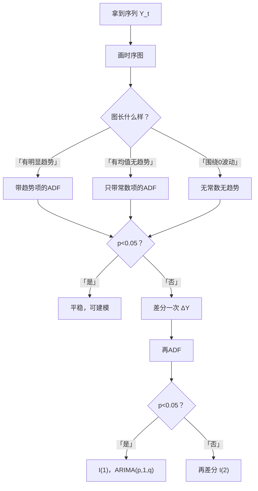

# 06 ADF 单位根检验：判断序列平不平稳

## 一、为什么要学这个？

前面几节反复说："非平稳序列要先差分"、"ADF 检验 p < 0.05 才是平稳的"。

但 ADF 检验到底是什么？原假设是什么？为什么 p < 0.05 就能说平稳？

**ADF（Augmented Dickey-Fuller）检验**是时间序列论文里**出现频率最高**的检验。你写实证部分，第一件事就是给每个变量跑 ADF。

**不学会怎样？**
- 论文里直接跑 `dfuller` 但不知道输出看哪个值；
- 把原假设搞反了：以为 p < 0.05 = 有单位根，写反了结论；
- 不做[[02_平稳性|平稳性]]检验直接建 [[05_ARIMA建模流程|ARIMA]]，导师直接打回。

---

## 二、是什么？（先打比方）

### 生活比喻：判断一个人是不是"飘着"

你在街上观察一个人：
- 如果他**站在原地**，偶尔左右晃两下 → 这是平稳的（均值固定）；
- 如果他**一直往前走**，停不下来 → 这是非平稳的（均值在漂移）。

ADF 检验就是问："这个序列，会不会自己走回来？"

- 会走回来（平稳）：你推它一下，它晃两下就回到原点；
- 不会走回来（单位根）：你推它一下，它就一直飘走了。

### 严格定义

> **单位根过程**：随机游走 $Y_t = Y_{t-1} + \varepsilon_t$，它的特征方程有一个根 = 1（单位圆上），所以叫"单位根"。
>
> 这种过程没有均值回归，冲击是永久的。

> **ADF 检验**：检验一个序列是不是单位根过程（即非平稳）。

**原假设 $H_0$**：序列**有单位根** = 非平稳。

**备择假设 $H_1$**：序列**没有单位根** = 平稳。

**怎么判断**：
- p < 0.05 → 拒绝原假设 → **平稳**；
- p > 0.05 → 不拒绝原假设 → **非平稳**（有单位根）。

**记反就完蛋**：原假设是"非平稳"，所以 p 小才能拒绝它，才能说平稳。

### 虚假回归长什么样？怎么识别？

> 📖 对应 [[../../教材笔记/03_时间序列/06_多元时序与协整/知识点/KP01_虚假回归|时序·KP01 虚假回归]]。

**生活比喻**：两个完全不认识的人在街上随机漫步，碰巧有一段时间一个往左走另一个也往左走——你以为他们是"同伙"，其实只是巧合。时间越长，这种"巧合"越像真的。

**三个识别信号**（看到任何一个都要警惕）：

1. **$R^2$ 很高但经济逻辑不通**：两个八竿子打不着的变量（医生人数 vs 啤酒销量）回归出 $R^2=0.9$，只是因为它们都随时间涨；
2. **D-W 统计量接近 0**：残差高度自相关——这是伪回归的典型指纹（$R^2 \gg D-W$）；
3. **换个样本期结论就变号**：2000-2015 年"显著正相关"，2016-2024 年突然"显著负相关"，说明关系是假的。

**最可怕的一点**：样本量越大，伪回归的"假显著"反而越严重。$n=200$ 时，两个独立随机游走回归出 t 值 > 2 的概率超过 60%。

**正确做法**：
- 先做 ADF 检验 → 两个变量都是非平稳？
- 再做协整检验 → 它们的线性组合平稳吗？
  - 协整存在 → 可以做长期回归（[[07_协整与误差修正ECM|下一节讲]]）；
  - 不协整 → 必须差分后再回归，只解释"变化量"。

---

## 三、公式怎么来的？

### DF 检验（最简单的版本）

假设序列满足：
$$Y_t = \rho Y_{t-1} + \varepsilon_t$$

- 如果 $\rho = 1$：单位根过程（随机游走），非平稳；
- 如果 $|\rho| < 1$：平稳（均值回归）。

两边减 $Y_{t-1}$：
$$\Delta Y_t = (\rho - 1) Y_{t-1} + \varepsilon_t = \delta Y_{t-1} + \varepsilon_t$$

其中 $\delta = \rho - 1$。

- 原假设 $H_0$：$\delta = 0$（即 $\rho=1$，有单位根）；
- 备择 $H_1$：$\delta < 0$（即 $\rho<1$，平稳）。

我们跑回归 $\Delta Y_t$ 对 $Y_{t-1}$，看系数 $\delta$ 的 t 值。如果 t 值足够小（负得够多），就拒绝 $H_0$。

### ADF 检验（升级版）

DF 检验假设 $\varepsilon_t$ 没有[[03_自相关|自相关]]。但实际序列的残差往往有自相关。

ADF 加了几个**滞后差分项**来控制自相关：

$$\Delta Y_t = \alpha + \beta t + \delta Y_{t-1} + \sum_{i=1}^{p} \gamma_i \Delta Y_{t-i} + \varepsilon_t$$

- $\alpha$：常数项；
- $\beta t$：时间趋势项（序列有趋势时加）；
- $\delta$：关键系数，原假设是 $\delta=0$；
- $\sum \gamma_i \Delta Y_{t-i}$：滞后差分项，控制自相关。

滞后阶数 p 用 AIC 或 BIC 自动选。

---

## 四、符号表

| 符号 | 是什么 |
|------|--------|
| $H_0$ | 原假设：有单位根 = 非平稳 |
| $H_1$ | 备择：无单位根 = 平稳 |
| $\delta$ | 关键系数：原假设是 $\delta=0$ |
| t 统计量 | $\delta$ 的 t 值，越负越能拒绝 $H_0$ |
| p 值 | p < 0.05 = 拒绝原假设 = 平稳 |
| 滞后阶数 p | ADF 回归里加的滞后差分项个数 |

---

## 五、一个数字例子

**数据**：模拟一个随机游走（非平稳）：

| t | $Y_t$ |
|---|-------|
| 1 | 1.0 |
| 2 | 1.1 |
| 3 | 1.0 |
| 4 | 1.3 |
| 5 | 1.2 |
| 6 | 1.4 |
| ... | ... |

**跑 ADF 检验**（用 Python/Stata）：

输出大概是：
- ADF 统计量 = -1.2；
- p 值 = 0.65；
- 1% 临界值 = -3.5；5% 临界值 = -2.9。

**判断**：
- p = 0.65 > 0.05 → 不拒绝原假设 → **有单位根，非平稳**；
- ADF 统计量 -1.2 比 5% 临界值 -2.9 大（没那么负）→ 支持非平稳。

**差分后再跑**：
- $\Delta Y_t = Y_t - Y_{t-1}$；
- 再跑 ADF：p = 0.01 < 0.05 → 拒绝原假设 → **差分后平稳**；
- 结论：原序列是 I(1)（一阶单整），差分一次就平稳。

---

## 六、三种检验形式怎么选？

ADF 有三种形式，你要根据**时序图**选：

| 时序图长什么样 | 检验形式 |
|--------------|---------|
| 围绕 0 上下波动（无均值、无趋势） | 无常数项、无趋势项 |
| 围绕某个非 0 均值波动（有均值） | 加常数项 |
| 整体有明显的上升/下降趋势 | 加常数项 + 趋势项 |

**选错会怎样**：
- 你加了不必要的趋势项，检验功效下降，容易误判为非平稳；
- 你该加趋势项没加，会误判为平稳。

**经验法则**：先看图，再选形式。Stata 里 `dfuller, trend` 是带趋势项的版本。

---

## 七、前提假设

1. 序列的误差项 $\varepsilon_t$ 是白噪音（ADF 加滞后项就是为了让残差白噪音）；
2. 滞后阶数选得合适（用 AIC 自动选）；
3. 样本量足够（T > 30，最好 T > 50）。

---

## 八、易错点

1. **把原假设搞反**：原假设是"有单位根 = 非平稳"。p < 0.05 才能说平稳。
2. **所有变量用同一种形式**：有的变量有趋势，有的没有，要分别看图选形式。
3. **差分后不重复检验**：差分一次后一定要再跑 ADF，确认平稳了才能建模。
4. **滞后阶数拍脑袋**：用 AIC/BIC 自动选，不要固定 lag=1。
5. **ADF 不显著就放弃**：有时候 ADF 功效低（样本少），要结合 PP 检验、KPSS 检验一起看。

---

## 九、Stata / Python 代码

Stata 版：
```stata
* 假设你已经 tsset 了时间
* 基本版（只加常数项）
dfuller Y

* 带趋势项
dfuller Y, trend

* 看完输出看 p 值（MacKinnon p-value）
* p < 0.05 = 拒绝原假设 = 平稳
```

Python 版：
```python
from statsmodels.tsa.stattools import adfuller

# Y 是你的时序数据
result = adfuller(Y, regression='c', autolag='AIC')
# regression='c'：加常数项
# regression='ct'：加常数项+趋势项
# autolag='AIC'：自动选滞后阶数

print(f"ADF 统计量：{result[0]:.4f}")
print(f"p 值：{result[1]:.4f}")
print(f"滞后阶数：{result[2]}")
print(f"临界值：")
for key, value in result[4].items():
    print(f"  {key}: {value:.3f}")

# 判断：
# p < 0.05 → 拒绝原假设 → 平稳
# p > 0.05 → 不拒绝 → 非平稳（有单位根）
```

---

## 十、ADF 检验流程总结



---

## 十一、为什么不用别的方法？

- **为什么不只画图判断平稳？** 随机游走和趋势平稳的图肉眼分不清，而且 ADF 的原假设是"有单位根"——p < 0.05 拒绝原假设才能说平稳，这个判断方向靠图给不出来。
- **为什么不用 PP 检验或 KPSS 直接代替 ADF？** ADF 靠加滞后差分项控制残差自相关，是论文主报告的标准；小样本下 ADF 功效偏低（容易漏判单位根），这时用 KPSS（原假设是"平稳"）交叉验证：ADF 和 KPSS 结论一致才稳。本科论文以 ADF 为主即可。
- **为什么所有变量用同一种检验形式？** 有明显趋势的序列要加趋势项、有均值无趋势只加常数项，形式选错会降低检验功效甚至误判；必须先看每个变量自己的时序图，分别选无常数/加常数/加常数+趋势三种形式。

## 十二、答辩常问（直接背）

1. **问：ADF 检验的原假设是什么？** 答：H₀=序列有单位根（非平稳），H₁=没有单位根（平稳）。所以是 p < 0.05 拒绝原假设才能说平稳——原假设记反，整篇结论的方向就全错。
2. **问：ADF 输出怎么读？** 答：看 MacKinnon p 值，或把 t 统计量和 1%/5% 临界值（如 -2.9）比：p=0.65 > 0.05=不拒绝=非平稳；差分后 p=0.01 < 0.05=平稳，即原序列是 I(1)。滞后阶数用 AIC/BIC 自动选，别固定写 lag=1。
3. **问：三种检验形式怎么选？** 答：围绕 0 上下波动→无常数无趋势；围绕某个非 0 均值波动→加常数项；整体有明显升/降趋势→加常数项+趋势项（Stata 里 `dfuller, trend`），依据是每个变量自己的时序图。

## 十三、速记卡

> **ADF 原假设：有单位根 = 非平稳。**
> p < 0.05 → 拒绝原假设 → **平稳**。
> p > 0.05 → 不拒绝 → **非平稳**，要差分。
> 检验形式：看时序图选（无趋势/有均值/有趋势）。
> 差分后必须再跑 ADF 确认平稳。
> 原序列 I(0)、差分一次 I(1)、差分两次 I(2)。

---

下一篇：[[07_协整与误差修正ECM]]

---

## 📖 配套教材笔记

- [[../../教材笔记/03_时间序列/06_多元时序与协整/知识点/KP01_虚假回归|时序·KP01 虚假回归]]
- [[../../教材笔记/03_时间序列/06_多元时序与协整/知识点/KP02_DF与ADF检验|时序·KP02 DF/ADF检验]]
- [[../../教材笔记/02_计量经济学/13_单位根与协整/知识点/KP01_单位根检验ADF|计量·KP01 ADF]]

## 📚 配套原书

- [[../../原文件/时间序列分析/王燕_时间序列分析基于R_全书|王燕教材·第6章 单位根]]
