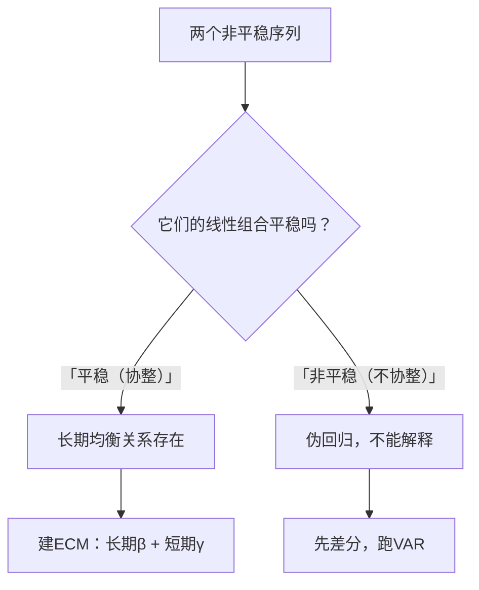

# 07 协整与误差修正 ECM：两个非平稳序列的长期均衡

## 一、为什么要学这个？

上一节我们知道：非平稳序列直接回归 = 伪回归。

但经济里有个现象：**很多变量单独看都非平稳，但它们长期是有关系的**。

比如：
- 中国 GDP 和中国居民消费——单独看都是非平稳的（一直在涨）；
- 但它们的比例（消费率）长期稳定在 50% 左右；
- 也就是说：消费不会偏离 GDP 太远，偏离多了会拉回来。

**问题来了**：既然两个序列都非平稳，直接回归会伪回归；但它们明明长期有关系，难道就不能研究了吗？

**协整（Cointegration）** 回答了这个问题：**如果两个非平稳序列的某个线性组合是平稳的，那它们之间就有长期均衡关系，回归就不是伪回归。**

**误差修正模型（ECM, Error Correction Model）** 进一步把这种关系拆成：
- 长期均衡关系；
- 短期偏离后，怎么向长期均衡调整。

**不学会怎样？**
- 论文里研究"货币供应量对 CPI 的影响"，两个都是 I(1) 序列，你直接跑 [[04_OLS截距和拟合值|OLS]]，导师说"伪回归"；
- 你不知道协整检验，只会差分后跑回归，丢掉了长期信息。

---

## 二、是什么？（先打比方）

### 生活比喻：恋爱中的两个人

男生和女生的情绪，各自看都是"非平稳"的——今天开心、明天生气，没有固定均值。

但他们长期是**协整**的：
- 男生特别开心时，女生通常也不差；
- 女生特别生气时，男生通常也好不到哪去；
- 他们的"情绪差"长期在某个范围内波动（不是永远差很多）。

如果他们吵架吵得特别凶（短期偏离），过几天会和好（向长期均衡调整）——这就是**误差修正**。

### 严格定义

> **协整**：如果两个（或多个）非平稳序列 $Y_t$ 和 $X_t$ 都是 $I(1)$（差分一次后平稳），但存在某个线性组合
> $$e_t = Y_t - \beta_0 - \beta_1 X_t$$
> 是平稳的（$I(0)$），则称 $Y_t$ 和 $X_t$ 是**协整的**。

意思：它们各自都在漂，但**它们之间的差距**不漂（有长期均衡关系）。

> 🎯 **更生动的比喻**：两个喝醉的人手拉手在广场上走。各自的步子随机歪歪扭扭（非平稳/随机游走），但手拉手让两人之间的距离保持稳定（线性组合平稳 = 协整）。ECM 就是"如果走偏了，手会把你拉回来"的那个力。经典例子：短期利率和长期利率都是随机游走（I(1)），但**利差**（长期 − 短期）是平稳的——它们有长期均衡关系。

> **协整和伪回归的分界线**：两个 I(1) 序列直接回归，**协整了**就不是伪回归（是长期均衡关系）；**不协整**才是伪回归。这就是为什么要先检验残差平稳。

> **误差修正模型 ECM**：
> $$\Delta Y_t = \alpha_0 + \alpha_1 \Delta X_t + \gamma e_{t-1} + \varepsilon_t$$
> 其中 $e_{t-1} = Y_{t-1} - \beta_0 - \beta_1 X_{t-1}$ 是上一期的"非均衡误差"。

- $\alpha_1 \Delta X_t$：短期影响（X 变化 1 单位，Y 短期变多少）；
- $\gamma e_{t-1}$：误差修正项——上一期偏离均衡多少，本期就往回调整多少；
- $\gamma$ 应该是负的（偏离多了往回拉）。

---

## 三、公式怎么来的？

**第一步：发现两个序列都是 I(1)**

GDP 和 CPI，各自 [[06_ADF单位根检验|ADF]] 检验都是 p > 0.05（非平稳）。
差分一次后都平稳了。它们都是 I(1)。

**第二步：先跑一个"伪回归"看残差**

$$Y_t = \beta_0 + \beta_1 X_t + e_t$$

你跑 OLS，得到残差 $e_t$。

**第三步：检验残差 $e_t$ 是不是平稳**

如果 $e_t$ 是平稳的（ADF p < 0.05），说明：
- 虽然 $Y_t$ 和 $X_t$ 各自非平稳；
- 但它们的差距 $e_t$ 是平稳的——它们没有越漂越远，长期保持稳定关系。

这就是**Engle-Granger 两步法**：
1. 第一步：跑回归，拿残差；
2. 第二步：对残差做 ADF 检验。

> **两个关键细节**（答辩常问）：
> 1. **协整成立时，OLS 估计量是"超一致"的**——收敛速度比普通 OLS 还快，所以长期系数 $\hat\beta$ 很可靠；
> 2. **残差 ADF 的临界值比普通 ADF 更严格**——因为残差是估计出来的（不是真实值），要用专门的协整检验临界值（MacKinnon 协整临界值），不能直接套普通 ADF 的 -2.9。Python 的 `coint()` 函数已经自动用对了临界值。

**第四步：建 ECM 模型**

如果残差平稳（协整存在），就建：
$$\Delta Y_t = \alpha_0 + \alpha_1 \Delta X_t + \gamma e_{t-1} + \varepsilon_t$$

---

## 四、符号表

| 符号 | 是什么 |
|------|--------|
| $Y_t, X_t$ | 两个 I(1) 序列 |
| $e_t$ | 长期回归的残差（非均衡误差） |
| $\beta_0, \beta_1$ | 长期均衡系数 |
| $\gamma$ | 误差修正系数（负的，往回拉） |
| $\Delta Y_t$ | Y 的差分（短期变化） |
| I(1) | 一阶单整：差分一次后平稳 |

---

## 五、一个数字例子（迷你版）

**数据**：两个变量 $X_t$（收入）和 $Y_t$（消费），都是 I(1)。

**第一步：跑长期回归**

$$Y_t = 100 + 0.7 X_t + e_t$$

意思：消费 = 100（自发消费）+ 0.7×收入 + 误差。
边际消费倾向 = 0.7（收入涨 100 元，消费涨 70 元）。

**第二步：检验残差 $e_t$**

ADF 检验：p = 0.02 < 0.05 → 残差平稳 → **协整存在**。

**第三步：建 ECM**

$$\Delta Y_t = 0.5 \Delta X_t - 0.3 e_{t-1} + \varepsilon_t$$

**解释**：
- 短期：收入涨 100 元，消费短期涨 50 元（$\alpha_1=0.5$）；
- 长期：收入涨 100 元，消费最终涨 70 元（$\beta_1=0.7$）；
- 误差修正：上一期消费比长期均衡水平高了 100 元（$e_{t-1}=100$），本期消费会**少涨 30 元**（$-0.3 \times 100$），往均衡拉回来。

**这就是"短期偏离、长期回归"。**

---

## 六、前提假设

1. 两个序列都是**同阶单整**（都是 I(1)）；
   - 如果一个是 I(0)，一个是 I(1)，不能协整；
2. 残差 $e_t$ 是平稳的；
3. 样本量足够（T > 30）；
4. 长期均衡关系在样本期内稳定（没有结构突变）。

---

## 七、易错点

1. **不同阶单整硬协整**：一个 I(0) 一个 I(1)，协整检验没意义。
2. **协整但不建 ECM**：你只跑了长期回归，没建短期调整模型，等于只说了一半故事。
3. **误差修正系数为正**：$\gamma > 0$ 意味着偏离越来越大，不是误差修正，模型错了。
4. **样本期太短**：协整检验功效低，T=20 根本看不出长期关系。
5. **多个变量时不用 Johansen 检验**：Engle-Granger 两步法只适用于两个变量。三个及以上变量要 Johansen 协整检验（Stata `vecrank`）。

---

## 八、Stata / Python 代码

Python 版（Engle-Granger 两步法）：
```python
import numpy as np
import pandas as pd
from statsmodels.tsa.stattools import adfuller, coint
from statsmodels.api import OLS, add_constant

# 假设 Y 和 X 都是 I(1) 序列

# 第一步：跑长期回归
X_c = add_constant(X)
model = OLS(Y, X_c).fit()
beta0, beta1 = model.params
e_t = model.resid  # 残差

# 第二步：检验残差平稳
adf_p = adfuller(e_t)[1]
print(f"残差 ADF p 值：{adf_p}")
# p < 0.05 → 协整存在

# 第三步：建 ECM
# ΔY_t = α0 + α1 ΔX_t + γ e_{t-1} + ε_t
dY = Y.diff().dropna()
dX = X.diff().dropna()
e_lag = e_t.shift(1).dropna()

# 对齐数据
df = pd.DataFrame({'dY': dY, 'dX': dX, 'e_lag': e_lag}).dropna()
ecm_model = OLS(df['dY'], add_constant(df'dX', 'e_lag')).fit()
print(ecm_model.summary())
# e_lag 的系数 γ 应该是负的
```

Stata 版：
```stata
* 假设 Y, X 都是 I(1)
* 第一步：跑长期回归
reg Y X
predict e, residual

* 第二步：检验残差平稳
dfuller e

* 第三步：建 ECM
reg d.Y d.X L.e
* L.e 的系数应该是负的
```

---

## 九、协整 vs 伪回归



---

## 十、为什么不用别的方法？

- **为什么不把两个 I(1) 序列差分后直接跑回归？** 差分后只剩短期效应，把"消费率长期稳定在 50%"这种长期均衡信息整个丢掉；如果两序列其实协整，差分回归还是误设模型，长期系数估不出来。
- **为什么不直接对原序列跑 OLS 就报告？** 若两序列不协整，直接回归就是伪回归（R² 高但假显著）；必须先做 Engle-Granger 第二步——对长期回归的残差跑 ADF，p < 0.05 确认协整，这个长期系数才可信。
- **为什么三个以上变量还用 Engle-Granger？** EG 两步法只适用于两个变量；三个及以上变量可能同时存在多个协整关系，必须用 Johansen 协整检验（Stata `vecrank`），否则会漏掉长期关系。

## 十一、答辩常问（直接背）

1. **问：什么叫协整？** 答：两个 I(1) 序列各自非平稳，但它们的某个线性组合 $e_t = Y_t - \beta_0 - \beta_1 X_t$ 是 I(0)（平稳），说明它们长期不会越漂越远、存在长期均衡关系，这时回归才不是伪回归。
2. **问：ECM 里误差修正系数 γ 的符号和含义？** 答：γ 必须为负——上一期偏离均衡 $e_{t-1}$ 越大，本期越往回拉（如 γ=-0.3，上期偏高 100 元，本期少涨 30 元）；γ > 0 说明偏离越拉越大，模型设定错了。
3. **问：短期效应和长期效应分别看哪个系数？** 答：短期看 ECM 里 $\Delta X_t$ 的系数 α₁，长期看第一步长期回归的 β₁；例：边际消费倾向长期 0.7、短期只有 0.5，中间的缺口由 -0.3·$e_{t-1}$ 逐期补回来。

## 十二、速记卡

> **协整 = 两个 I(1) 序列的线性组合是 I(0) = 有长期均衡关系。**
> Engle-Granger 两步法：跑回归 → 检验残差平稳。
> ECM：$\Delta Y_t = \alpha_1 \Delta X_t + \gamma e_{t-1}$，$\gamma < 0$（往回拉）。
> 短期效应看 $\alpha_1$，长期效应看 $\beta_1$（长期回归的系数）。
> 三个以上变量用 Johansen 检验。

---

下一篇：[[08_GARCH模型]]

---

## 📖 配套教材笔记

- [[../../教材笔记/03_时间序列/06_多元时序与协整/知识点/KP03_协整与ECM|时序·KP03 协整与ECM]]
- [[../../教材笔记/03_时间序列/06_多元时序与协整/知识点/KP01_虚假回归|时序·KP01 虚假回归（协整解决它）]]
- [[../../教材笔记/02_计量经济学/13_单位根与协整/知识点/KP02_协整与ECM|计量·KP02 协整与ECM]]

## 📚 配套原书

- [[../../原文件/时间序列分析/王燕_时间序列分析基于R_全书|王燕教材·第6章 协整]]
