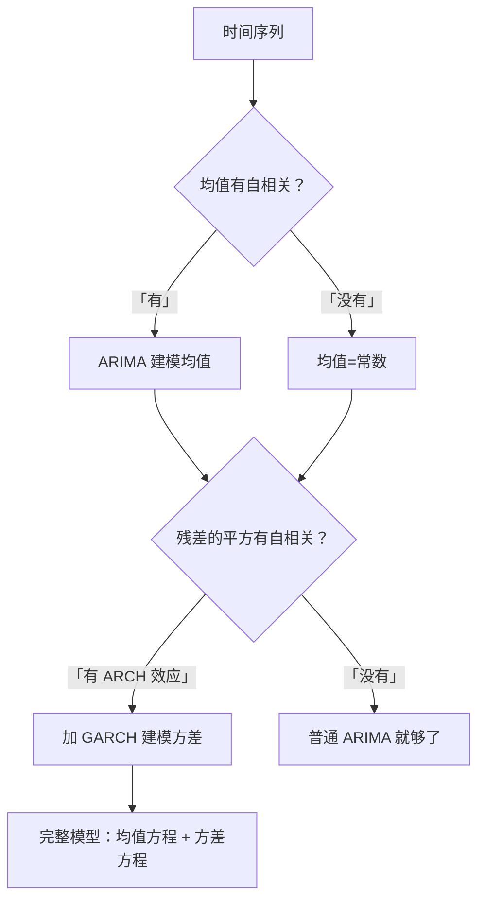

# 08 GARCH 模型：金融数据的"大波动跟着大波动"

<div style="text-align:right;margin:10px 0;"><a href="../../exam.html" target="_blank" style="display:inline-block;padding:6px 16px;background:#2563eb;color:#fff;border-radius:6px;text-decoration:none;font-size:14px;">📝 开始做题</a></div>


## 一、为什么要学这个？

你打开股票软件，看某只股票过去 5 年的日收益率：

- 2015 年股灾：连续几周暴涨暴跌，每天收益率 ±3%、±5%；
- 2017 年平稳期：每天收益率在 ±1% 以内晃；
- 2020 年疫情：又是连续大波动。

**你发现一个规律**：**大波动后面跟着大波动，小波动后面跟着小波动**。这叫**波动聚集（volatility clustering）**。

前面学的 [[05_ARIMA建模流程|ARIMA]] 模型有个假设：**方差是恒定的**（同方差）。但金融数据的方差明显在变——有时候很大，有时候很小。这叫**条件[[02_异方差|异方差]]（ARCH effect）**。

**GARCH（Generalized Autoregressive Conditional Heteroskedasticity）** 就是专门建模这种"方差会变"的模型。

**不学会怎样？**
- 论文里用 ARIMA 预测股票收益率，残差的方差忽大忽小，你不知道；
- 被导师问"你这模型考虑条件异方差了吗"，你一脸懵；
- 金融类论文（股价、汇率、利率）不做 GARCH，等于没做。

---

## 二、是什么？（先打比方）

### 生活比喻：天气预报的"气压"

ARIMA 预测的是**温度**（均值）。
GARCH 预测的是**气压波动**（方差）——

- 最近天气稳定（方差小）：明天也大概率稳定；
- 最近台风连连（方差大）：明天大概率还是不稳定。

GARCH 说：**今天的波动幅度，取决于过去几天的波动幅度**。

### 严格定义

> **GARCH(p, q) 模型**分两部分：

**均值方程**（和 ARIMA 一样）：
$$r_t = c + \phi_1 r_{t-1} + \varepsilon_t$$

**方差方程**（GARCH 新增）：
$$\sigma_t^2 = \omega + \sum_{i=1}^{q} \alpha_i \varepsilon_{t-i}^2 + \sum_{j=1}^{p} \beta_j \sigma_{t-j}^2$$

- $r_t$：收益率（或你要预测的序列）；
- $\varepsilon_t$：残差（今天的新冲击）；
- $\sigma_t^2$：今天的条件方差（今天的波动大小）；
- $\alpha_i$：过去的冲击 $\varepsilon^2$ 对方差的影响；
- $\beta_j$：过去的方差 $\sigma^2$ 对方差的影响。

**最常用的是 GARCH(1,1)**：
$$\sigma_t^2 = \omega + \alpha_1 \varepsilon_{t-1}^2 + \beta_1 \sigma_{t-1}^2$$

意思：今天的波动 = 一个基础波动 + 昨天的新冲击大小 + 昨天的波动大小。

---

## 三、公式怎么来的？

**第一步：发现问题**

ARIMA 假设 $\text{Var}(\varepsilon_t) = \sigma^2$ 是常数。

但金融数据里，残差的平方 $\varepsilon_t^2$ 是[[03_自相关|自相关]]的——昨天残差大，今天残差也大。

**第二步：ARCH(q) 模型**

Engle（1982）提出：让方差取决于过去的残差平方：
$$\sigma_t^2 = \omega + \alpha_1 \varepsilon_{t-1}^2 + \dots + \alpha_q \varepsilon_{t-q}^2$$

**第三步：Bollerslev（1986）加一项**

光靠过去的残差平方不够，还要加过去的方差本身：
$$\sigma_t^2 = \omega + \alpha_1 \varepsilon_{t-1}^2 + \beta_1 \sigma_{t-1}^2$$

这就是 GARCH(1,1)。

**为什么 GARCH(1,1) 最常用？**
- 它已经能捕捉大多数波动聚集现象；
- 参数少（3 个：$\omega, \alpha_1, \beta_1$），好估计；
- $\alpha_1 + \beta_1$ 接近 1 时，波动会持续很久（这就是金融数据的特点）。

---

## 四、符号表

| 符号 | 是什么 |
|------|--------|
| $r_t$ | 收益率（均值方程的因变量） |
| $\varepsilon_t$ | 均值方程的残差 |
| $\sigma_t^2$ | 条件方差（今天的波动大小） |
| $\omega$ | 长期基础方差 |
| $\alpha_1$ | 新冲击对方差的影响 |
| $\beta_1$ | 旧波动对方差的影响 |
| $\alpha_1 + \beta_1$ | 波动持续性（接近 1 = 波动持续很久） |

---

## 五、一个数字例子（GARCH(1,1)）

**已知**：
- 长期基础方差 $\omega = 0.00001$；
- $\alpha_1 = 0.1$；
- $\beta_1 = 0.85$；
- 昨天的残差 $\varepsilon_{t-1} = 0.02$（涨了 2%）；
- 昨天的方差 $\sigma_{t-1}^2 = 0.0004$。

**算今天的方差**：
$$\sigma_t^2 = 0.00001 + 0.1 \times (0.02)^2 + 0.85 \times 0.0004$$

$$= 0.00001 + 0.1 \times 0.0004 + 0.00034$$

$$= 0.00001 + 0.00004 + 0.00034 = 0.00039$$

今天的波动率 = $\sqrt{0.00039} \approx 0.0198 = 1.98\%$。

**解释**：
- 昨天涨了 2%（一个冲击）；
- 今天的波动是 1.98%，比基础波动（$\sqrt{0.00001} = 0.32\%$）大很多；
- 因为 $\alpha_1 + \beta_1 = 0.95$，波动会持续——接下来几天波动率都会比较大。

---

## 六、前提假设

1. 均值方程的残差 $\varepsilon_t$ 是无自相关的（ARIMA 那部分要先建好）；
2. 残差的平方 $\varepsilon_t^2$ 是自相关的（有 ARCH 效应）；
3. $\alpha_1 + \beta_1 < 1$（方差平稳）；
4. 通常假设残差服从[[07_正态分布|正态分布]]或 t 分布（金融数据有尖峰厚尾，用 t 分布更好）。

---

## 七、怎么检验有没有 ARCH 效应？

**ARCH-LM 检验**：
- 原假设：残差没有 ARCH 效应（同方差）；
- p < 0.05 → 拒绝原假设 → 有 ARCH 效应 → 需要 GARCH。

**经验法则**：
- 股票收益率、汇率收益率，几乎一定有 ARCH 效应；
- 宏观经济变量（GDP、消费），通常没有。

---

## 八、易错点

1. **没建均值方程直接跑 GARCH**：GARCH 是加在 ARIMA 上面的，均值方程要先建好（残差无自相关），再跑方差方程。
2. **$\alpha_1 + \beta_1 > 1$**：方差不平稳，模型有问题。一般金融数据这个和在 0.95-0.99 之间。
3. **把 GARCH 当均值预测工具**：GARCH 预测的是**方差/波动率**，不是收益率本身。你不能用 GARCH 预测"明天涨多少"，只能预测"明天波动有多大"。
4. **忽略厚尾**：金融数据的残差不是正态的（极端值多），要用 t 分布或 GED 分布。
5. **不做非对称效应**：股票下跌后的波动比上涨后更大（杠杆效应），这要用 EGARCH 或 TGARCH。

---

## 九、Stata / Python 代码

Python 版：
```python
from arch import arch_model
import numpy as np

# r 是股票日收益率（一维数组）

# 建 GARCH(1,1) 模型，均值用常数
model = arch_model(r, mean='Constant', vol='GARCH', p=1, q=1, dist='t')
# dist='t'：用t分布（适合金融厚尾）
result = model.fit(disp='off')
print(result.summary())

# 关键输出：
# omega：基础方差
# alpha[1]：新冲击影响
# beta[1]：旧波动影响
# alpha + beta：波动持续性

# 预测未来5天的波动率
forecast = result.forecast(horizon=5)
print("未来5天预测波动率：")
print(np.sqrt(forecast.variance.values[-1, :]))
```

Stata 版：
```stata
* 假设 r 是股票日收益率
arch r, arch(1) garch(1) distribution(t)
* 预测波动率
predict volatility, variance
```

---

## 十、GARCH 和 ARIMA 的关系



**一句话**：
- ARIMA 管"明天均值大概多少"；
- GARCH 管"明天波动大概多大"；
- 金融数据两个都要。

---

## 十一、为什么不用别的方法？

- **为什么只用 ARIMA 预测收益率就够？** ARIMA 假设残差同方差，但金融收益率有波动聚集（股灾期连续 ±3%、平稳期 ±1%）；ARCH-LM 检验 p < 0.05 说明残差平方自相关，不建模方差，预测区间和 VaR 风控全算错。
- **为什么不用 ARCH(q) 而用 GARCH？** ARCH(q) 只取过去 q 期残差平方，要刻画长期波动持续性需要很大的 q、参数太多；GARCH(1,1) 多加一个 $\sigma^2_{t-1}$ 项，3 个参数就能捕捉波动聚集，且 $\alpha_1+\beta_1\approx0.95$ 正好刻画波动长期持续。
- **为什么残差用 t 分布而不用正态？** 金融收益率尖峰厚尾（极端涨跌日比正态预测的多），正态分布会低估崩盘风险概率；GARCH 估计时默认选 t 分布或 GED 分布。

## 十二、答辩常问（直接背）

1. **问：什么时候才需要 GARCH？** 答：先把收益率的均值方程（ARIMA）建好、残差无自相关，再跑 ARCH-LM 检验：p < 0.05 拒绝"同方差"原假设=存在 ARCH 效应=要加 GARCH。宏观 GDP、消费通常没有 ARCH 效应，股票、汇率收益率几乎一定有。
2. **问：GARCH 预测的到底是什么？** 答：是条件方差/波动率 $\sigma_t^2$——明天波动幅度大概多大，不是收益率均值；预测"明天涨多少"仍看均值方程，别拿 GARCH 当涨跌预测器。
3. **问：GARCH(1,1) 的参数和 α₁+β₁ 怎么解释？** 答：ω=长期基础方差，α₁=昨日新冲击 ε² 对今天方差的影响，β₁=昨日方差的传导；α₁+β₁ 接近 1（金融数据常在 0.95-0.99）表示波动会持续很多天，但必须 < 1 才能保证方差平稳。

## 十三、速记卡

> **GARCH = 给 ARIMA 的残差方差建模，抓波动聚集。**
> GARCH(1,1)：$\sigma_t^2 = \omega + \alpha_1 \varepsilon_{t-1}^2 + \beta_1 \sigma_{t-1}^2$。
> $\alpha_1 + \beta_1$ 接近 1 = 波动持续很久。
> 先建均值方程，再建方差方程。
> GARCH 预测的是**波动率**，不是收益率。
> 金融数据（股票、汇率）必用 GARCH；宏观数据通常不用。

---

## 💡 经济学视角：股价和通胀的大波动聚集效应

**这个方法是为了解决什么经济学问题？**
打开 K 线图你会发现：市场风平浪静的时候一连几周波动都小；一旦出个大事（加息、地缘冲突），接下来几周波动都大。波动率不是常数，它有"聚集性"——大波动后面跟着大波动，小波动后面跟着小波动。普通回归假设方差不变，对这种数据完全失效。GARCH 模型就是让波动率自己也随时间变化，专门处理"异方差"。

**经济学里哪些经典模型必须面对波动聚集？**
通胀也是如此：平时 CPI 每月变 0.1%，一旦石油危机、食品涨价潮，CPI 连续几个月大起大落。央行制定通胀目标制时，必须考虑通胀波动率的聚集性——GARCH 是宏观金融里测波动率的标配。

**举个实证论文的例子：**
《中国股市波动率的 GARCH 研究》对沪深 300 指数日收益率拟合 GARCH(1,1)，发现 ARCH 项 0.08、GARCH 项 0.91，两者之和接近 1——说明冲击对波动率的影响会持续很久，这就是 2015 股灾之后 A 股波动长期居高不下的统计写照。

**📚 配套经济学笔记：**
- [[../../教材笔记/06_西方经济学/13_失业通胀与经济周期/知识点/KP02_通货膨胀成因|原KP·通货膨胀成因]]

---

下一篇：[[00_章节总结]]

---

## 📖 配套教材笔记

- [[../../教材笔记/03_时间序列/05_ARIMA与异方差/知识点/KP04_ARCH模型|时序·KP04 ARCH模型]]
- [[../../教材笔记/03_时间序列/05_ARIMA与异方差/知识点/KP05_GARCH模型|时序·KP05 GARCH模型]]
- [[../../教材笔记/03_时间序列/05_ARIMA与异方差/知识点/KP03_残差自回归|时序·KP03 残差自回归]]

## 📚 配套原书

- [[../../原文件/时间序列分析/王燕_时间序列分析基于R_全书|王燕教材·第5章 GARCH]]
