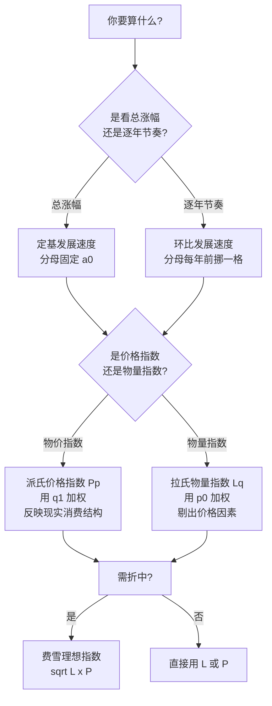

# 09 基期、报告期与指数方法选择：把"跟谁比、怎么加权"一次讲透

<div style="text-align:right;margin:10px 0;"><a href="../../exam.html" target="_blank" style="display:inline-block;padding:6px 16px;background:#2563eb;color:#fff;border-radius:6px;text-decoration:none;font-size:14px;">📝 开始做题</a></div>


> 本章是 09 时间序列章的"传统统计补丁"。前面几章（[[01_时间序列是什么|时间序列是什么]]、[[05_ARIMA建模流程|ARIMA建模流程]]）讲的是现代时序方法，但写论文时你绕不开一个最朴素的问题：**这个数到底是跟谁比？用哪一年的权重加权？** 基期、报告期、定基、环比、拉氏、派氏——这一堆词听着像绕口令，搞错了一个，整张表的结论全错。

---

## 一、为什么要学这个

写论文算下面这些东西时，你天天在跟这几个概念打交道：

- **CPI 同比涨了 2.1%** —— "同比"就是跟去年同月比（环比发展速度）；
- **GDP 从 1978 年到现在增长了 30 倍** —— "从 1978 年到现在"就是定基；
- **居民消费价格指数（CPI）= 102.5** —— 这是个派氏价格指数；
- **GDP 平减指数** —— 这是个拉氏物量指数的变形；
- **"今年 1—9 月出口额累计同比增长 8%"** —— 这里的"累计"用的是时期数列的序时平均数。

这些数字你不能只抄过来，你得知道：**它的分母是谁？权重是谁？** 分母换了、权重换了，同一个"涨了 5%"背后的含义完全不同。

本章目标：让你看到任何一个指数，能立刻判断三件事——

1. 它的**基期**是哪一年/哪一期；
2. 它是**定基**还是**环比**；
3. 它是**拉氏加权**还是**派氏加权**。

---

## 二、一句话直觉（先记住这个，后面全是展开）

| 概念 | 一句话直觉 |
|---|---|
| **基期** | "去年花的钱"——对比的基准，分母用它 |
| **报告期** | "今年花的钱"——当前要分析的那一期，分子用它 |
| **定基** | "所有年份都跟 2005 年比"——分母永远固定 |
| **环比** | "今年只跟去年比"——分母每年往前挪一格 |
| **拉氏指数** | "用去年的消费量当权重"加权 |
| **派氏指数** | "用今年的消费量当权重"加权 |

> 记住这张表，后面所有公式都是这两句话的展开。

---

## 三、基期 vs 报告期：对比基准与当前分析期

### 3.1 什么是基期、什么是报告期

- **基期（base period）**：作为对比基准的那个时期，记为 $0$ 期。它的数值出现在公式的**分母**里。
- **报告期（current period / given period）**：你当前要分析、要评价的那个时期，记为 $1$ 期（或 $t$ 期）。它的数值出现在公式的**分子**里。

举个最简单的例子：今年 GDP 是 110 万亿，去年是 100 万亿，那么

- 报告期 = 今年（110）
- 基期 = 去年（100）
- 发展速度 = 110 / 100 = 110%
- 增长速度 = 110% − 100% = 10%

### 3.2 发展水平 vs 序时平均数

时间序列里每一期的那个数，叫**发展水平**，记为 $a_0, a_1, a_2, \dots, a_n$。

但有时候你不能直接拿某一期的 $a_t$ 当代表，而要把一段时间的水平平均一下，这就叫**序时平均数**（动态平均数）。算法分两种情况：

#### （1）时期数列（可加）——直接算术平均

时期数列的特点是：指标可以跨期相加（比如各月 GDP、各月销售额）。

$$
\bar{a} = \frac{a_1 + a_2 + \cdots + a_n}{n}
$$

例：Q1=100，Q2=120，Q3=110，Q4=130，全年平均季度 GDP = (100+120+110+130)/4 = 115。

#### （2）时点数列（不可加）——首末折半法

时点数列的特点是：指标是某个时点上的"快照"（比如月末人口数、月末存款余额），**不能相加**（你不能把 1 月末和 2 月末的人口加起来）。

如果这个时点数列是**按月/按季连续**登记的，用**首末折半法**（也叫简单序时平均法）：

$$
\bar{a} = \frac{\frac{a_1}{2} + a_2 + a_3 + \cdots + a_{n-1} + \frac{a_n}{2}}{n - 1}
$$

为什么要首末折半？因为相邻两个时点之间是线性变化的，1 月末和 2 月末的中点（即 2 月初）水平 = $(a_1 + a_2)/2$。把每个相邻时段的中点水平平均一下，就是上面那个公式。

例：某企业 1—4 月月初职工人数分别为 200、210、220、230 人，一季度平均人数 = $(200/2 + 210 + 220 + 230/2)/3 = (100+210+220+115)/3 = 645/3 = 215$ 人。

### 3.3 时期指标 vs 时点指标（一张表分清）

| | 时期指标 | 时点指标 |
|---|---|---|
| 含义 | 一段时间内发生的总量 | 某个瞬间的状态 |
| 可加性 | 可加（1 月+2 月=第一季度） | 不可加（1 月末+2 月末无意义） |
| 数值大小与时期长短 | 时期越长，数值一般越大 | 与时间间隔无直接关系 |
| 典型例子 | 产值、销售额、GDP、进出口额 | 人口数、存款余额、库存量 |
| 序时平均算法 | 简单算术平均 | 首末折半法 |

---

## 三补、指数到底是什么：个体指数、总指数与同度量因素

> 📖 对应 [[../../教材笔记/05_统计学原理/10_统计指数/知识点/KP01_指数定义与作用|统计原理·KP01 指数定义]]、[[../../教材笔记/05_统计学原理/10_统计指数/知识点/KP02_个体指数vs总指数|KP02 个体vs总指数]]、[[../../教材笔记/05_统计学原理/10_统计指数/知识点/KP04_同度量因素|KP04 同度量因素]]。

### 指数是干什么用的？

**统计指数**（简称指数）是一种**相对数**，专门用来衡量"不能直接加总的复杂现象"在两个时期之间的综合变动。

**生活例子**：今年物价到底涨了多少？你不能把"大米 8 元/斤、猪肉 20 元/斤、理发 30 元/次"直接加起来——单位不一样、重要性不一样。指数就是把它们**加权合成为一个数**，告诉你"一篮子商品"整体涨了百分之几。

### 个体指数 vs 总指数

| | 个体指数 | 总指数 |
|---|---|---|
| 看什么 | 只一种商品/一个项目 | 一篮子商品/整个总体 |
| 公式 | $K_p = p_1/p_0$ | 加权合成（拉氏/派氏等） |
| 例子 | "猪肉价格今年涨了 67%" | "CPI 今年涨了 2.1%" |
| 难度 | 两个数一除 | 要解决权数、同度量因素问题 |

**关系**：总指数不是个体指数的简单平均，而是按各商品的经济重要性（销售额）加权合成。CPI、上证综指、GDP 平减指数都是总指数。

### 数量指标指数 vs 质量指标指数

- **数量指标指数**（物量指数）：研究"销量/产量/人数"变了多少，比如销售量指数 $I_q$；
- **质量指标指数**（质量指数）：研究"价格/成本/单价"变了多少，比如价格指数 $I_p$。

**记忆口诀**：数量 = 多少个，质量 = 多少钱一个。

### 同度量因素：把不能加的东西变成能加的

**核心难题**：猪肉按斤卖、布按米卖、电按度卖——直接把价格加起来没意义。

**解决办法**：**价格 × 销量 = 销售额（元）**，都是钱，能加！

- 算**价格指数**（研究 $p$ 变动）：用**销量 $q$** 当同度量因素，把 $p$ 转成 $pq$（销售额）；
- 算**销量指数**（研究 $q$ 变动）：用**价格 $p$** 当同度量因素，把 $q$ 转成 $pq$。

> **同度量因素有两个身份**：它既是"把不可加变可加"的桥梁，又是"各商品重要性"的权数。固定在基期就是拉氏，固定在报告期就是派氏（下一节细讲）。

### 加权算术平均指数 vs 加权调和平均指数：拉氏/派氏的另一种算法

> 📖 对应 [[../../教材笔记/05_统计学原理/10_统计指数/知识点/KP08_加权算术平均指数|KP08 加权算术平均]]、[[../../教材笔记/05_统计学原理/10_统计指数/知识点/KP09_加权调和平均指数|KP09 加权调和平均]]。

综合指数是"先加总 $pq$ 再相除"。但有时候你手里只有**个体指数**和**权数**，没有完整的 $p_1, q_1$ 数据。这时候用平均指数：

| 方法 | 权数 | 数学上等价于 | 什么时候用 |
|---|---|---|---|
| **加权算术平均** | 基期销售额 $p_0 q_0$ | **拉氏综合指数** | 手里有个体指数和基期销售额 |
| **加权调和平均** | 报告期销售额 $p_1 q_1$ | **派氏综合指数** | 手里有个体指数和报告期销售额 |

**手算例子（加权算术平均）**：三种商品的个体价格指数分别为 133%、120%、167%，基期销售额权重分别为 18%、29%、53%。

$$I_p = 1.33 \times 0.18 + 1.20 \times 0.29 + 1.67 \times 0.53 = 1.47 = 147\%$$

这和拉氏价格指数 $\sum p_1 q_0 / \sum p_0 q_0 = 147\%$ 完全一样——殊途同归。

> **CPI 就是用加权算术平均法编的**：先算每种商品的个体价格指数，再按居民消费支出结构（$p_0 q_0$ 比重）加权平均。

---

## 四、发展速度 vs 增长速度

### 4.1 公式

- **发展速度** = 报告期水平 / 基期水平

$$
\text{发展速度} = \frac{a_1}{a_0}
$$

- **增长速度** = 发展速度 − 1（或 100%）

$$
\text{增长速度} = \frac{a_1 - a_0}{a_0} = \frac{a_1}{a_0} - 1
$$

> 关键提醒：**增长速度 = 发展速度 − 1，不是发展速度本身减 100 就完事那么简单——它的"1"代表基期水平本身。** 发展速度 110%，对应增长速度就是 10%，不是 110%。

### 4.2 增长量 vs 增长 1% 的绝对值

- **增长量** = 报告期水平 − 基期水平 = $a_1 - a_0$（绝对数，带单位）
- **增长 1% 的绝对值** = 基期水平 / 100 = $a_0 / 100$

为什么要搞"增长 1% 的绝对值"？因为**高速度未必高增量**。

例：A 国 GDP 从 1 万亿涨到 1.2 万亿，发展速度 120%，增长 20%，增量 = 0.2 万亿；B 国 GDP 从 100 万亿涨到 115 万亿，发展速度 115%，增长 15%，增量 = 15 万亿。

- A 的"增长速度"更高（20% > 15%），但**绝对增量只有 0.2 万亿**；
- B 的"增长速度"更低（15% < 20%），但**绝对增量是 15 万亿**，是 A 的 75 倍。

公式上，**增长 1% 的绝对值 = 增长量 / 增长速度百分点数**。A 国增长 1% 的绝对值 = 1 万亿 / 100 = 100 亿；B 国 = 100 万亿 / 100 = 1 万亿。这就是为什么看增速必须同时看基数。

---

## 五、定基 vs 环比：固定基期对比 vs 逐期对比

### 5.1 定义

- **定基发展速度**：所有报告期都跟**同一个固定基期**（通常是最初一期 $a_0$）比。

$$
\text{定基发展速度} = \frac{a_t}{a_0} \quad (t=1,2,\dots,n)
$$

- **环比发展速度**：每一期都跟**上一期**比。

$$
\text{环比发展速度} = \frac{a_t}{a_{t-1}} \quad (t=1,2,\dots,n)
$$

### 5.2 核心换算关系（必考）

$$
\boxed{\text{定基发展速度} = \text{环比发展速度的连乘积}}
$$

也就是：

$$
\frac{a_n}{a_0} = \frac{a_1}{a_0} \times \frac{a_2}{a_1} \times \cdots \times \frac{a_n}{a_{n-1}}
$$

中间的 $a_1, a_2, \dots, a_{n-1}$ 全部约掉，只剩下 $a_n / a_0$。

> **极重要的易错点**：这个连乘关系只对**发展速度**成立，对**增长速度**不成立！
>
> ❌ 错误做法：把各年环比增长速度（比如 5%、8%、10%）直接连乘，当成定基增长速度。
>
> ✅ 正确做法：先把每个环比增长速度还原成环比发展速度（+100%），连乘后再减 100%。
>
> 例：三年环比增长速度分别为 5%、8%、10%，则定基发展速度 = 1.05 × 1.08 × 1.10 = 1.2474，定基增长速度 = 24.74%，不是 5%+8%+10% = 23%，更不是 5%×8%×10%。

### 5.3 定基 vs 环比对比表

| 指标 | 公式 | 直觉 | 适用场景 | 换算关系 |
|---|---|---|---|---|
| 定基发展速度 | $a_t / a_0$ | "都跟 2005 年比" | 看长期总趋势、累计涨幅 | = 各期环比发展速度连乘 |
| 环比发展速度 | $a_t / a_{t-1}$ | "今年只跟去年比" | 看逐年节奏、短期波动 | = 相邻两期定基发展速度相除 |
| 定基增长速度 | $a_t/a_0 - 1$ | "累计涨了百分之几" | 论文里"较 2005 年增长 X%" | 不能由环比增长速度连乘得到 |
| 环比增长速度 | $a_t/a_{t-1} - 1$ | "今年比去年涨了百分之几" | 同比、环比增速 | 不能连乘求定基增长速度 |

---

## 六、平均发展速度：几何平均法 vs 方程法

当你想把一段时期的"平均每年发展速度"算出来时，有两种方法，结果不一样，适用场景也不一样。

### 6.1 几何平均法（水平法）

公式：

$$
\bar{x} = \sqrt[n]{\frac{a_n}{a_0}}
$$

也就是用**最末水平 $a_n$ 与最初水平 $a_0$ 的比值开 $n$ 次方**。

它关心的是**最末一年达到的水平**——"如果每年都按这个平均速度发展，从 $a_0$ 出发，$n$ 年后刚好到 $a_n$"。

适用：GDP 增速、人口增速等关心"期末水平"的指标。

例：GDP 从 100 万亿涨到 161 万亿，用了 2 年，平均发展速度 = √1.61 = 1.269，即平均每年增长 26.9%。

### 6.2 方程法（累计法）

它关心的是**这 $n$ 年的累计总量**，要求解下面这个方程：

$$
a_0 \cdot \bar{x} + a_0 \cdot \bar{x}^2 + \cdots + a_0 \cdot \bar{x}^n = \sum_{t=1}^{n} a_t
$$

也就是每年按 $\bar{x}$ 发展，$n$ 年的累计值要等于实际累计值。需要查累计法平均增长速度表。

适用：固定资产投资、累计完成工作量等关心"累计总量"的指标。

### 6.3 两种方法怎么选

| | 几何平均法（水平法） | 方程法（累计法） |
|---|---|---|
| 关心的 | 期末水平 | 累计总量 |
| 公式 | 期末/期初开 n 次方 | 解累计方程 |
| 适用 | GDP、人口、产量 | 投资、建设工作量 |
| 缺点 | 中间各年波动被忽略 | 末年水平未必能复原 |

---

## 七、拉氏指数 vs 派氏指数：基期加权还是报告期加权

这是本章最核心、最容易配错的部分。

### 7.1 问题从哪来

你要算"物价整体涨了多少"。但物价是一篮子商品的价格，不同商品消费量差很多——大米涨 1 毛 vs 牛肉涨 10 块，对老百姓的感受完全不同。所以你不能把每种商品的涨幅简单平均，**必须加权**。

权重用什么？这就分成两派：

- **拉氏（Laspeyres）**：权重用**基期**的消费量 $q_0$；
- **派氏（Paasche）**：权重用**报告期**的消费量 $q_1$。

### 7.2 四个指数的公式（必须背下来）

| 指数 | 拉氏（基期加权） | 派氏（报告期加权） |
|---|---|---|
| **价格指数** | $L_p = \dfrac{\sum p_1 q_0}{\sum p_0 q_0}$ | $P_p = \dfrac{\sum p_1 q_1}{\sum p_0 q_1}$ |
| **物量指数** | $L_q = \dfrac{\sum p_0 q_1}{\sum p_0 q_0}$ | $P_q = \dfrac{\sum p_1 q_1}{\sum p_1 q_0}$ |

记忆技巧：

- 价格指数的分子分母都是"价格 × 数量"，**数量**是权重——拉氏用 $q_0$，派氏用 $q_1$；
- 物量指数的分子分母都是"数量 × 价格"，**价格**是权重——拉氏用 $p_0$，派氏用 $p_1$；
- 拉氏 = 权重固定在基期（$q_0$ 或 $p_0$）；派氏 = 权重固定在报告期（$q_1$ 或 $p_1$）。

### 7.3 为什么结果会不同：权偏误

现实中，**涨价多的商品，消费者会少买**（替代效应）。

- 拉氏价格指数用 $q_0$ 加权：涨价多的商品在基期买得多，权重被高估，所以拉氏价格指数**偏高**；
- 派氏价格指数用 $q_1$ 加权：涨价多的商品在报告期已经少买了，权重被低估，所以派氏价格指数**偏低**。

这就是著名的**替代偏误（substitution bias）**：

$$
\text{拉氏价格指数} \ge \text{派氏价格指数}
$$

（只要价格和数量反向变化，不等式就严格成立。）

### 7.4 实践惯例：物量用拉氏、物价用派氏

为什么？

- **物量指数用拉氏**（用基期价格 $p_0$ 加权）：这样能把价格因素剔掉，纯粹反映"实物量变化"。如果用派氏（用报告期 $p_1$ 加权），价格变化会混进去。GDP 物量增长、工业生产指数都用这个思路。
- **价格指数用派氏**（用报告期消费量 $q_1$ 加权）：这样反映的是"今天真实消费结构下的物价变化"，更贴近老百姓的实际感受。CPI、居民消费价格指数就是这个思路。

> 注意：一个完整的指数体系里，**价格指数和物量指数必须一个用拉氏、一个用派氏**，才能满足
>
> $$
> \text{销售额指数} = \frac{\sum p_1 q_1}{\sum p_0 q_0} = L_p \times P_q = P_p \times L_q
> $$
>
> 如果你两个都用拉氏，或两个都用派氏，这个连乘关系就不成立。

### 7.5 费雪理想指数

为了折中拉氏的偏高和派氏的偏低，费雪（Fisher）提出取两者的**几何平均**：

$$
F_p = \sqrt{L_p \times P_p}
$$

它叫"理想指数"，因为它能同时满足时间互换检验和因子互换检验。但实际编制中用得少，主要是理论上的折中。

---

## 八、完整数字例子（手算 + 验证）

### 8.1 数据

假设只有两种商品：猪肉和大米。

| 商品 | 基期价格 $p_0$（元/斤） | 基期销量 $q_0$（斤） | 报告期价格 $p_1$（元/斤） | 报告期销量 $q_1$（斤） |
|---|---|---|---|---|
| 猪肉 | 12 | 3000 | 20 | 2000 |
| 大米 | 4 | 10000 | 5 | 12000 |

观察一下：猪肉价格涨了 $20/12 = 166.7\%$，但销量从 3000 斤跌到 2000 斤（−33.3%）；大米价格涨了 $5/4 = 125\%$，销量从 10000 斤涨到 12000 斤（+20%）。

猪肉是"涨得多、买得少"的典型，大米是"涨得少、买得多"的典型——正好可以演示权偏误。

### 8.2 算四个交叉项

| 项目 | 猪肉 | 大米 | 合计 |
|---|---|---|---|
| $p_0 q_0$（基期价 × 基期量） | 12×3000 = 36000 | 4×10000 = 40000 | **Σp₀q₀ = 76000** |
| $p_1 q_0$（报告期价 × 基期量） | 20×3000 = 60000 | 5×10000 = 50000 | **Σp₁q₀ = 110000** |
| $p_0 q_1$（基期价 × 报告期量） | 12×2000 = 24000 | 4×12000 = 48000 | **Σp₀q₁ = 72000** |
| $p_1 q_1$（报告期价 × 报告期量） | 20×2000 = 40000 | 5×12000 = 60000 | **Σp₁q₁ = 100000** |

### 8.3 拉氏价格指数

$$
L_p = \frac{\sum p_1 q_0}{\sum p_0 q_0} = \frac{110000}{76000} = 1.4474 = 144.74\%
$$

直觉：假设老百姓还是按去年的消费量（3000 斤猪肉 + 10000 斤大米）买东西，今年要多花 44.74% 的钱。

### 8.4 派氏价格指数

$$
P_p = \frac{\sum p_1 q_1}{\sum p_0 q_1} = \frac{100000}{72000} = 1.3889 = 138.89\%
$$

直觉：按今年真实的消费量（2000 斤猪肉 + 12000 斤大米）算，今年多花了 38.89% 的钱。

### 8.5 费雪理想价格指数

$$
F_p = \sqrt{1.4474 \times 1.3889} = \sqrt{2.0104} = 1.4178 = 141.78\%
$$

### 8.6 为什么派氏 < 拉氏？

- 拉氏价格指数里，猪肉（涨幅 66.7% 的那个）按 $q_0 = 3000$ 斤加权，权重很大；
- 派氏价格指数里，猪肉按 $q_1 = 2000$ 斤加权，权重已经变小了（因为大家嫌贵少买了）；
- 于是派氏把"涨得最凶的猪肉"的权重压低了，整体涨幅自然显得小一些。

这就是**替代偏误**：涨价商品被消费者替代掉，派氏权重天然偏低，所以派氏 ≤ 拉氏。

### 8.7 Python 验证（数字来源可追溯）

```python
items = {
    "猪肉": {"p0":12, "q0":3000, "p1":20, "q1":2000},
    "大米": {"p0":4,  "q0":10000,"p1":5,  "q1":12000},
}
s_p0q0 = sum(v["p0"]*v["q0"] for v in items.values())   # 76000
s_p1q0 = sum(v["p1"]*v["q0"] for v in items.values())   # 110000
s_p0q1 = sum(v["p0"]*v["q1"] for v in items.values())   # 72000
s_p1q1 = sum(v["p1"]*v["q1"] for v in items.values())   # 100000

Lp = s_p1q0/s_p0q0   # 1.4474 -> 144.74%
Pp = s_p1q1/s_p0q1   # 1.3889 -> 138.89%
import math
Fp = math.sqrt(Lp*Pp) # 1.4178 -> 141.78%
```

---

## 九、决策树：你到底该用哪种方法



---

## 十、和现代时序（ARIMA/GARCH）的关系

前面几章讲的 ARIMA、GARCH、协整，跟本章这些传统概念不是割裂的：

1. **ARIMA 用的是报告期数据的差分**。你拿到一个时间序列 $a_0, a_1, \dots, a_n$，做一阶差分 $\Delta a_t = a_t - a_{t-1}$，本质上就是"环比增长量"。ARIMA 里的 $d$ 阶差分，就是反复做环比。
2. **ARIMA 里常用的对数差分** $\Delta \ln a_t = \ln a_t - \ln a_{t-1} \approx a_t/a_{t-1} - 1$，近似等于**环比增长速度**。所以你在论文里看到的"对 CPI 取对数后差分"，跑出来的就是环比通胀率。
3. **CPI 编制本质是派氏价格指数**（用当期消费权重）。国家统计局发布的 CPI 同比、环比，就是派氏价格指数的定基/环比版本。
4. **GDP 平减指数** = 名义 GDP / 实际 GDP，本质上是拉氏物量指数变形出来的价格指数。
5. **协整检验**要求两个非平稳序列有共同的随机趋势——这里的"非平稳"往往就是因为它们是定基增长型序列（$a_t$ 本身不平稳，但 $\Delta a_t$ 或 $\Delta \ln a_t$ 平稳）。

所以本章不是"老掉牙的知识点"，而是理解现代时序变量构造的底层。

---

## 十一、易错点清单

| 易错点 | 错误做法 | 正确做法 |
|---|---|---|
| 把环比增长速度连乘 | 5% × 8% × 10% = 4% 当定基增速 | 先还原成发展速度：1.05×1.08×1.10 − 1 = 24.74% |
| 基数太小导致速度失真 | 只看增速 200% 就下结论 | 同时看增长 1% 绝对值 = $a_0/100$ |
| 拉氏派氏配错 | 价格和物量都用拉氏 | 价格用派氏、物量用拉氏（或反过来），才能连乘 |
| 时点数列直接相加 | 把 1 月末 + 2 月末人口相加 | 用首末折半法 |
| 发展速度和增长速度混淆 | 发展速度 110% 说成"增长 110%" | 发展速度 − 100% 才是增长速度 |
| 平均发展速度用算术平均 | (1.2 + 1.3)/2 = 1.25 | 用几何平均：√(1.2×1.3) = 1.249 |

---

## 十二、补充：传统波动分解、指数体系与现实指数

> 前面十一节把"水平、速度、拉氏派氏"讲透了。但写论文时你还会碰到三个绕不开的传统话题：**趋势/季节怎么测？指数涨跌里价格和销量各贡献多少？CPI、PPI 到底是怎么编出来的？** 这一节用最短篇幅补上，详细推导见各 KP。

### 12.1 长期趋势测定：移动平均法与指数平滑法

[[../../教材笔记/05_统计学原理/09_时间序列分析/知识点/KP15_长期趋势测定|统计学原理·KP15 长期趋势测定]]

一个时间序列 $Y_t$ 里既有长期往上走的趋势 $T_t$，又有季节、循环、噪音。想把趋势单独拎出来，最朴素的办法是**移动平均法**：取连续 $k$ 期（比如 3 期、5 期）算一个平均值，窗口顺着时间滑过去，波动大的地方被平均掉，剩下一条平滑的线——这就是趋势。$k$ 取得越大越平滑，但越滞后、越丢掉细节。月度数据常用 12 期移动平均，正好把 12 个月的季节性抹平。

另一个办法是**指数平滑法**：新一期的趋势预测 = $\alpha \times$ 最新观测值 $+$ $(1-\alpha)\times$ 上一期预测值。$\alpha \in (0,1)$ 越大越重视新数据。它和后面 [[05_ARIMA建模流程|ARIMA]] 的关系是：**简单指数平滑本质上就是 ARIMA(0,1,1)**，Holt-Winters 带季节项的指数平滑就是 SARIMA 的近亲。本科论文做短期外推时，指数平滑是 ARIMA 之外的常见对照方法。

### 12.2 季节波动测定：同期平均法与趋势剔除法

[[../../教材笔记/05_统计学原理/09_时间序列分析/知识点/KP16_季节波动测定|统计学原理·KP16 季节波动测定]]

羽绒服销量冬天高、夏天低，每年都重复——这就是季节波动 $S_t$。测它有两种思路：

- **同期平均法**：把每年 1 月的数平均、每年 2 月的数平均……算出 12 个"季节指数"。如果某年 1 月是全年平均的 1.5 倍，1 月季节指数就是 150%。简单，但要求序列没有明显长期趋势。
- **移动平均趋势剔除法**：序列有长期上涨趋势时，直接平均会把"趋势"误算成"季节"。正确做法是先用移动平均把趋势 $T_t$ 提出来，再用 $Y_t / T_t$（或 $Y_t - T_t$）把趋势剔掉，剩下的再按同月平均，得到干净的季节指数。

论文里做月度数据预测，季节项要么用"季节差分"（SARIMA 里的 $D$ 阶季节差分），要么用"季节指数"去季节性——两者本质上都是在处理这个 $S_t$。

### 12.3 循环波动与不规则波动

[[../../教材笔记/05_统计学原理/09_时间序列分析/知识点/KP17_循环与不规则波动|统计学原理·KP17 循环与不规则波动]]

把趋势 $T_t$ 和季节 $S_t$ 都剔掉后，剩下的就是 $C_t + I_t$。

- **循环波动 $C_t$**：周期不固定的涨跌，比如经济周期（繁荣—衰退—复苏），3—10 年一轮，不像季节那样每年准点来。它最难预测，因为周期长度不固定。
- **不规则波动 $I_t$**：突发噪音，比如疫情、地震、政策突变。它不可预测，只能事后归因。

现代时序里，ARIMA 建模时做的"残差白噪音检验"，本质上就是确认残差里只剩 $I_t$——趋势、季节、循环都被模型榨干了。

### 12.4 指数体系与因素分析：涨跌里价格和销量各贡献多少

[[../../教材笔记/05_统计学原理/10_统计指数/知识点/KP10_指数体系与因素分析|统计学原理·KP10 指数体系与因素分析]]

一个卖猪肉+大米的商店，今年销售额比去年多了 2.4 万元。这多出来的钱，多少是因为涨价？多少是因为卖得多？这就是**因素分析**要回答的问题。

核心恒等式（指数体系）：

$$\text{销售额指数} = \text{销售量指数} \times \text{价格指数}$$

$$\frac{\sum p_1 q_1}{\sum p_0 q_0} = \frac{\sum p_0 q_1}{\sum p_0 q_0} \times \frac{\sum p_1 q_1}{\sum p_0 q_1}$$

右边第一项是**拉氏销售量指数**（用基期价格加权，纯量的变化），第二项是**派氏价格指数**（用报告期销量加权，纯价的变化）。分子分母一对，多出来的销售额 = 因多卖货多赚的 + 因涨价多赚的，两块加起来正好等于总销售额增长。

论文里做"价格变动对销售额的影响""销量变动对总成本的影响"，用的就是这套——它其实就是 [[07_协整与误差修正ECM|ECM]] 之前，传统统计对"双因素分解"的标准做法。

### 12.5 常见统计指数：CPI、PPI、PMI

[[../../教材笔记/05_统计学原理/10_统计指数/知识点/KP11_常见统计指数_CPI等|统计学原理·KP11 常见统计指数 CPI 等]]

论文里高频引用的几个官方指数，你得知道它们是什么：

- **CPI（居民消费价格指数）**：一篮子消费品和服务的**派氏价格指数**，反映老百姓买东西贵了多少。CPI 同比涨 2.1% = 今年这个月的篮子比去年同月贵 2.1%。
- **PPI（工业生产者出厂价格指数）**：工厂出厂端的价格指数，是 CPI 的上游先行指标——PPI 涨了，过几个月 CPI 往往跟着涨。
- **PMI（采购经理指数）**：50% 为荣枯线，>50 制造业扩张，<50 收缩。它是个扩散指数，不是拉氏派氏那一套。
- **GDP 平减指数** = 名义 GDP / 实际 GDP，是范围最广的价格指数，国家统计局算实际 GDP 增速时用的就是它。
- **股票价格指数**（上证综指、沪深 300）：选一组样本股票，用派氏或加权平均算出来的综合价格指数。

写论文引用这些数据时，记得标注：基期是哪一年、同比还是环比、价格指数还是物量指数——这正是本章前面花大力气讲的东西。

---

## 十三、速记卡

> **基期分母，报告期分子。**
> **定基跟老祖宗比，环比只跟上期比。**
> **发展速度连乘，增长速度先加百再减百。**
> **涨价多的买得少，派氏低、拉氏高。**
> **物价用派氏，物量用拉氏，一个指数体系里不能同派同拉。**
> **首末折半管时点，时期直接算平均。**
> **几何平均管期末，方程法管累计。**

---

## 💡 经济学视角：CPI 到底是怎么算出来的？指数方法选不对就乱套

**这个方法是为了解决什么经济学问题？**
统计局每月公布 CPI 涨了 0.3%，这 0.3% 怎么来的？老百姓一篮子里有猪肉、蔬菜、房租、教育、医疗……几万种商品价格涨跌不一，怎么合成一个数？选哪个年份当"基期"（基准篮子）？用拉氏指数还是派氏指数？这些选择看似技术细节，实则直接影响通胀感受——2019 年猪肉涨价，CPI 权重怎么设，结论完全不同。

**经济学里哪些经典指标都是这么算出来的？**
GDP 核算里"名义 GDP"和"实际 GDP"的换算用 GDP 平减指数，本质就是一种价格指数。CPI、PPI、GDP 平减指数是宏观经济三大价格指标，全部建立在基期选择、同度量因素、加权方法之上——不懂指数方法，就读不懂宏观数据。

**举个实证论文的例子：**
《中国 CPI 编制方法的改进研究》对比拉氏指数和派氏指数在 2000—2022 年中国数据上的差异，发现长期看派氏指数比拉氏指数低约 0.2 个百分点（替代效应造成的偏差），论文建议统计局每 5 年调整一次篮子权重，以减少" substitution bias"。

**📚 配套经济学笔记：**
- [[../../教材笔记/06_西方经济学/09_宏观经济基本指标/知识点/KP02_名义GDP与实际GDP|原KP·名义GDP与实际GDP]]
- [[../../教材笔记/06_西方经济学/09_宏观经济基本指标/知识点/KP03_CPI消费价格指数|原KP·CPI消费价格指数]]

---

下一篇：[[00_章节总结]]

---

### 延伸阅读

📚 **教材笔记**：
- [[../../教材笔记/05_统计学原理/09_时间序列分析/知识点/KP11_发展速度与增长速度|统计学原理·发展速度与增长速度]]
- [[../../教材笔记/05_统计学原理/10_统计指数/知识点/KP07_拉氏vs派氏对比|统计学原理·拉氏vs派氏对比]]

📖 **关联章节**：
- [[01_时间序列是什么|时间序列是什么]]
- [[05_ARIMA建模流程|ARIMA建模流程]]

---

## 📖 配套教材笔记

- [[../../教材笔记/05_统计学原理/10_统计指数/00_章节总结|统计原理·第10章 统计指数]]
- [[../../教材笔记/05_统计学原理/10_统计指数/知识点/KP01_指数定义与作用|统计·KP01 指数定义]]
- [[../../教材笔记/05_统计学原理/10_统计指数/知识点/KP02_个体指数vs总指数|统计·KP02 个体vs总指数]]
- [[../../教材笔记/05_统计学原理/10_统计指数/知识点/KP04_同度量因素|统计·KP04 同度量因素]]
- [[../../教材笔记/05_统计学原理/10_统计指数/知识点/KP05_拉氏综合指数|统计·KP05 拉氏指数]]
- [[../../教材笔记/05_统计学原理/10_统计指数/知识点/KP06_派氏综合指数|统计·KP06 派氏指数]]
- [[../../教材笔记/05_统计学原理/10_统计指数/知识点/KP07_拉氏vs派氏对比|统计·KP07 拉氏vs派氏]]
- [[../../教材笔记/05_统计学原理/10_统计指数/知识点/KP08_加权算术平均指数|统计·KP08 加权算术平均]]
- [[../../教材笔记/05_统计学原理/10_统计指数/知识点/KP09_加权调和平均指数|统计·KP09 加权调和平均]]
- [[../../教材笔记/05_统计学原理/10_统计指数/知识点/KP10_指数体系与因素分析|统计·KP10 指数体系]]
- [[../../教材笔记/05_统计学原理/10_统计指数/知识点/KP11_常见统计指数_CPI等|统计·KP11 常见指数]]

## 📚 配套原书

- [[../../原文件/统计学原理/韩兆洲_统计学原理第7版_全书|韩兆洲教材·第10章 统计指数]]
