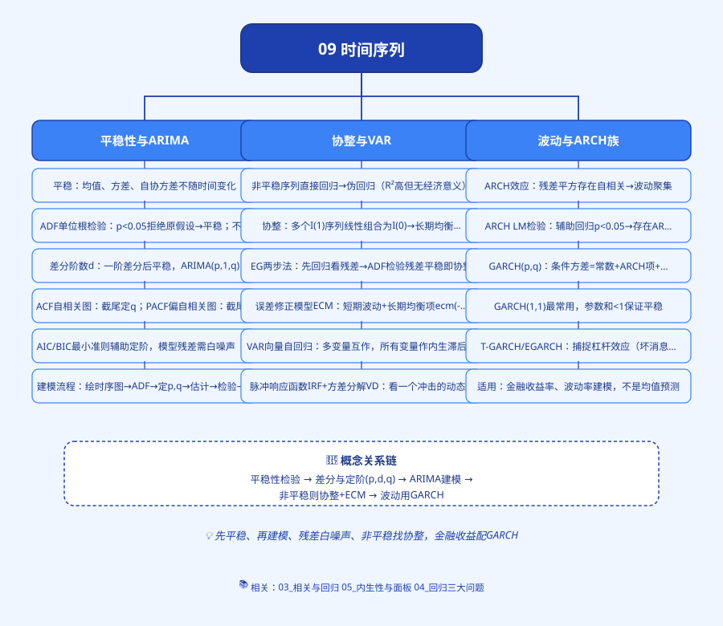
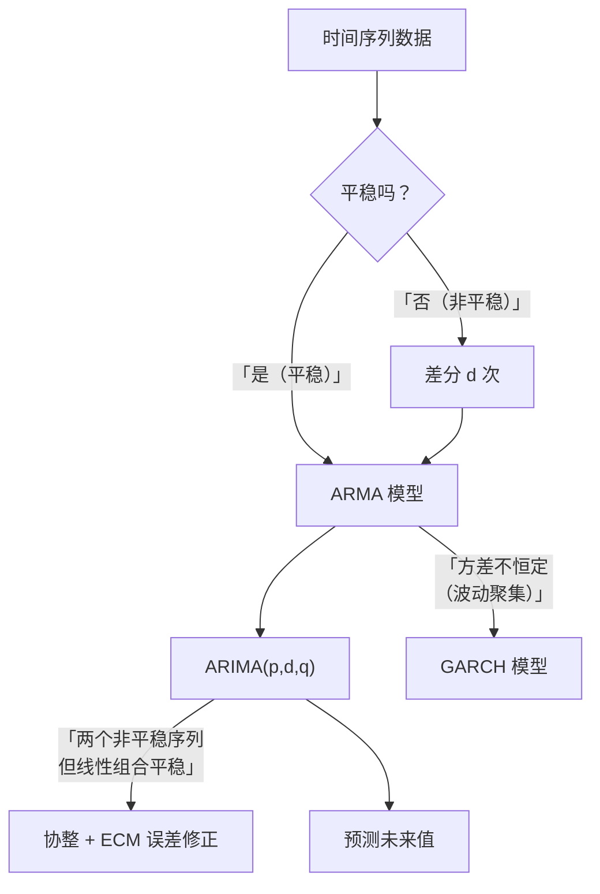

# 思维导图

---

# 09 时间序列：预测未来的学问

> 这一章解决一个你天天想的问题：**明年 GDP 多少？下个月股价多少？明天 CPI 多少？**
> 按时间顺序排好的数据，就是时间序列。怎么用过去预测未来，这一章教你。

---

## 这一章你会学到什么

| 文件 | 解决什么问题 | 一句话 |
|------|-------------|--------|
| [01_时间序列是什么](01_时间序列是什么.md) | 什么是时序数据？和截面数据啥区别？ | 按时间排好的一列数 |
| [02_平稳性](02_平稳性.md) | 为什么平稳这么重要？ | 均值方差不随时间变，否则伪回归 |
| [03_自相关与ACF](03_自相关与ACF.md) | 怎么看数据的时间结构？ | 自己跟自己滞后相关 |
| [04_ARMA模型](04_ARMA模型.md) | 核心模型长什么样？ | AR(自回归) + MA(移动平均) |
| [05_ARIMA建模流程](05_ARIMA建模流程.md) | 完整建模[[08_答辩PPT怎么做|怎么做]]？ | Box-Jenkins 五步走 |
| [06_ADF单位根检验](06_ADF单位根检验.md) | 怎么检验平不平稳？ | p<0.05 = 平稳 |
| [07_协整与误差修正ECM](07_协整与误差修正ECM.md) | 两个非平稳序列能一起回归吗？ | 长期均衡 + 短期修正 |
| [08_GARCH模型](08_GARCH模型.md) | 金融数据的大波动聚集怎么办？ | [[05_ARIMA建模流程|ARIMA]] 管均值，[[08_GARCH模型|GARCH]] 管方差 |
| [09_基期报告期与指数方法选择](09_基期报告期与指数方法选择.md) | 基期vs报告期、定基vs环比、拉氏vs派氏 | 传统统计指数的完整决策 |
| [00_章节总结](00_章节总结.md) | 方法怎么选？自测题 | 决策图 + 复习 |

---

## 什么时候会用到这一章？

**场景一：毕业论文做"中国 GDP 增长预测"**
你有 1978-2025 年的年度 GDP 数据，想预测 2026、2027 年。
→ 用 ARIMA 模型（先差分平稳，再定阶，再预测）。

**场景二：做"通货膨胀（CPI）影响因素分析"**
你有 CPI、货币供应量、GDP 增速的月度数据 20 年。
→ 先 [[06_ADF单位根检验|ADF]] 检验，发现都是非平稳的；再做协整检验，发现它们有长期均衡关系；最后建 [[07_协整与误差修正ECM|ECM]] 模型。

**场景三：做"股票收益率波动研究"**
你有某只股票 5 年的日收益率。
→ 发现大波动跟着大波动（2008 年金融危机期间天天暴涨暴跌），这叫"波动聚集"。
→ 用 G[[KP04_ARCH模型|ARCH]] 模型，ARIMA 预测均值，GARCH 预测方差。

---

## 方法关系图

---

## 前置知识

读这一章，你需要先会：
- 回归分析（第 3 章）——ARIMA 本质上是一种特殊的回归；
- [[02_平稳性|平稳性]]、单位根的直觉（本章会从零讲）；
- Stata [[01_Stata基本操作|基本操作]]（第 10 章会教完整的）。

---

下一篇：[[01_时间序列是什么]]

---

## 延伸阅读
- 📚 教材笔记：[[../../教材笔记/03_时间序列/README|时间序列教材笔记]]
- 📖 原书：[[../../原文件/时间序列分析/王燕_时间序列分析基于R_全书|王燕《时间序列分析——基于R》封面]]
- 📖 原书：[[../../原文件/时间序列分析/王燕_时间序列分析基于R_全书|王燕教材·GARCH模型篇]]
- 📖 **统计学原理配套（Ch09 时间序列分析 17 KP + Ch10 统计指数 11 KP）**：

  **① 时间序列基础（Ch09 入门）**
  - [[../../教材笔记/05_统计学原理/09_时间序列分析/知识点/KP01_时间数列两个基本要素|KP01 时间数列两个基本要素（时间+指标值）]]
  - [[../../教材笔记/05_统计学原理/09_时间序列分析/知识点/KP02_时期数列与时点数列|KP02 时期数列 vs 时点数列]]
  - [[../../教材笔记/05_统计学原理/09_时间序列分析/知识点/KP03_时间数列编制原则|KP03 时间数列编制原则（可比性）]]

  **② 水平分析（序时平均数，"这一段平均水平是多少"）**
  - [[../../教材笔记/05_统计学原理/09_时间序列分析/知识点/KP04_发展水平与序时平均数|KP04 发展水平与序时平均数]]
  - [[../../教材笔记/05_统计学原理/09_时间序列分析/知识点/KP05_时期数列序时平均数|KP05 时期数列序时平均数（直接算术平均）]]
  - [[../../教材笔记/05_统计学原理/09_时间序列分析/知识点/KP06_时点数列序时平均数_连续登记|KP06 时点数列序时平均数（连续登记）]]
  - [[../../教材笔记/05_统计学原理/09_时间序列分析/知识点/KP07_首末折半法|KP07 首末折半法（间隔相等时点）]]
  - [[../../教材笔记/05_统计学原理/09_时间序列分析/知识点/KP08_间隔不等时点序列序时平均数|KP08 间隔不等时点序列序时平均数（加权）]]
  - [[../../教材笔记/05_统计学原理/09_时间序列分析/知识点/KP09_相对数与平均数时间数列序时平均数|KP09 相对数/平均数时间数列序时平均数]]

  **③ 速度分析（"涨了多少、涨多快"）**
  - [[../../教材笔记/05_统计学原理/09_时间序列分析/知识点/KP10_增长量与平均增长量|KP10 增长量与平均增长量]]
  - [[../../教材笔记/05_统计学原理/09_时间序列分析/知识点/KP11_发展速度与增长速度|KP11 发展速度与增长速度（定基/环比）]]
  - [[../../教材笔记/05_统计学原理/09_时间序列分析/知识点/KP12_平均发展速度_几何平均法|KP12 平均发展速度·几何平均法（水平法）]]
  - [[../../教材笔记/05_统计学原理/09_时间序列分析/知识点/KP13_平均发展速度_方程法|KP13 平均发展速度·方程法（累计法）]]
  - [[../../教材笔记/05_统计学原理/09_时间序列分析/知识点/KP14_增长百分之一绝对值|KP14 增长 1% 的绝对值]]

  **④ 波动分解（T/S/C/I，"数据里到底藏着什么波动"）**
  - [[../../教材笔记/05_统计学原理/09_时间序列分析/知识点/KP15_长期趋势测定|KP15 长期趋势测定（移动平均、指数平滑）]]
  - [[../../教材笔记/05_统计学原理/09_时间序列分析/知识点/KP16_季节波动测定|KP16 季节波动测定（同期平均、趋势剔除）]]
  - [[../../教材笔记/05_统计学原理/09_时间序列分析/知识点/KP17_循环与不规则波动|KP17 循环波动与不规则波动]]

  **⑤ 统计指数（Ch10，"一篮子东西整体涨跌多少"）**
  - [[../../教材笔记/05_统计学原理/10_统计指数/知识点/KP01_指数定义与作用|KP01 指数定义与作用]]
  - [[../../教材笔记/05_统计学原理/10_统计指数/知识点/KP02_个体指数vs总指数|KP02 个体指数 vs 总指数]]
  - [[../../教材笔记/05_统计学原理/10_统计指数/知识点/KP03_数量指标指数vs质量指标指数|KP03 数量指标指数 vs 质量指标指数]]
  - [[../../教材笔记/05_统计学原理/10_统计指数/知识点/KP04_同度量因素|KP04 同度量因素]]
  - [[../../教材笔记/05_统计学原理/10_统计指数/知识点/KP05_拉氏综合指数|KP05 拉氏综合指数（基期加权）]]
  - [[../../教材笔记/05_统计学原理/10_统计指数/知识点/KP06_派氏综合指数|KP06 派氏综合指数（报告期加权）]]
  - [[../../教材笔记/05_统计学原理/10_统计指数/知识点/KP07_拉氏vs派氏对比|KP07 拉氏 vs 派氏对比]]
  - [[../../教材笔记/05_统计学原理/10_统计指数/知识点/KP08_加权算术平均指数|KP08 加权算术平均指数]]
  - [[../../教材笔记/05_统计学原理/10_统计指数/知识点/KP09_加权调和平均指数|KP09 加权调和平均指数]]

  **⑥ 因素分析与现实指数（"涨跌里价格和销量各贡献多少"）**
  - [[../../教材笔记/05_统计学原理/10_统计指数/知识点/KP10_指数体系与因素分析|KP10 指数体系与因素分析（两因素分析）]]
  - [[../../教材笔记/05_统计学原理/10_统计指数/知识点/KP11_常见统计指数_CPI等|KP11 常见统计指数（CPI/PPI/PMI）]]

- 📐 方法选择：[[09_基期报告期与指数方法选择|基期/报告期·指数方法选择指南]]
