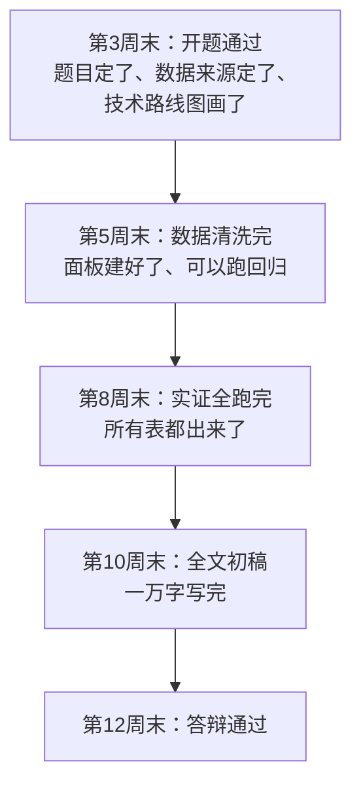

# 00 章节总结：论文写作 12 周甘特图

> 这一章把"从选题到答辩"的完整时间线画成一张甘特图。
> 建议打印出来贴在桌前，每周对照打勾。

---

## 一、本章文件清单（8 个）

| 文件 | 核心内容 |
|------|----------|
| `01_怎么选题.md` | 论文骨架（7 部分）+ 好题目 4 标准 + 35 个选题库 + 漏斗选题法 |
| `02_文献综述怎么做.md` | 数据库入口 + 检索式拼法 + 倒读法 + 文献卡片 + 三种写作模板（对话法） |
| `03_数据从哪来.md` | 变量设计表 + 宏观/微观/数字经济数据库入口 + Excel 整理规范 + 面板拼接 + 清洗一条龙 |
| `04_实证部分怎么写.md` | 描述 → 相关 → 基准回归 → 稳健性 → 异质性 → 机制（六步走） |
| `05_结果怎么读怎么写.md` | Stata 输出逐列解读 + 三线表正反对比 + 一句话报告模板 + esttab 导出到 Word |
| `06_稳健性检验.md` | 6 种方法（换 Y/换 X/滞后/缩样本/换方法/安慰剂）+ 方法选择决策表 + 保底组合 |
| `07_结论与摘要.md` | 摘要四要素 + 差中好三版对比 + 结论三段式 + 政策建议三可标准 + 句式库 |
| `08_技术路线图怎么做.md` | 回归类/综合评价类两套现成图 + 工具选择 + 文字描述模板 |

---

## 二、12 周完整时间线

```mermaid
graph TD
    title 毕业论文 12 周甘特图

    section 第1阶段：开题
    选题+导师沟通           :a1, 2026-03-02, 7d
    搜文献+写综述           :a2, after a1, 7d
    开题报告+开题答辩       :a3, after a2, 7d

    section 第2阶段：数据
    找数据+下载             :b1, after a3, 5d
    数据清洗+建面板         :b2, after b1, 7d

    section 第3阶段：实证
    描述统计+相关           :c1, after b2, 3d
    基准回归                :c2, after c1, 5d
    稳健性+异质性+机制      :c3, after c2, 10d

    section 第4阶段：写作
    写引言+文献+现状        :d1, after c3, 7d
    写实证+结论+摘要        :d2, after d1, 7d
    格式排版+三线表         :d3, after d2, 5d

    section 第5阶段：收尾
    自查+改稿+导师看        :e1, after d3, 7d
    查重+降重               :e2, after e1, 5d
    答辩PPT+演练            :e3, after e2, 5d
```

---

## 三、每周任务清单

| 周次 | 任务 | 对应本章文件 | 交付物 |
|------|------|-------------|--------|
| 第 1 周 | 选题，和导师确认方向 | `01_怎么选题` | 3 个备选题目 |
| 第 2 周 | 知网搜文献 30 篇，读 15 篇 | `02_文献综述怎么做` | 文献卡片 + 综述初稿 |
| 第 3 周 | 写开题报告，画技术路线图，开题答辩 | `08_技术路线图怎么做` | 开题报告 [[08_答辩PPT怎么做|PPT]] |
| 第 4 周 | 找数据，下载所有变量 | `03_数据从哪来` | 原始数据 Excel |
| 第 5 周 | 清洗数据，拼成面板 | `03_数据从哪来` | clean.dta |
| 第 6 周 | 跑描述统计、相关性 | `04_实证部分怎么写` | 表 1、表 2 |
| 第 7 周 | 跑基准回归，esttab 导出三线表 | `05_结果怎么读怎么写` | 主回归表 |
| 第 8 周 | 稳健性 + 异质性 + 机制 | `06_稳健性检验` | 表 4~6 |
| 第 9 周 | 写引言、文献综述、现状 | `02_文献综述怎么做` | 前半部分初稿 |
| 第 10 周 | 写实证、结论、摘要 | `07_结论与摘要` | 全文初稿 |
| 第 11 周 | 导师改稿 + 格式排版 + 查重 | `../12_毕业论文实战/09_查重与降重` | 修改稿 |
| 第 12 周 | 答辩 PPT + 演练 + 答辩 | `../12_毕业论文实战/08_答辩PPT怎么做` | PPT + 终稿 |

---

## 四、关键里程碑



**最容易拖的节点**：
- 第 4~5 周找数据（找两周很正常，别慌）；
- 第 8 周机制分析（中介效应模型调半天）；
- 第 11 周格式排版（三线表、参考文献最磨人）。

---

## 五、核心要点速记

1. **论文骨架**：摘要 → 引言 → 文献 → 假设 → 实证 → 结论 → 参考文献，选题时就要顺着这条线走通；
2. **选题定生死**：具体、可数据化、有文献、自己能驾驭；
3. **文献是对话不是罗列**：写出观点对立 + 批判性（指出局限）+ 你的位置；
4. **数据先查再写**：开题前列好变量设计表，确认每个变量真能下到；
5. **Excel 规范**：一行一样本、一列一指标、英文短列名；
6. **实证六步走**：描述 → 相关 → 基准 → 稳健 → 异质 → 机制；
7. **回归表三要素**：系数（3 位小数）+ 括号标准误 + 右上角星号，用 esttab 导出不要手敲；
8. **稳健性做 3~4 个**：换 Y、换 X、滞后一期、缩样本（保底三组合）；
9. **摘要四要素**：目的 → 方法 → 结果 → 结论建议，200~300 字；
10. **政策建议三可**：可对应、可操作、可检验，不要"加强领导"这类废话；
11. **技术路线图**：图和正文一一对应，图下面配一段连贯文字说明；
12. **格式最后一周统一弄**，别边写边调格式。

---

下一篇：[[../11_方法选择决策/README]]


---

## 📖 配套教材笔记
- [[../../教材笔记/02_计量经济学/14_实证研究指南/00_实证研究流程|计量经济学·实证研究流程]]
- [[../../教材笔记/05_统计学原理/11_统计分析/知识点/KP08_统计分析报告的特点与结构|统计学原理·统计分析报告结构]]

## 📚 配套原书
- [[../../原文件/计量经济学/陈强_计量经济学及Stata应用_全书|陈强《计量经济学及Stata应用》实证篇]]
