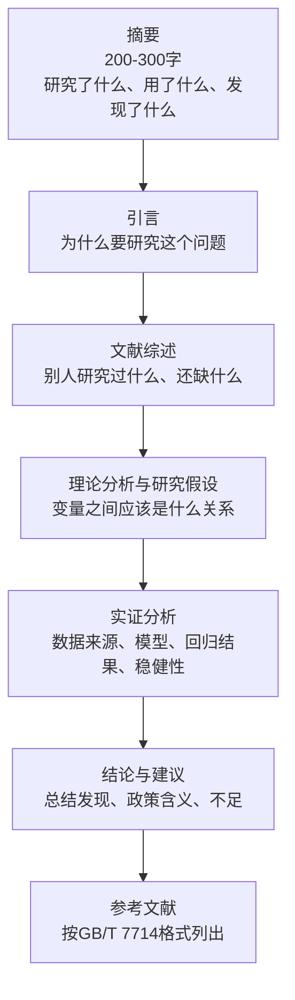
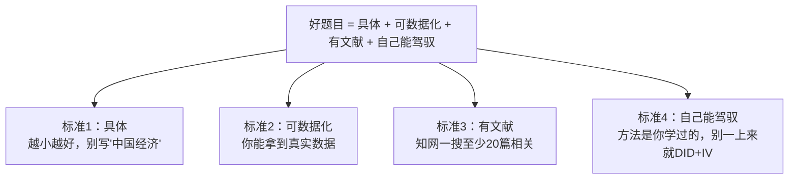
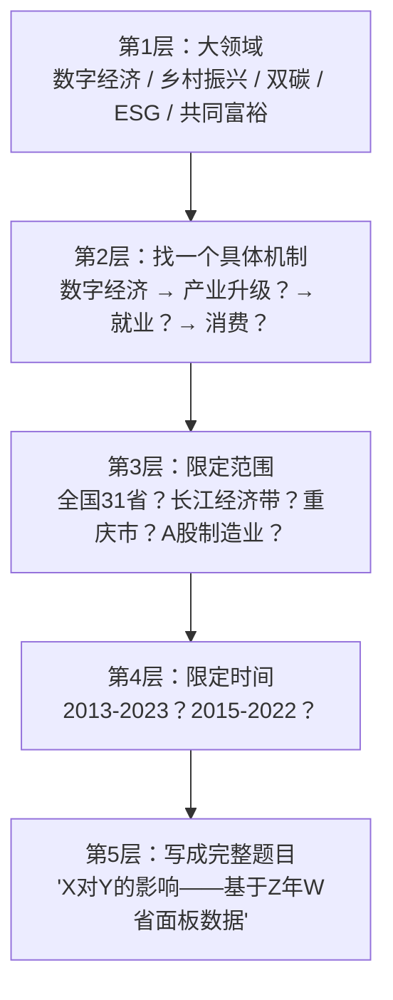

# 01 怎么选题？（选题选错，后面全白搭）

<div style="text-align:right;margin:10px 0;"><a href="../../exam.html" target="_blank" style="display:inline-block;padding:6px 16px;background:#2563eb;color:#fff;border-radius:6px;text-decoration:none;font-size:14px;">📝 开始做题</a></div>


## 一、为什么要学这个？

**选题是论文的生死线。**

我见过太多同学：
- 题目叫《中国经济高质量发展研究》——写了三个月，导师说"太大了，重写"；
- 题目叫《数字经济研究》——跑了两个月数据，发现根本找不到"数字经济"的统一衡量指标；
- 题目叫《重庆市居民消费调查》——发了 50 份问卷，样本量不够回归，全部重来。

**选题错了，后面方法再熟、软件再溜，都是在沙地上盖楼。**

反过来，选对一个好题目：
- 数据好找；
- 方法刚好是你学过的；
- 文献一搜一大把，不怕没参考；
- 导师看了就点头，不用大改。

**这一节先帮你建立全局观：一篇论文到底是什么，然后教你 30 分钟判断一个题目能不能做，以及 35 个直接能抄的选题。**

---

## 二、论文到底是什么？（先建立全局观）

本科毕业论文不是让你去发现新大陆，而是让你**用一个学过的方法，把一个真实问题说清楚**。仅此而已。

### 2.1 生活类比：论文就是一次"正规化的算账"

你有没有帮家里人算过一笔账？比如妈妈说："今年菜价涨了这么多，是不是因为外面修路、运输成本高了？"——这其实就是一个**研究问题**。

你怎么回答呢？你会去找附近几个菜市场近三年的价格、加油站的油价、修路的时间段，把它们摆在一起看：是不是路一修，菜价就跟着往上走？最后得出结论："是的，运输成本上升大约能解释菜价上涨的六成。"

这套"**提出疑问 → 找数据 → 用方法算 → 下结论**"的过程，搬到学术场景里，就是一篇毕业论文。

| 生活里的算账 | 论文里的对应物 |
|---|---|
| 妈妈的疑问 | 研究问题（引言） |
| 你猜"运输成本是主因" | 研究假设 |
| 你找的菜价、油价、修路记录 | 数据 |
| 你心算或拿计算器比对 | 计量方法 / 统计模型 |
| 你说"六成是运输成本" | 实证结论 |
| 你补一句"不过隔壁小区没涨，可能还有别的原因" | 研究局限与展望 |

### 2.2 一篇本科论文的标准骨架

以经济统计学专业为例，一篇合格的本科毕业论文由七个部分组成：



**选题这一步，决定的就是 D 和 E 能写什么。** 你选的题目，必须能顺着这个骨架一路走到底——能提出假设、能找到数据、能跑模型、能得出结论。任何一环断了，题目就得换。

---

## 三、好题目的 4 个标准（背下来）

一个能做的本科毕业论文题目，必须同时满足下面 4 条：



### 标准 1：具体——越小越好

| 大而空（别做） | 具体（能做） |
|----------------|-------------|
| 中国经济研究 | 数字经济对重庆市产业结构升级的影响 |
| 乡村振兴研究 | 乡村振兴背景下重庆市农村居民消费结构影响因素分析 |
| 上市公司绩效研究 | 新能源行业上市公司资本结构对经营绩效的影响 |
| 房价问题研究 | 重庆市商品房价格影响因素的实证分析 |
| 货币政策研究 | 数量型货币政策工具对房地产投资的影响——基于[[KP01_VAR模型|VAR]]模型 |

**判断方法**：把题目念出来，如果题目里出现"研究""探析""浅析"这种大词，赶紧缩小。好题目读出来应该是一个完整的因果句："X 对 Y 有影响吗——基于 Z 数据"。

### 标准 2：可数据化——你真能拿到数据

选题前先问自己：
- "我要的 X 变量，哪个网站有？"
- "Y 变量是省级面板还是企业截面？"
- "样本量大概多少？够不够跑回归（至少 30 个观测值）？"

**大忌**：题目写"人工智能对就业的影响"，结果发现"人工智能水平"根本没有官方数据，自己瞎编一个——这就是垃圾进垃圾出。数据来源的详细清单见 `[[03_数据从哪来]].md`。

### 标准 3：有文献——知网能搜到至少 20 篇

去知网搜你的关键词，如果搜出来：
- < 5 篇：太新了，没人做过，你一个本科生搞不定；
- 5~20 篇：刚刚好，有参考但不会撞车；
- > 100 篇：太老了，做烂了，创新点难找。

### 标准 4：自己能驾驭——方法别贪难

本科毕业论文，方法复杂度和成功率成反比：
- **简单但做扎实**：描述统计 + [[04_OLS截距和拟合值|OLS]] 回归 + 稳健性 → 85 分；
- **难但做崩了**：DID + [[03_工具变量IV|工具变量]] + 机制分析，结果模型不收敛 → 60 分甚至延毕。

**建议**：第一次写论文，就用"面板[[06_固定效应FE|固定效应]]"或"熵值-[[05_TOPSIS法|TOPSIS]]"这两种套路，把它做扎实。方法怎么选见 `../11_方法选择决策/[[01_方法选择决策树]].md`。

---

## 四、35 个直接能用的选题库（标注方法和难度）

> 下面这些题目，都是经济统计学本科论文里被反复验证过、数据好找、方法成熟的。
> 难度分三档：★（简单）、★★（中等）、★★★（有挑战但本科能做）。

### A 组：面板回归类（X 对 Y 有影响吗？）——最稳

> 💡 这一组题目里反复出现的"产业结构""城乡收入差距""消费"等变量，背后都是统计学原理 Ch11 讲的常用经济指标：[[../../教材笔记/05_统计学原理/11_统计分析/知识点/KP02_GDP与GNP|GDP与GNP]]（经济规模）、[[../../教材笔记/05_统计学原理/11_统计分析/知识点/KP03_三次产业划分|三次产业划分]]（产业结构）、[[../../教材笔记/05_统计学原理/11_统计分析/知识点/KP04_恩格尔系数|恩格尔系数]]（生活水平）、[[../../教材笔记/05_统计学原理/11_统计分析/知识点/KP05_基尼系数与洛伦兹曲线|基尼系数]]（收入差距）。选题前先搞清楚你要用的变量到底是什么意思。

| # | 题目 | 方法 | 难度 |
|---|------|------|------|
| 1 | 数字经济对重庆市产业结构升级的影响——基于2013-2023年31省面板数据 | 固定效应FE | ★★ |
| 2 | 绿色金融对区域碳排放强度的影响——基于长江经济带11省市面板 | 固定效应FE | ★★ |
| 3 | 营商环境优化对民营企业创新投入的影响——基于A股上市公司面板 | 固定效应FE | ★★ |
| 4 | 财政支农支出对农村居民收入增长的影响——基于2013-2023年省级面板 | OLS+FE | ★ |
| 5 | 人口老龄化对居民储蓄率的影响——基于中国家庭追踪调查(CFPS)数据 | 固定效应FE | ★★ |
| 6 | 互联网普及对城乡收入差距的影响——基于省级面板数据 | 固定效应FE | ★★ |
| 7 | 环境规制对绿色全要素生产率的影响——基于省级面板 | FE+异质性 | ★★★ |
| 8 | 基础设施建设对区域经济增长的溢出效应——基于空间面板 | 空间杜宾 | ★★★ |
| 9 | 金融发展对城乡消费差距的影响——基于省级面板数据 | FE+稳健性 | ★★ |
| 10 | 科技创新对经济高质量发展的影响——基于30省面板 | FE+中介效应 | ★★★ |

### B 组：综合评价类（给对象打分排名）——最容易上手

| # | 题目 | 方法 | 难度 |
|---|------|------|------|
| 11 | 成渝地区双城经济圈城市高质量发展水平评价 | 熵值-TOPSIS | ★★ |
| 12 | 重庆市乡村振兴发展水平测度与区域差异分析 | [[06_熵值法-TOPSIS组合|熵值法]] | ★ |
| 13 | 长江经济带城镇化质量综合评价 | 熵值法+聚类 | ★★ |
| 14 | 上市公司ESG表现评价——以新能源行业为例 | TOPSIS | ★★ |
| 15 | 中国省域数字经济发展水平测度及时空演变 | 熵值法 | ★★ |
| 16 | 区域金融生态环境评价——以西部地区12省为例 | [[04_AHP层次分析法|AHP]]-熵值 | ★★ |
| 17 | 经济高质量发展[[KP02_指标体系|指标体系]]构建与测度——基于新发展理念 | 指标筛选+熵值 | ★★ |
| 18 | 城市营商环境评价——基于副省级城市数据 | 熵值-TOPSIS | ★★ |

熵值法的具体计算步骤见 `../07_综合评价方法/[[03_熵值法]].md` 和 `../07_综合评价方法/[[09_Excel熵值法计算]].md`。

### C 组：受限因变量类（是/否、买/不买）

| # | 题目 | 方法 | 难度 |
|---|------|------|------|
| 19 | 居民消费意愿的影响因素分析——基于CHFS微观数据 | Logit | ★★ |
| 20 | 上市公司财务困境预警模型研究——基于制造业 | PCA+Logit | ★★★ |
| 21 | 农户信贷可得性影响因素——基于CHFS数据 | Probit | ★★ |
| 22 | 大学生创业意愿影响因素分析——基于问卷数据 | Logit | ★ |
| 23 | P2P网贷违约风险影响因素研究 | Logit | ★★ |

### D 组：时间序列类（预测或传导）

| # | 题目 | 方法 | 难度 |
|---|------|------|------|
| 24 | 重庆市GDP预测——基于ARIMA模型 | ARIMA | ★ |
| 25 | 我国CPI走势预测与分析 | ARIMA | ★ |
| 26 | 货币政策对房地产价格的传导效应——基于VAR模型 | VAR | ★★ |
| 27 | 原油价格波动对我国宏观经济的影响——基于VAR | VAR | ★★ |
| 28 | 上证指数波动率预测——基于GARCH模型 | GARCH | ★★★ |

### E 组：政策评估类（DID 双重差分）——加分项

| # | 题目 | 方法 | 难度 |
|---|------|------|------|
| 29 | 乡村振兴战略对农村居民收入的政策效应评估——基于DID | DID | ★★★ |
| 30 | 自贸区设立对区域经济增长的影响——基于多期DID | 多期DID | ★★★ |
| 31 | 低碳城市试点政策对碳排放的影响——基于DID | DID | ★★★ |
| 32 | 营商环境改革对企业创新的影响——基于DID | DID | ★★★ |

### F 组：微观调查类（问卷自己发）

| # | 题目 | 方法 | 难度 |
|---|------|------|------|
| 33 | 重庆市大学生消费结构影响因素调查分析 | OLS/Logit | ★ |
| 34 | 居民低碳消费意愿影响因素——基于问卷数据 | Logit+信效度 | ★★ |
| 35 | 电商直播对消费者购买意愿的影响——基于问卷调查 | Logit | ★★ |

---

## 五、选题的"漏斗法"（实操步骤）

不要一上来就想题目，按这个漏斗一步步缩：



**举例**：
1. 大领域：数字经济
2. 找机制：数字经济 → 产业结构升级
3. 限定范围：全国31省
4. 限定时间：2013-2023
5. 成题：《数字经济对产业结构升级的影响——基于2013-2023年31省面板数据》

---

## 六、选题时导师会骂什么？（易错点）

1. **"你这个题目太大了，博士都做不完"**
   → 对策：把"中国"缩成"某流域""某省""某行业"。

2. **"你这个 X 变量怎么衡量？"**
   → 对策：选题前先查文献，看别人是用什么指标衡量你的核心变量的。如果 10 篇文献有 10 种做法，说明这个变量不好衡量，换题。

3. **"你数据在哪？"**
   → 对策：选题前先去国家统计局、CSMAR、Wind 查一下，确认数据真的能下载到。别等开题报告交了才发现数据要花钱买。

4. **"你这个方法我看不懂，你自己懂吗？"**
   → 对策：别贪难。本科论文，FE + 稳健性 + 异质性，已经是优秀水平。

5. **"你这题目和别人撞了"**
   → 对策：在知网搜题目关键词，看有没有近 3 年的硕士论文做过一模一样的。如果有，换个地区或换个机制。

---

## 七、可直接复制的选题模板

把下面 5 个模板存下来，填空就能出题目：

```
模板1（面板回归）：
《[核心解释变量X]对[被解释变量Y]的影响——基于[年份范围]年[地区]面板数据》

模板2（综合评价）：
《[评价对象]综合发展水平测度与[时空特征/区域差异]分析——基于[方法]》

模板3（政策评估）：
《[政策名称]对[结果变量]的政策效应评估——基于[DID/多期DID]》

模板4（微观调查）：
《[人群]的[行为/意愿]影响因素分析——基于[问卷/数据库]数据》

模板5（时间序列）：
《[变量]的预测与分析——基于[ARIMA/VAR/GARCH]模型》
```

---

## 八、对比：反面 vs 正面

| 反面题目（导师皱眉） | 正面题目（导师点头） | 差在哪 |
|----------------------|---------------------|--------|
| 《数字经济研究》 | 《数字经济对产业结构升级的影响——基于31省面板》 | 有没有说清 X、Y、数据范围 |
| 《乡村振兴问题研究》 | 《乡村振兴对农村居民消费的影响——基于DID》 | 有没有说清你要回答的问题 |
| 《上市公司财务研究》 | 《制造业上市公司资本结构对ROE的影响》 | 有没有限定行业、变量 |
| 《房价影响因素》 | 《重庆市商品房价格影响因素——基于2010-2023年月度数据》 | 有没有限定地区、时间 |

---

## 九、速记卡

> **论文 = 用学过的方法把一个真实问题说清楚，骨架是：摘要→引言→文献→假设→实证→结论→参考文献。**
> **好题目 = 一个具体的因果句：X 对 Y 有影响吗？基于 Z 数据。**
> 四个标准：**具体、可数据化、有文献、自己能驾驭**。
> 选题漏斗：大领域 → 找机制 → 限范围 → 限时间 → 写成句。
> 本科论文最稳的两种套路：**面板 FE** 或 **熵值-TOPSIS 评价**。
> 选题前先去知网搜、去统计局查数据，别开题了才发现做不了。

---

## 💡 经济学视角：选题要从现实经济问题出发，而不是从方法出发

**这一步在回答什么经济学问题？**
很多小白选题的思路是反的：先想"我会跑 DID"，然后到处找题目套 DID。这在经济学里叫"手里拿着锤子，看什么都是钉子"。正经的经济学选题顺序是反过来的：先有一个现实世界的困惑——"为什么外卖骑手越来越多，工资却没涨？""数字普惠金融到底有没有让农民更敢消费？""碳减排政策会不会拖累经济增长？"——再倒推用什么数据、什么方法去回答它。方法是为问题服务的，不是反过来。

**经济学里哪些经典问题长盛不衰？**

| 现实经济母题 | 对应的经济学理论 | 论文可以怎么切 |
|---|---|---|
| 数字经济 | 新发展理念、高质量发展 | 数字经济指数对城市全要素生产率的影响 |
| 共同富裕 | 收入分配、边际消费倾向 | 缩小收入差距能不能拉动居民消费 |
| 双碳目标 | 生态文明、绿色发展 | 碳交易试点对企业碳排放强度的因果效应 |
| 人口老龄化 | 储蓄—消费、社会保障 | 老龄化对居民储蓄率的面板回归 |

这些母题之所以常写常新，是因为它们背后是真实的政策需求和理论争论，数据在更新、机制在演化，永远有可做的边际贡献。

**举个实证论文的例子：**
《数字普惠金融对农村居民消费的影响——基于 CFPS 2018—2022 的实证》。这个题目背后是经济学里一个老问题：流动性约束为什么让农民不敢消费？（永久收入假说认为，人们根据一生收入决定消费，但若借不到钱，当下就得节衣缩食。）数字普惠金融正好缓解了"借钱难"，所以可以假设它提高了农村消费。你看，题目一句话里藏着理论机制——这才叫经济学选题，不是"我跑了个回归发现显著"。

**📚 配套经济学笔记：**
- [[../../教材笔记/07_政治经济学/06_社会主义市场经济与发展/知识点/KP02_新发展理念与高质量发展|原KP·新发展理念与高质量发展]]
- [[../../教材笔记/07_政治经济学/07_民生开放与全球治理/知识点/KP01_生态文明与绿色发展|原KP·生态文明与绿色发展]]

---

下一篇：[[02_文献综述怎么做]]


---

## 📖 配套教材笔记
- [[../../教材笔记/02_计量经济学/14_实证研究指南/00_实证研究流程|计量经济学·实证研究流程]]
- [[../../教材笔记/05_统计学原理/11_统计分析/知识点/KP08_统计分析报告的特点与结构|统计学原理·统计分析报告结构]]

## 📚 配套原书
- [[../../原文件/计量经济学/陈强_计量经济学及Stata应用_全书|陈强《计量经济学及Stata应用》实证篇]]
