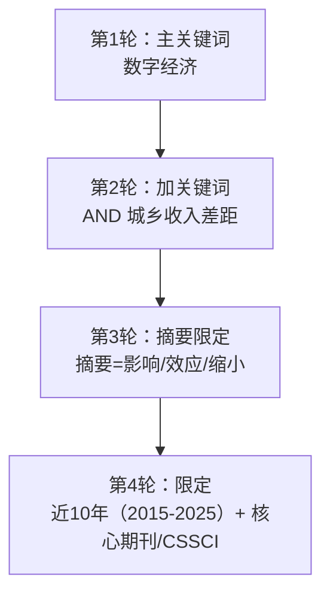
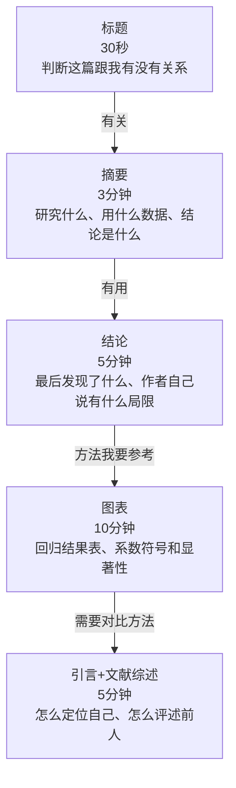
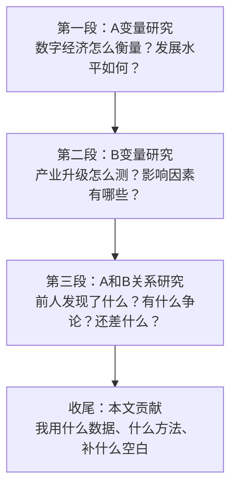

# 02 文献综述怎么做？（不是罗列，是对话）

## 一、为什么要学这个？

**文献综述是论文的"地基"，也是导师最容易挑刺的地方。**

常见翻车现场：
- 综述写了 3000 字，全是"A 研究了……B 研究了……C 研究了……"——像流水账，导师说"你这是文献罗列，不是综述"；
- 只看了 5 篇文献就开始写——导师说"你这领域前人做了那么多，你看 5 篇就敢写？"；
- 文献看了 50 篇，但写出来和你自己的论文没关系——导师说"综述和正文两张皮"。

**好的文献综述，是告诉读者两件事：**
1. 前人做到哪了？（站在巨人肩膀上）
2. 还剩什么没做？（我的贡献在哪）

---

## 二、是什么？（比喻）

**文献综述就像开 party 前的客人名单。**

- 你是主人，要办一个关于"数字经济和产业升级"的 party；
- 先请最有名的学者（大牛）来：他们说了什么？观点一致还是吵架？
- 再请和你研究最像的人：他们做了什么？用了什么数据？什么方法？
- 最后发现：所有人都在做全国层面，**没人做长江经济带**——那就是你的空位。

**综述不是"把客人介绍一遍"，而是"告诉大家：这帮人吵了什么、还差谁没来、我这个新客人能补什么位"。**

一句话：文献综述是你和前人的**对话**，不是你单方面念别人的论文摘要。

---

## 三、怎么搜？（实操步骤）

### 3.1 用什么数据库？

| 数据库 | 用途 | 要不要钱 |
|--------|------|----------|
| **中国知网 CNKI** | 最主要，中文文献全在这，占引用量 70% | 校园网免费 |
| **万方** | 补充，有些会议论文知网没有 | 校园网免费 |
| **百度学术** | 中文文献的"搜索引擎"，按被引排序找经典 | 免费 |
| **Google Scholar** | 英文文献、被引次数 | 免费（需翻墙） |
| **Web of Science** | 英文核心 | 校园网 |
| **SSRN** | 经济学/金融工作论文，前沿研究 | 免费 |

**本科论文，知网就够了。** 引用量建议：本科 20~40 篇，其中英文 3~5 篇。引用 50 篇但每篇只写一句话"张三（2020）研究了XX"，不如引用 25 篇但每篇都有评述。

### 3.2 检索式怎么拼？

别只搜一个词"数字经济"，出来两万篇直接傻眼。正确做法是**拼检索式**，把范围缩到你真正要的那 20~40 篇：



知网操作路径：**高级检索 → 主题 = 数字经济 → AND 主题 = 城乡收入差距 → 来源类别勾选"核心期刊"和"CSSCI" → 时间限定近 10 年**。这样一筛，通常出来 30~80 篇，正好是你要读的量。

### 3.3 怎么用"被引频次"找经典文献

打开知网检索结果页，点一下"被引"排序。被引次数最高的那几篇，就是这个领域的**开山之作**或**必引文献**。为什么要看被引高的？因为被引高 = 这个领域的人都在跟它对话，你写综述绕不开它。

**操作建议**：
1. 被引前 5 篇 → 精读（逐字读，做文献卡片）；
2. 被引第 6~20 篇 → 泛读（只读摘要+结论+图表）；
3. 被引 20 名以后 → 扫读（看标题和摘要，觉得有用再翻）。

### 3.4 先看综述，再看单篇

这是最省时间的方法：

1. 在知网搜"数字经济 产业升级 综述"或"数字经济 产业升级 研究进展"；
2. 找 2~3 篇别人已经写好的综述论文；
3. 把这些综述里引用的文献，挑出被引最多的 10~15 篇；
4. 只读这 10~15 篇原文。

**为什么？** 综述论文已经帮你把 100 篇文献浓缩过了，你站在综述的肩膀上，不用自己一篇篇啃。

---

## 四、怎么读文献？（倒读法 + 文献卡片）

### 4.1 不要从头读到尾

很多小白拿到一篇论文，从摘要开始一个字一个字读到参考文献，一篇读 3 小时，读完脑子空空。**正确读法是"倒着读"**：



**总计约 30 分钟。** 一篇论文真正值得你逐字读的，是它的**结论和图表**——因为那是它最核心的产出。

### 4.2 文献卡片：一张纸记一篇

每读完一篇，立刻在笔记软件（Notion / Obsidian / Word 都行）里填一张卡片：

```
【文献卡片】
作者：张三
年份：2020
标题：数字经济对城乡收入差距的影响研究
期刊：经济研究
研究问题：数字经济发展是否缩小了城乡收入差距？
研究方法：面板固定效应模型（OLS + FE）
数据：2011-2018年30个省份面板数据，数字普惠金融指数
核心结论：数字普惠金融指数每提高1单位，城乡收入比下降0.08，在中西部更显著
局限：作者自己说的——只到2018年，没处理内生性
我能怎么用：→ 作为"直接研究二者关系"的主流文献引用
           → 它没处理内生性，我的论文可以用IV/DID改进
```

**为什么要做卡片？** 因为你读了 20 篇之后，绝对记不住每篇说了什么。写综述时直接翻卡片，不用重新翻论文。

### 4.3 精读 vs 泛读：怎么分配时间

| 文献类型 | 怎么读 | 花多久 |
|---|---|---|
| 被引前 5 的经典文献 | 精读：逐字读+做卡片+摘 3 个金句 | 每篇 40~60 分钟 |
| 跟你主题最接近的 5~8 篇 | 精读：做卡片+对比方法和数据 | 每篇 30~40 分钟 |
| 相关但不直接的 10~15 篇 | 泛读：只做卡片的"问题+结论+局限" | 每篇 10~15 分钟 |
| 扫到觉得可能有用的 | 扫读：只看标题和摘要 | 每篇 2 分钟 |

**时间分配建议**：找文献+读文献总共花 1~2 周是正常的。不要指望一个周末读完 30 篇。

---

## 五、文献综述怎么写？（三种模板 + 对话法）

### 5.1 反面教材：流水账

> 张三（2020）研究了数字经济对产业升级的影响，发现显著为正。
> 李四（2021）研究了数字经济对产业升级的影响，发现也显著为正。
> 王五（2022）研究了数字经济对产业升级的影响，发现显著为正。

**导师评语**："你这是把参考文献念了一遍，不是综述。"

### 5.2 三种写作模板（选一种你最顺手的，不要混用）

**模板一：按主题归类（最推荐，小白首选）**

把文献按主题分成 2~4 组，每组讲清楚"谁做了什么、发现了什么、有什么分歧"，最后一段总评述指出现有研究还缺什么。

```
2.1 关于【主题A，如：数字经济测度】的研究
    早期学者XXX（2015）从XX角度衡量数字经济……
    后续研究XXX（2018）构建了XX指数……

2.2 关于【主题B，如：城乡收入差距影响因素】的研究
    XXX等（2016）发现财政支出结构……

2.3 关于【主题C，如：数字经济与收入差距关系】的研究
    直接研究二者关系的文献最早见于XXX（2019）……
    但也有学者持不同观点，XXX（2021）认为……

2.4 文献评述
    综观上述研究，现有成果在XX方面已较为丰富，但仍存在以下不足：
    （1）……（2）……（3）……
    本文试图在……方面做出补充。
```

**模板二：按方法分**——适合你论文的创新点在于"用了一个别人没用过的方法"（如 DID/IV/PSM），能自然引出"别人都没处理内生性，我处理了"。

**模板三：按时间分**——适合研究一个领域的发展脉络。本科论文用得少，且最容易写成流水账，每段必须加上评述。

### 5.3 正面教材：对话法

好的综述，要写出**学者之间的争论和你自己的位置**：

> 关于数字经济与产业升级的关系，现有文献主要形成了两种观点。
>
> **一方认为数字经济显著促进了产业升级**。张三（2020）基于省级面板数据发现，数字经济发展水平每提高 1%，产业结构高级化指数提升 0.32%；李四（2021）进一步区分了产业结构合理化与高级化两个维度，发现数字经济对高级化的促进作用更强。
>
> **另一方则提出了不同看法**。王五（2022）认为，数字经济对产业升级的影响存在"门槛效应"——只有当人力资本水平跨过某一门槛后，促进作用才显著；否则数字经济反而会挤出传统产业投资。
>
> 现有研究仍存在两点不足：第一，多数文献关注全国层面，对长江经济带等重点区域的讨论较少；第二，在机制分析上，多聚焦于技术创新单一渠道，对要素配置效率这一渠道关注不足。**本文以长江经济带 11 省市为样本，从要素配置视角补充现有研究。**

**看到区别了吗？** 上面这段里：
- 有观点对立（一方说促进，另一方说有门槛）；
- 有批判性（指出每篇文献的局限，如"样本期截至 2018 年""未处理反向因果"）；
- 有你的总结（现有研究不足）；
- 有你的位置（本文补什么）。

### 5.4 综述的三段式结构



---

## 六、参考文献管理

### 6.1 用什么工具？

| 工具 | 适合谁 | 优缺点 |
|------|--------|--------|
| **Excel 自己列** | 本科论文（够用） | 简单，但容易乱 |
| **Zotero** | 想长期用 | 免费自动抓取，强烈推荐 |
| **NoteExpress** | 学校要求 | 收费但和知网兼容好 |
| **EndNote** | 学术重度用户 | 贵，本科没必要 |

**本科论文，Excel 列一个表就够了**，列：序号、作者、年份、题目、期刊、卷期页码、你读的时候记的一句话笔记。

### 6.2 引用时的两个动作

1. **转引要查原文**：如果你在 A 文献里看到"B（2019）发现了 X"，不要直接写"B（2019）发现了 X"然后引用 A——你必须找到 B 的原文确认。转引一旦出错，导师一查就露馅。
2. **引用要精准到观点**：不要写"张三（2020）研究了数字经济"，要写"张三（2020）利用 2011-2018 年省级面板，发现数字普惠金融指数每提高 1 单位，城乡收入比下降 0.08"。导师看你引用的精度，就知道你有没有真读。

正文引用格式和参考文献列表规范见 `../12_毕业论文实战/[[03_参考文献GB-T7714]].md`。

---

## 七、易错点（导师会骂什么）

1. **只引近 3 年的文献**——经典文献（被引几百次的）不引，说明你没读过原著。
2. **引用教材当文献**——教材是教科书，不是学术论文。
3. **罗列 30 篇但没有评述**——综述要"评"，不是"述"。
4. **综述和正文脱节**——综述里说的不足，正文里没补；正文做的事，综述里没说前人没做过。
5. **引用网页当学术文献**——百度百科、知乎不能进参考文献。
6. **把知识点又讲一遍**——"数字经济是指……"这种教科书式定义不要，要围绕"别人怎么测度这个变量"来组织。
7. **只夸前人不指出局限**——如果所有前人都完美，你的论文还有什么必要做？

---

## 八、可直接套用的综述模板

```
关于[核心解释变量X]的研究，现有文献主要从以下几个方面展开：

第一，[X]的测度。张三（2020）采用……方法构建指标体系；李四（2021）则……。

第二，[X]的经济效应。多数研究认为[X]对[Y1]具有促进作用（王五，2022）；但也有学者指出，[X]的影响存在门槛效应（赵六，2023）。

关于[被解释变量Y]的研究，早期文献主要关注……（钱七，2019），近年来……（孙八，2022）。

在[X]与[Y]的关系上，现有研究已取得一定进展，但仍存在拓展空间：一是研究对象上，多关注全国层面，对[本文样本区域]的讨论不足；二是机制分析上，对[本文关注的机制渠道]关注不够。本文以[样本]为研究对象，采用[方法]，对[X]与[Y]的关系进行实证检验，以期补充相关研究。
```

---

## 九、对比

| 流水账综述（反面） | 对话式综述（正面） |
|---------------------|---------------------|
| 张三研究了A，李四研究了A | 关于A，学界有两种观点：一方认为…另一方认为… |
| 只说别人做了什么 | 还说别人争论什么、还差什么、每篇有什么局限 |
| 和自己论文没关系 | 最后一段自然引出"本文要补什么" |
| 读起来像念名单 | 读起来像一场学术辩论的旁白 |

---

## 十、速记卡

> **文献综述 = 和前人对话，不是文献罗列。**
> 搜索：知网先搜综述，再按图索骥找经典原文；检索式从主题→关键词→摘要→年限逐步缩小。
> 阅读：标题→摘要→结论→图表，30 分钟一篇，做文献卡片。
> 写作：三种模板（按主题/按方法/按时间），最推荐按主题归类。
> 核心：写出**观点对立**、**批判性（指出局限）**和**你的位置**。
> 引用要精准到观点，转引要查原文。

---

下一篇：[[03_数据从哪来]]


---

## 📖 配套教材笔记
- [[../../教材笔记/02_计量经济学/14_实证研究指南/00_实证研究流程|计量经济学·实证研究流程]]
- [[../../教材笔记/05_统计学原理/11_统计分析/知识点/KP08_统计分析报告的特点与结构|统计学原理·统计分析报告结构]]

## 📚 配套原书
- [[../../原文件/计量经济学/陈强_计量经济学及Stata应用_全书|陈强《计量经济学及Stata应用》实证篇]]
