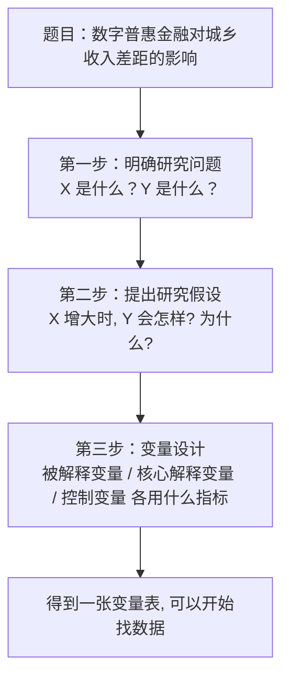
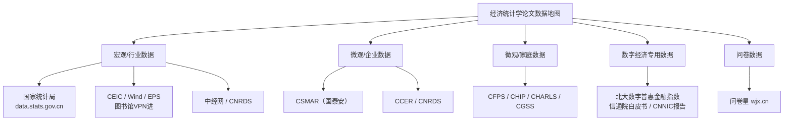

# 03 数据从哪来？（找数据找半天？这节给你地图）

## 一、为什么要学这个？

**很多同学论文卡在"找不到数据"这一步。**

- 开题报告写得很漂亮，要做"数字经济对产业升级的影响"；
- 开始找数据，发现"数字经济指数"国家统计局根本不发布；
- 在网上搜到一篇硕士论文做过，去问师兄，师兄说"我是自己用[[06_熵值法-TOPSIS组合|熵值法]]算的"；
- 于是你花了两周自己凑指标、算指数，论文进度全乱了。

**数据是论文的米。巧妇难为无米之炊。**

这一节把经济统计学本科论文最常用的数据库全部列出来，告诉你每个网站有什么、怎么下、什么数据用什么库，以及拿到原始数据后怎么整理成 Stata 能跑的样子。

---

## 二、从题目到变量设计：先列一张"采购清单"

拿到题目后，不要急着去下载数据，先把题目里的概念拆成具体变量。这张表就是你后续找数据的"采购清单"：

### 2.1 三步拆解法



### 2.2 变量设计表（照这个格式列）

| 变量类型 | 抽象概念 | 具体指标 | 单位 / 口径 | 数据来源 |
|---|---|---|---|---|
| 被解释变量 Y | 城乡收入差距 | 城镇人均可支配收入 / 农村人均可支配收入 | 比值，越大差距越大 | 《中国统计年鉴》 |
| 核心解释变量 X | 数字普惠金融水平 | 北大数字普惠金融总指数 | 指数（0-100 量级） | 北大数字金融研究中心（公开下载） |
| 控制变量 Z1 | 经济发展水平 | 人均 GDP | 元/人 | 各省统计年鉴 |
| 控制变量 Z2 | 产业结构 | 第三产业增加值占 GDP 比重 | % | 各省统计年鉴 |
| 控制变量 Z3 | 政府干预 | 财政支出 / GDP | % | 各省统计年鉴 |
| 控制变量 Z4 | 教育水平 | 每万人大学生数 | 人 | 各省统计年鉴 |

**要点**：
- 一个抽象概念至少给一个指标，最好在[[06_稳健性检验|稳健性检验]]里换一个指标（比如 Y 用"城乡收入比"测一遍，再用"泰尔指数"测一遍）；
- 控制变量不是越多越好，4~6 个足够，挑那些文献里反复出现的因素。

---

## 三、数据库入口地图（收藏夹存好）



### 3.1 宏观数据（经济类论文 90% 用这个）

**国家统计局（data.stats.gov.cn）——免费、最权威、本科用得最多**

- 有什么：全国 31 省、地级市的 GDP、人口、就业、财政、投资、消费；时间序列长（1949 年至今）；省级面板的绝佳来源（31 省 × 10 年 = 310 个观测值，够回归了）。
- 怎么下：打开官网 → 顶部"数据" → "数据查询" → 选"分省年度数据" → 勾选指标 → 选年份 → 下载 Excel。
- 注意：下载的 Excel 通常是"宽表"（每行一个省，每列一个年份），需要转成"长表"（省份-年份一行一个观测）才能做面板分析，转法见下文 4.3。

**CEIC / Wind / EPS / 中经网——学校图书馆买了，VPN 进**

| 数据库 | 特点 | 适合 |
|---|---|---|
| CEIC | 中国分省、分城市、宏观、行业数据全 | 做区域研究 |
| Wind（万得） | 金融数据最全，股票债券基金宏观 | 金融类论文（Mac 装不了，用 Windows 机房） |
| EPS | 分世界/中国宏观/工业数据库，导出友好 | 快速选指标导出 |
| 中经网 | 更新快，月度数据多 | 时间序列论文 |
| CNRDS | 上市公司、专利、数字经济、乡村振兴专题 | CSMAR 找不到的变量来这碰运气 |

VPN 连接：学校官网 → 信息中心 → VPN → 下载 EasyConnect → 学号密码登录 → 访问图书馆数据库。

### 3.2 微观企业数据

**CSMAR（国泰安，gtarsc.com）——商科论文用得最多**

- 有什么：A 股上市公司财务（资产负债表、利润表、现金流量表）、公司治理（董事会、股权结构）、股票交易、并购重组、专利。
- 怎么进：学校图书馆搜"CSMAR" → 选表 → 筛年份和行业 → 导出 CSV/Excel。
- 适合：企业创新、企业绩效、公司治理、ESG、财务预警类题目。

### 3.3 微观家庭数据（做微观题目用）

| 数据库 | 调查什么 | 怎么申请 |
|--------|----------|----------|
| **CFPS**（中国家庭追踪调查，北大） | 家庭收入、消费、教育、健康、就业 | isss.pku.edu.cn 注册→填研究计划→导师签字→1-2 周审批 |
| **CHIP**（中国家庭收入调查，北师大） | 收入分配、城乡差距 | chipsurvey.org，年份 1995/2002/2007/2013/2018 |
| **CHARLS**（中国健康与养老追踪调查） | 45 岁以上中老年人、老龄化、医疗支出 | charls.pku.edu.cn |
| **CGSS**（中国综合社会调查） | 社会态度、行为、收入 | csru.edu.cn |

**注意**：这些数据库要注册申请，审批 1~2 周。做微观题目（如"居民消费意愿""农户信贷"）必须提前申请。

### 3.4 数字经济方向专用数据

| 数据 | 用途 | 获取方式 |
|---|---|---|
| **北京大学数字普惠金融指数** | 衡量各省/市/县数字金融发展水平 | 北大数字金融研究中心官网免费下载 |
| 《中国数字经济发展白皮书》（信通院） | 全国数字经济规模、结构 | 官网免费下载 PDF |
| 《中国互联网络发展状况统计报告》（CNNIC） | 互联网普及率、网民规模 | 官网免费下载 |
| 各省《数字经济发展报告》 | 省级数字经济指标 | 各省统计局/发改委官网 |

### 3.5 问卷数据（适合问卷类题目）

如果你的题目是"消费者购买意愿""大学生使用行为"这类，用问卷星（wjx.cn）发放问卷：

- **样本量**：本科论文有效问卷 ≥ 200 份；量表类问卷（结构方程模型）≥ 300；每个变量至少 10 个样本。
- **问卷结构**：甄别题（是否符合目标人群）→ 核心变量题（1-5 分 Likert 量表）→ 人口统计学题（年龄、性别、收入、学历）。
- **一个变量至少用 2~3 道题测度**，便于做信效度检验（Cronbach's α > 0.7）。
- **不要在问卷里直接问因果**，例如"是不是因为微信你才多花钱"——这种题得到的答案不可靠。

---

## 四、Excel 数据整理规范（拿到原始数据先摆好）

从年鉴、网站抄来的一堆数字，要先整理成一张**干净、整齐、软件一打开就能算**的表。这就像做菜前先把菜洗干净、切好、分类摆盘——原料乱糟糟地堆着，后面炒（计算）一定出错。

### 4.1 表格怎么摆（关键原则）

- **一行 = 一个评价对象（样本）**；
- **一列 = 一个指标（变量）**；
- 第一行是**列名（变量名）**，不要加标题行、不要合并单元格。

### 4.2 字段（列名）怎么命名

| 规则 | 正确 | 错误 |
|---|---|---|
| 不超过 8 个字符、用英文短名（Stata 友好） | `gdp` `urate` `fiscal` `doctor` | `人均GDP(元)`（带括号太长） |
| 不用空格、特殊符号 | `fiscal_pc` | `人均 财政支出` |
| 第一列放样本名 | `district` / `prov` | （空着没编号） |

论文里用中文名（人均GDP），Excel/Stata 里用短英文名（gdp）对应，附录里给一张"变量名对照表"：

| Excel名 | 中文指标 | 单位 | 方向 |
|---|---|---|---|
| gdp | 人均GDP | 元 | 正 |
| urate | 城镇登记失业率 | % | 逆 |
| fiscal | 人均公共财政支出 | 元 | 正 |
| doctor | 每万人医生数 | 人 | 正 |

### 4.3 宽格式转成长格式（面板数据必做）

Stata 跑面板回归（`xtreg`）之前，数据必须是"**长格式**"——每一行是一个"个体-年份"观测。

❌ **错误格式（宽格式，不能直接跑 xtreg）**：

| 省份 | gdp2013 | gdp2014 | gdp2015 | ... |
|---|---|---|---|---|
| 北京 | 100 | 105 | 110 | ... |

✅ **正确格式（长格式）**：

| prov_id | year | gdp | 城乡收入比 | 数字普惠金融指数 |
|---|---|---|---|---|
| 1 | 2013 | 100 | 2.5 | 150 |
| 1 | 2014 | 105 | 2.4 | 170 |
| 1 | 2015 | 110 | 2.3 | 190 |
| 2 | 2013 | 90 | 2.6 | 140 |

Stata 里一行命令就能从宽转长：

```stata
* 假设原始数据有 gdp2013 gdp2014 gdp2015 三列
* reshape long：把"年份列"转成"年份行"
reshape long gdp, i(省份) j(年份)
```

---

## 五、面板数据怎么拼？（实操）

假设你要做"2013-2023 年 31 省面板"，数据要这么拼：

### 5.1 建一个 Excel 主表

列结构：省份、年份、GDP、第三产业占比、数字经济指数、城镇化率……**行数 = 31 省 × 11 年 = 341 行**。

### 5.2 每个变量单独下载

- GDP：国家统计局下；
- 第三产业占比：国家统计局下；
- 数字经济指数：去搜文献，看别人怎么算的，自己用熵值法算一个（这就是为什么 07 章学综合评价，详见 `../07_综合评价方法/[[03_熵值法]].md`）。

### 5.3 用 Stata merge 拼到一起

```stata
* 面板数据拼接
* 目的：把"省级GDP数据"和"数字经济指数数据"按省份+年份合并
* 为什么用merge：两个数据集的共同键是"省份+年份"

import excel "gdp.xlsx", firstrow clear   // 读GDP数据
encode province, gen(prov_id)             // 把省份文字转成数字编码
xtset prov_id year                        // 告诉Stata这是面板数据
save "panel_gdp.dta", replace             // 存一份

import excel "digital_index.xlsx", firstrow clear
encode province, gen(prov_id)
xtset prov_id year

merge 1:1 prov_id year using "panel_gdp.dta"  // 按省份+年份1:1合并
keep if _merge == 3                       // 只保留两边都有的（匹配上的）
drop _merge
```

---

## 六、[[05_数据清洗|数据清洗]]一条龙（拿到原始 Excel 后从头跑到尾）

刚下载下来的数据是"生的"，不能直接扔进回归。下面这段代码每一步都有注释，改改变量名就能用。

```stata
* ============================================
* 数据清洗一条龙代码（复制即用）
* ============================================

* === 0. 从Excel导入原始数据 ===
import excel "原始数据.xlsx", sheet("Sheet1") firstrow clear

* === 1. 查看数据结构 ===
describe
list in 1/5

* === 2. 改变量名为英文短名 ===
rename 省份 prov
rename 年份 year
rename 城乡收入比 gap
rename 数字经济指数 digeco
rename 人均gdp pgdp

* === 3. 给变量加中文标签（输出表格时显示中文） ===
label variable prov   "省份"
label variable year   "年份"
label variable gap    "城乡收入比"
label variable digeco "数字经济指数"

* === 4. 检查缺失值 ===
* misstable 告诉你每个变量缺多少
misstable sum

* === 5. 缺失值处理：按省份分组线性插值 ===
sort prov year
bysort prov: ipolate gap year, gen(gap_i) epolate
replace gap = gap_i
drop gap_i

* === 6. 缩尾处理：把上下1%的极端值拉回到1%和99%分位数 ===
* 第一次用先装：ssc install winsor2, replace
* 目的：防止个别极端值把回归系数带偏
winsor2 gap digeco pgdp, cuts(1 99) replace

* === 7. 生成对数变量 ===
* 经济数据取对数，把指数增长变线性；取对数前确保变量为正
gen ln_pgdp = ln(pgdp)

* === 8. 声明面板数据结构 ===
xtset prov year

* === 9. 异常值检查 ===
summarize gap digeco ln_pgdp
histogram gap, normal

* === 10. 保存清洗后的数据 ===
save "清洗后.dta", replace
```

### 6.1 每一步在干什么

| 步骤 | 命令 | 为什么要做 |
|------|------|-----------|
| import excel | 把 Excel 数据搬进 Stata | |
| rename | 中文变量名 Stata 能跑，但英文名更稳妥 | |
| misstable | 找缺失值，缺失多了回归结果会偏 | |
| ipolate | 补缺失值，不要随便填 0 | |
| winsor2 | 缩尾，防止极端值带偏结果 | |
| gen ln() | 取对数，经济数据常用变换 | |
| xtset | 告诉 Stata 这是面板数据 | |

### 6.2 缺失值和异常值的处理原则

**缺失值**：
- 缺失 < 5%：用线性插值补上，或删除该观测；
- 缺失 > 20%：这个变量别用了，换指标；
- 关键变量缺失：不能补，直接删掉那年的数据；
- 不要直接留空让软件当 0 处理（0 和缺失是两回事）。

**异常值**：
- 明显抄错的（如失业率填成 300%）：回头核对原表；
- 真实存在的极端值：不要随便删，用缩尾（winsor2）比删除更稳妥；
- 论文里一定要写一句："为消除极端值影响，本文对连续变量在 1% 和 99% 分位数进行缩尾处理。"

---

## 七、怎么判断数据靠不靠谱？

| 检查项 | 怎么查 |
|--------|--------|
| 口径一致吗？ | 2013 年和 2023 年的 GDP 统计口径有没有变？ |
| 单位统一吗？ | 有的表是"亿元"，有的是"万元"；gdp 列里既有"8万"又有"80000" |
| 样本量够吗？ | 面板至少 100 个观测值，截面至少 30 个 |
| 数据来源权威吗？ | 别用百度文库里的 Excel |
| N 列突然变小？ | 如果某列 N 从 360 掉到 320，说明有变量缺失被 Stata 自动删了 40 个，去查是哪个变量 |

---

## 八、可直接复制的数据来源清单

```
做省级面板：国家统计局 data.stats.gov.cn
做上市公司：CSMAR / CNRDS
做微观家庭：CFPS / CHIP / CHARLS / CGSS
做时间序列：国家统计局月度数据 / 中经网
做数字经济：北大数字普惠金融指数 + CNNIC报告 + 信通院白皮书
做国际比较：世界银行 data.worldbank.org
做行业报告：艾瑞咨询 iresearch.com.cn
做自己问卷：问卷星 wjx.cn
```

---

## 九、易错点

1. **数据来源不写在论文里**——评审老师第一眼看"数据来源"，你不写就是不规范。每个变量都要注明"数据来自XX年鉴XX年"。
2. **直接拿别人算好的指数用，不说明来源**——比如"数字经济指数"，你必须写清楚"本文参考赵涛等（2020）的方法，从互联网普及率等 5 个维度构建"。
3. **样本量太小硬做面板**——3 个省 5 年 = 15 个观测值，跑出来的回归没有意义。
4. **不做清洗直接跑**——异常值、缺失值不管，系数是错的。
5. **第一行写大标题**——[[05_SPSS操作指引|SPSS]]/Stata 会把标题当一个变量。第一行必须直接是列名。
6. **合并单元格、一张表里分好几块**——一个 Excel sheet 只放一张表。
7. **原始数据不备份**——下载的 Excel 和清洗后的 .dta，都存一份在网盘。

---

## 十、速记卡

> **找数据先想清楚你的题目类型**：
> - 省级面板 → 国家统计局；
> - 上市公司 → CSMAR；
> - 微观家庭 → CFPS/CHIP/CHARLS；
> - 数字经济指数 → 北大数字普惠金融指数 / 自己用熵值法算；
> - 打分评价 → 统计局自己算指数。
> **先列变量设计表（X/Y/Z 各用什么指标），再按表找数据。**
> **清洗三步**：查缺失（ipolate）→ 缩尾（winsor2）→ 取对数（ln）。
> **面板格式**：一行一个"省-年"观测，用 reshape long 从宽转长。
> 论文里必须写清：数据来源、样本区间、观测值数量、处理方法。

---

## 💡 经济学视角：不同的数据，回答的是不同的经济学问题

**这一步在回答什么经济学问题？**
小白常以为"数据就是越多越好、越新越好"。经济学的看法是：**先想清楚你要回答什么问题，再倒推选什么数据。** 因为数据的颗粒度决定了你能识别什么问题。

**主流数据库各自在回答什么问题？**

| 数据库 | 颗粒度 | 适合回答的经济学问题 |
|---|---|---|
| CFPS / CHIP | 家庭—个人微观 | 收入分配、消费行为、教育回报、健康冲击 |
| CSMAR | 上市公司 | 企业投资、融资约束、高管薪酬、股权激励 |
| 省级面板 | 省—年宏观 | 财政政策效果、产业结构、区域差距、双碳 |
| 国家统计局 | 宏观总量 | GDP 核算、物价、就业——描述经济大盘 |

CFPS 一个家庭一个家庭地追踪，所以你能研究"一个人上了大学，工资涨多少"（明瑟方程）；CSMAR 一家公司一家公司，你能研究"发了债会不会多投资"；省级面板粗，但你能研究"一个省搞了自贸区，GDP 涨没涨"（DID）。**颗粒度越细，越能讲个体行为机制；颗粒度越粗，越能讲宏观政策效果。**

**举个实证论文的例子：**
同样研究"消费"，用 CFPS 微观数据你能写出"收入每增加 1 元，边际消费倾向 0.62，且农村比城市高"——这是微观行为；用省级面板你只能写出"全省居民消费率随收入增长而上升"——这是宏观相关。前者能讲机制、能做政策微设计，后者只能描述趋势。选错数据，论文的经济学深度立刻掉一档。

**📚 配套经济学笔记：**
- [[../../教材笔记/06_西方经济学/09_宏观经济基本指标/知识点/KP01_GDP的含义与核算|原KP·GDP的含义与核算]]

---

下一篇：[[04_实证部分怎么写]]


---

## 📖 配套教材笔记
- [[../../教材笔记/02_计量经济学/14_实证研究指南/00_实证研究流程|计量经济学·实证研究流程]]
- [[../../教材笔记/05_统计学原理/11_统计分析/知识点/KP08_统计分析报告的特点与结构|统计学原理·统计分析报告结构]]

## 📚 配套原书
- [[../../原文件/计量经济学/陈强_计量经济学及Stata应用_全书|陈强《计量经济学及Stata应用》实证篇]]
