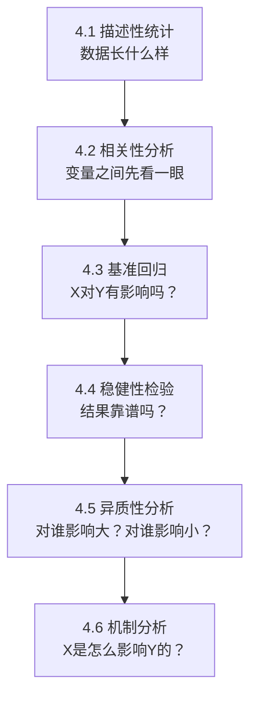

# 04 实证部分怎么写？（从描述统计到机制分析的完整顺序）

## 一、为什么要学这个？

实证部分是论文的"肉"。

很多同学回归跑完了，面对空白 Word 不知道写什么：
- 描述性统计这段到底写几句话？
- 相关性分析要不要写？写几行？
- 基准回归结果出来了，怎么从表格变成文字？
- 异质性分析和机制分析，分别是干嘛的？

**实证部分有固定的"流水线顺序"。** 这一节告诉你每一段写什么、写多长、怎么写。

---

## 二、实证部分的标准结构（背下来）

一篇本科实证论文，实证部分按下面这个顺序写，一段都不能少：



**为什么是这个顺序？** 因为读者的疑问是递进的：
1. 你的[[01_数据长什么样|数据长什么样]]？（描述）
2. 变量之间大概什么关系？（相关）
3. 核心结果是什么？（基准）
4. 结果换个方法还成立吗？（稳健）
5. 结果对所有人都一样吗？（异质）
6. X 是通过什么渠道影响 Y 的？（机制）

---

## 三、每一段具体写什么

### 3.1 描述性统计（写 1 段 + 1 张表）

> 💡 描述性统计是统计报告的"基本情况"段。写之前先想清楚：你要通过这张表告诉读者什么观点？[[../../教材笔记/05_统计学原理/11_统计分析/知识点/KP08_统计分析报告的特点与结构|统计报告四段式]] 说"基本情况"的任务是"说清楚本期/本地区总量、速度、结构"，不是把表念一遍。写完检查有没有犯 [[../../教材笔记/05_统计学原理/11_统计分析/知识点/KP09_统计分析报告常见毛病|数字堆砌]] 的毛病——每张表下面必须有一句解读。

**写什么**：
- 样本区间、观测值数量；
- 每个变量的均值、标准差、最小值、最大值；
- 用 2~3 句话概括："样本期间，Y 的均值为 X，标准差为 Y，说明……"

**模板**：

> 表 4-1 报告了主要变量的描述性统计结果。由表可知，样本期间被解释变量 Y 的均值为 5.23，标准差为 1.08，最小值为 2.11，最大值为 8.97，表明样本期间 Y 在不同省份间存在较大差异。核心解释变量 X 的均值为 0.34，标准差为 0.12，分布较为集中。控制变量方面，人均 GDP 对数的均值为 10.56，城镇化率均值为 58.3%，与现有文献基本一致。

**注意**：描述性统计不是把表念一遍，是挑 2~3 个有意思的数字说。

### 3.2 相关性分析（写 1 段 + 1 张[[01_相关系数|相关系数]]表）

**写什么**：
- X 和 Y 的相关系数是正还是负？显著吗？
- 控制变量之间有没有高度相关（[[04_多重共线性|多重共线性]]预警）？

**模板**：

> 表 4-2 报告了主要变量的 Pearson 相关系数。由表可知，核心解释变量 X 与被解释变量 Y 的相关系数为 0.32，在 1% 水平上显著为正，初步表明 X 与 Y 存在正相关关系，与本文预期一致。此外，各控制变量之间的相关系数绝对值均小于 0.7，方差膨胀因子 VIF 均值为 2.1，表明不存在严重的多重共线性问题。

**为什么要做这一步？** 两个作用：
1. 初步验证你的假设（X 和 Y 是不是同方向）；
2. 检查多重共线性（两个控制变量相关太高，回归会不准）。

### 3.3 基准回归（写 2~3 段 + 1 张主回归表）

这是全文最核心的表。
**写什么**：
- 先说明用了什么模型（混合 [[04_OLS截距和拟合值|OLS]]？[[06_固定效应FE|固定效应]]？[[07_随机效应RE与Hausman检验|随机效应]]？为什么）；
- 逐列报告：从不加控制变量 → 加控制变量 → 加固定效应，系数怎么变；
- 重点解释核心解释变量 X 的系数。

**模板**：

> 表 4-3 报告了基准回归结果。列（1）为未加入控制变量的混合 OLS 结果，X 的系数为 0.45，在 1% 水平上显著为正；列（2）加入了经济发展水平、城镇化率等控制变量，X 的系数为 0.38，仍在 1% 水平显著；列（3）进一步控制了省份固定效应和年份固定效应，X 的系数为 0.32，在 5% 水平显著为正。
>
> 以列（3）为基准结果，X 的系数为 0.32，意味着**X 每提高 1 个单位，Y 平均提高 0.32 个单位**，假设 H1 得到验证。

**关键**：必须用中文把系数翻译成"X 每变 1 单位，Y 变多少"。

### 3.4 [[06_稳健性检验|稳健性检验]]（写 1~2 段 + 1 张表）

**写什么**：一句话说"为验证结果可靠性，本文从以下几个方面进行稳健性检验"，然后列结果。
（具体 6 种方法见 `[[06_稳健性检验]].md`）

### 3.5 异质性分析（写 1~2 段 + 1 张表）

**写什么**：把样本分组，看 X 对 Y 的影响在不同组之间有没有差别。

常见分组方式：
- 东部 vs 中西部；
- 高经济发展水平 vs 低经济发展水平；
- 大城市 vs 小城市；
- 国有企业 vs 民营企业。

**模板**：

> 上述基准回归揭示了 X 对 Y 的平均影响，但未考虑不同区域间的差异。本文将样本分为东部和中西部两组进行回归，结果如表 4-5 所示。列（1）显示，东部地区 X 的系数为 0.45，在 1% 水平显著；列（2）显示，中西部地区 X 的系数为 0.18，不显著。这表明 X 对 Y 的促进作用主要体现在东部地区，可能原因是东部地区要素市场更完善，X 更容易转化为 Y。

### 3.6 机制分析（写 1~2 段 + 1 张表）

**写什么**：X 是通过什么中间渠道影响 Y 的？

比如你做"数字经济 → 产业升级"，机制可能是：
- 数字经济 → 促进技术创新 → 产业升级；
- 数字经济 → 优化资源配置 → 产业升级。

**做法**：中介效应模型——
1. X 对 Y 的总效应（基准回归）；
2. X 对中介变量 M 的影响；
3. X 和 M 同时放进回归，看 X 的系数是不是变小了。

**模板**：

> 为探究 X 影响 Y 的作用机制，本文参考中介效应模型，检验技术创新（T）和资源配置效率（R）两个渠道。表 4-6 结果显示：列（2）中 X 对 T 的系数显著为正；列（3）中同时放入 X 和 T，X 的系数从 0.32 下降至 0.25，T 的系数显著为正，表明技术创新发挥了部分中介作用。资源配置渠道类似（见表 4-6 列 4-5）。

---

## 四、每段写多长？

| 部分 | 字数 | 表几张 |
|------|------|--------|
| 描述性统计 | 150 字 | 1 |
| 相关性分析 | 150 字 | 1 |
| 基准回归 | 400 字 | 1 |
| 稳健性检验 | 300 字 | 1~2 |
| 异质性分析 | 300 字 | 1 |
| 机制分析 | 400 字 | 1 |

**实证部分总共约 2000 字、6 张表。**

---

## 五、易错点

1. **描述性统计把表念一遍**——不要，挑 2~3 个有意思的说。
2. **基准回归只说"显著为正"，不解释系数大小**——必须说"X 每提高 1 单位，Y 提高多少"。
3. **异质性分析分组后不解释为什么不一样**——分组结果摆出来，还要说"为什么东部显著、中西部不显著"。
4. **机制分析写成黑箱**——必须说清楚中介变量 M 是什么、为什么选这个 M。

---

## 六、可直接复制的实证部分框架

```
4 实证分析
4.1 模型设定与变量说明
    （方程、变量定义表、数据来源）
4.2 描述性统计
4.3 相关性分析
4.4 基准回归结果
4.5 稳健性检验
4.6 异质性分析
4.7 进一步分析：机制检验
```

---

## 七、对比

| 流水账写法（反面） | 讲故事写法（正面） |
|---------------------|---------------------|
| "回归结果如表所示，系数为0.32**" | "X每提高1单位，Y平均提高0.32单位，假设H1得到验证" |
| 异质性分组后只报数字 | 分组后解释"为什么东部显著中西部不显著" |
| 机制分析只放表不解释 | 说清M是什么、中介效应占比多少 |

---

## 八、速记卡

> **实证六步走**：描述 → 相关 → 基准 → 稳健 → 异质 → 机制。
> 每一步回答读者一个疑问：数据长啥样？大概啥关系？核心结果？靠谱吗？对谁有效？通过什么渠道？
> 核心原则：**每报一个数字，都要翻译成一句中文解释。**

---

下一篇：[[05_结果怎么读怎么写]]


---

## 📖 配套教材笔记
- [[../../教材笔记/02_计量经济学/14_实证研究指南/00_实证研究流程|计量经济学·实证研究流程]]
- [[../../教材笔记/05_统计学原理/11_统计分析/知识点/KP08_统计分析报告的特点与结构|统计学原理·统计分析报告结构]]

## 📚 配套原书
- [[../../原文件/计量经济学/陈强_计量经济学及Stata应用_全书|陈强《计量经济学及Stata应用》实证篇]]
