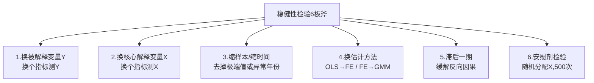
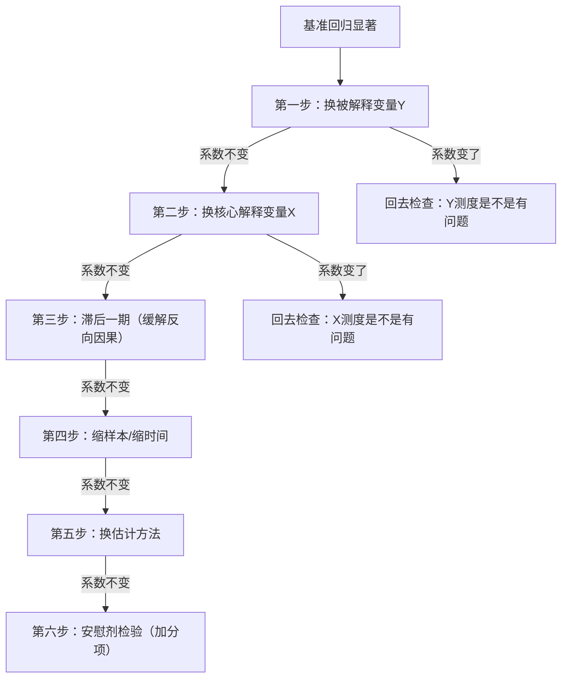

# 06 稳健性检验（结论换个方法还成立吗？）

<div style="text-align:right;margin:10px 0;"><a href="../../exam.html" target="_blank" style="display:inline-block;padding:6px 16px;background:#2563eb;color:#fff;border-radius:6px;text-decoration:none;font-size:14px;">📝 开始做题</a></div>


## 一、为什么要学这个？

很多同学的论文：基准回归一显著，就直接写结论"X 显著促进 Y"。

导师一看："你这个结论，换个被解释变量还成立吗？缩掉几个极端省还成立吗？安慰剂检验过了吗？"

**稳健性检验就是回答：我的结论是不是碰巧跑出来的？**

不做稳健性检验的论文，评审老师默认你的结论"可能是假的"。本科论文，基准回归显著只是起点，能扛住 3~4 种稳健性检验，结论才算立得住。

---

## 二、是什么？（比喻）

**稳健性检验就像一把椅子。**

你的基准回归是椅子的四条腿：X 的系数显著为正。

但评审老师会晃一晃这把椅子——换个被解释变量（晃第一条腿）、换个估计方法（晃第二条腿）、缩样本（晃第三条腿）、做安慰剂（晃第四条腿）——四条腿都晃不塌，说明这把椅子能坐。

如果晃一下就倒了（系数变号、不显著），说明你的结论"不稳健"，得回去找原因。

---

## 三、6 种稳健性检验方法（本科够用）



### 方法 1：换被解释变量 Y

**思路**：Y 这个变量我是不是测得不准？换一种测法再跑一遍。

**例子**：城乡收入差距，基准用"泰尔指数"，稳健性换成"城镇人均可支配收入 / 农村人均可支配收入"（城乡收入比）。如果系数还是负的、还是显著，说明不是 Y 的测度问题。

```stata
* === 稳健性1：换被解释变量为城乡收入比 ===
xtreg urban_rural_ratio ln_dig controls i.year, fe
eststo r1
```

### 方法 2：换核心解释变量 X

**思路**：X 这个变量我是不是测得不准？换一种测法再跑一遍。

**例子**：数字经济指数，基准用"数字普惠金融总指数"，稳健性换成"覆盖广度指数"。如果结论不变，说明不是 X 的测度问题。

```stata
* === 稳健性2：换核心解释变量为数字普惠金融覆盖广度 ===
xtreg theil ln_dig_coverage controls i.year, fe
eststo r2
```

### 方法 3：缩样本或缩时间

**思路**：是不是某个极端省份、某个异常年份把结果带偏了？

- 去掉四个直辖市（北京、上海、天津、重庆）；
- 去掉某一个异常年份（比如疫情冲击的 2020 年）；
- 按 1% 缩尾后再跑（缩尾方法见 `[[03_数据从哪来]].md`）。

```stata
* === 稳健性3：去掉四个直辖市 ===
xtreg theil ln_dig controls i.year if provid!=11 & provid!=12 & provid!=13 & provid!=14, fe
eststo r3

* === 稳健性3b：去掉2020年（疫情异常） ===
xtreg theil ln_dig controls i.year if year!=2020, fe
eststo r3b
```

### 方法 4：换估计方法

**思路**：是不是我选的模型不对？换一种估计方法再跑一遍。

- 基准用[[06_固定效应FE|固定效应]]，稳健性换[[07_随机效应RE与Hausman检验|随机效应]]（豪斯曼检验支持的话）；
- 基准用 [[04_OLS截距和拟合值|OLS]]，稳健性换面板 GMM（处理动态面板）；
- 基准用 FE，稳健性换双向固定效应 + 聚类[[KP03_稳健标准误|稳健标准误]]。

```stata
* === 稳健性4：换双向固定效应 + 省级聚类稳健标准误 ===
xtreg theil ln_dig controls i.year i.prov, fe vce(cluster provid)
eststo r4
```

### 方法 5：核心解释变量滞后一期

**思路**：X 和 Y 之间可能有反向因果（不是 X 影响 Y，而是 Y 影响 X）。把 X 滞后一期，让"过去的 X"解释"现在的 Y"，反向因果就被切断了。

```stata
* === 稳健性5：核心解释变量滞后一期 ===
gen L_ln_dig = L.ln_dig          // 生成滞后一期变量
xtreg theil L_ln_dig controls i.year, fe
eststo r5
```

### 方法 6：安慰剂检验（Placebo Test）

**思路**：我的结果是不是纯靠运气？把 X 随机分配给各个省份，跑 500 次，如果这 500 次里大部分系数都不显著、都集中在 0 附近，说明原来显著的系数不是运气。

```stata
* === 稳健性6：安慰剂检验（随机分配X，500次） ===
* 目的：检验基准回归的显著系数是不是随机碰出来的
permute ln_dig _b[ln_dig], reps(500) seed(12345) saving("placebo.dta", replace): ///
    xtreg theil ln_dig controls i.year, fe

* 查看随机分配后的系数分布
use "placebo.dta", clear
twoway (histogram b_ln_dig, frequency) ///
       (vertical line at(-0.189, lcolor(red) lwidth(2))), ///
       title("安慰剂检验：随机分配X的系数分布") ///
       xtitle("随机分配下的系数") ytitle("频数")
```

**怎么读结果**：把你基准回归的真实系数（-0.189）画一条竖线，如果这条线在直方图的最尾部（500 次里只有不到 5% 的随机系数比它更大），说明真实系数不是随机能碰出来的，结论可信。

---

## 四、方法选择决策表（我该做哪几种？）

不是所有论文都要把 6 种全做。按你的论文类型选 3~4 种：

| 论文类型 | 建议做哪几种 | 为什么 |
|---|---|---|
| 面板 FE（最常见） | 换 Y + 换 X + 滞后一期 + 缩样本 | 最常用的 4 种组合 |
| DID 政策评估 | 平行趋势 + 安慰剂 + PSM-DID + 缩样本 | DID 的标配是平行趋势和安慰剂 |
| 截面回归（OLS） | 换 Y + 换 X + 缩样本 + 换标准误 | 截面没有"滞后一期"的优势 |
| 综合评价（熵值/[[05_TOPSIS法|TOPSIS]]） | 换权重法（熵值→变异系数）+ 缩样本 + 换[[KP02_指标体系|指标体系]] | 评价类稳健性看权重和指标是否敏感 |

---

## 五、按什么顺序做？（流程图）



**经验**：前 4 种做下来系数都不变，论文已经很稳了；第 5、6 种是加分项，时间充裕再做。

---

## 六、论文里怎么写？（汇总表 + 一段话）

### 6.1 汇总表（一张表搞定所有稳健性检验）

**表 5-4 稳健性检验结果**

| 变量 | (1) 换Y | (2) 换X | (3) 滞后一期 | (4) 缩样本 | (5) 安慰剂 |
|------|---------|---------|-------------|-----------|-----------|
| X | -0.152\*\*\* | -0.178\*\*\* | -0.165\*\*\* | -0.171\*\*\* | 0.002 |
| | (-3.12) | (-3.45) | (-3.20) | (-3.05) | (0.08) |
| 控制变量 | 是 | 是 | 是 | 是 | 是 |
| 年份固定效应 | 是 | 是 | 是 | 是 | 是 |
| N | 360 | 360 | 330 | 324 | 500 |
| R² | 0.598 | 0.605 | 0.589 | 0.612 | — |

注：括号内为 t 值；\*\*\*、\*\*、\* 分别表示在 1%、5%、10% 水平上显著。

### 6.2 正文一段话（直接套）

> 为检验基准回归结果的可靠性，本文从以下四个方面进行稳健性检验：
>
> 第一，替换被解释变量。将城乡收入差距的度量指标由泰尔指数替换为城乡收入比，回归结果（表 5-4 列(1)）显示，X 的系数依然在 1% 水平上显著为负，系数大小与基准回归接近。
>
> 第二，替换核心解释变量。将数字普惠金融总指数替换为覆盖广度指数，结果（列(2)）依然显著为负。
>
> 第三，核心解释变量滞后一期。为缓解反向因果，将 X 滞后一期重新回归（列(3)），系数和显著性均无明显变化。
>
> 第四，剔除直辖市样本。考虑到北京、上海等直辖市的特殊性，将其剔除后重新回归（列(4)），结论依然成立。
>
> 上述结果表明，本文基准回归的结论是稳健的，并非由变量测度、样本选择或反向因果所驱动。

---

## 七、做几个合适？

- **本科毕业论文**：3~4 种足够。做 6 种会显得堆砌，评审老师反而怀疑你是不是在凑数。
- **硕士论文**：5~6 种，含安慰剂检验。
- **核心期刊**：8 种以上，含 DID 平行趋势、PSM、IV-GMM。

**本科的最优组合**：换 Y + 换 X + 滞后一期 + 缩样本 = 4 种，既不堆砌又显严谨。

---

## 八、三种保底组合（时间不够时选）

如果只剩两天就要交论文，按下面优先级选 3 种：

1. **换被解释变量 Y**（最容易做，改个变量名跑一遍就行）；
2. **滞后一期**（一行 `L.` 命令，缓解反向因果）；
3. **缩样本**（剔除四个直辖市或剔除某一年）。

这三种做完，论文至少有"稳健性检验"这一节，不会被评为"缺失关键检验"。

---

## 九、易错点

1. **只做一种稳健性检验**——评审会说"检验单薄"。至少做 3 种。
2. **换了 Y 但系数变了，还硬说结论稳健**——系数从显著为正变成不显著，这叫"不稳健"，要诚实写"在替代测度下结论减弱"，不能藏着。
3. **安慰剂检验只跑 50 次**——太少，分布画不出来。至少 500 次。
4. **稳健性[[08_t检验和F检验|检验和]]基准回归用同一份数据同一个模型**——那叫"换个变量名重跑"，不叫稳健性。
5. **把"异质性分析"当稳健性**——异质性（东中西部分组）回答的是"效果在不同地区是否不同"，不是"结论稳不稳"。两者要分开写。
6. **写"通过了稳健性检验"但不给表**——必须有一张表列出所有稳健性结果。

---

## 十、速记卡

> **稳健性检验 = 晃一晃椅子，看结论倒不倒。**
> 6 板斧：**换 Y、换 X、滞后一期、缩样本、换方法、安慰剂**。
> 本科做 3~4 种就够：**换 Y + 换 X + 滞后一期 + 缩样本**。
> 顺序：先换 Y/X，再滞后一期，再缩样本，最后安慰剂。
> 论文里用**一张汇总表** + **一段话**写清楚每种检验[[08_答辩PPT怎么做|怎么做]]、结果变没变。
> 系数变了要诚实说"不稳健"，不要硬藏。

---

## 💡 经济学视角：稳健性就是"这个经济学结论到底可不可靠"

**这一步在回答什么经济学问题？**
稳健性检验这个词听着像纯技术活，其实它在问一个经济学的根本问题：**我发现的这个关系，是真的经济规律，还是样本碰巧、模型碰巧、变量定义碰巧？** 经济学结论要经得起"晃一晃椅子"。

**为什么经济学特别看重稳健？**
因为实证分析的本质是用样本推断总体，用相关逼近因果。你今天用"消费支出"作 Y 跑出来显著，明天换"社会消费品零售总额"作 Y 就不显著了，那说明你原来的结论可能是变量定义的偶然产物。规范分析追求的是逻辑自洽，但实证结论必须能扛住替代解释——这是经济学和"随便跑跑"的分水岭。

**几种检验各自在排除什么经济学质疑？**

| 检验手段 | 在排除什么 |
|---|---|
| 换 Y / 换 X | 结论是不是只在这个特定指标定义下成立 |
| 滞后一期 | 是不是反向因果（不是 X 影响 Y，是 Y 预期影响 X） |
| 缩样本（剔除直辖市/疫情期） | 结论是不是被少数极端样本带偏 |
| 换方法（OLS→FE→IV） | 结论是不是依赖特定识别假设 |
| 安慰剂检验 | 是不是随机噪音也能跑出同样的系数 |

**举个实证论文的例子：**
你发现"数字金融提高农村消费"。审稿人会问：万一只是因为有钱的农村先通了数字金融呢？你就得做滞后一期（用上一年的数字金融预测今年的消费）、剔除疫情异常年份、换用北大数字普惠金融指数的不同维度。如果系数始终在 0.5—0.7 之间、方向不变，你才能自信地写"这一发现是稳健的"——政策建议才站得住。

**📚 配套经济学笔记：**
- [[../../教材笔记/06_西方经济学/00_导论/知识点/KP03_实证分析与规范分析|原KP·实证分析与规范分析]]

---

下一篇：[[07_结论与摘要]]

---

## 🔗 相关方法模块

- [[../04_回归三大问题/README|04 回归三大问题]] — 异方差/自相关/多重共线性的诊断与修正，是稳健性检验的基础
- [[../05_内生性与面板/README|05 内生性与面板]] — 换估计方法（OLS→FE→IV）是稳健性检验的重要手段
- [[../03_相关与回归/README|03 相关与回归]] — 基准回归结果的解读基础
- [[../11_方法选择决策/01_方法选择决策树|方法选择决策树]] — 怎么根据数据类型选择合适的稳健性检验方法

---

## 📖 配套教材笔记
- [[../../教材笔记/02_计量经济学/14_实证研究指南/00_实证研究流程|计量经济学·实证研究流程]]
- [[../../教材笔记/05_统计学原理/11_统计分析/知识点/KP08_统计分析报告的特点与结构|统计学原理·统计分析报告结构]]

## 📚 配套原书
- [[../../原文件/计量经济学/陈强_计量经济学及Stata应用_全书|陈强《计量经济学及Stata应用》实证篇]]
