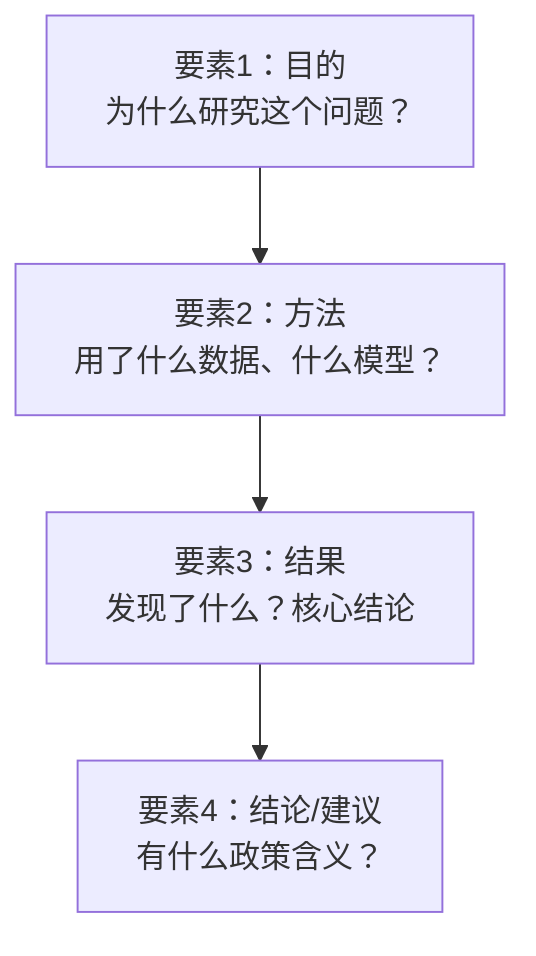
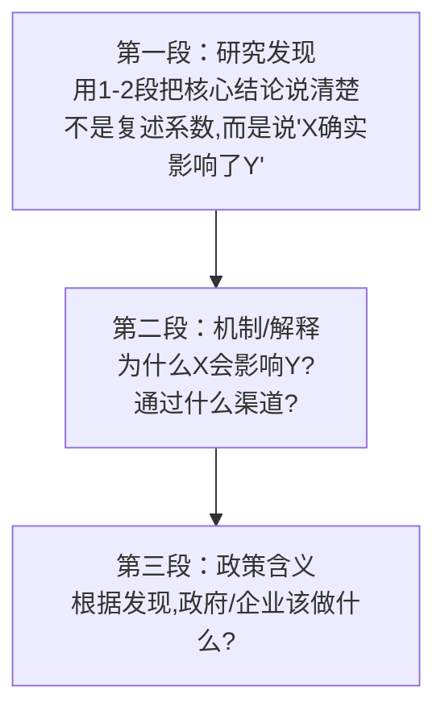

# 07 结论与摘要（论文的"脸"，评审第一眼就看这里）

## 一、为什么要学这个？

**摘要和结论，是评审老师看得最仔细的两段。**

- 摘要写不好，老师翻两页就不想看正文了；
- 结论写成"结果复述"，老师会觉得你没有思想；
- 政策建议写成"加强领导、提高重视"，老师会直接扣分——这是正确的废话。

这一节教你：摘要四要素怎么凑齐、结论三段式怎么写、政策建议怎么落到"可执行"，最后附一个论文常用句式库。

---

## 二、摘要：四要素凑齐（200~300 字）

摘要就是论文的"微缩版"，四要素一个都不能少：



| 要素 | 占字数 | 常见写法 |
|------|--------|----------|
| 目的 | 30~50 字 | "数字经济发展对城乡收入差距的影响，是……领域的重要问题" |
| 方法 | 50~80 字 | "基于2013-2023年30个省级面板数据，采用双向[[KP01_固定效应模型|固定效应模型]]……" |
| 结果 | 80~120 字 | "研究发现：数字经济发展显著缩小了城乡收入差距，系数为-0.189（1%水平显著）；机制分析表明……" |
| 结论 | 30~50 字 | "据此提出延伸农村数字基础设施、配套金融教育等政策建议" |

### 2.1 填空模板（直接套）

> **目的**：随着[背景]，[问题]日益受到关注。本文以[样本]为研究对象，考察[X]对[Y]的影响。
> **方法**：基于[年份]年[地区]面板数据，采用[模型/方法]，并通过[稳健性方法]检验结论可靠性。
> **结果**：研究发现，[X]对[Y]具有显著的[正向/负向]影响（系数=X\*\*，在X%水平显著）；异质性分析表明，该效应在[东部/中西部/农村/城市]更为显著；机制检验发现，[X]通过[机制渠道]影响[Y]。
> **结论/建议**：上述结论为[政策领域]提供了经验证据，据此建议[1~2条具体政策]。

### 2.2 差、中、好三版对比

**差版（70 分以下）**：

> 数字经济是现在的热点问题，很多人在研究。本文用了一些数据，跑了回归，发现数字经济和收入差距有关系。政策上应该加强领导。

问题：没说数据、没说方法、没给系数、建议是废话。

**中版（75~80 分）**：

> 本文基于2013-2023年30个省的面板数据，用固定效应模型研究数字经济对城乡收入差距的影响。结果发现数字经济显著缩小了城乡收入差距，在1%水平显著。政策建议包括发展数字经济、缩小差距。

问题：方法有了、结果有了，但没给系数、没提异质性、建议太空。

**好版（85+ 分）**：

> 在数字中国建设和共同富裕背景下，数字经济发展对城乡收入差距的影响备受关注。本文基于2013-2023年中国30个省级面板数据，采用双向固定效应模型，实证检验数字经济对城乡收入差距的影响及其机制。研究发现：（1）数字经济发展显著缩小了城乡收入差距，数字普惠金融指数每提高1%，泰尔指数下降约0.189%（在1%水平显著）；（2）该效应在中西部地区和农村地区更为明显，存在显著的异质性；（3）机制分析表明，数字经济通过促进农村劳动力非农就业这一渠道缩小城乡差距。上述结论经替换变量、滞后一期、剔除直辖市样本等[[06_稳健性检验|稳健性检验]]后依然成立。据此，本文提出延伸农村数字基础设施、配套农村金融教育、推动数字技能培训等政策建议，为缩小城乡差距提供经验参考。

### 2.3 英文摘要（Abstract）

英文摘要不是中文摘要逐字翻译，要更简洁。结构一样：目的 → 方法 → 结果 → 结论。

```
Abstract: Against the backdrop of the Digital China initiative and common prosperity, 
the impact of digital economy on urban-rural income gap has attracted wide attention. 
Using panel data of 30 Chinese provinces from 2013 to 2023, this paper employs a 
two-way fixed effects model to empirically examine the impact of digital economy on 
urban-rural income gap. The results show that: (1) digital economy significantly 
narrows the urban-rural income gap, with the digital inclusive finance index 
increasing by 1% leading to a 0.189% decrease in the Theil index (significant at 
the 1% level); (2) the effect is more pronounced in central and western regions 
and rural areas; (3) mechanism analysis indicates that digital economy reduces the 
income gap by promoting non-agricultural employment of rural labor. These findings 
survive a series of robustness checks. Policy implications for extending rural 
digital infrastructure and supporting rural financial education are discussed.

Keywords: digital economy; urban-rural income gap; fixed effects model; 
non-agricultural employment
```

### 2.4 关键词怎么选

关键词选 3~5 个，从三个池子里挑：

| 池子 | 例子 | 为什么 |
|------|------|--------|
| 核心解释变量 X | 数字经济 / 数字普惠金融 | 别人搜这个词能找到你 |
| 被解释变量 Y | 城乡收入差距 / 共同富裕 | 同上 |
| 方法或机制 | [[06_固定效应FE|固定效应]] / 非农就业 / 机制分析 | 体现你的技术路线 |

**不要**选太泛的词（"经济发展""中国经济"），也不要选太窄的词（你自己造的、别人不会搜的）。

---

## 三、结论：三段式（不是结果复述）

**结论 ≠ 结果。**

- **结果**：X 的系数是 -0.189，在 1% 水平显著。（这是 Stata 跑出来的数字）
- **结论**：数字经济发展确实缩小了城乡收入差距，这说明……（数字）背后的经济含义是什么？政策上意味着什么？

### 3.1 结论三段式结构



### 3.2 第一段：研究发现（模板）

> 本文以2013-2023年中国30个省级面板为样本，考察了数字经济发展对城乡收入差距的影响。主要结论如下：
>
> 第一，数字经济发展显著缩小了城乡收入差距。数字普惠金融指数每提高1%，城乡收入差距（泰尔指数）下降约0.189%。这一结论在替换被解释变量、核心解释变量滞后一期、剔除直辖市样本等稳健性检验后依然成立。
>
> 第二，数字经济的缩小效应存在显著异质性。在中西部地区、农村劳动力占比较高的省份，这一效应更为明显；在东部地区效应相对较弱。
>
> 第三，机制分析表明，数字经济主要通过促进农村劳动力非农就业这一渠道缩小城乡差距——数字普惠金融发展降低了农村居民获取金融服务和就业信息的门槛，使其能够转向工资更高的非农部门。

### 3.3 第二段：机制解释（一句话说清楚"为什么"）

> 数字经济之所以能缩小城乡收入差距，核心在于它打破了传统金融服务的地理限制。在传统模式下，农村居民难以获得贷款、支付和理财服务，创业和就业机会受限；数字普惠金融通过手机银行、移动支付等手段，使农村居民无需网点就能获得金融服务，从而提升了收入水平。这与既有文献中"数字普惠金融通过缓解信贷约束促进农户创业"的发现一致。

### 3.4 第三段：政策含义（见下一节）

---

## 四、政策建议：黄金法则（三可标准）

**最差的政策建议**（评审看了直接皱眉）：

- "加强领导，提高认识"
- "完善相关法律法规"
- "进一步加大投入"
- "提高重视程度"

这些叫"正确的废话"——谁都不能说错，但什么也没说。

### 4.1 三可标准

好的政策建议必须满足**可对应、可操作、可检验**：

| 标准 | 含义 | 反面 | 正面 |
|------|------|------|------|
| 可对应 | 每条建议对应一条你的实证发现 | "完善法律法规"（跟你结果没关系） | "数字经济效应在中西部更显著 → 建议中西部优先布局5G基站" |
| 可操作 | 谁来做、做什么、[[08_答辩PPT怎么做|怎么做]] | "加大投入" | "由省发改委牵头，2026年前完成乡镇一级5G网络覆盖" |
| 可检验 | 过几年能看出有没有效果 | "提高重视" | "目标：到2028年，农村数字普惠金融覆盖率从60%提高到85%" |

### 4.2 政策建议模板（按你的发现写）

> 基于上述研究结论，提出以下政策建议：
>
> **第一，延伸农村数字基础设施，缩小数字鸿沟。** 研究发现数字经济缩小城乡差距的效应在农村更强，因此应将5G基站、光纤网络向行政村延伸，降低农村居民使用数字服务的成本。
>
> **第二，配套农村金融教育和数字技能培训。** 研究还发现数字经济通过促进非农就业发挥作用，而这一渠道的前提是农村居民具备基本的数字操作能力。建议由人社部门和商业银行合作，在乡镇开展手机银行、电商运营等免费培训。
>
> **第三，中西部地区优先布局数字普惠金融试点。** 异质性分析表明中西部地区效应更显著，建议在中西部省份扩大数字普惠金融改革试点，将更多县域纳入数字人民币试点范围。

**看到区别了吗？** 每条建议：先点出"我发现了什么"，再推出"所以应该做什么"，最后说"由谁做、做到什么程度"。

---

## 五、研究不足与未来展望（诚实写）

任何本科论文都有局限，诚实写出来，反而加分。常见写法：

> **研究不足与展望**
>
> 本文仍存在以下不足：
>
> 第一，内生性处理有限。受数据可得性限制，本文主要采用双向固定效应和滞后一期缓解反向因果，未能使用[[03_工具变量IV|工具变量]]或自然实验进一步识别因果关系。未来研究可结合数字金融试点的外生冲击，采用DID方法更严谨地识别因果效应。
>
> 第二，微观机制证据不足。本文从省级宏观层面识别了"非农就业"这一渠道，但未能使用CFPS等微观家庭数据直接验证"数字金融 → 个体创业/就业选择 → 收入"这一微观链条。未来研究可结合微观调查数据开展机制检验。
>
> 第三，样本范围为省级面板，未能下沉到地级市或县域层面。未来可利用更精细的空间数据，考察数字经济影响的空间溢出效应。

**要点**：
- 不足要具体（说清哪里不足、为什么不足），不要写"本文研究尚浅，能力有限"这种套话；
- 展望要对应不足（你没做什么，未来就做什么），不要另起炉灶。

---

## 六、附录：论文常用句式库（写作时挑着用）

### 6.1 背景/引言句式

| 用途 | 句式 |
|------|------|
| 引出大背景 | 近年来，随着……的快速发展，……问题日益凸显，受到学界和政策层的广泛关注。 |
| 引出矛盾 | 一方面，……；另一方面，……。这种矛盾如何调和，成为本文关注的核心问题。 |
| 引用国家政策 | 党的二十大报告明确提出"……"，为本研究提供了政策背景。 |

### 6.2 文献不足句式（写在综述末尾）

| 用途 | 句式 |
|------|------|
| 指出样本不足 | 现有研究多关注全国层面，针对[某区域]的讨论仍较为有限。 |
| 指出方法不足 | 多数文献采用[[04_OLS截距和拟合值|OLS]]回归，较少处理内生性问题，因果识别策略有待加强。 |
| 指出机制不足 | 已有研究多聚焦于……单一渠道，对……渠道的讨论尚显不足。 |
| 引出本文贡献 | 鉴于此，本文以……为样本，采用……方法，试图在……方面补充现有研究。 |

### 6.3 研究目标/方法句式

| 用途 | 句式 |
|------|------|
| 交代数据 | 本文选取2013-2023年中国30个省级面板数据，共360个观测值。 |
| 交代模型 | 为检验X对Y的影响，本文构建如下双向固定效应模型：Y_it = α + βX_it + γControls_it + μ_i + λ_t + ε_it。 |
| 交代变量 | 被解释变量Y采用……衡量；核心解释变量X采用……指数；控制变量包括……。 |

### 6.4 计算/结果描述句式

| 用途 | 句式 |
|------|------|
| 描述基准结果 | 表X列(1)报告了X对Y的基准回归结果，X的系数为X\*\*，在X%水平上显著为正/负。 |
| 描述稳健性 | 为检验结论可靠性，本文从替换变量、滞后一期、缩样本等方面进行稳健性检验，结果均支持基准结论。 |
| 描述异质性 | 进一步分样本回归发现，X对Y的影响在[子样本A]中更为显著，在[子样本B]中不显著，说明……。 |

### 6.5 结论/建议句式

| 用途 | 句式 |
|------|------|
| 总结发现 | 本文研究表明，X对Y具有显著的正向/负向影响，这一结论在多种稳健性检验下依然成立。 |
| 政策建议 | 基于上述结论，提出如下政策建议：第一，……；第二，……；第三，……。 |
| 研究展望 | 受数据和方法限制，本文仍存在……不足，未来可在……方面进一步拓展。 |

### 6.6 避坑句式对照

| 错误（不要写） | 正确写法 |
|---|---|
| "众所周知，数字经济很重要" | "数字经济已成为推动高质量发展的重要引擎（张三，2023）" |
| "不难看出，X对Y有影响" | "回归结果显示，X的系数为0.189，在1%水平显著为正" |
| "由于水平有限，论文存在不足" | "受数据可得性限制，本文未能使用工具变量进一步识别因果" |
| "本研究具有重大意义" | "本文结论为……政策提供了经验证据" |

---

## 七、易错点

1. **摘要写成引言的缩写**——摘要必须有数据、有方法、有系数、有结论，不能只讲背景。
2. **结论复述结果**——结论要讲"经济含义"和"政策含义"，不是把系数再念一遍。
3. **政策建议是正确的废话**——"加强领导""完善法规"这种话一条都不要写。
4. **研究不足写成自我贬低**——"笔者水平有限""论文尚显稚嫩"这种话删掉，客观说哪里不足就行。
5. **关键词选太泛**——"经济发展""中国经济"这种词删掉，换成你的具体变量。
6. **摘要超过 400 字**——本科论文摘要 200~300 字最合适，太长老师不看。
7. **英文摘要机翻**——英文摘要要单独写，不要逐字对译中文。

---

## 八、速记卡

> **摘要四要素**：目的 → 方法 → 结果 → 结论建议，200~300 字。
> **结论三段式**：研究发现 → 机制解释 → 政策含义。
> **政策建议三可**：可对应（对应你的发现）、可操作（谁做什么）、可检验（能看出效果）。
> **研究不足**：具体说哪里不足、为什么不足，对应未来展望。
> **摘要里必须有**：数据区间、样本量、模型、核心系数、显著性水平。
> **政策建议里不能有**："加强领导""提高重视""完善法规"这类正确的废话。

---

下一篇：[[08_技术路线图怎么做]]


---

## 📖 配套教材笔记
- [[../../教材笔记/02_计量经济学/14_实证研究指南/00_实证研究流程|计量经济学·实证研究流程]]
- [[../../教材笔记/05_统计学原理/11_统计分析/知识点/KP08_统计分析报告的特点与结构|统计学原理·统计分析报告结构]]

## 📚 配套原书
- [[../../原文件/计量经济学/陈强_计量经济学及Stata应用_全书|陈强《计量经济学及Stata应用》实证篇]]
