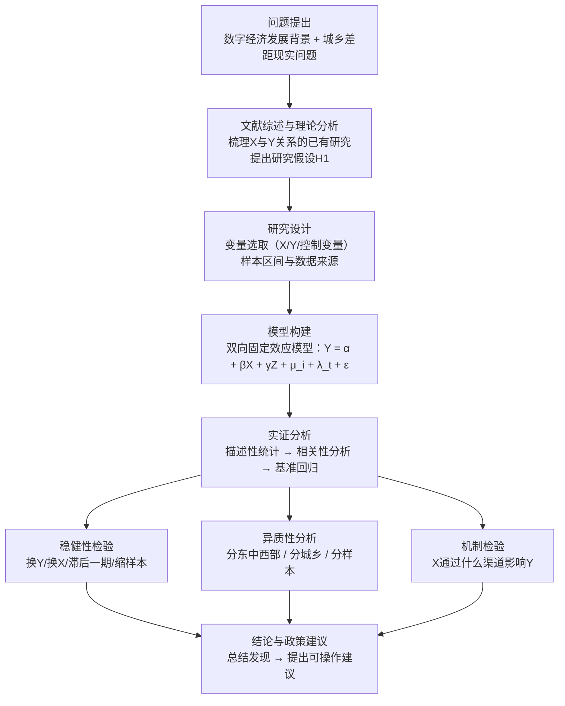
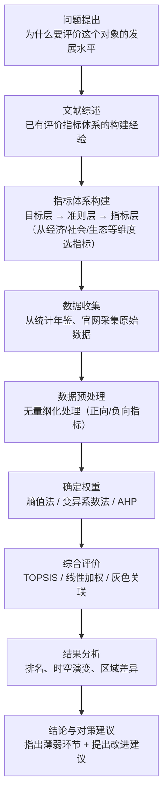

# 08 技术路线图怎么做？（开题和正文都要一张）

## 一、为什么要学这个？

开题报告和论文正文里，导师都会要求放一张"技术路线图"。

很多同学的做法：
- 把 Word 里的流程图画得像幼儿园涂鸦；
- 图画得很漂亮，但和正文对不上；
- 放了图但正文里没解释，老师看不懂你想表达什么。

**技术路线图不是装饰，是你整个研究的"导航图"。** 它要回答三个问题：
1. 你研究的逻辑顺序是什么？（先做什么、后做什么）
2. 每一步用什么方法/数据？
3. 最终要得到什么结果？

这一节给你两套现成的图（回归类、综合评价类），直接套。

---

## 二、技术路线图是什么？

**技术路线图 = 把你的研究从"问题提出"到"结论建议"的全过程，用箭头连起来。**

它和"流程图"的区别：
- 流程图：偏操作步骤（"打开 Excel → 导入数据 → 清洗 → 回归"）；
- 技术路线图：偏研究逻辑（"为什么研究 → 用什么理论 → 怎么验证 → 得到什么结论"）。

**本科论文的技术路线图，一般放在引言末尾或第 3 章开头，占半页到一页。**

---

## 三、回归类论文：标准技术路线图（直接套）

适用于"X 对 Y 有影响吗"这类实证论文（面板回归、DID、Logit 等）。

### 3.1 图里每个框和你正文的对应关系

| 图里的框 | 对应正文哪一章 |
|---|---|
| 问题提出 | 第 1 章 引言 |
| 文献综述与理论分析 | 第 2 章 文献综述 + 理论分析与研究假设 |
| 研究设计 | 第 3 章 研究设计（变量、数据、描述统计） |
| 模型构建 | 第 3 章 研究设计（模型设定） |
| 实证分析 | 第 4 章 实证结果与分析 |
| [[06_稳健性检验|稳健性检验]] | 第 4 章 第 X 节 稳健性检验 |
| 异质性分析 | 第 4 章 第 X 节 异质性分析 |
| 机制检验 | 第 4 章 第 X 节 机制分析 |
| 结论与政策建议 | 第 5 章 结论与建议 |

**画图时记住：图里有几个框，正文就应该有对应小节。图和正文对不上，就是你的问题。**

---

## 四、综合评价类论文：技术路线图（变体）

适用于"给对象打分排名"这类论文（[[06_熵值法-TOPSIS组合|熵值法]]、[[05_TOPSIS法|TOPSIS]]、[[04_AHP层次分析法|AHP]] 等）。

**综合评价类和回归类的区别**：没有"[[KP02_假设检验|假设检验]]"和"稳健性检验"，但多了"[[KP02_指标体系|指标体系]]构建"和"权重确定"两步。你的技术路线图要画成哪一种，取决于你的论文类型——方法怎么选见 `../11_方法选择决策/[[01_方法选择决策树]].md`。

---

## 五、用什么工具画？

| 工具 | 适合谁 | 优缺点 |
|------|--------|--------|
| **Word 自带形状** | 本科论文（够用） | 免费，但画连接线麻烦 |
| **[[08_答辩PPT怎么做|PPT]]** | 本科论文（最推荐） | 形状和对齐方便，画完另存为图片贴进 Word |
| **Visio** | 学校机房有 | 专业，但大材小用 |
| **亿图图示 / draw.io** | 想画得好看 | 免费在线，模板多 |
| **Python（matplotlib）** | 学过 Python | 可复现，但排版麻烦 |

**本科论文，用 PPT 画最省事**：插入矩形框 → 打字 → 用箭头连接 → 全选 → 另存为图片 → 贴进 Word。

### 5.1 画图规范

- **统一配色**：最多 2~3 种颜色（主框一种，子框一种），不要五彩斑斓；
- **统一字号**：框内文字 10~12 磅，全图一致；
- **箭头方向**：从上到下（竖向）或从左到右（横向），不要交叉；
- **框的形状**：研究环节用矩形，判断环节用菱形（本科很少有判断，基本全是矩形）；
- **导出图片**：导出 PNG 或 EMF，分辨率 ≥ 300 DPI。

---

## 六、论文里怎么配文字？（图下面的说明）

图下面一定要配一段文字，不能只放图。模板：

> **图 1-1 技术路线图**
>
> 本文的研究逻辑如图 1-1 所示。首先，在数字中国建设和共同富裕背景下，提出"数字经济发展如何影响城乡收入差距"这一核心问题；其次，通过梳理国内外相关文献，从理论上分析数字经济影响城乡收入差距的机制，提出研究假设；再次，基于 2013-2023 年中国 30 个省级面板数据，构建双向[[KP01_固定效应模型|固定效应模型]]进行实证检验；然后，通过替换变量、滞后一期、剔除直辖市样本等方法进行稳健性检验，并进一步开展异质性分析和机制检验；最后，总结研究结论，提出相应的政策建议。

**要点**：这段话就是把技术路线图从上到下念一遍，但要用连贯的学术语言，不要只是"第一步……第二步……第三步……"。

---

## 七、方法选择理由段落（技术路线图旁边配一段）

技术路线图里写了用什么模型，但正文里还要说清楚"为什么选这个模型"。模板：

> **模型选择依据**：
>
> 本文采用双向固定效应模型，主要基于以下考虑：第一，样本为 2013-2023 年中国 30 个省的面板数据，同时包含截面维度（省份）和时间维度（年份），固定效应模型能够控制不随时间变化的个体异质性（如地理位置、资源禀赋）和共同时间冲击（如宏观政策、疫情）；第二，Hausman 检验结果（χ² = XX.XX, p < 0.001）拒绝随机效应模型，支持固定效应设定；第三，为缓解异方差和序列相关，本文采用省级层面聚类稳健标准误。
>
> 稳健性检验方面，本文从替换被解释变量、核心解释变量滞后一期、剔除直辖市样本三个方面检验结论的可靠性；异质性分析按东、中、西部分组；机制检验采用中介效应模型，检验"非农就业"这一渠道。

---

## 八、常见错误

1. **技术路线图和正文对不上**——图里画了 6 步，正文只写了 4 步，另外 2 步凭空消失。
2. **图画得像流程图**——只画"操作步骤"（打开 Excel → 导入数据），没有体现"研究逻辑"（为什么做这一步）。
3. **颜色太多、太花哨**——评审老师看的是逻辑，不是美术。
4. **箭头交叉**——读者看不懂谁连谁。从上到下画，不要回头。
5. **图下面不配文字**——只放图不配说明，老师不知道你想表达什么。
6. **用别人论文的图**——直接抄知网论文的图，改都不改，评审老师一搜就看到了。
7. **图里文字太小**——导出图片后在 Word 里看不清框内文字。字号至少 10 磅。

---

## 九、速记卡

> **技术路线图 = 研究逻辑的导航图**，不是装饰。
> 回归类模板：问题 → 文献+假设 → 研究设计 → 模型 → 基准回归 → 稳健性 → 异质性/机制 → 结论建议。
> 综合评价类模板：问题 → 文献 → 指标体系 → 数据 → 预处理 → 权重 → 评价 → 结果 → 建议。
> 工具：PPT 画最省事，导出 300 DPI 图片贴进 Word。
> 图下面配一段"把图从上到下念一遍"的学术语言说明。
> 图和正文必须一一对应，图里有什么框，正文就有什么小节。

---

## 💡 经济学视角：技术路线图就是研究逻辑的可视化

**这一步在回答什么经济学问题？**
技术路线图常被当成"美工任务"，PPT 里画几个框连起来就行。但它的本质是把整个经济学研究的思维链条摊开给人看：你的问题从哪来、假设怎么提出、数据怎么对应、模型怎么识别、结论怎么回到政策。

**为什么经济学研究特别需要这张图？**
因为经济学研究是一条严谨的因果链：现实经济问题 → 理论机制（为什么 A 影响 B）→ 可检验假设 → 研究设计（用什么数据、什么识别策略排除混淆）→ 实证模型 → 稳健性检验 → 政策含义。这链条里任何一环断掉，论文就站不住。路线图就是把这条链画出来，让答辩老师一眼看到"你没想漏"。

**经典宏观政策逻辑可以借鉴：**
比如财政政策的传导链条——政府支出↑ → 总需求↑ → 产出↑（乘数效应），中间每一环都要写清楚工具、对象、传导渠道、最终效果。你画技术路线图时，思路和这一模一样：你的"政策工具"就是解释变量 X，你的"传导渠道"就是机制变量，你的"最终效果"就是被解释变量 Y，最后落到"政策建议"。

**举个实证论文的例子：**
《数字金融→农村消费》路线图：现实问题（农民消费不足）→ 理论假设（流动性约束抑制消费）→ 数据（CFPS 微观 + 北大数字金融指数）→ 模型（固定效应 + 工具变量）→ 基准回归 → 稳健性（换指标/滞后/安慰剂）→ 机制检验（流动性约束渠道）→ 结论政策（收入分配与金融普惠）。图下面配一段话，把图从上到下念一遍，就是论文的摘要雏形。

**📚 配套经济学笔记：**
- [[../../教材笔记/06_西方经济学/15_宏观经济政策/知识点/KP01_财政政策工具与自动稳定器|原KP·财政政策工具与自动稳定器]]

---

上一篇：[[07_结论与摘要]]

__agent_infra_status=$?
pwd > '/Users/wangpengcheng/Library/Application Support/Doubao/Default/agent_infra/to/lr_303ba58fa146987e/non_interactive_cwd_00054dfb-f269-40ed-955e-391752319594.txt'
exit "$__agent_infra_status"

---

## 📖 配套教材笔记
- [[../../教材笔记/02_计量经济学/14_实证研究指南/00_实证研究流程|计量经济学·实证研究流程]]
- [[../../教材笔记/05_统计学原理/11_统计分析/知识点/KP08_统计分析报告的特点与结构|统计学原理·统计分析报告结构]]

## 📚 配套原书
- [[../../原文件/计量经济学/陈强_计量经济学及Stata应用_全书|陈强《计量经济学及Stata应用》实证篇]]
