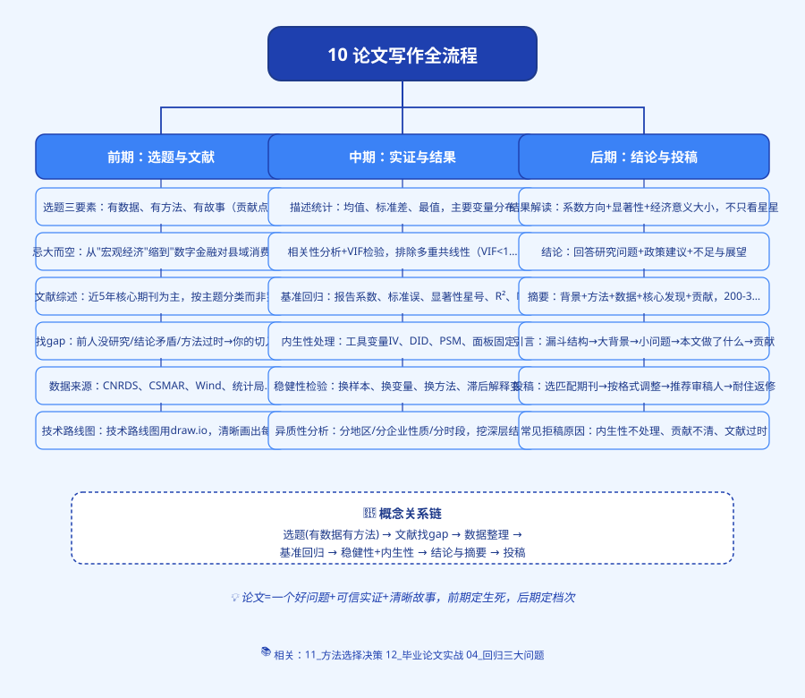
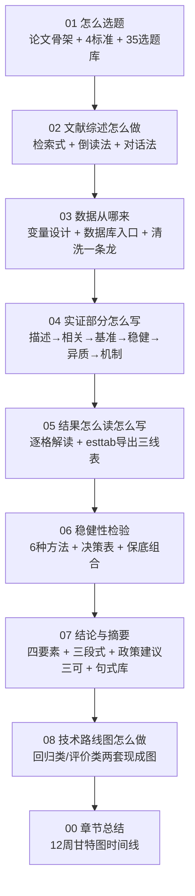

# 思维导图

---

# 10 论文写作全流程

> 前面 00~09 章教你"统计学是什么、怎么算"。
> 从这一章开始，教你**怎么用这些方法写出一篇真正的毕业论文**。
>
> 这一章是流水线：选题 → 文献 → 数据 → 实证 → 结果 → 稳健性 → 结论摘要 → 技术路线图。
> 每一步都告诉你"具体做什么、[[08_答辩PPT怎么做|怎么做]]、踩什么坑"。

---

## 为什么要有这一章？

很多同学学完回归、学完[[06_熵值法-TOPSIS组合|熵值法]]，一到写论文就懵：

- "我知道 [[04_OLS截距和拟合值|OLS]] 怎么算，但论文第一段写什么？"
- "回归结果出来了，系数是 0.32 两颗星，这句话怎么写成中文？"
- "导师说要做[[06_稳健性检验|稳健性检验]]，我到底做几个、怎么做？"
- "技术路线图画成什么样才合格？"

**统计学方法是"工具"，论文写作是"把工具用在一个完整故事里"。**

前面教你怎么用螺丝刀、扳手、电钻；这一章教你怎么盖一间房子。

---

## 这一章你会学到什么？

---

## 文件清单

| 文件 | 一句话说明 |
|------|-----------|
| [`01_怎么选题.md`](01_怎么选题.md) | 先建立"论文是什么"的全局观，再用 4 标准 + 35 个现成选题快速定题 |
| [`02_文献综述怎么做.md`](02_文献综述怎么做.md) | 检索式怎么拼、文献卡片怎么做、三种写作模板怎么选 |
| [`03_数据从哪来.md`](03_数据从哪来.md) | 变量设计表 + 国家统计局/CSMAR/CFPS 等入口 + Excel 规范 + 面板拼接 + 清洗 Stata 代码 |
| [`04_实证部分怎么写.md`](04_实证部分怎么写.md) | 实证六步走：描述统计 → 相关性 → 基准回归 → 稳健性 → 异质性 → 机制 |
| [`05_结果怎么读怎么写.md`](05_结果怎么读怎么写.md) | Stata 输出每个数字什么意思、三线表怎么用 esttab 导出、一句话报告模板 |
| [`06_稳健性检验.md`](06_稳健性检验.md) | 6 种方法详解、按论文类型选哪几种、保底三组合 |
| [`07_结论与摘要.md`](07_结论与摘要.md) | 摘要四要素 + 差中好三版对比、结论三段式、政策建议三可标准、常用句式库 |
| [`08_技术路线图怎么做.md`](08_技术路线图怎么做.md) | 回归类/综合评价类两套现成图、用 [[08_答辩PPT怎么做|PPT]] 画、配文字说明 |
| [`00_章节总结.md`](00_章节总结.md) | 12 周甘特图 + 每周任务清单 + 关键里程碑 |

---

## 这一章和前面章节的关系

| 你在这一章做的事 | 用到前面哪一章的知识 |
|------------------|---------------------|
| 选题 | 00 学前准备（知道论文长什么样） |
| 文献综述 | ——（纯写作技能） |
| [[05_数据清洗|数据清洗]] | 02 描述统计 |
| 基准回归 | 03 相关与回归（OLS 手推） |
| [[KP03_稳健标准误|稳健标准误]] | 04 回归三大问题（[[02_异方差|异方差]]） |
| 固定效应 | 05 内生性与面板 |
| Logit | 06 受限因变量 |
| 熵值法/TOPSIS | 07 综合评价方法（`../07_综合评价方法/03_熵值法.md`） |
| PCA | 08 降维与分类 |
| ARIMA | 09 时间序列 |

**这一章不教新方法，教你"把前面学过的方法串成一篇论文"。**

---

## 怎么用这一章？

- **如果你刚开题**：从 `[[01_怎么选题]]` 开始一路读下来；
- **如果你已经有题目、在跑数据**：直接跳到 `[[04_实证部分怎么写]]` 和 `[[05_结果怎么读怎么写]]`；
- **如果你快交稿了**：看 `[[07_结论与摘要]]` 和 `00_章节总结` 的 12 周甘特图，对一下自己落后在哪；
- **如果你在写开题报告**：重点看 `[[08_技术路线图怎么做]]` 和 `[[01_怎么选题]]`。

---

## 跨模块链接

- 方法选择决策：`../11_方法选择决策/[[01_方法选择决策树]].md`
- 重庆财经学院格式要求：`../12_毕业论文实战/[[01_重庆财经学院格式要求]].md`
- 三线表规范：`../12_毕业论文实战/[[02_三线表怎么做]].md`
- 参考文献 GB/T 7714：`../12_毕业论文实战/[[03_参考文献GB-T7714]].md`
- 答辩 50 问：`../12_毕业论文实战/[[07_答辩50问]].md`

---

下一篇：[[01_怎么选题]]

---

## 📖 配套统计学原理

> Ch11「统计分析」分两块：前半段讲常用经济指标（GDP、基尼系数……），后半段讲怎么写统计分析报告。写论文时两头都用得上。

### 📝 报告写作（写实证结果、写结论时对照）

- [[../../教材笔记/05_统计学原理/11_统计分析/知识点/KP08_统计分析报告的特点与结构|KP08 统计分析报告的特点与结构]] — 报告四段式：基本情况→成绩/问题→原因分析→对策建议。论文实证部分的骨架就是这个。
- [[../../教材笔记/05_统计学原理/11_统计分析/知识点/KP09_统计分析报告常见毛病|KP09 统计分析报告常见毛病]] — 流水账、数字堆砌、缺乏结论……写完初稿对照这份清单自查一遍。
- [[../../教材笔记/05_统计学原理/02_统计数据采集/知识点/KP05_问卷设计原则|问卷设计原则]] — 一手数据怎么采集（做微观调查类论文时用）

### 📊 常用经济指标（写区域经济论文时的变量库）

- [[../../教材笔记/05_统计学原理/11_统计分析/知识点/KP01_综合评价法总览|KP01 综合评价法总览]] — 给城市/省份打分排名的总框架，对应第07章
- [[../../教材笔记/05_统计学原理/11_统计分析/知识点/KP02_GDP与GNP|KP02 GDP与GNP]] — 经济规模怎么衡量
- [[../../教材笔记/05_统计学原理/11_统计分析/知识点/KP03_三次产业划分|KP03 三次产业划分]] — 产业结构怎么分析
- [[../../教材笔记/05_统计学原理/11_统计分析/知识点/KP04_恩格尔系数|KP04 恩格尔系数]] — 生活水平高低怎么看
- [[../../教材笔记/05_统计学原理/11_统计分析/知识点/KP05_基尼系数与洛伦兹曲线|KP05 基尼系数与洛伦兹曲线]] — 收入分配公平不公平
- [[../../教材笔记/05_统计学原理/11_统计分析/知识点/KP06_通货膨胀率与CPI|KP06 通货膨胀率与CPI]] — 物价涨跌怎么度量
- [[../../教材笔记/05_统计学原理/11_统计分析/知识点/KP07_失业率|KP07 失业率]] — 就业冷热怎么判断

---

## 常用经济指标速查

> 写区域经济论文时，描述一个地区的"经济家底"，逃不开下面这几个指标。每个指标一句话讲清它是什么、论文里怎么用。

| 指标 | 一句话小白解释 | 论文里怎么用 | 详情 |
|------|---------------|-------------|------|
| **GDP / GNP** | GDP 是"国境内不管谁生产的都算"，GNP 是"本国人不管在哪生产的都算" | 衡量地区经济规模和增长速度；做省际比较、人均 GDP 的分母 | [[../../教材笔记/05_统计学原理/11_统计分析/知识点/KP02_GDP与GNP|GDP与GNP]] |
| **三次产业划分** | 一产是根（农林牧渔）、二产是干（制造建筑）、三产是枝叶（服务业） | 分析产业结构高级化程度；三产比重是"经济发展水平"的常用代理变量 | [[../../教材笔记/05_统计学原理/11_统计分析/知识点/KP03_三次产业划分|三次产业划分]] |
| **恩格尔系数** | 吃饭花的钱占总支出的比重，越低日子越宽裕 | 衡量居民生活水平；做城乡差距、区域富裕程度比较 | [[../../教材笔记/05_统计学原理/11_统计分析/知识点/KP04_恩格尔系数|恩格尔系数]] |
| **基尼系数** | 把全国人按收入排队，看最穷的一半人分走了多少收入；0 最平均，1 最不平均 | 衡量收入分配公平程度；被解释变量里"城乡收入差距"常用它或泰尔指数 | [[../../教材笔记/05_统计学原理/11_统计分析/知识点/KP05_基尼系数与洛伦兹曲线|基尼系数与洛伦兹曲线]] |
| **CPI / 通货膨胀率** | 一篮子商品平均涨了多少价；CPI 是尺子，通胀率是 CPI 的涨幅 | 把名义 GDP、名义工资折算成实际值；时间序列论文里常做预测 | [[../../教材笔记/05_统计学原理/11_统计分析/知识点/KP06_通货膨胀率与CPI|通货膨胀率与CPI]] |
| **失业率** | 想工作却找不到工作的人占能工作的人的比例 | 判断经济冷热；做就业、民生类论文的核心变量 | [[../../教材笔记/05_统计学原理/11_统计分析/知识点/KP07_失业率|失业率]] |

**写区域经济论文时怎么用？**
- 做"某省/某市经济发展水平评价"：用 GDP + 人均 GDP + 三产比重 + 城镇化率搭指标体系；
- 做"收入差距"主题：被解释变量用基尼系数或泰尔指数，控制变量加恩格尔系数；
- 做"物价/消费"主题：核心解释变量是 CPI，控制变量加工资、失业率；
- 做"产业升级"主题：核心是二产→三产的比重变化，配 GDP 增速看整体盘子。

---

上一篇：[[../09_时间序列/README|09 时间序列]] ｜ 下一篇：[[01_怎么选题]] ｜ 流程下一步：[[../11_方法选择决策/README|11 方法选择决策]]

---

## 📖 配套教材笔记
- [[../../教材笔记/02_计量经济学/14_实证研究指南/00_实证研究流程|计量经济学·实证研究流程]]
- [[../../教材笔记/05_统计学原理/11_统计分析/知识点/KP08_统计分析报告的特点与结构|统计学原理·统计分析报告结构]]

## 📚 配套原书
- [[../../原文件/计量经济学/陈强_计量经济学及Stata应用_全书|陈强《计量经济学及Stata应用》实证篇]]
