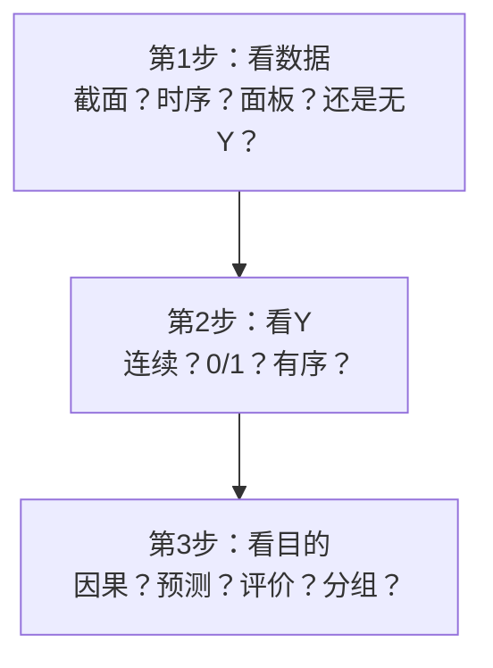

# 00 章节总结：A4 纸决策速查卡

> 打印这一页贴桌前，拿到题目对着选。

---

## 一张表选方法

| 你的情况 | 选这个方法 |
|----------|-----------|
| 省级面板，X 影响 Y | 双向[[06_固定效应FE|固定效应]] FE + [[KP03_稳健标准误|稳健标准误]] |
| 企业面板，担心内生 | FE + 滞后一期 / IV |
| 评估一个政策效果 | DID / 多期 DID |
| 处理组对照组本来就不一样 | PSM-DID |
| 截面数据，Y 连续 | 多元 [[04_OLS截距和拟合值|OLS]] + robust |
| 截面数据，Y 是 0/1 | Logit / Probit + 边际效应 |
| 要给对象打分排名 | [[06_熵值法-TOPSIS组合|熵值法]] / [[05_TOPSIS法|TOPSIS]] |
| 权重想主客观结合 | [[04_AHP层次分析法|AHP]]-熵值-TOPSIS |
| 变量太多想降维 | [[02_主成分分析PCA|PCA]] 主成分 |
| 想把对象分几类 | K-means 聚类 |
| 只有一个变量要预测 | [[05_ARIMA建模流程|ARIMA]] |
| 要预测波动率 | GARCH |
| 多个变量互相传导 | VAR |
| 财务预警（ST 预测） | PCA + Logit |
| 效率测算 + 影响因素 | DEA + Tobit |
| 小样本（n<30）影响因素排序 | 灰色关联 |
| 两个系统协调发展 | 耦合协调度 |
| 邻省有溢出效应 | 空间杜宾 SDM |
| X 对 Y 有门槛 | Hansen 面板门槛 |

---

## 三步决策法

---

## 本科论文最稳的 3 个套路

1. **面板 FE 套路**：X 对 Y 的影响 → 双向 FE + 稳健标准误 + 异质性 + 机制；
2. **熵值-TOPSIS 套路**：给城市/省打分 → 指标体系 + 熵值赋权 + TOPSIS 排名；
3. **DID 套路**：评估政策 → 处理组/对照组 + DID 交互项 + 平行趋势检验。

---

## 四条铁律

1. **先做 ADF 检验再跑时序回归**——否则是伪回归；
2. **所有回归都加 robust**——否则标准误有偏；
3. **样本量 N < 30 别跑面板**——扩样本；
4. **相关 ≠ 因果**——讲故事时留有余地。

---

## 这一章有哪些文件

| 文件 | 干什么用 |
|---|---|
| [[01_方法选择决策树]] | 拿到题目对着树一路问到具体方法 |
| [[02_15种论文方法组合套路]] | 25 种经过验证的套路，每种给题目+代码+三线表+答辩常问 |
| [[03_常见方法误用]] | 18 个导师常骂的坑，错误写法 vs 正确写法 |
| [[04_Stata_R实操速查]] | 从导数据到出结果的命令清单 |
| [[05_SPSS操作指引]] | 点菜单做标准化、PCA、因子分析、信效度 |

---

下一篇：[[../12_毕业论文实战/README]]

---

## 📖 配套教材笔记
- [[../../教材笔记/02_计量经济学/README|计量经济学总览]]
- [[../../教材笔记/02_计量经济学/09_工具变量法/00_章节总结|第9章 工具变量法]]
- [[../../教材笔记/02_计量经济学/11_面板数据/00_章节总结|第11章 面板数据]]
- [[../../教材笔记/02_计量经济学/10_二值选择模型/00_章节总结|第10章 二值选择模型]]

## 📚 配套原书
- [[../../原文件/计量经济学/陈强_计量经济学及Stata应用_全书|陈强《计量经济学及Stata应用》]]
