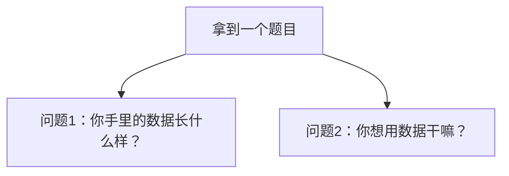
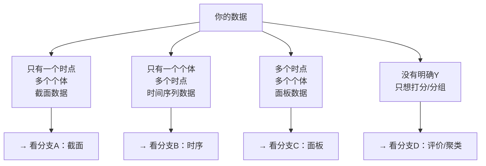
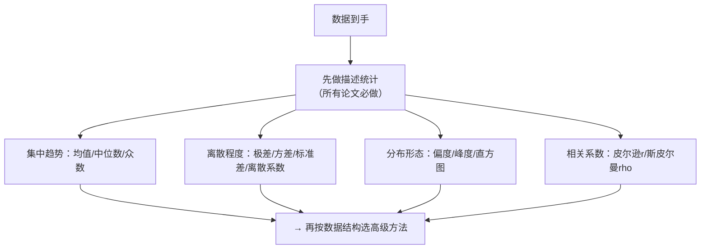
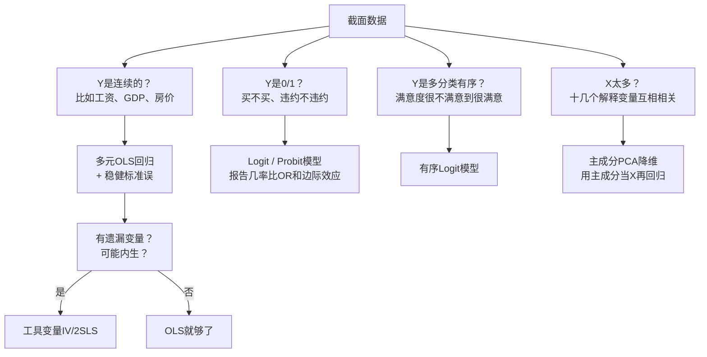
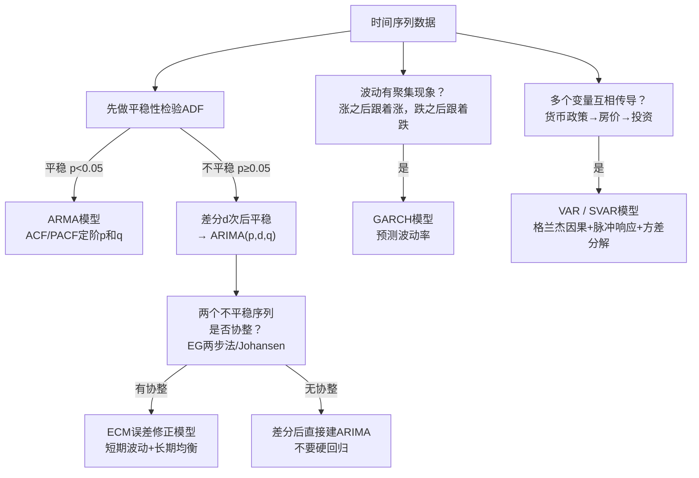
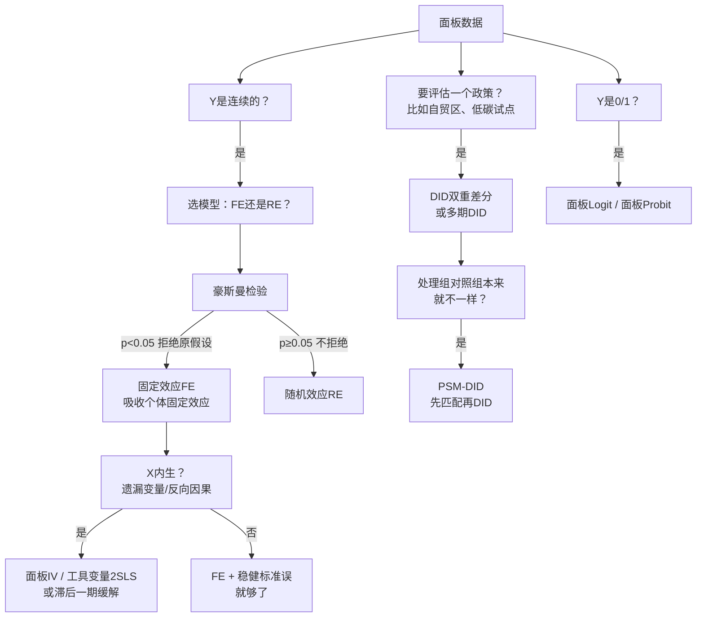
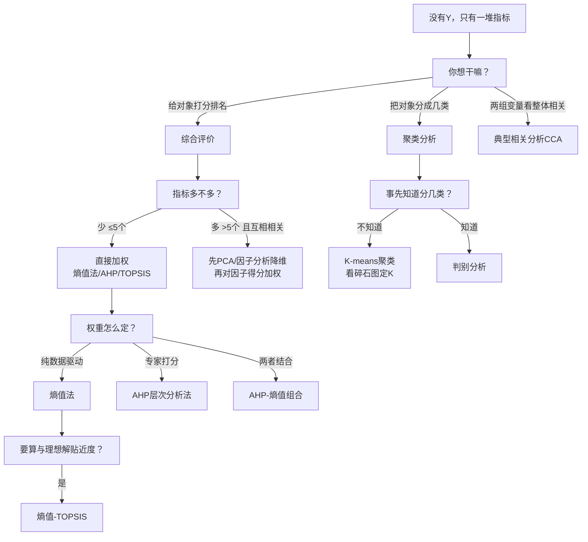
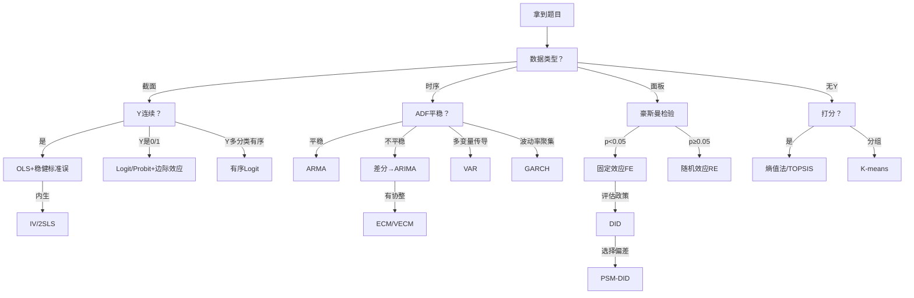

# 01 方法选择决策树（对着题目一路问到底）

## 一、为什么要学这个

90% 的方法选错，都是因为没问对问题。

拿到题目不要上来就想"我用什么模型高级"，而是按两个维度问自己：你手里的[[01_数据长什么样|数据长什么样]]？你想用数据干嘛？

先看数据，再看目的。数据决定你能用什么，目的决定你想用什么。本科论文方法选错，本质是把这两个问题问反了——先挑了一个"看起来高级"的方法，再硬找题目往上套。

---

## 二、第一步：你的数据长什么样

四种数据结构对应四种完全不同的方法家族。把数据结构认错，后面全错。

### 0. 第零步：先做描述统计（所有论文都要先做）

不管你后面用什么高级模型，**第一步永远是描述统计**——把数据的基本情况说清楚。

**描述统计是论文的"体检报告"**：读者先看均值、标准差、最大最小，就知道你的数据大概什么水平。连描述统计都不做，直接上回归，导师第一眼就觉得你不专业。

> 📖 统计学原理：[[KP01_统计总体|总体]]与[[KP02_样本|样本]]、[[KP07_算术平均数|均值]]、[[KP08_中位数与众数|中位数]]、[[KP11_标准差|标准差]]、[[KP14_离散系数|离散系数]]

---

## 三、分支 A：截面数据（一个时点，很多个体）

**截面数据典型题目**：
- "重庆市房价的影响因素" → [[04_OLS截距和拟合值|OLS]] + [[KP03_稳健标准误|稳健标准误]]；
- "居民消费意愿（是/否）" → Logit；
- "上市公司财务预警" → [[02_主成分分析PCA|PCA]] + Logit。

**截面回归还要做的两件体检**：
- [[KP01_异方差检验|异方差检验]]（White / BP）：p<0.05 就有[[02_异方差|异方差]]，系数不变但要换稳健标准误；
- [[03_自相关|自相关]]检验：截面数据一般不涉及，除非你的个体有地理或时间邻接关系。

---

## 四、分支 B：时间序列数据（一个个体，很多时点）

**时序典型题目**：
- "重庆市GDP预测" → [[05_ARIMA建模流程|ARIMA]]；
- "货币政策对房价的传导" → VAR；
- "上证指数波动率" → GARCH。

**时间序列的生命线**：不做 ADF 直接回归就是伪回归。Granger 1974 年用两个完全无关的非平稳序列回归也能跑出 R²=0.8。

---

## 五、分支 C：面板数据（多个时点，多个个体）——本科论文最常用

**面板典型题目**：
- "数字经济对产业升级的影响" → 双向固定效应 FE；
- "自贸区设立对经济增长的影响" → DID；
- "营商环境对企业创新的影响" → FE + IV。

**本科论文建议**：绝大多数省级/企业面板直接上双向固定效应 FE。Hausman 检验在 N 大时几乎一定拒绝 RE，而且 FE 假设更稳妥、答辩更不容易被挑刺。

---

## 六、分支 D：没有明确 Y，只想打分或分组

**评价/聚类典型题目**：
- "成渝双城经济圈高质量发展评价" → 熵值-TOPSIS；
- "上市公司ESG评价" → TOPSIS；
- "区域金融发展水平分类" → K-means 聚类。

**聚类前必做**：标准化（Z-score）。否则"人均收入（万元）"和"教育年限（年）"量纲天差地别，收入会主导一切。

### D.补充：到底什么时候才需要"综合评价"？（别一上来就搞复杂）

很多同学一拿到"评价XX发展水平"的题目，立刻就上熵值法、TOPSIS。其实你先问一句：**单看一个指标够不够？**

打个比方：你想知道一个班同学的成绩好不好，单看数学平均分就够了——这叫**单项指标评价**。但你想评价一个学校"综合实力"，单看数学成绩就以偏概全了，得同时看语文、数学、英语、物理、化学，这才叫**综合评价**。

**四种思路怎么选？**（[[../../教材笔记/05_统计学原理/11_统计分析/知识点/KP01_综合评价法总览|统计学原理·综合评价法总览]]）

| 你的情况 | 选什么方法 | 举个例子 |
|---|---|---|
| 问题单一、一个维度就能说清 | **单项指标评价** | "全国人均GDP排名"——一个数就够了 |
| 多维度、要排出整体名次、指标互相独立 | **综合评价法**（加权合成） | 城市综合实力：经济+社会+环境三个维度 |
| 指标十几个且高度相关、彼此重叠 | **先PCA/因子分析降维**再加权 | 上市公司财务预警：15个财务指标压成5个主成分 |
| 没有数据、只能靠专家经验拍 | **专家打分法（AHP/德尔菲）** | 评审职称、项目立项、无历史数据的新领域 |

**综合评价的三条铁律（新手最容易踩）**：

1. **不同量纲不能直接加**。GDP是元、绿化率是%、人口是人——直接加权求和等于把"米、秒、千克"加在一起，毫无意义。**必须先无量纲化**（Z-score 或极差归一化）。
2. **权重不能拍脑袋**。权重直接决定排名。主观赋权（AHP）要做一致性检验 CR<0.1；客观赋权（熵值法）要解释每个权重的经济含义。
3. **正向指标和负向指标不能混用**。GDP是"越大越好"（正向），失业率是"越小越好"（负向），没正向化就加权，等于把"好学生"和"坏学生"放一起打分。

> 📖 统计学原理：[[../../教材笔记/05_统计学原理/11_统计分析/知识点/KP01_综合评价法总览|综合评价法总览]]

---

## 七、完整决策树（一张总图）

---

## 八、怎么用这棵树（实操举例）

**题目**：数字经济对重庆市产业结构升级的影响——基于2013-2023年31省面板数据。

走一遍树：
1. 数据类型？→ 面板（31省 × 11年）；
2. Y 是连续的？→ 是（产业结构高级化指数）；
3. 豪斯曼检验？→ 大概率拒绝，用 FE；
4. X 内生？→ 是（产业升级也可能反过来促进数字经济），本科先用滞后一期缓解，能做 IV 更好；
5. 最终方法：**双向固定效应 FE + 稳健标准误 + 滞后一期稳健性**。

**题目**：成渝地区双城经济圈城市高质量发展水平评价。

走一遍树：
1. 数据类型？→ 没有明确 Y，一堆指标；
2. 想干嘛？→ 打分排名；
3. 权重？→ 客观权重（数据驱动）；
4. 最终方法：**熵值法 + TOPSIS**。

**题目**：新冠疫情对武汉居民消费的影响。

走一遍树：
1. 数据类型？→ 面板（城市 × 疫情前后）；
2. 想干嘛？→ 评估政策/冲击效果；
3. 处理组对照组本来就不一样？→ 武汉本来就是中心城市，先 PSM 匹配；
4. 最终方法：**PSM-DID**。

---

## 九、速查表：我该用什么

| 你的论文题目大概长这样 | 你该用的方法 |
|---|---|
| 评价某省/市/企业的发展水平并排名 | 熵值法 + TOPSIS，或先 PCA 再加权 |
| X 对 Y 的影响研究（截面数据） | OLS + 稳健标准误 |
| X 对 Y 的影响（多年多省数据） | 面板固定效应 FE |
| 被解释变量是"是否 XX" | Logit + 边际效应 |
| 预测未来 5 年的 GDP/消费/销量 | ADF → ARIMA / VAR |
| 把企业/城市分成几类 | K-means 聚类 |
| 问卷调研数据，想看影响因素 | 信效度 → 因子分析 → 回归 |
| 想证明"X 通过 M 影响 Y" | 中介效应三步法 + Bootstrap |
| 想看"在不同群体里影响是否不同" | 异质性分样本回归 |
| 效率测算 + 影响因素 | DEA + Tobit |
| 评估某个政策试点的效果 | DID，有选择偏差用 PSM-DID |
| 怀疑 X 对 Y 的影响存在门槛 | Hansen 面板门槛回归 |
| 怀疑邻省有溢出效应 | 空间杜宾 SDM |

---

## 十、速记卡

> **第一步看数据**：截面 / 时序 / 面板 / 无Y。
> **第二步看目的**：因果回归 / 预测 / 评价 / 分组。
> **本科论文三大万能套路**：
> 1. 面板问题 → **双向 FE + 稳健标准误**；
> 2. 评价问题 → **熵值-TOPSIS**；
> 3. 政策问题 → **DID**。
> 拿不准就选最稳的，别贪难。
>
> 方法是为研究问题服务的，不是越复杂越好。能把一种方法用对、用透、解释清楚，远比堆砌五六种方法但每个都跑错要强。答辩老师最常问的一句话是："你这个模型的前提假设检验做了吗？"

---

下一篇：[[02_15种论文方法组合套路]]

---

## 🗺️ 所有方法模块导航

| 模块 | 核心方法 | 链接 |
|------|----------|------|
| 00 学前准备 | 入门导论 | [[../00_学前准备/README|00 学前准备]] |
| 01 基础数学 | 概率/分布/统计推断 | [[../01_基础数学/README|01 基础数学]] |
| 02 描述统计 | 均值/方差/可视化 | [[../02_描述统计/README|02 描述统计]] |
| 03 相关与回归 | OLS/假设检验 | [[../03_相关与回归/README|03 相关与回归]] |
| 04 回归三大问题 | 异方差/自相关/共线性 | [[../04_回归三大问题/README|04 回归三大问题]] |
| 05 内生性与面板 | IV/2SLS/FE/RE | [[../05_内生性与面板/README|05 内生性与面板]] |
| 06 受限因变量 | Logit/Probit | [[../06_受限因变量/README|06 受限因变量]] |
| 07 综合评价方法 | 熵值法/AHP/TOPSIS | [[../07_综合评价方法/README|07 综合评价方法]] |
| 08 降维与分类 | PCA/因子分析/聚类 | [[../08_降维与分类/README|08 降维与分类]] |
| 09 时间序列 | ARIMA/GARCH/VAR | [[../09_时间序列/README|09 时间序列]] |
| 10 论文写作全流程 | 选题→实证→结论 | [[../10_论文写作全流程/README|10 论文写作全流程]] |
| 12 毕业论文实战 | 格式/答辩/范文 | [[../12_毕业论文实战/README|12 毕业论文实战]] |

---

## 📖 配套教材笔记
- [[../../教材笔记/02_计量经济学/README|计量经济学总览]]
- [[../../教材笔记/02_计量经济学/09_工具变量法/00_章节总结|第9章 工具变量法]]
- [[../../教材笔记/02_计量经济学/11_面板数据/00_章节总结|第11章 面板数据]]
- [[../../教材笔记/02_计量经济学/10_二值选择模型/00_章节总结|第10章 二值选择模型]]
- [[../../教材笔记/05_统计学原理/11_统计分析/00_章节总结|统计学原理·第11章 统计分析]]（综合评价方法选择、宏观经济指标）

## 📚 配套原书
- [[../../原文件/计量经济学/陈强_计量经济学及Stata应用_全书|陈强《计量经济学及Stata应用》]]
- [[../../原文件/统计学原理/韩兆洲_统计学原理第7版_全书|韩兆洲《统计学原理（第7版）》]]
