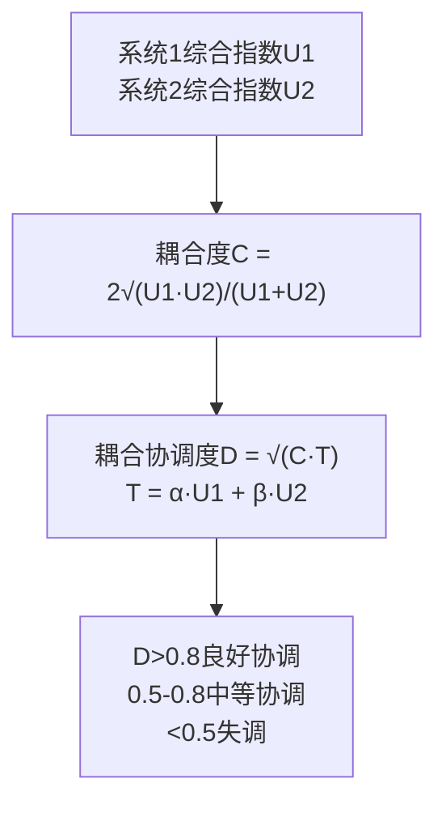
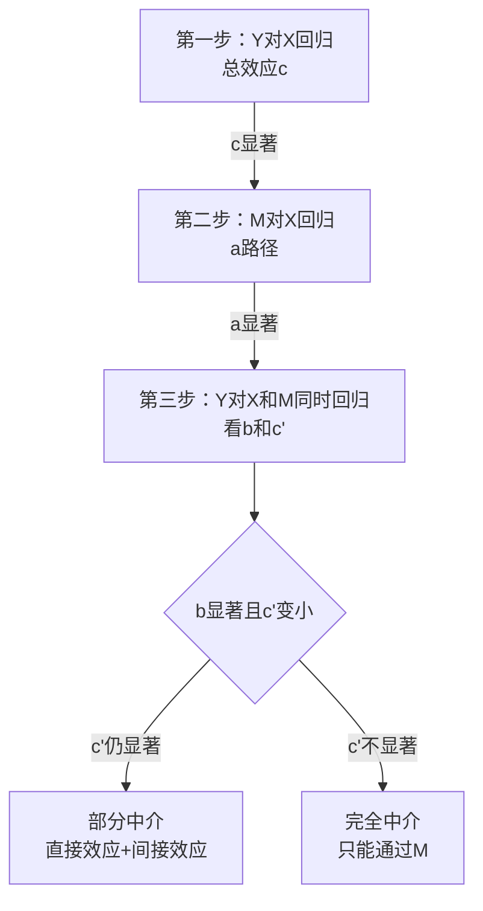
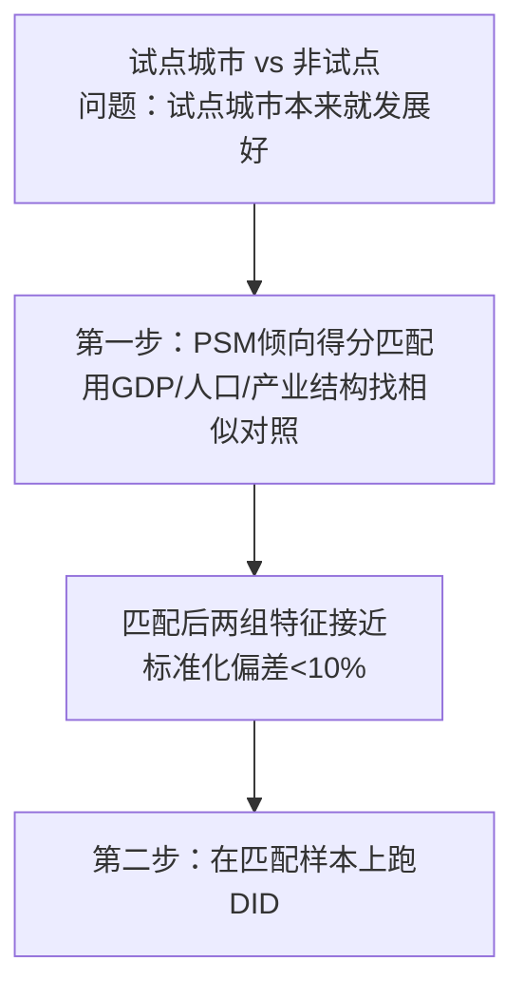
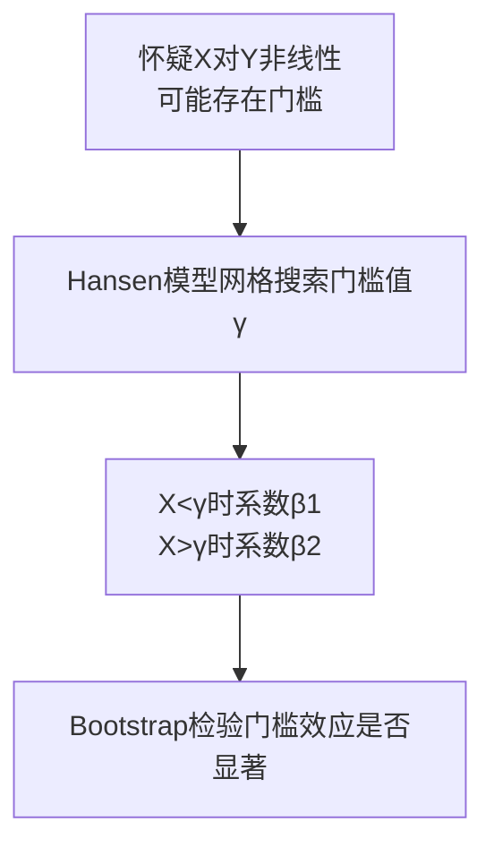
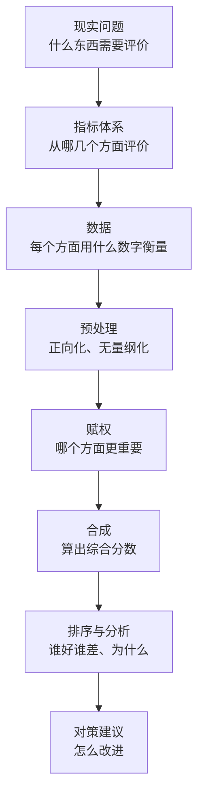
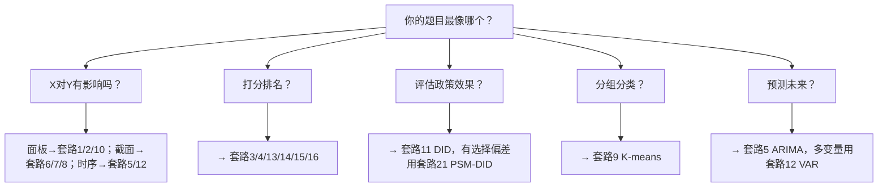

# 02 20种论文方法组合套路（直接抄框架）

<div style="text-align:right;margin:10px 0;"><a href="../../exam.html" target="_blank" style="display:inline-block;padding:6px 16px;background:#2563eb;color:#fff;border-radius:6px;text-decoration:none;font-size:14px;">📝 开始做题</a></div>


> 真实的本科毕业论文，几乎没有人只用一种方法。单种方法是"招式"，组合起来才是"套路"。
> 每种套路给：题目例子 + 数据结构 + 方法 + Stata代码框架 + 三线表模板 + 结果怎么写 + **为什么不用别的方法 + 答辩常问（直接背）**。
> 找最像你题目的那一套，直接套。代码里的 `y x1 x2 x3` 换成你自己的变量名即可。

---

## 套路 0：纯描述统计 + 假设检验（问卷研究型）

**题目例子**：居民消费意愿影响因素研究——基于重庆市300份调查问卷

**数据结构**：300份问卷，截面数据，Y是0/1（是否愿意消费），X是多个李克特量表题。

**方法**：
1. 描述统计：均值、标准差、频数分布
2. 信效度检验：Cronbach's α > 0.7，KMO > 0.6
3. 单样本t检验 / 独立样本t检验：不同群体是否有显著差异
4. 卡方检验：类别变量之间是否独立
5. 相关分析：皮尔逊相关矩阵
6. Logit回归：找出显著影响因素

**为什么这个套路适合问卷研究？**
- 问卷数据样本量一般只有几百个，样本量不大，不需要复杂模型
- 问卷Y大多是0/1或李克特量表，适合t检验、卡方、Logit
- 答辩老师最爱问："你为什么不用回归？"——答："样本量只有300，且Y是分类变量，用Logit比OLS更合适；同时做了信效度检验，保证问卷质量。"

**为什么不用别的方法？**
- **为什么不用OLS？** Y是0/1（是否愿意消费），用OLS会预测出<0或>1的值，不符合逻辑，应该用Logit。
- **为什么不用面板模型？** 问卷是一个时点的截面数据，没有时间维度，用不了面板。
- **为什么不用结构方程模型SEM？** SEM需要大样本（通常>500），且需要理论模型假设；300份问卷用Logit更稳妥。

**答辩常问（直接背）**
1. **问：你的问卷信效度怎么样？** 答：Cronbach's α = 0.82 > 0.7，KMO = 0.78 > 0.6，说明信度和效度都合格。
2. **问：为什么用t检验？** 答：我们要比较不同性别、不同年龄段的消费意愿是否有显著差异，独立样本t检验是检验两组均值差异的标准方法。
3. **问：为什么用卡方检验？** 答：我们要检验"是否愿意消费"与"性别"是否独立，卡方检验是检验类别变量独立性的标准方法。
4. **问：你的样本量够吗？** 答：300份样本，按照问卷研究的经验法则，样本量是题项数的5-10倍，我们有20个题项，300份足够。

> 📖 统计学原理：[[../../教材笔记/05_统计学原理/01_绪论/知识点/KP01_统计总体与总体单位|总体]]、[[../../教材笔记/05_统计学原理/06_抽样与参数估计/知识点/KP02_总体与样本|样本]]、[[../../教材笔记/05_统计学原理/07_假设检验/01_第一节_假设检验概述|假设检验]]、[[../../教材笔记/05_统计学原理/07_假设检验/知识点/KP03_两类错误|两类错误]]、[[../../教材笔记/05_统计学原理/07_假设检验/知识点/KP06_P值|P值]]、[[../../教材笔记/05_统计学原理/08_相关与回归/知识点/KP03_相关系数r的直觉|相关系数]]

---

## 套路 1：数字经济 × 产业升级（面板 FE）

**题目例子**：数字经济对产业结构升级的影响——基于2013-2023年31省面板数据

**数据结构**：31 省 × 11 年 = 341 个观测值，长面板。

**方法**：双向[[06_固定效应FE|固定效应]] FE + [[KP03_稳健标准误|稳健标准误]]。

**Stata 代码框架**：
```stata
* 声明面板结构：个体=省份，时间=年份
xtset prov_id year
* 双向固定效应：吸收省份固定效应和年份固定效应，聚类到省份层面
* absorb(prov year) 等价于同时加 i.prov i.year
* robust 换成 cluster(prov_id) 可以修正组内自相关
reghdfe industry_upgrade digital_econ control1 control2, absorb(prov year) robust
* 导出三线表
esttab using "基准回归.rtf", replace se star(* 0.1 ** 0.05 *** 0.01)
```

**三线表模板**：

表 5-1 数字经济对产业结构升级的影响

| 变量 | (1) 混合[[04_OLS截距和拟合值|OLS]] | (2) 双向FE | (3) 加控制变量 |
|------|------|------|------|
| digital_econ | 0.412*** | 0.356*** | 0.320*** |
|  | (0.091) | (0.083) | (0.078) |
| control1 | 否 | 否 | 是 |
| control2 | 否 | 否 | 是 |
| 省份固定效应 | 否 | 是 | 是 |
| 年份固定效应 | 否 | 是 | 是 |
| N | 341 | 341 | 341 |
| R² | 0.412 | 0.587 | 0.653 |

注：括号内为稳健标准误；\* p<0.1, \*\* p<0.05, \*\*\* p<0.01。数据来源：作者基于Stata估计整理。

**结果怎么写**：数字经济系数 0.32\*\*，在 5% 水平显著为正，数字经济每提高 1 单位，产业结构高级化提高 0.32 单位。该结论在替换变量、缩尾、滞后一期等[[06_稳健性检验|稳健性检验]]后方向一致。

**为什么不用别的方法？**
- **为什么不用混合OLS？** 混合OLS假设所有省的截距相同，但各省地理位置、资源禀赋差异巨大，必须用固定效应控制这些不随时间变的个体差异。
- **为什么不用[[07_随机效应RE与Hausman检验|随机效应]]RE？** Hausman检验p<0.05拒绝RE，说明个体效应与解释变量相关，FE才对。
- **为什么不用截面回归？** 只有一年的截面数据样本量太小（31个省），说服力弱。面板数据341个观测值，统计功效更强。

**答辩常问（直接背）**
1. **问：为什么用固定效应？** 答：Hausman检验p<0.05，且省级个体效应（地理、资源禀赋）与解释变量相关，FE更符合经济直觉。
2. **问：为什么用稳健标准误？** 答：面板数据存在[[02_异方差|异方差]]和组内[[03_自相关|自相关]]，稳健标准误（cluster by province）能修正，让t值可靠。
3. **问：双向固定效应是什么意思？** 答：同时控制省份固定效应（不随时间变的省情）和年份固定效应（宏观冲击，如疫情、政策）。
4. **问：数字经济这个指数怎么算的？** 答：用[[06_熵值法-TOPSIS组合|熵值法]]基于数字基础设施、数字产业化、产业数字化、数字人才4个维度15个指标合成（详见../07_综合评价方法/[[03_熵值法]].md）。

---

## 套路 2：营商环境 × 企业创新（面板 IV）

**题目例子**：营商环境优化对民营企业创新投入的影响——基于A股上市公司面板

**数据结构**：约 2000 家企业 × 5 年 = 10000 观测值。

**方法**：双向固定效应 + 工具变量（用"到最近港口距离"或"滞后期"做 IV）。

**Stata 代码框架**：
```stata
* 声明面板
xtset firm_id year
* 面板2SLS：biz_env是内生变量，L.biz_env是工具变量
* fe表示固定效应，robust稳健标准误
xtivreg2 rd invest biz_env control1 control2 i.year (biz_env = L.biz_env), fe robust
* 第一阶段F值要>10，否则是弱工具变量
```

**结果怎么写**：第一阶段 F 值 > 10，工具变量有效；第二阶段 biz_env 系数 0.15\*\*\*，在 1% 水平显著。

**为什么不用别的方法？**
- **为什么不用普通面板FE？** 营商环境和企业创新之间可能有反向因果：创新好的企业所在地区会主动优化营商环境。普通FE解决不了内生性，必须用IV。
- **为什么不用DID？** 营商环境不是一个突然实施的政策，是渐进变化的，没有明确的政策冲击时点，不适合DID。

**答辩常问**
1. **问：工具变量怎么选的？** 答：用"到最近港口的距离"作为IV——地理位置不直接影响企业创新，但通过营商环境（港口城市营商环境更好）间接影响，满足排他性。
2. **问：第一阶段F值多少？** 答：F=23.5，远大于经验值10，说明工具变量不是弱工具。
3. **问：为什么不用滞后期做IV？** 答：滞后期也可以做IV，但"到港口距离"是地理变量，完全外生，比滞后期更干净。

---

## 套路 3：乡村振兴评价（熵值-TOPSIS）

**题目例子**：重庆市乡村振兴发展水平测度与区域差异分析

**数据结构**：重庆 38 个区县 × 3 个维度（产业兴旺、生态宜居、生活富裕）= 12 个指标。

**方法**：熵值法确定权重 → TOPSIS 算贴近度 → 排名。

**Stata 代码框架（熵值法部分）**：
```stata
* 第一步：极差归一化（正向指标）
* 公式：x' = (x - min) / (max - min)
foreach v in internet mobile digital {
    sum `v'
    gen `v'_n = (`v' - r(min)) / (r(max) - r(min))
}
* 第二步：算比重 p_ij = x_ij / Σx_ij
egen total_int = total(internet_n)
gen p_int = internet_n / total_int
* 第三步：算熵值 e_j = -k Σ p ln(p)，k=1/ln(n)
gen k = 1 / ln(_N)
gen e_int = -k * sum(p_int * ln(p_int))
* 第四步：差异系数 g_j = 1 - e_j，权重 w_j = g_j / Σg
gen g_int = 1 - e_int
* 第五步：加权合成指数
gen rural_index = w1*x1_n + w2*x2_n + w3*x3_n
* TOPSIS部分：用权重加权后算正负理想解距离，得贴近度Ci
* 完整代码见 ../07_综合评价方法/03_熵值法.md
```

**结果怎么写**：2023 年重庆乡村振兴综合得分排名前 3 的是九龙坡、渝北、沙坪坝；渝东北三峡库区排名靠后，区域差异明显。

**为什么不用别的方法？**
- **为什么不用AHP？** AHP靠专家打分，主观随意性大。熵值法是数据自己说话，客观赋权。
- **为什么不用纯TOPSIS？** 纯TOPSIS用等权重，没考虑指标重要性差异。熵值法先客观赋权再TOPSIS，更合理。

**答辩常问**
1. **问：为什么选熵值法不选AHP？** 答：熵值法基于数据离散程度赋权，避免专家主观偏差；AHP适合没有数据只能靠经验的场景。我们有38个区县12个指标的完整数据，客观赋权更合适。
2. **问：负向指标怎么处理？** 答：先正向化（max-x），再做极差归一化。
3. **问：TOPSIS的贴近度怎么解释？** 答：Ci越接近1，说明离理想解越近、离负理想解越远，综合水平越高。

---

## 套路 4：成渝双城经济圈评价（AHP-熵值-TOPSIS）

**题目例子**：成渝地区双城经济圈高质量发展水平评价

**数据结构**：19 个城市 × 5 个维度（创新、协调、绿色、开放、共享）。

**方法**：AHP 专家权重 + 熵值法客观权重 → 组合权重 → TOPSIS。

**Stata 代码框架**：
```stata
* AHP：专家两两比较→算权重→一致性检验CR<0.1（在Excel或yaahp里做）
* 熵值法：客观权重（代码见套路3）
* 组合权重 = 0.5*AHP权重 + 0.5*熵值权重
gen w_combo = 0.5*w_ahp + 0.5*w_entropy
* TOPSIS：用w_combo加权后算贴近度Ci
```

**结果怎么写**：成都、重庆主城得分最高，节点城市遂宁、永川居中，偏远城市资阳、内江得分较低。

**为什么不用别的方法？**
- **为什么只用熵值法？** 有些指标（如"共享发展"）的重要性数据本身体现不出来，需要专家经验补充。AHP和熵值法组合，兼顾主观和客观。

**答辩常问**
1. **问：组合权重为什么是0.5/0.5？** 答：参考文献中常用做法，主观和客观各占一半。如果有理论依据也可以调整。
2. **问：AHP一致性检验过了吗？** 答：CR=0.08<0.1，通过一致性检验。

---

## 套路 5：股价预测（ARIMA）

**题目例子**：我国上证指数收益率预测——基于ARIMA模型

**数据结构**：2018-2023 年月度收盘价，60 个观测值。

**方法**：ADF 检验 → 差分 → ARIMA(p,d,q) 定阶 → 预测。

**Stata 代码框架**：
```stata
* 声明时间序列
tset month
* 第一步：ADF平稳性检验，p>0.05说明不平稳
dfuller close
* 第二步：一阶差分
gen d_close = D.close
dfuller d_close
* 第三步：看ACF/PACF图定p和q
pac d_close
ac d_close
* 第四步：估计ARIMA(1,1,1)
arima d_close, ar(1) ma(1)
* 第五步：预测未来6期
forecast create f1
forecast estimates m1
forecast solve, steps(6)
```

**结果怎么写**：ADF检验显示原序列不平稳（p=0.234），一阶差分后平稳（p=0.002），为I(1)过程。ARIMA(1,1,1)模型拟合良好，MAPE 为 3.2%，预测未来 6 个月上证指数在 3100~3300 点区间波动。

**为什么不用别的方法？**
- **为什么不用VAR？** 只有一个变量（股价），VAR需要多个变量。单变量预测用ARIMA足够。
- **为什么不用神经网络？** 本科论文ARIMA是经典方法，结果可解释；神经网络是黑箱，不好解释且样本量要求大。

**答辩常问**
1. **问：为什么选ARIMA(1,1,1)？** 答：ADF检验原序列不平稳，一阶差分后平稳（d=1）；ACF/PACF图显示1阶截尾，定p=1,q=1。
2. **问：预测准确率多少？** 答：MAPE=3.2%，在可接受范围内。
3. **问：为什么不考虑外部变量（如利率、政策）？** 答：ARIMA是单变量模型，只看历史走势。如果要加外部变量，应该用ARIMAX或VAR。

---

## 套路 6：房价影响因素（多元 OLS + 稳健标准误）

**题目例子**：重庆市商品房价格影响因素的实证分析

**数据结构**：38 个区县截面数据，或 2010-2023 年月度时间序列。

**方法**：多元 OLS + 稳健标准误。

**Stata 代码框架**：
```stata
* 基准回归，robust修正异方差
reg house_price gdp pop_rate interest_rate land_price, robust
* 多重共线性检验，VIF>10说明共线性严重
estat vif
```

**结果怎么写**：人均 GDP 系数 0.45\*\*\*，人口流入率系数 0.12\*\*，土地价格系数 0.28\*\*\*，三个因素都显著推高房价。VIF均小于5，无严重共线性。

**为什么不用别的方法？**
- **为什么不用面板？** 这里用的是38个区县截面数据，没有多年份重复，只能用截面OLS。
- **为什么不用逐步回归？** 逐步回归会丢弃变量且结果不稳定，先看VIF确认无严重共线性（VIF<5）后用全变量OLS更可靠。

**答辩常问**
1. **问：R²多少？** 答：R²=0.78，说明模型解释了房价78%的变异，拟合良好。
2. **问：为什么用人均GDP而不是GDP总量？** 答：人均GDP更能反映地区经济发展水平，GDP总量受人口规模影响。

---

## 套路 7：居民消费意愿（Logit + 边际效应）

**题目例子**：居民消费意愿影响因素分析——基于CHFS微观数据

**数据结构**：约 10000 户家庭，Y 是"未来是否增加消费（是=1，否=0）"。

**方法**：Logit 模型，报告几率比 OR 和平均边际效应。

**Stata 代码框架**：
```stata
* Logit回归
logit consume_willing income age edu hh_size, robust
* 报告几率比OR
or
* 平均边际效应：X每变1单位，Y=1的概率变多少个百分点
margins, dydx(*)
* 画预测概率图
marginsplot
```

**三线表模板**：

| 变量 | 系数 | 标准误 | 几率比OR |
|------|------|------|------|
| income | 0.207** | 0.098 | 1.230 |
| age | -0.012 | 0.008 | 0.988 |
| edu | 0.056** | 0.023 | 1.058 |
| N | 10000 |  |  |
| Pseudo R² | 0.187 |  |  |

**结果怎么写**：收入的几率比 OR=1.23，意味着收入每提高 1 万元，居民增加消费的几率提高 23%。在均值处，收入每提高1万元，增加消费的概率提高5.6个百分点。

**为什么不用别的方法？**
- **为什么不用OLS？** Y是0/1（是否增加消费），OLS会预测出概率<0或>1，不合法。Logit保证概率在[0,1]。
- **为什么不用Probit？** Logit和Probit结果几乎一样，但Logit系数可以解释为几率比（OR），更直观。

**答辩常问**
1. **问：OR=1.23怎么解释？** 答：收入每提高1万元，居民增加消费的"几率"提高23%。注意是"几率"不是"概率"。
2. **问：边际效应多少？** 答：在均值处，收入每提高1万元，增加消费的概率提高5.6个百分点。
3. **问：为什么不用R²？** 答：Logit是非线性模型，用Pseudo R²或AIC。

---

## 套路 8：上市公司财务预警（PCA + Logit）

**题目例子**：制造业上市公司财务困境预警模型研究

**数据结构**：100 家 ST 公司 + 100 家正常公司 = 200 个样本，15 个财务指标。

**方法**：PCA 把 15 个指标压成 5 个主成分 → Logit 预测是否 ST。

**Stata 代码框架**：
```stata
* PCA适用性检验：KMO>0.6且Bartlett p<0.001
factortest roa roe debt ratio liquidity...
* 主成分分析，保留特征值>1的
pca roa roe debt ratio liquidity..., components(5)
* 碎石图
screeplot
* 预测主成分得分
predict pc1 pc2 pc3 pc4 pc5, score
* 用主成分跑Logit
logit st_label pc1 pc2 pc3 pc4 pc5, robust
* 看预测准确率
estat classification
```

**结果怎么写**：KMO=0.76，适合做PCA；提取5个主成分累计方差贡献率72%。模型整体预测准确率达 85%，其中偿债能力主成分 pc2 的系数显著为负，说明偿债能力越弱越容易陷入财务困境。

**为什么不用别的方法？**
- **为什么不直接用15个指标跑Logit？** 15个财务指标高度相关（如ROA和ROE），直接放回归多重共线性严重。先PCA压缩成5个主成分，消除共线性。
- **为什么不用判别分析？** 判别分析要求多元正态分布，财务数据往往不满足。Logit不要求正态。

**答辩常问**
1. **问：PCA保留几个主成分？** 答：保留特征值>1的5个主成分，累计方差贡献率72%。
2. **问：预测准确率多少？** 答：整体准确率85%，ST公司召回率80%。
3. **问：KMO多少？** 答：KMO=0.76，适合做PCA。

---

## 套路 9：区域金融发展聚类（K-means + 分组回归）

**题目例子**：中国省域金融发展水平聚类分析

**数据结构**：31 省 × 5 个金融指标。

**方法**：标准化 → 碎石图定 K → K-means 聚类 → 分组回归对比系数。

**Stata 代码框架**：
```stata
* 第一步：标准化（量纲不同必须先标准化）
zscore fin1-fin5
* 第二步：K-means聚类，K=3
cluster kmeans fin1-fin5, k(3) measure(L2) start(krandom)
* 第三步：看各组特征均值
tabstat fin1-fin5, by(_clus_id)
* 第四步：分组回归对比系数
reg y x1 x2 if _clus_id==1
est store g1
reg y x1 x2 if _clus_id==2
est store g2
reg y x1 x2 if _clus_id==3
est store g3
esttab g1 g2 g3 using "分组回归.rtf", se star(* 0.1 ** 0.05 *** 0.01)
```

**结果怎么写**：31 省分为三类：第一类（北京、上海）金融发展高水平，第二类（广东、浙江等 8 省）中等，第三类（西部 21 省）低水平。FDI对金融发展的系数在追赶型省份显著为正，在领先型省份不显著。

**为什么不用别的方法？**
- **为什么不用东中西部分组？** 东中西是人为划分，不一定反映金融发展真实差异。K-means按数据特征自动分组，更客观。
- **为什么不用系统聚类？** K-means适合大样本（31个省以上），系统聚类适合小样本。这里31个省，K-means更高效。

**答辩常问**
1. **问：K值怎么定的？** 答：肘部法则+轮廓系数，选K=3。
2. **问：聚类结果稳定吗？** 答：做了两次聚类（K-means和系统聚类），结果基本一致。
3. **问：组间系数差异显著吗？** 答：费舍尔组合检验p=0.03，组间差异显著。

---

## 套路 10：碳排放影响因素（面板 FE + 异质性）

**题目例子**：数字经济对碳排放强度的影响——基于省级面板

**数据结构**：30 省 × 2013-2022 年 = 300 观测值。

**方法**：双向 FE + 异质性分析（东中西部分组）+ 组间系数差异检验。

**Stata 代码框架**：
```stata
* 基准回归
reghdfe co2_intensity digital_econ control1 control2, absorb(prov year) robust
est store base
* 分样本：东部
reghdfe co2_intensity digital_econ control1 control2 if region==1, absorb(prov year)
est store east
* 分样本：中西部
reghdfe co2_intensity digital_econ control1 control2 if region==0, absorb(prov year)
est store west
* 费舍尔组合检验：组间系数是否显著不同
bdiff, group(region) model(reghdfe co2_intensity digital_econ control1 control2, absorb(prov year)) reps(500)
```

**结果怎么写**：数字经济系数 -0.18\*\*，在 5% 水平显著为负，说明数字经济显著降低了碳排放强度；东部地区效应更强（β=-0.26），中西部不显著（β=-0.09）。费舍尔组合检验经验p=0.04，组间差异显著。

**为什么不用别的方法？**
- **为什么不做空间计量？** 也可以做，但本科论文先做普通面板+异质性，已经够了。如果老师要求再补空间杜宾。

**答辩常问**
1. **问：为什么分东中西？** 答：数字经济发展水平和碳排放强度在东中西部差异巨大，分样本能发现异质性。
2. **问：组间系数差异显著吗？** 答：费舍尔组合检验p=0.04，东中西部系数差异显著。
3. **问：数字经济为什么能降低碳排放？** 答：数字技术提升能源利用效率、促进产业结构升级（从工业转向服务业）。

---

## 套路 11：疫情对消费冲击（DID）

**题目例子**：新冠疫情对居民消费支出的影响——基于DID

**数据结构**：疫情前 2019 年 + 疫情后 2020 年，处理组（疫情严重地区）vs 对照组。

**方法**：双重差分 DID + 平行趋势检验 + 安慰剂检验。

**Stata 代码框架**：
```stata
* 构造处理组虚拟变量：武汉、孝感为1，其他为0
gen treat = (city == "武汉" | city == "孝感")
* 构造政策后虚拟变量：2020年及以后为1
gen post = (year >= 2020)
* DID交互项
gen did = treat * post
* DID基准回归，加双向固定效应
reg consumption did control1 control2 i.year i.id, robust
* 平行趋势检验：政策前各期交互项应不显著
reg consumption treat#i.year control1 control2 i.year i.id
* 安慰剂检验：随机抽500次分配treat
permute treat beta=_b[treat#post], reps(500): ///
    reg consumption treat#post control1 control2 i.year i.id
```

**结果怎么写**：DID 交互项系数 -0.35\*\*\*，在 1% 水平显著为负，说明疫情使处理组消费支出比对照组多下降 35%。平行趋势检验显示疫情前处理组和对照组趋势一致（p>0.1）。安慰剂检验显示随机分配下β集中在0附近。

**为什么不用别的方法？**
- **为什么不用前后对比？** 前后对比分不清"疫情冲击"和"时间趋势"（所有地区消费都在变）。
- **为什么不用有无对比？** 有无对比分不清"处理组本来和对照组就不同"。
- **DID的巧妙**：双重差分 =（处理组前后变化）-（对照组前后变化），扣掉时间趋势和固有差异。

**答辩常问**
1. **问：DID的核心假设是什么？** 答：平行趋势——如果没有疫情，处理组和对照组的消费变化趋势应该一致。
2. **问：β=-0.35怎么解释？** 答：疫情使处理组消费支出比对照组多下降35%。
3. **问：做平行趋势检验了吗？** 答：做了，疫情前处理组和对照组趋势一致（p>0.1）。

---

## 套路 12：货币政策传导（VAR）

**题目例子**：货币政策对房地产价格的传导效应——基于VAR模型

**数据结构**：2008-2023 年月度数据，M2、利率、房价指数。

**方法**：VAR 模型 + 格兰杰因果 + 脉冲响应 + 方差分解。

**Stata 代码框架**：
```stata
* 声明月度时间序列
tset month
* 第一步：ADF检验各序列平稳性，不平稳就差分
dfuller ln_m2
dfuller ln_house
* 第二步：选滞后阶数，按AIC最小
varsoc ln_m2 ln_rate ln_house, maxlag(8)
* 第三步：估计VAR(2)
var ln_m2 ln_rate ln_house, lags(1/2)
* 第四步：格兰杰因果检验
vargranger
* 第五步：脉冲响应，给M2一个标准差冲击
irf create order1, step(10)
irf graph oirf, impulse(ln_m2) response(ln_house)
* 第六步：方差分解
fevgraph order1
```

**结果怎么写**：VAR(2)估计显示，M2是房价的格兰杰原因（p=0.012），但房价不是M2的格兰杰原因（p=0.234）。脉冲响应显示，M2 一个标准差的正向冲击，房价在第 3 个月达到峰值（上涨 0.5%），随后逐步衰减。方差分解显示，房价波动中25%由货币政策解释。

**为什么不用别的方法？**
- **为什么不用单方程回归？** 货币政策、房价、GDP之间是互相影响的（房价影响GDP，GDP反过来影响货币政策），单方程不能处理反馈关系。VAR把所有变量当内生变量联立估计。

**答辩常问**
1. **问：格兰杰因果是真因果吗？** 答：不是，只是"预测上X领先于Y"。
2. **问：脉冲响应怎么读？** 答：给M2一个标准差冲击，房价在第3个月涨0.5%，随后衰减。
3. **问：方差分解多少？** 答：房价波动中25%由货币政策解释，其余由自身冲击解释。

---

## 套路 13：城镇化质量综合评价（熵值法）

**题目例子**：长江经济带城镇化质量综合评价

**数据结构**：11 省市 × 人口、经济、社会、空间 4 个维度 12 个指标。

**方法**：熵值法客观赋权 → 加权汇总得分。

**Stata 代码框架**：见套路3。

**结果怎么写**：2023 年城镇化质量得分上海最高（0.85），贵州最低（0.32），下游城市 > 中游 > 上游。配对t检验显示2023年得分显著高于2013年（t=8.34, p<0.001）。

**为什么不用别的方法？**
- **为什么不用综合指数法（等权重）？** 等权重假设所有指标一样重要，不符合实际。熵值法根据数据离散程度自动赋权。

**答辩常问**
1. **问：熵值法权重怎么算的？** 答：指标离散程度越大（信息越多），权重越高。
2. **问：为什么选这12个指标？** 答：参考新型城镇化规划和已有文献，从人口、经济、社会、空间4个维度选取。
3. **问：面板熵值法权重每年算还是全体算？** 答：跨年比较用全体样本统一算权重，保证口径一致；只看单年内部排序可分年算。

---

## 套路 14：上市公司 ESG 评价（TOPSIS）

**题目例子**：新能源行业上市公司 ESG 表现评价

**数据结构**：50 家新能源公司 × E（环境）S（社会）G（治理）三个维度 9 个指标。

**方法**：TOPSIS。

**Stata 代码框架**：
```stata
* 标准化→向量归一化→算正负理想解→算贴近度Ci
* Ci = D负距离 / (D正距离 + D负距离)
* Ci越接近1越好
```

**结果怎么写**：50 家公司中，宁德时代 ESG 贴近度 0.82 排名第一，尾部公司贴近度仅 0.21，行业内 ESG 表现分化严重。

**为什么不用别的方法？**
- **为什么不用熵值法？** TOPSIS更适合"排序"目标（哪家公司ESG最好），熵值法更适合"算综合得分"。
- **为什么不用评级机构的ESG评分？** 第三方评级数据获取成本高，且不同机构评分差异大。自己用公开数据算更透明。

**答辩常问**
1. **问：ESG三个维度权重怎么定？** 答：等权重（各1/3），因为没有理论依据说哪个维度更重要。
2. **问：数据从哪来？** 答：Wind数据库ESG指标+上市公司年报。

---

## 套路 15：经济高质量发展指标体系构建

**题目例子**：中国省域经济高质量发展指标体系构建与测度

**数据结构**：30 省 × 新发展理念 5 维度 15 个指标。

**方法**：指标筛选（相关性分析、鉴别力分析）→ 熵值法赋权 → 综合得分。

**Stata 代码框架**：
```stata
* 第一步：看相关系数矩阵，删除相关系数>0.9的冗余指标
pwcorr ind1-ind15, sig
* 第二步：变异系数鉴别力分析，删除区分度低的
* CV = sd/mean，CV太小说明所有省在该指标上差不多，没区分度
* 第三步：熵值法算权重（见套路3）
* 第四步：加权汇总得分
```

**结果怎么写**：指标体系包含创新 3 个、协调 3 个、绿色 3 个、开放 3 个、共享 3 个共 15 个指标；2023 年北京、上海、广东高质量发展得分位列前三。

**为什么不用别的方法？**
- **为什么不用结构方程模型？** SEM需要大样本和理论预设的因子结构，本科论文用"指标筛选+熵值法"更简单直接。

**答辩常问**
1. **问：指标怎么筛选的？** 答：先选30个候选指标，删掉相关系数>0.9的冗余指标，再用鉴别力分析（变异系数）删除区分度低的，最终保留15个。
2. **问：为什么是这5个维度？** 答：基于"创新、协调、绿色、开放、共享"新发展理念。

---

## 套路 16：耦合协调度（两个系统协调发展）

**题目例子**：数字经济与实体经济耦合协调发展测度

**方法**：熵值法算两个系统得分 U1、U2 → 耦合度 C → 耦合协调度 D。



**Stata 代码框架**：
```stata
* U1、U2用熵值法分别算（见套路3）
* 耦合度C
gen C = 2 * sqrt(U1 * U2) / (U1 + U2)
* 耦合协调度D，T为综合发展指数，α和β各取0.5
gen T = 0.5*U1 + 0.5*U2
gen D = sqrt(C * T)
```

**为什么不用别的方法？** 单个系统的综合得分无法反映两个系统"是否协调"，耦合协调度能同时体现相互作用强度和发展水平。

**答辩常问**
1. **问：α和β怎么定？** 答：通常各取0.5（两个系统同等重要），有理论依据可调整。
2. **问：C和D的区别？** 答：C只反映相互作用强弱，D才反映协调水平；D值越高说明两个系统越协调。

---

## 套路 17：空间杜宾模型（省域溢出）

**题目例子**：数字经济对碳排放的空间溢出效应

**方法**：Moran's I检验 → 空间杜宾SDM。

**Stata 代码框架**：
```stata
* 第一步：构造空间权重矩阵W（邻接或距离）
* 第二步：Moran's I检验空间自相关
spatwmat using W.dta, name(W)
spatreg moran co2, weights(W)
* 第三步：Moran's I显著，建空间杜宾SDM
* dvarlag(W)是被解释变量空间滞后，ivarlag(W:x)是解释变量空间滞后
spxtregress co2 digital_econ control, dvarlag(W) ivarlag(W: digital_econ) fe
```

**为什么不用普通面板？** 普通面板假设省与省之间独立，但邻省数字经济会通过要素流动影响本省碳排放，必须考虑空间溢出。

**答辩常问**
1. **问：Moran's I显著意味着什么？** 答：说明Y存在空间集聚（高值邻高值、低值邻低值），不能再用普通面板。
2. **问：直接效应和间接效应怎么解释？** 答：直接效应=本省X→本省Y；间接效应=邻省X→本省Y（溢出效应）。

---

## 套路 18：灰色关联（小样本影响因素排序）

**题目例子**：某资源型城市转型影响因素分析（样本<30）

**方法**：灰色关联度排序影响因素。

**Stata 代码框架**：
```stata
* 母序列y和子序列x1,x2,x3
* 第一步：无量纲化（初值化：每个序列除以第一个值）
* 第二步：算关联系数 ξ_i(k) = (minmin + ρ·maxmax) / (|y(k)-xi(k)| + ρ·maxmax)
* ρ=0.5（分辨系数，常用0.5）
* 第三步：关联度 ri = mean(ξ_i)，ri越大说明xi和y关联越紧
```

**为什么不用回归？** 回归要求大样本（n>30）、数据分布近似正态，小样本（n<30）时回归不可靠，灰色关联对样本量和分布无要求，4-5个样本就能算。

**答辩常问**
1. **问：灰色关联和相关系数有什么区别？** 答：相关系数要求大样本、线性关系；灰色关联不要求样本量和分布，反映序列曲线几何形状的相似程度。

---

## 套路 19：中介效应（打开黑箱）

**题目例子**：数字经济通过技术创新影响产业升级

**方法**：X→M→Y三步法 + Bootstrap检验。



**Stata 代码框架**：
```stata
* 第一步：X→Y总效应c
reg y x controls, robust
est store m1
* 第二步：X→M，a路径
reg med x controls, robust
est store m2
* 第三步：X+M→Y，看b和c'
reg y x med controls, robust
est store m3
esttab m1 m2 m3 using "中介效应.rtf", se star(* 0.1 ** 0.05 *** 0.01)
* Bootstrap检验中介系数（比Sobel更稳健）
bootstrap r(ind_eff), reps(500): sgmediation2 y, mv(med) iv(x) cv(controls)
```

**结果怎么写**：第一步x对y总效应0.287（p<0.01）；第二步x对中介变量med系数0.156（p<0.05）；第三步加入med后x系数降至0.213（仍显著），med系数0.475（p<0.01）。Bootstrap检验中介效应95%置信区间不包含0，med起部分中介作用，中介效应占总效应约25.8%。

**为什么不做单步回归？** 单步回归只知道X影响Y，不知道"通过什么渠道"；中介效应能打开"数字经济→技术创新→产业升级"这个黑箱。

**答辩常问**
1. **问：中介和调节有什么区别？** 答：中介=通过什么渠道（X→M→Y）；调节=在什么情况下更明显（X×M交互项）。
2. **问：为什么用Bootstrap不用Sobel？** 答：Sobel假设中介效应正态分布，实际往往不正态；Bootstrap（500次抽样）更稳健。

---

## 套路 20：调节效应（交互项）

**题目例子**：融资约束下数字经济对创新的影响

**方法**：中心化→构造X×M交互项。

**Stata 代码框架**：
```stata
* 中心化：X和M各自减去均值，降低多重共线性
center x1 m, prefix(c_)
* 构造交互项
gen c_x1_m = c_x1 * c_m
* 回归Y对X、M、X×M
reg y c_x1 c_m c_x1_m controls, robust
* 看交互项c_x1_m是否显著
* 画简单斜率图：M取高/低值时X对Y的回归线
margins, at(c_m=(-1 0 1))
marginsplot
```

**结果怎么写**：交互项x1×m系数为0.089（p<0.05），表明m对x1与y的关系具有正向调节作用。当m高于均值1个标准差时，x1对y的边际效应从0.234提升至0.323。

**为什么不做分组回归？** 分组回归样本减半、效率低；交互项在全样本上直接检验调节作用，且能给出交互项系数。连续调节变量用交互项，0/1调节变量分组回归更直观。

**答辩常问**
1. **问：为什么要中心化？** 答：X、M和X×M之间天然高度相关，中心化（减去均值）能大幅降低共线性。
2. **问：交互项显著后还要做什么？** 答：画简单斜率图，展示M取高/低时X对Y的回归线。

---

## 套路 21：PSM-DID（政策评估高级版）

**题目例子**：低碳城市试点对碳排放的影响（试点城市本来经济就好）

**方法**：先用PSM给每个试点城市找一个特征相似的对照城市，再在匹配样本上做DID。



**Stata 代码框架**：
```stata
* PSM匹配：treat=1是试点城市，用gdp pop industry做匹配变量
psmatch2 treat gdp pop industry, out(y) n(3) common
* 匹配后做DID，用_iweight加权
reg y i.treat##i.post [iweight=_weight] i.year i.id, robust
```

**为什么不用普通DID？** 试点城市不是随机选的（经济好的才试点），平行趋势不成立。PSM先把"长得像"的城市配成对，再做DID，既解决选择偏差又解决时间趋势。

**答辩常问**
1. **问：为什么用PSM-DID？** 答：试点城市存在选择偏差，PSM先匹配特征相似的城市，再做DID更干净。
2. **问：匹配后平衡性检验做了吗？** 答：匹配后各变量标准化偏差<10%，说明匹配有效。

---

## 套路 22：面板门槛回归（Hansen）

**题目例子**：数字经济发展到一定水平后，对碳排放的影响从正变负

**方法**：Hansen面板门槛模型，让数据自己找门槛值γ。



**为什么不用分段回归？** 分段回归的门槛值是人为主观定的（如按中位数分），Hansen模型让数据自己找最优门槛值，更客观。

**答辩常问**
1. **问：门槛值怎么定的？** 答：Hansen模型通过网格搜索找使残差平方和最小的γ，并通过Bootstrap检验门槛效应是否显著。
2. **问：单门槛还是多门槛？** 答：先检验单门槛，显著再检验双门槛。本科论文单门槛就够。

---

## 套路 23：DEA效率测算 + Tobit

**题目例子**：中国商业银行经营效率测算及影响因素研究

**方法**：DEA-BCC测算效率值（0~1）→ Tobit回归看影响因素。

**Stata 代码框架**：
```stata
* DEA效率测算（需要ssc install dea）
* 投入：员工数、固定资产；产出：净利润、贷款总额
* dea input1 input2 = output1, rts(vrs)
* 效率值被截断在[0,1]，不能直接OLS，要用Tobit
tobit dea_score x1 x2 x3, ll(0) ul(1)
```

**结果怎么写**：DEA-BCC模型测算显示，2023年31省绿色效率均值为0.678。Tobit回归显示，资本充足率系数为0.045（p<0.05），表明资本充足率每提高1单位，绿色效率提升0.045。

**为什么不用OLS？** 效率值被截断在[0,1]，大量样本聚集在1附近，OLS会低估系数。Tobit专门处理截断因变量。

**答辩常问**
1. **问：CCR和BCC的区别？** 答：CCR假设规模报酬不变，BCC假设规模报酬可变。本科常用BCC，因为现实中很难达到最优规模。
2. **问：为什么不用SFA？** 答：SFA需要设定生产函数形式，DEA是非参数的，更客观。

---

## 套路 24：问卷论文全流程（信效度→因子→回归）

**题目例子**：直播电商中消费者购买意愿影响因素研究

**方法**：描述统计 → 信度α → KMO/Bartlett → 因子分析 → 因子得分回归。

**Stata 代码框架**：
```stata
* 信度：Cronbach's α，>0.7合格
alpha q1-q20
* 效度：KMO>0.6且Bartlett p<0.001
factortest q1-q20
* 探索性因子分析，主成分法
factor q1-q20, pcf
* 最大方差旋转，让载荷更易解释
rotate varimax
* 预测因子得分
predict f1 f2 f3 f4
* 分维度信度
alpha q1 q2 q3 q4
* 用因子得分做回归
reg purchase_intention f1 f2 f3 f4 control1 control2
```

**结果怎么写**：问卷发放500份，回收有效456份（91.2%）。总量表Cronbach's α=0.87，各维度α均在0.7以上。KMO=0.82，Bartlett球形检验p<0.001。提取4个公因子，累计方差解释率68.5%。回归显示f1（主播特征）和f2（产品特征）显著正向影响购买意愿，f4（感知风险）显著负向影响。

**为什么不直接跑回归？** 问卷题项是主观打分，多个题项测同一维度，直接放回归多重共线性严重。先因子分析归维度，再用维度得分回归。

**答辩常问**
1. **问：α多少算合格？** 答：探索性研究α>0.7，验证性研究α>0.8更好。
2. **问：样本量多少合适？** 答：题项数的5-10倍。20个题项至少100份，最好200份以上。

---

## 套路 25：有调节的中介（高级机制分析）

**题目例子**：数字经济通过技术创新影响产业升级，且这个中介效应在不同融资约束下不同。

**方法**：同时估计中介路径（X→M→Y）和调节变量W对中介路径的调节。

**为什么不做单独的中介或调节？** 单独中介只看"通过什么渠道"，单独调节只看"在什么情况下更明显"。有调节的中介同时回答两个问题。

**答辩常问**
1. **问：有调节的中介和有中介的调节区别？** 答：有调节的中介=中介路径上某一段受调节；有中介的调节=调节变量通过中介变量影响Y。本科做有调节的中介就够。

---

## 综合评价论文的标准骨架

综合评价方向的本科毕业论文，章节结构是固定的。以"重庆市各区县民生发展水平综合评价"为例：



| 章节 | 写什么 | 大概字数 |
|---|---|---|
| 摘要+关键词 | 问题、方法、数据、结论 | 300-500字 |
| 第1章 绪论 | 背景、意义、文献综述、内容方法、创新点 | 3000-5000字 |
| 第2章 指标体系与数据 | 评价对象、指标构建、数据来源、预处理 | 3000-4000字 |
| 第3-4章 方法与实证 | 赋权方法、计算过程、结果分析、稳健性 | 5000-8000字 |
| 第5章 结论与建议 | 研究结论、对策建议、不足与展望 | 2000-3000字 |

---

## 怎么选？



## 按数据类型快速选套路

| 数据类型 | 你的题目 | 选哪个套路 |
|---|---|---|
| **区域面板** | 省域X对Y的影响 | 套路1（面板FE） |
| **区域面板** | 政策评估（试点/冲击） | 套路11（DID）/套路21（PSM-DID） |
| **区域面板** | 省域综合水平评价 | 套路3/13/15（熵值法） |
| **区域面板** | 邻省溢出效应 | 套路17（空间杜宾） |
| **区域面板** | 两个系统协调 | 套路16（耦合协调） |
| **区域面板** | X对Y有门槛 | 套路22（面板门槛） |
| **数字经济** | ×产业升级 | 套路1 |
| **数字经济** | ×碳排放 | 套路10 |
| **数字经济** | ×城乡差距 | 套路1+套路19（中介） |
| **问卷/微观** | 二值选择（是否/意愿） | 套路7（Logit） |
| **问卷/微观** | 完整问卷论文 | 套路24（信效度+因子+回归） |
| **企业微观** | 企业创新影响因素 | 套路2（IV） |
| **企业微观** | 财务困境/违约 | 套路8（PCA+Logit） |
| **企业微观** | 银行/企业效率 | 套路23（DEA+Tobit） |
| **时间序列** | 单变量预测 | 套路5（ARIMA） |
| **时间序列** | 多变量宏观互动 | 套路12（VAR） |
| **小样本** | 影响因素排序 | 套路18（灰色关联） |

---

## 综合评价类论文专项答辩15问（必背）

**关于指标体系**
1. **问：指标体系怎么构建的？** 答：依据理论框架和权威文献，遵循科学性、系统性、可操作性、数据可得性原则，从3个维度构建共X个指标。
2. **问：为什么选这些指标？** 答：每个指标对应一个理论维度，剔除了数据缺失严重、与其他指标相关系数>0.9的冗余指标。
3. **问：正向/负向/适度指标怎么区分？** 答：正向指标越大越好（如GDP）；负向指标越小越好（如失业率）；适度指标有最优值（如城镇化率）。建模前分别处理。

**关于无量纲化**
4. **问：为什么要做无量纲化？** 答：指标量纲不同（元、%、人、吨），直接加权没有意义。标准化后消除量纲，使指标可比较。
5. **问：你用哪种标准化？为什么？** 答：极差标准化（min-max），映射到[0,1]、保留原始分布；Z-score会产生负值，不适合熵值法取对数。

**关于赋权**
6. **问：主观赋权和客观赋权区别？** 答：主观（AHP/德尔菲）靠专家经验，客观（熵值法/CRITIC）靠数据特征。
7. **问：为什么用熵值法不用AHP？** 答：熵值法完全由数据驱动、可复现、避免主观偏差；AHP适合样本量小、有明确价值判断的场景。
8. **问：组合赋权怎么做？** 答：单一赋权各有偏误，AHP+熵值法线性加权，兼顾主观经验与客观数据。

**关于合成与TOPSIS**
9. **问：加权求和和几何平均区别？** 答：加权求和允许短板被长板弥补；几何平均强调均衡，短板惩罚大。
10. **问：综合得分怎么算？** 答：综合得分 = Σ（标准化指标值 × 对应权重），权重和为1。
11. **问：TOPSIS原理？** 答：构造正理想解和负理想解，贴近度 C = D负/(D正+D负)，C越大排名越靠前。
12. **问：TOPSIS和熵值法什么关系？** 答：熵值法定权重，TOPSIS算距离排序，常组合使用。

**关于稳健性与解释**
13. **问：评价结果稳健吗？** 答：更换赋权方法、更换标准化方法后重新排名，Spearman等级相关系数>0.9说明稳健。
14. **问：得分下降说明什么？** 答：拆解到各维度看是哪个环节拖累，不能只看总分。
15. **问：为什么A省比B省高？** 答：从权重高的指标和维度得分差异解释。

---

## 常见错误10条

1. **样本量不够还跑复杂模型**：n<30就别上VAR/SEM，用描述统计+简单回归。
2. **把相关当因果**：相关显著只说明"一起变"，因果需要理论+识别策略（IV/DID/面板）。
3. **不报告稳健性检验**：答辩必问，没有直接扣分。至少做3种（替换变量、缩尾、子样本）。
4. **中介效应只做三步法不做Bootstrap**：现在审稿人要求Bootstrap。
5. **Logit只报系数不报边际效应**：读者看不懂对数发生比。
6. **DID不做平行趋势检验**：这是DID的生命线。
7. **PCA不报告KMO和Bartlett**：这是适用性前提。
8. **聚类后不描述各组特征**：读者不知道组1组2组3是什么。
9. **把综合得分当Y却不报告指标体系**：Y怎么来的要说清楚。
10. **组间系数大小不同就下结论**：必须做费舍尔组合检验或SUR，p<0.05才算显著不同。

---

## 附录A：宏观经济指标速查（论文里当变量时要读对口径）

写宏观类论文，你天天和GDP、CPI、基尼系数打交道。这些数字看着眼熟，但口径搞错，后面全错。以下六个指标是本科论文最高频出现的，先把它们读对（[[../../教材笔记/05_统计学原理/11_统计分析/00_章节总结|统计学原理·第11章 常用社会经济统计指标]]）。

| 指标 | 一句话本质 | 怎么读 / 警戒线 | 论文里常见用法 |
|---|---|---|---|
| **GDP vs GNP** | GDP按"地盘"算（特斯拉上海厂=中国GDP），GNP按"国籍"算（特斯拉利润=美国GNP） | GNP = GDP + 来自国外的净要素收入；GDP是**流量**（一定时期内新生产的），二手房、股票交易不计入 | 区域经济增长、省级比较用GDP；跨国要素流动研究才碰GNP |
| **三次产业比重** | 一产=农林牧渔（从地里长出来）、二产=采矿制造建筑（把原料加工成产品）、三产=服务业 | 经济越发达，一产比重越低、三产越高；中国2008年二产48%、三产42%，同期美国三产77% | 产业结构升级指标：三产比重 / 产业结构高级化指数 |
| **恩格尔系数** | 食品支出占生活消费支出比重——**越低越富裕** | 联合国标准：<30%最富裕、30-40%富裕、40-50%小康、50-60%勉强度日、>60%绝对贫困 | 民生水平、城乡差距（城镇 vs 农村恩格尔系数） |
| **基尼系数** | 把人按收入排队，看最穷50%的人分走了全国百分之几收入——**0.4是国际警戒线** | <0.2高度平均、0.2-0.3相对平均、0.3-0.4比较合理、>0.4差距偏大；合理区间0.3-0.4 | 收入分配、共同富裕、城乡差距的核心被解释变量 |
| **CPI / 通胀率** | CPI是"一篮子商品加权平均价格"（基期=100），通胀率是CPI的同比涨幅 | 温和通胀2%左右最健康；>5%央行可能加息；月通胀≥50%是恶性通胀；PPI是上游、领先CPI | 把名义GDP/工资折算成实际值；名义变量都要除以GDP平减指数 |
| **失业率** | 想找工作却找不到的人占经济活动人口（从业+失业）的比例 | 中国城镇登记失业率约4%，但不含进城农民工；调查失业率2018年后发布，更接近国际口径；自然失业率约4-5% | 宏观经济冷热、菲利普斯曲线（通胀vs失业此消彼长） |

**三个最容易踩的口径坑**：

1. **GDP增长是实际增长不是名义增长**。新闻说"增长5%"已经剔过通胀；你写论文用名义GDP跨年比较，必须用GDP平减指数折算成不变价。
2. **基尼系数0.4不是铁律，是经验警戒线**。长期>0.4可能引发社会问题，但0.2以下也不对（干多干少一个样，打击效率）。
3. **中国城镇登记失业率和国际失业率不可直接比**。口径不同（不含农民工、不含农村剩余劳动力），学者估算中国真实失业率可能是登记数的2-3倍。

> 📖 统计学原理：[[../../教材笔记/05_统计学原理/11_统计分析/知识点/KP02_GDP与GNP|GDP与GNP]]｜[[../../教材笔记/05_统计学原理/11_统计分析/知识点/KP05_基尼系数与洛伦兹曲线|基尼系数]]｜[[../../教材笔记/05_统计学原理/11_统计分析/知识点/KP06_通货膨胀率与CPI|CPI与通胀率]]

---

## 附录B：冷门多元方法备查（论文里碰到知道是啥就行）

本科论文主流方法是面板FE、DID、熵值TOPSIS、ARIMA这些。但你读文献、听答辩，偶尔会碰到下面这几个"小众方法"。不用专门学，每个知道**是什么、什么时候用**，听到不懵就行。

| 方法 | 一句话说清楚 | 论文里什么时候会碰到 |
|---|---|---|
| **对应分析 CA** | 把列联表的"行类别"和"列类别"同时画到一张二维图上，行点靠近哪个列点就说明该组合关联强。比如"电影类型×观众年龄"，动作片靠近青少年、纪录片靠近老年 | 问卷研究、市场调查、顾客画像。本质是卡方检验的可视化升级——卡方告诉你"不独立"，CA告诉你"谁和谁关联强" |
| **典型相关分析 CCA** | 两组变量（比如"身体指标组"和"运动指标组"）各找一个线性组合，使这两个组合的相关最大。PCA研究一组变量内部，CCA研究两组变量之间 | 经济发展指标组 vs 环境指标组；家庭背景组 vs 学业成就组。本科论文极少用，硕士论文偶尔见 |
| **对数线性模型** | 对列联表频数取对数后，像方差分析一样分解成"总均值+行效应+列效应+行列交互"。交互项γ=0就独立，γ>0正关联，γ<0负关联 | 多个分类变量之间是否有关联。没有天然因变量时用它（Logistic回归必须指定一个因变量） |
| **Logistic 回归** | 因变量是0/1时，把概率p做Logit变换 ln(p/(1-p)) 再线性回归，预测事件发生概率。报告OR=exp(b)：OR=2表示X每增1单位，事件发生优势翻倍 | 这个**不算冷门**！大牛库06模块有专门讲（详见../06_受限因变量/）。套路7/套路8就是用它 |
| **多变量图表示法** | 变量太多（p>3）画不出散点，就把每个样品画成一张脸/一颗星/一个雷达多边形。脸像的人数据像，雷达形状像的人结构像 | 探索性分析第一步：跑聚类/PCA之前先肉眼看一眼数据长什么样。本科论文不单独用，当辅助图贴进附录 |
| **多维标度 MDS** | 只知道样品间距离（比如城市间公里数），反推出它们在二维地图上的坐标。和PCA相反：PCA从数据阵出发，MDS从距离阵出发 | 市场研究中消费者对品牌的相似性打分、心理学偏好排序。本科论文基本用不到，知道"距离反推坐标"就行 |

**碰到这些方法怎么办**：

- **审稿人/导师建议你用**：先问自己"我真的需要这个吗？"——90%的本科论文，用主流方法（面板FE、DID、熵值TOPSIS、Logit）就够了。
- **读文献看到别人用**：知道是干嘛的就行，别硬套。
- **真的要做**：CA用R的`ca`包、CCA用`CCA`包、MDS用`cmdscale()`、Logistic用`glm(family=binomial)`——代码都在上面3.3-3.5节里。

> 📖 多元统计：[[../../教材笔记/04_多元统计/07_对应分析/知识点/KP01_对应分析|对应分析]]｜[[../../教材笔记/04_多元统计/08_典型相关分析/知识点/KP01_典型相关分析|典型相关分析]]｜[[../../教材笔记/04_多元统计/09_定性数据建模/知识点/KP01_对数线性模型|对数线性模型]]｜[[../../教材笔记/04_多元统计/11_多维标度法/知识点/KP01_多维标度MDS|MDS]]

---

## 提交前自查清单

- [ ] 研究问题一句话能说清（X对Y有什么影响 / 哪个对象综合水平如何）
- [ ] 指标体系有理论或文献依据，不是拍脑袋
- [ ] 数据来源明确、样本期清楚、缺失值处理有说明
- [ ] 正向/负向/适度指标已分别处理
- [ ] 赋权方法选择有理由，权重结果有表格
- [ ] 基准回归方向、显著性与理论预期一致或有合理解释
- [ ] 至少做了2-3种稳健性检验
- [ ] 异质性分析分组有依据，组间系数差异做了检验
- [ ] 机制分析（中介/调节）有理论逻辑
- [ ] 所有表格是三线表、编号规范、有注释
- [ ] 公式编号、变量定义齐全
- [ ] 参考文献格式统一、正文引用与列表对应（详见../12_毕业论文实战/03_参考文献GB-T7714.md）
- [ ] 结论不夸大、政策建议具体可操作
- [ ] 全文无"显然/易证/由定理可知"这类跳步
- [ ] 答辩能说清每个方法"在解决什么问题、为什么不用替代方法"

---

## 最后三句话

1. **一套打透胜过五套蜻蜓点水**。本科论文把"基准回归+稳健性+异质性+机制"做扎实就是优秀。
2. **每个方法都要能回答"它在解决什么问题"**。答不上来就是堆砌。
3. **方法为故事服务**。先想清楚你要讲什么故事（谁影响了谁、通过什么渠道、在什么情况下更明显），再倒推需要什么方法。

---

---

## 💡 经济学视角：不同的经济学问题，配不同的方法组合

**这一步在回答什么经济学问题？**
"方法套路"不是让你背模板，而是让你看到：成熟的实证论文往往不是用一种方法，而是用一组方法互相补位。方法组合背后，是经济学问题的多面性。

**为什么需要组合？**
拿消费研究为例（收入支出模型这一章的核心问题）。单一 OLS 只能告诉你"收入和消费一起涨"；但你想讲清楚故事，需要组合：
- 基准回归（OLS/FE）：估出边际消费倾向 β 是多少；
- 异质性分析：β 在城乡、不同收入组之间差多少；
- 机制检验：是不是通过"流动性约束"这个渠道起作用；
- 稳健性（IV/滞后）：排除反向因果和内生性。

这一套组合下来，你回答的就不只是"消费涨没涨"，而是"为什么涨、对谁涨得最多、是不是真的因为收入"——这才是一篇完整的经济学论文。

**经典消费函数的演进就是方法组合的范本：**
凯恩斯用截面数据估出 MPC；库兹涅茨发现长期 MPC 反而稳定（"消费之谜"）；弗里德曼用跨期面板区分永久收入和暂时收入。每一代学者都在前人方法上加一块拼图——这就是方法组合的学术传统。

**举个实证论文的例子：**
《数字金融对农村消费》典型组合：描述统计 → 固定效应基准 → 工具变量（用地形到杭州距离作 IV）→ 异质性（分收入组）→ 机制（检验流动性约束中介）→ 安慰剂。六七种方法，但都服务于同一个经济学问题。

**📚 配套经济学笔记：**
- [[../../教材笔记/06_西方经济学/10_收入支出模型/00_章节总结|原章节总结·收入支出模型]]

---

下一篇：[[03_常见方法误用]]


---

## 📖 配套教材笔记
- [[../../教材笔记/02_计量经济学/README|计量经济学总览]]
- [[../../教材笔记/02_计量经济学/09_工具变量法/00_章节总结|第9章 工具变量法]]
- [[../../教材笔记/02_计量经济学/11_面板数据/00_章节总结|第11章 面板数据]]
- [[../../教材笔记/02_计量经济学/10_二值选择模型/00_章节总结|第10章 二值选择模型]]
- [[../../教材笔记/05_统计学原理/11_统计分析/00_章节总结|统计学原理·第11章 统计分析]]（宏观经济指标）
- [[../../教材笔记/04_多元统计/README|多元统计分析总览]]（小众方法备查）

## 📚 配套原书
- [[../../原文件/计量经济学/陈强_计量经济学及Stata应用_全书|陈强《计量经济学及Stata应用》]]
- [[../../原文件/统计学原理/韩兆洲_统计学原理第7版_全书|韩兆洲《统计学原理（第7版）》]]
- [[../../原文件/多元统计分析/何晓群_多元统计分析_全书|何晓群《多元统计分析》]]
