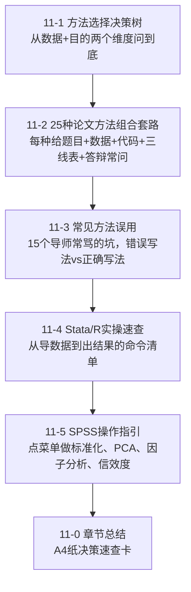

# 11 方法选择决策

> 拿到一个题目，到底该用哪个模型？
> 这一章给你一棵决策树 + 25 种经过验证的论文套路 + Stata/R/[[05_SPSS操作指引|SPSS]] 实操命令。
> 不用再纠结"我该用 [[04_OLS截距和拟合值|OLS]] 还是 FE 还是 Logit"——对着树走就行。

---

## 为什么要有这一章？

前面 03~09 章教了你十几种方法：OLS、FE、RE、IV、Logit、[[02_主成分分析PCA|PCA]]、[[05_ARIMA建模流程|ARIMA]]、[[06_熵值法-TOPSIS组合|熵值法]]、[[05_TOPSIS法|TOPSIS]]、聚类、DID、[[KP01_VAR模型|VAR]]……

但一拿到题目你就懵：
- "我做数字经济对产业升级的影响，到底用 OLS 还是[[06_固定效应FE|固定效应]]？"
- "我要给成渝双城经济圈打分，用熵值法还是 TOPSIS？"
- "我做居民消费意愿，Y 是'买/不买'，用 OLS 行不行？"

**这一章不教新方法，教你"从题目反推方法"。**

---

## 这一章你会学到什么？

---

## 怎么用这一章？

- **刚定题目**：看 `[[01_方法选择决策树]]`，一路问到你的方法；
- **不知道选哪个套路**：看 `[[02_15种论文方法组合套路]]`，找最像你题目的那一套，直接抄框架；
- **导师说你方法用错了**：看 `[[03_常见方法误用]]`，对照自己犯了哪条；
- **软件不知道敲什么命令**：看 `[[04_Stata_R实操速查]]` 或 `[[05_SPSS操作指引]]`。

---

上一篇：[[../10_论文写作全流程/README|10 论文写作全流程]] ｜ 下一篇：[[01_方法选择决策树]] ｜ 流程下一步：[[../12_毕业论文实战/README|12 毕业论文实战]]

---

## 📖 配套教材笔记
- [[../../教材笔记/02_计量经济学/README|计量经济学总览]]
- [[../../教材笔记/02_计量经济学/09_工具变量法/00_章节总结|第9章 工具变量法]]
- [[../../教材笔记/02_计量经济学/11_面板数据/00_章节总结|第11章 面板数据]]
- [[../../教材笔记/02_计量经济学/10_二值选择模型/00_章节总结|第10章 二值选择模型]]

## 📚 配套原书
- [[../../原文件/计量经济学/陈强_计量经济学及Stata应用_全书|陈强《计量经济学及Stata应用》]]

## 📖 配套统计学原理速查

- 描述统计基础 → [[../../教材笔记/05_统计学原理/05_平均与变异指标/README|05章 平均与变异指标]]
- 抽样与检验 → [[../../教材笔记/05_统计学原理/06_抽样与参数估计/README|06章 抽样与参数估计]] / [[../../教材笔记/05_统计学原理/07_假设检验/README|07章 假设检验]]
- 相关回归 → [[../../教材笔记/05_统计学原理/08_相关与回归/README|08章 相关与回归]]
- 时序与指数 → [[../../教材笔记/05_统计学原理/09_时间序列分析/README|09章 时间序列]] / [[../../教材笔记/05_统计学原理/10_统计指数/README|10章 统计指数]]
- 综合评价 → [[../../教材笔记/05_统计学原理/11_统计分析/知识点/KP01_综合评价法总览|综合评价法总览]]
