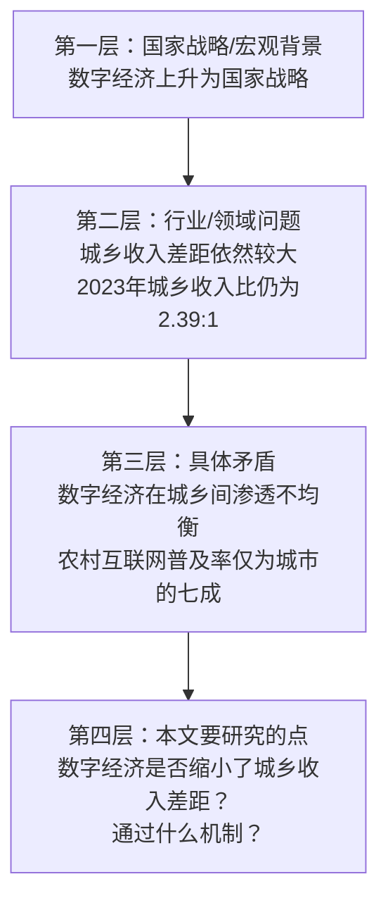
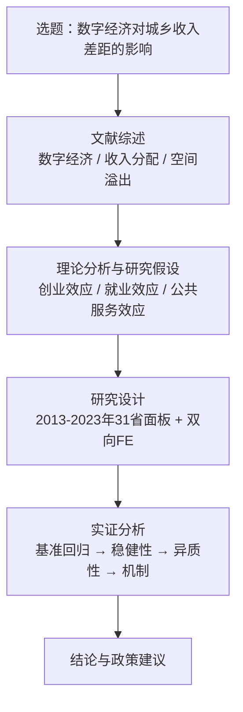

# 05 引言（绪论）怎么写

## 一、为什么要学这个

引言是论文的"第一印象"。很多同学一开笔就写"随着经济全球化的快速发展……"——这是空话，导师看了一百遍。

好的引言是一个**漏斗**：从国家大事一路收到你论文要解决的那个具体矛盾。漏斗收得越窄，论文越聚焦。

绪论只回答四个问题：

1. 为什么要研究这个问题？（现实背景）
2. 研究它有什么用？（理论意义 + 现实意义）
3. 你打算怎么研究？（研究内容、框架、方法）
4. 你的论文跟别人有什么不一样？（创新点）

把这四个问题回答清楚，绪论就写完了。

---

## 二、研究背景：漏斗式写法（从大到小）



研究背景最忌讳一上来就喊口号。正确做法是从最大的国家战略，一层一层收窄，最后落到你论文要研究的具体问题。**每一层都要有具体数字或政策文件名**，不能空泛。

### 填空模板：研究背景四段式

```text
第一段（宏观背景）：
    【年份】，【中央文件/国家战略】明确提出"【政策原话】"。
    据【数据来源】统计，【关键数字：如2023年数字经济占GDP比重达41.5%】。

第二段（行业问题）：
    然而，在【领域快速发展】的同时，【矛盾/问题】依然突出。
    【具体数字对比：如2023年城镇人均可支配收入51821元，农村21691元，城乡收入比2.39:1】。

第三层（具体矛盾）：
    值得注意的是，【X因素】在【城乡/地区】之间的分布并不均衡。
    【具体数字：如城镇互联网普及率85.9%，农村62.2%】。
    这种【数字鸿沟】是否会影响收入差距？其作用机制是什么？

第四段（引出本文）：
    基于此，本文以【样本：如2013-2023年31省面板数据】为样本，
    采用【方法：如双向固定效应模型】，
    系统考察【X】对【Y】的影响及其机制，
    为【政策目标】提供经验证据。
```

### 反例 vs 正例

**反例（空话套话）**：

> 随着经济全球化的快速发展和信息技术的不断进步，数字经济已经成为推动全球经济增长的重要动力。在我国，数字经济也取得了举世瞩目的成就。然而，在数字经济发展过程中，也出现了一些问题。因此，研究数字经济对城乡收入差距的影响具有重要的理论和现实意义。

为什么是反例：没有任何数字，没有具体矛盾，"出现了一些问题"等于没说。

**正例（具体到数字和矛盾）**：

> 2022 年，《"十四五"数字经济发展规划》明确提出"到 2025 年数字经济核心产业增加值占 GDP 比重达到 10%"。据中国信息通信研究院测算，2023 年我国数字经济规模达 56.1 万亿元，占 GDP 比重提升至 41.5%。
>
> 然而，数字经济的红利在城乡间分配并不均衡。国家统计局数据显示，2023 年城镇居民人均可支配收入为 51821 元，农村居民为 21691 元，城乡收入比仍达 2.39:1。与此同时，第 52 次《中国互联网络发展状况统计报告》显示，截至 2023 年 6 月，城镇地区互联网普及率为 85.9%，农村地区仅为 62.2%。
>
> 这就引出一个值得深究的问题：数字经济究竟是缩小了城乡收入差距，还是因为"数字鸿沟"的存在反而拉大了差距？其作用机制是什么？

正例好在哪：有政策文件名、有规模数字、有城乡对比数字，用一个真实矛盾自然引出研究问题。

### 漏斗自检表

| 检查项 | 合格标准 | 不合格表现 |
|---|---|---|
| 有政策文件名吗？ | 至少出现 1 个具体文件 | 只写"国家高度重视" |
| 有具体数字吗？ | 至少 2 个来自权威来源的数字 | 只写"规模不断扩大" |
| 有矛盾/张力吗？ | 能说出一个"好事背后的问题" | 全是正面描述，没有问题意识 |
| 最后一段落到你论文了吗？ | 最后一句说出用什么数据、什么方法、研究什么 | 最后一段还是宏观口号 |
| 字数合适吗？ | 研究背景约 400~600 字 | 写了 1500 字还没说到自己的题目 |

---

## 三、研究意义：理论意义 + 现实意义

### 理论意义 = 你补充了文献的哪块空白

不要写"丰富了相关理论研究"这种空话，要具体到"补了什么"。

| 类型 | 填空句式 |
|---|---|
| 补样本/时间 | "现有研究多聚焦于 ____ 年之前，本文将样本期扩展至 ____ 年，检验在新的政策环境下结论是否依然成立。" |
| 补方法 | "现有研究多采用 [[04_OLS截距和拟合值|OLS]]/面板回归，在因果识别上存在不足。本文采用 ____ 方法（DID/IV/PSM），更干净地识别了二者的因果关系。" |
| 补视角 | "现有研究多关注 ____ 维度，本文引入 ____ 视角（空间溢出/异质性/机制），拓展了该领域的研究边界。" |

**正例**：

> 本文的理论意义体现在两个方面：第一，在研究视角上，现有文献多将省份视为独立个体，本文引入空间权重矩阵，考察数字经济影响城乡收入差距的空间溢出效应，是对现有收入分配文献的补充。第二，在因果识别上，现有研究多使用 OLS 或面板[[06_固定效应FE|固定效应]]，本文利用"宽带中国"试点作为准自然实验，采用多期 DID 方法识别因果效应，为该领域提供了更干净的经验证据。

### 现实意义 = 你的结论对谁有用、有什么用

| 对象 | 填空句式 |
|---|---|
| 政府/政策制定 | "本文结论可为 ____ 部门制定 ____ 政策提供经验依据，特别是在 ____ 方面。" |
| 企业/市场主体 | "本文发现对 ____ 企业布局 ____ 业务具有参考价值。" |
| 老百姓/居民 | "本文结论有助于理解 ____，为农村居民利用数字工具增收提供启示。" |

**正例**：

> 本文的现实意义在于：第一，为评估"宽带中国"试点和数字乡村政策的收入分配效应提供了量化证据，有助于政策制定者判断后续资源应优先投向东部还是中西部；第二，本文发现数字经济缩小城乡收入差距的主要机制是促进农村创业，这为金融机构在农村地区推广数字信贷、支付服务提供了经验支撑。

---

## 四、技术路线图（绪论里最好放一张）

绪论里放一张技术路线图，让导师一眼看到你全文的逻辑。节点文字不要太长，每个节点控制在 15 个字以内，用 `<br/>` 换行；节点之间单向递进，不要回头箭头。



技术路线图下面配一段文字，简单交代全文分几章：

> 本文共分为六章。第一章为绪论，阐述研究背景、意义、内容与方法。第二章为文献综述。第三章为理论分析与研究假设。第四章为研究设计，介绍样本选择、变量定义与模型设定。第五章为实证分析。第六章为结论与政策建议。

---

## 五、研究方法：一句话说清

研究方法不要写成长篇大论，本科论文用一段话交代清楚就行。**不要单独写"文献研究法"**——那是所有论文的默认动作。你的方法部分只需写你实证上用了什么：数据是什么、基准模型是什么、用了什么识别策略、做了哪些检验。

**填空模板**：

> 本文以 2013—2023 年中国 31 个省份的面板数据为样本，核心解释变量采用北京大学数字普惠金融指数，被解释变量采用城乡居民收入比。基准回归采用双向[[KP01_固定效应模型|固定效应模型]]，并以"宽带中国"试点作为准自然实验构建多期 DID 模型进行因果识别。进一步通过替换被解释变量、缩尾处理、安慰剂检验进行[[06_稳健性检验|稳健性检验]]，通过中介效应模型检验农村创业和就业结构两条机制。

**反例（正确的废话）**：

> 本文采用文献研究法、实证分析法、比较分析法、定性与定量相结合的方法，综合运用经济学、统计学、社会学等多学科理论，对数字经济与城乡收入差距问题进行了深入研究。

---

## 六、研究假设（点出你要检验什么）

绪论末尾用 1~2 段话点出你要检验的核心假设，导师一眼就知道你的"待检验命题"是什么。

```text
基于上述背景，本文聚焦三个核心问题：
第一，【X】是否显著影响了【Y】？
第二，如果存在影响，其作用机制是什么？
第三，这种影响在不同地区间是否存在异质性？

对应地，本文提出以下待检验假设：
H1：在控制其他因素后，【X】显著【缩小/提升】了【Y】。
H2：【X】通过【机制变量】这一渠道影响【Y】。
H3：上述效应在【中西部地区】更为显著。
```

**反例**：

> 本文将对数字经济与城乡收入差距的关系进行深入研究，探讨二者之间的内在联系。

"深入研究""内在联系"没有任何可检验的命题，导师读完不知道你到底要证明什么。

---

## 七、创新点：本科论文写 3 个就够

本科论文的创新点**不要吹"首次发现""填补空白"**，导师一看就觉得你不诚恳。写下面三个角度，安全又合理：

| 创新角度 | 填空句式 |
|---|---|
| 视角新 | "现有研究多从 X 角度考察，本文从 ____ 角度切入，关注 ____。" |
| 数据新 | "本文将样本期更新至 ____ 年，覆盖了 ____ 政策实施后的最新情况。" |
| 方法应用新 | "本文将 ____ 方法（DID/空间杜宾/中介效应）应用于 ____ 问题，该方法在本领域应用较少。" |

**反例（吹过头）**：

> 本文首次发现数字经济对城乡收入差距存在非线性影响，填补了国内外研究空白，具有开创性意义。

**正例（诚恳、具体）**：

> 本文可能的边际贡献在于：第一，在研究视角上，同时考察数字经济影响城乡收入差距的直接效应和空间溢出效应；第二，在样本期上，将数据更新至 2023 年，覆盖了数字乡村战略实施后的完整周期；第三，在识别策略上，利用"宽带中国"试点构建多期 DID，比传统 OLS 更接近因果效应。需要说明的是，本文并不试图提出新理论，而是在已有理论框架下提供更新、更干净的经验证据。

如果你实在想不出创新点，用"降维法"：把别人做过的事，换一个小切口再说一遍。别人研究了全国，你只研究县域；别人用了 2011—2020 年数据，你更新到 2023 年；别人用了 OLS，你用 DID。本科论文不是让你发明新轮子，是让你把别人的轮子在一个新地方、用一种新方式再装一遍。

**创新点雷区**：

| 雷区 | 为什么不能写 |
|---|---|
| "首次发现……" | 你不可能是全球第一个发现的，导师一查文献就打脸 |
| "填补了国内外空白" | 本科论文做不到这个高度，写了显得不诚恳 |
| "具有开创性意义" | 太夸张 |
| 创新点写 5 个以上 | 写得多说明你不知道哪个是真创新，凑数 |

---

## 八、完整绪论填空模板（照着写，约 1500 字）

**（一）研究背景**

【年份】，【中央文件/国家战略】明确提出"【政策原话】"。据【数据来源】统计，【领域关键数字】。

然而，在【领域快速发展】的同时，【矛盾/问题】依然突出。据【数据来源】统计，【具体数字对比：A vs B】。

值得注意的是，【X 因素】在【城乡/地区】之间的分布并不均衡。【具体数字】。这就引出一个问题：【X】究竟是缩小了【Y】，还是因为【Z 机制】反而拉大了【Y】？

基于此，本文以【样本】为研究对象，采用【方法】，系统考察【X】对【Y】的影响及其机制，为【政策目标】提供经验证据。

**（二）研究意义**

1. 理论意义：本文从【视角】补充了现有文献在【方面】的不足。
2. 现实意义：本文结论可为【部门】制定【政策】提供参考。

**（三）研究内容与框架**

本文共分为六章。第一章绪论……第二章文献综述……第三章理论分析与研究假设……第四章研究设计……第五章实证分析……第六章结论与政策建议。技术路线见图 1-1。

**（四）研究方法**

本文以【样本】为对象，核心解释变量为 ____，被解释变量为 ____。基准回归采用 ____ 模型，进一步通过 ____ 进行稳健性检验，通过 ____ 检验机制，通过 ____ 进行异质性分析。数据来源于 ____。

**（五）可能的创新点**

本文的边际贡献在于：第一，视角上，____；第二，数据上，样本更新至 ____ 年；第三，方法上，采用 ____ 方法识别因果。需要说明的是，本文不试图提出新理论，而是在已有框架下提供更新、更干净的经验证据。

---

## 九、篇幅分配

| 部分 | 建议字数 | 说明 |
|---|---|---|
| 研究背景 | 400~600 字 | 漏斗式，4 段左右 |
| 理论意义 | 150~250 字 | 写 1~2 点，不要贪多 |
| 现实意义 | 200~300 字 | 写 2~3 点，落到具体对象 |
| 研究内容与框架 | 150~200 字 + 技术路线图 | 图为主，文字为辅 |
| 研究方法 | 100~150 字 | 一段话讲清 |
| 创新点 | 150~200 字 | 3 个点，每点 2 句话 |
| **合计** | **约 1200~1700 字** | 不超过 2000 字 |

绪论不是越长越好。很多同学绪论写 3000 字，导致后面实证部分没的写。绪论控制在 1500 字左右，把空间留给第五章实证分析。

---

下一篇：[[06_实证部分错误vs正确]]


---

## 📖 配套教材笔记
- [[../../教材笔记/02_计量经济学/14_实证研究指南/00_实证研究流程|计量经济学·实证研究流程]]
- [[../../教材笔记/05_统计学原理/11_统计分析/知识点/KP08_统计分析报告的特点与结构|统计学原理·统计分析报告]]

## 📚 配套原书
- [[../../原文件/计量经济学/陈强_计量经济学及Stata应用_全书|陈强《计量经济学及Stata应用》]]
