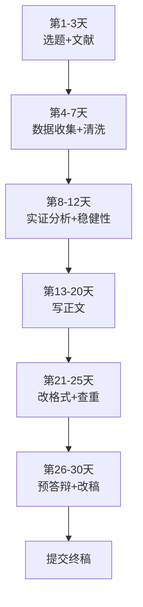

# 10 论文写作时间线（30 天 / 14 天 / 7 天三套方案）

> 不管你是按部就班还是临期救火，照着每天的"今日必做清单"打勾就行。
> 原则：**没做完当天的事不睡觉，没通过阶段检查清单不进下一阶段。**
> 所有时间均为"纯投入小时数"，不是坐在图书馆发呆的小时数。

---

## 一、总览图



---

## 二、30 天完整版（按天排）

这是最理想的节奏。每天投入 4-6 小时，周末可以 8 小时。每天开头先读"今日目标"，结束前对着"必做清单"打勾。

### 第一阶段：选题 + 文献（第 1-3 天）

#### 第 1 天：定题

**今日目标**：从 0 到 1，拿到一个能写的题目。

- [ ] 参考 `../10_论文写作全流程/01_怎么选题`，圈出 3 个你感兴趣且数据能拿到的题目
- [ ] 每个题目在知网上搜 3 篇近 3 年的核心期刊论文，确认"有人做过但还能做"
- [ ] 用一句话写出研究问题："我想研究【X】对【Y】的影响"
- [ ] 把题目报给导师，微信发过去等回复（不要等导师回完再睡，先干别的）
- [ ] 建一个文件夹，命名格式：`论文_姓名_题目关键词`，下面建子文件夹：`01文献`、`02数据`、`03代码`、`04稿件`、`05图表`

**今日交付物**：一个导师认可的题目 + 一个空文件夹结构。

#### 第 2 天：啃文献

**今日目标**：读完 10 篇文献，知道别人都做了什么。

- [ ] 知网导出 5 篇核心期刊论文的 PDF，放进 `01文献` 文件夹
- [ ] 每篇文献只读三样东西：摘要、研究假设、实证结果
- [ ] 用一张 Excel 表记录：作者、年份、研究问题、用了什么数据、核心结论、自变量、因变量
- [ ] 标出 3 个"别人没做透"的方向，这就是你的创新点
- [ ] 整理出 5-8 个控制变量（别人都用了哪些）

**今日交付物**：一张文献综述 Excel 表（10 行）。文献综述写法见 `../10_论文写作全流程/[[02_文献综述怎么做]]`。

#### 第 3 天：定研究框架

**今日目标**：画出技术路线图，写出 3 个研究假设。

- [ ] 用 mermaid 或手画：研究问题 → 理论机制 → 假设 H1/H2/H3 → 数据 → 模型 → 结论
- [ ] 写出 H1："【X】会【正向/负向】影响【Y】，因为 ____"
- [ ] 写出 H2："【X】对【Y】的影响在【东部/中西部】地区更显著，因为 ____"
- [ ] 写出 H3："【机制变量 Z】在【X】影响【Y】的过程中起中介作用，因为 ____"
- [ ] 把研究框架发给导师，约面谈时间

**阶段检查清单（第一阶段）**——全部打勾才能进第二阶段：

- [ ] 题目导师已微信确认
- [ ] 文献 Excel 表至少 10 篇
- [ ] 3 个研究假设写出来了，每个都有理论依据
- [ ] 技术路线图清晰

---

### 第二阶段：数据收集 + 清洗（第 4-7 天）

#### 第 4 天：找数据

**今日目标**：把因变量、自变量、控制变量的原始数据全部下载下来。

- [ ] 因变量数据：从国家统计局/统计年鉴找，下载 Excel
- [ ] 自变量数据：如果是指数类（如数字经济指数），找现成的或用[[06_熵值法-TOPSIS组合|熵值法]]自己合成（见 `../07_综合评价方法/03_熵值法`）
- [ ] 控制变量数据：人均 GDP、产业结构、对外开放、教育水平、政府支出——统计年鉴都有
- [ ] 检查时间跨度：本科论文至少 5-10 年面板数据，否则样本量不够
- [ ] 检查省份数量：31 个省（不含港澳台），缺数据的省份用插值法补

**今日交付物**：一个 `02数据/原始数据.xlsx`，每个变量一个 sheet。数据获取详见 `../10_论文写作全流程/[[03_数据从哪来]]`。

#### 第 5 天：数据合并

**今日目标**：把所有变量拼成一张面板数据表。

- [ ] 在 Excel 里以"省份-年份"为主键，VLOOKUP 或 Power Query 合并所有变量
- [ ] 检查：31 省 × 10 年 = 310 行（如果是平衡面板）
- [ ] 标出缺失值单元格，黄色高亮
- [ ] 缺失值处理规则：单个缺失用前后年份插值；超过 3 个缺失的省份考虑剔除
- [ ] 另存为 `02数据/面板数据.xlsx`

**今日交付物**：一张 310 行左右的面板数据宽表。

#### 第 6 天：Stata 清洗

**今日目标**：把 Excel 数据导进 Stata，跑完所有清洗代码。

```stata
* 导入面板数据
import excel "02数据/面板数据.xlsx", firstrow clear
* 中文变量名改成英文短名
rename 城乡收入比 gap
rename 数字经济指数 digeco
* 给每个变量加中文标签
label variable gap "城乡收入比"
label variable digeco "数字经济指数"
* 检查缺失值
misstable sum
* 连续变量1%和99%缩尾
winsor2 pgdp, cuts(1 99) replace
* 生成对数变量
gen ln_pgdp = ln(pgdp)
* 声明面板结构
xtset prov year
* 保存清洗后数据
save "03代码/清洗后.dta", replace
```

**今日交付物**：`清洗后.dta` + 一份 .do 代码文件（每一步都有注释）。

#### 第 7 天：描述统计 + 初步观察

**今日目标**：跑完描述统计和相关性，看看数据"长什么样"。

- [ ] `summarize` 跑所有变量的描述统计
- [ ] `corr` 跑[[01_相关系数|相关系数]]矩阵，检查[[04_多重共线性|多重共线性]]（相关系数 > 0.8 要警惕）
- [ ] `twoway scatter` 画因变量和自变量的散点图，加拟合线
- [ ] 把散点图导出 `05图表/图1_散点图.png`
- [ ] 如果散点图方向和假设相反，回头检查变量定义或数据单位

**阶段检查清单（第二阶段）**：

- [ ] 所有变量数据已拿到，样本量 ≥ 300
- [ ] Stata 清洗代码能从头到尾跑通不报错
- [ ] `xtset` 成功，是平衡面板
- [ ] 描述统计表已生成
- [ ] 散点图趋势和假设方向一致（或能解释为什么不一致）

---

### 第三阶段：实证分析 + 稳健性（第 8-12 天）

#### 第 8 天：基准回归

**今日目标**：跑完基准回归，拿到核心系数。

```stata
* 模型1：只放核心自变量
xtreg gap digeco, fe
* 模型2：加控制变量1
xtreg gap digeco ln_pgdp, fe
* 模型3：加全部控制变量
xtreg gap digeco ln_pgdp indus open edu, fe
* 存储三个模型准备导出
eststo m1: xtreg gap digeco, fe
eststo m2: xtreg gap digeco ln_pgdp, fe
eststo m3: xtreg gap digeco ln_pgdp indus open edu, fe
```

- [ ] 记录核心变量 `digeco` 的系数、标准误、p 值
- [ ] 如果系数不显著：检查是不是控制变量太多、样本量不够、或者变量定义有问题

**今日交付物**：3 个回归结果，核心系数方向和显著性能解释。

#### 第 9 天：[[06_稳健性检验|稳健性检验]]（第一轮）

**今日目标**：做 3 种稳健性检验。

- [ ] 替换因变量：用"城乡消费比"替换"城乡收入比"
- [ ] 缩短样本期：只用 2015-2023 年数据跑一遍
- [ ] 更换估计方法：用[[07_随机效应RE与Hausman检验|随机效应]] `re` 跑一遍，和[[06_固定效应FE|固定效应]]对比
- [ ] 每个稳健性检验都记录核心系数是否仍然显著、方向是否一致
- [ ] 如果稳健性结果和基准不一致，写一段解释

#### 第 10 天：内生性处理

**今日目标**：至少做一种内生性处理（导师最看重这个）。

```stata
* 滞后一期缓解反向因果
xtreg gap L.digeco ln_pgdp indus open edu, fe
* 如有合适工具变量，用2SLS
* ivregress 2sls gap (digeco = iv) ln_pgdp indus, fe
```

- [ ] 说明：为什么自变量可能内生？（反向因果：收入差距大的地区数字经济也发达）
- [ ] 内生性结果和基准对比，写一段讨论

#### 第 11 天：异质性分析

**今日目标**：按东中西部分组跑回归。

```stata
* 东部
xtreg gap digeco controls if region == 1, fe
* 中部
xtreg gap digeco controls if region == 2, fe
* 西部
xtreg gap digeco controls if region == 3, fe
```

- [ ] 对比三个组的系数大小和显著性
- [ ] 解释：为什么东部/西部更显著？

#### 第 12 天：机制分析（可选但加分）

**今日目标**：如果时间够，做一个中介效应。

- [ ] 第一步：X → Y（基准回归，已跑）
- [ ] 第二步：X → M（中介变量，如创业活跃度）
- [ ] 第三步：X + M → Y
- [ ] 观察中介变量 M 的系数是否显著，X 的系数是否变小
- [ ] 如果跑不通就放弃，不要硬做——本科论文没有机制分析也能过

**阶段检查清单（第三阶段）**：

- [ ] 基准回归 3 列结果完整
- [ ] 至少 3 种稳健性检验结果
- [ ] 至少 1 种内生性处理
- [ ] 异质性分析（东中西部分组）
- [ ] 所有回归表能导出 Word

---

### 第四阶段：写正文（第 13-20 天）

这是最磨人的阶段。原则：**先写完，再写好。** 不要在第一段就反复改。

#### 第 13 天：写绪论（约 1500 字）
- [ ] 研究背景：政策背景 + 现实问题（写法见 `05_引言怎么写`）
- [ ] 研究意义：理论意义 + 现实意义
- [ ] 研究方法与技术路线：列用了什么方法 + 放技术路线图
- [ ] 论文结构安排：简述每一章写什么

#### 第 14 天：写文献综述（约 2000 字）
- [ ] 数字经济相关研究：概念、测度、经济效应
- [ ] 城乡收入差距相关研究：影响因素、衡量方式
- [ ] 数字经济与收入差距：直接相关文献的主要结论
- [ ] 文献评述：已有研究做了什么、还缺什么、我这篇补了什么

#### 第 15 天：写理论机制与假设（约 1500 字）
- [ ] 直接机制：就业效应、创业效应、公共服务可及性
- [ ] 异质性机制：为什么地区间有差异
- [ ] 研究假设：把 H1/H2/H3 正式写出来，每个配一段理论推导

#### 第 16 天：写研究设计（约 1500 字）
- [ ] 样本选择与数据来源
- [ ] 变量定义表（变量名、符号、定义、单位、数据来源）
- [ ] 模型设定：写出面板 FE 方程（公式 4.1），解释每个符号

#### 第 17 天：写实证结果——上半部分（约 2000 字）
- [ ] 描述性统计：放表，解读均值、标准差、最大最小值
- [ ] 相关系数：放表，说明没有严重多重共线性
- [ ] 基准回归：放 3 列回归表，逐列解读

#### 第 18 天：写实证结果——下半部分（约 2000 字）
- [ ] 稳健性检验：放扩展表，解读每种检验的结论
- [ ] 内生性处理：放滞后/IV 结果表
- [ ] 异质性分析：放东中西部分组表

#### 第 19 天：写结论与政策建议（约 1500 字）
- [ ] 主要结论：用 3-5 条总结发现
- [ ] 政策建议：对应结论来写，每条结论配 1-2 条建议
- [ ] 研究不足与展望

#### 第 20 天：写摘要、关键词、致谢、参考文献
- [ ] 中文摘要 300 字：背景一句 + 方法一句 + 数据一句 + 主要结果 3 条 + 建议一句（写法见 `../10_论文写作全流程/07_结论与摘要`）
- [ ] 英文摘要：中文摘要翻译，用 Grammarly 检查语法
- [ ] 关键词 5 个
- [ ] 致谢 100-200 字
- [ ] 参考文献按 GB/T 7714 格式，至少 15 篇（格式见 `03_参考文献GB-T7714`）

**阶段检查清单（第四阶段）**：

- [ ] 全文写完，总字数 ≥ 8000 字（本科一般要求 8000-15000）
- [ ] 所有表格、图、公式都已插入
- [ ] 正文引用 [1][2] 和文末参考文献一一对应
- [ ] 摘要、关键词、致谢写完

---

### 第五阶段：改格式 + 查重（第 21-25 天）

#### 第 21 天：按格式规范改字体
- [ ] 打开 `01_重庆财经学院格式要求`，逐项核对
- [ ] 页边距：左 2.8cm，右/上/下 2.5cm
- [ ] 全文行距固定值 26 磅
- [ ] 正文：宋体小四号，首行缩进 2 字符
- [ ] 一级标题：黑体小三号加粗居中

#### 第 22 天：改表格和图
- [ ] 所有表格转三线表（做法见 `02_三线表怎么做`）
- [ ] 表题在表上方，格式"表 5-1"
- [ ] 图题在图下方，格式"图 5-1"
- [ ] 每个表/图下方加数据来源注释
- [ ] 公式编号右对齐，格式（5.1）

#### 第 23 天：改参考文献和页码
- [ ] 参考文献另起一页，悬挂缩进 2 字符
- [ ] 正文引用设为上标
- [ ] 封面无页码；前置部分罗马数字；正文阿拉伯数字从 1 开始

#### 第 24 天：查重
- [ ] 用学校指定的查重系统自查一次（方法见 `09_查重与降重`）
- [ ] 标出重复段落，逐段改写

#### 第 25 天：通读全文
- [ ] 从头到尾读一遍，改错别字
- [ ] 检查"的/地/得"、"做/作"混用
- [ ] 检查中英文标点：中文用全角，英文用半角

**阶段检查清单（第五阶段）**：

- [ ] 格式规范自查表全部打勾（见 `01_重庆财经学院格式要求` 末尾）
- [ ] 查重率达标
- [ ] 全文通读无错别字

---

### 第六阶段：预答辩 + 改稿（第 26-30 天）

#### 第 26 天：做答辩 [[08_答辩PPT怎么做|PPT]]
- [ ] 10-12 页（做法见 `08_答辩PPT怎么做`）
- [ ] 每页一个核心信息，不要大段文字

#### 第 27 天：练答辩
- [ ] 对着 PPT 讲一遍，控制在 8-10 分钟
- [ ] 录音回听：语速、口头禅、逻辑跳跃
- [ ] 预想老师会问的问题（翻 `07_答辩50问`），写好答案

#### 第 28 天：预答辩
- [ ] 穿着整洁，提前到教室
- [ ] 讲的时候看评委，不要一直念 PPT
- [ ] 提问环节：听清问题再答，不会就说"这个问题我回去补充研究"

#### 第 29 天：按预答辩意见改稿
- [ ] 把评委意见记下来，逐条改
- [ ] 改完发给导师确认

#### 第 30 天：终稿提交
- [ ] 按学校要求格式（Word + PDF 各一份）命名
- [ ] 检查附件：数据表、代码、[[../../教材笔记/05_统计学原理/02_统计数据采集/知识点/KP06_问卷结构与问题措辞|问卷]]（如有）
- [ ] 对照 `17_提交Checklist` 最后打勾
- [ ] 提交系统，保存提交截图

---

## 三、14 天紧急版

如果你只剩两周，砍掉所有"加分项"，只保"及格项"。每天投入 8 小时以上。

| 天数 | 任务 | 交付物 |
|------|------|--------|
| 第 1 天 | 定题 + 找 5 篇核心文献 | 题目导师确认 + 文献表 |
| 第 2 天 | 文献综述 Excel + 3 个假设 | 研究框架图 |
| 第 3 天 | 下载数据 + 合并面板 | 面板数据 Excel |
| 第 4 天 | Stata 清洗 + 描述统计 | 清洗后 .dta + 描述统计表 |
| 第 5 天 | 基准回归 3 列 | 基准回归表 |
| 第 6 天 | 稳健性（替换变量+缩样本） | 稳健性表 |
| 第 7 天 | 异质性（东中西） | 异质性表 |
| 第 8 天 | 写绪论+文献+理论假设 | 前三章初稿 |
| 第 9 天 | 写研究设计+实证结果 | 四五章初稿 |
| 第 10 天 | 写结论+建议+摘要+参考文献 | 全文初稿 |
| 第 11 天 | 按格式规范排版 | 格式合规稿 |
| 第 12 天 | 查重+改重复 | 查重率达标 |
| 第 13 天 | 做 PPT+练讲 | 答辩 PPT |
| 第 14 天 | 预答辩+改稿+提交 | 终稿 |

14 天版砍掉了内生性处理、机制分析、英文摘要精修、政策建议深度，但至少能拿到及格。

---

## 四、7 天冲刺版

最后一周怎么救。只保：题目有、数据有、回归有、全文 8000 字、格式对。这不是推荐方案，是救火方案。

| 天数 | 必做 | 时间 |
|------|------|------|
| 第 1 天 | 直接用现成题目，找国家统计局宏观数据，跑通基准回归 | 10 小时 |
| 第 2 天 | 跑完稳健性（替换因变量+换估计方法），所有结果表导出 | 10 小时 |
| 第 3 天 | 写绪论+文献+理论，每章 1500 字 | 10 小时 |
| 第 4 天 | 写研究设计+实证结果，表格从 Stata 导出直接粘贴 | 10 小时 |
| 第 5 天 | 写结论+摘要+参考文献+致谢 | 8 小时 |
| 第 6 天 | 格式排版（照 `01_重庆财经学院格式要求` 逐项勾）+ 查重改重 | 10 小时 |
| 第 7 天 | 做 PPT（10 页）+ 练讲 + 提交 | 8 小时 |

**7 天版铁律**：

1. 不要追求完美，能写完就是胜利。
2. 不要临时换题目，不要临时换数据。
3. 表格三线表可以最后在 Word 里一键调。
4. 查重率如果超了，优先改绪论和文献综述（最容易重复的部分）。
5. 每天必须产出一段能粘贴进论文的文字，不要"先想清楚再写"。

---

## 五、阶段检查清单（汇总版）

每个阶段结束前，对照以下清单。**任何一项没打勾，不要进下一阶段。**

### 阶段一：选题文献期
- [ ] 题目具体、可操作、数据可获得
- [ ] 文献综述表 ≥ 10 篇，知道别人做了什么
- [ ] 3 个研究假设，每个有理论依据
- [ ] 导师确认题目

### 阶段二：[[05_数据清洗|数据清洗]]期
- [ ] 样本量 ≥ 300（面板）或 ≥ 200（截面）
- [ ] 所有变量定义清晰、单位统一
- [ ] Stata 清洗代码可重复运行
- [ ] 无严重缺失值、无明显异常值

### 阶段三：实证分析期
- [ ] 基准回归核心系数方向和假设一致
- [ ] 至少 3 种稳健性检验
- [ ] 至少 1 种内生性处理
- [ ] 异质性分析完成
- [ ] 所有结果表能导出 Word

### 阶段四：正文写作期
- [ ] 全文 ≥ 8000 字
- [ ] 摘要 300 字、关键词 5 个
- [ ] 所有图表有编号、有标题、有数据来源
- [ ] 正文引用和参考文献一一对应

### 阶段五：格式排版期
- [ ] 页边距、行距、字体字号按 `01_重庆财经学院格式要求`
- [ ] 三线表全部合格
- [ ] 公式编号（5.1）格式
- [ ] 页码分节正确
- [ ] 查重率达标

### 阶段六：答辩期
- [ ] PPT 10-12 页，8-10 分钟能讲完
- [ ] 预想了 10 个答辩问题并写了答案
- [ ] 终稿按学校要求命名提交

---

## 六、给小白的 5 条时间管理建议

1. **每天固定一个"写论文时间块"**：哪怕只有 2 小时，也要固定下来，不要"有时间再写"。
2. **先完成再完美**：初稿写得烂没关系，先把字数堆到 8000，再回头改。
3. **数据和代码当天存盘**：Stata 的 .do 文件和 .dta 文件每天备份一次，电脑崩了是真的会哭。
4. **导师回复要追**：发了消息 3 天没回，就打电话或者去办公室堵。不要不好意思。
5. **留 2 天缓冲**：30 天计划实际按 28 天做完，最后 2 天留给突发情况。

---

上一篇：[[09_查重与降重]]｜下一篇：[[11_开题报告怎么写]]


---

## 📖 配套教材笔记
- [[../../教材笔记/02_计量经济学/14_实证研究指南/00_实证研究流程|计量经济学·实证研究流程]]
- [[../../教材笔记/05_统计学原理/11_统计分析/知识点/KP08_统计分析报告的特点与结构|统计学原理·统计分析报告]]

## 📚 配套原书
- [[../../原文件/计量经济学/陈强_计量经济学及Stata应用_全书|陈强《计量经济学及Stata应用》]]
