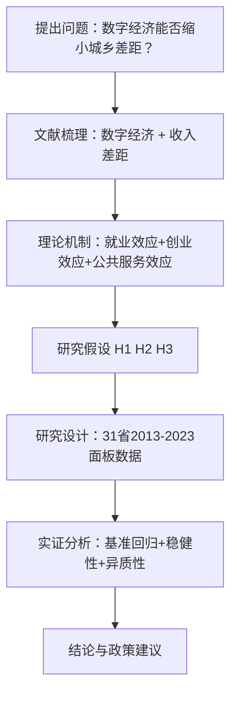

# 12 完整范文结构（填空式全套模板）

> 以"数字经济对城乡收入差距的影响——基于 2013-2023 年 31 省面板数据"为例，给一份可以直接填空的完整论文骨架。
> 用法：把【】里的内容换成你自己的研究内容，其他句式和结构直接用。
> 编号体系按重财规范"一、（一）1.（1）"，不用"第 1 章"格式。

---

## 题目（3 个备选）

**备选 1（推荐，最稳）**：
数字经济对城乡收入差距的影响——基于 2013-2023 年 31 省面板数据的实证研究

**备选 2（强调机制）**：
数字经济、要素流动与城乡收入差距——来自中国 31 个省份的经验证据

**备选 3（强调异质性）**：
数字经济缩小了城乡收入差距吗？——基于东中西部分组的面板数据分析

**题目怎么起**：主标题写研究对象 + 核心关系（X 对 Y 的影响）；副标题写数据范围 + 方法（基于 XX 年 XX 面板数据）；不要超过 30 个字。

---

## 摘要（中文 300 字填空模板）

> 摘要就 5 句话：背景 + 方法 + 数据 + 结果 + 建议。最后写摘要，因为那时你才知道自己到底做了什么。

【近年来，数字经济成为推动我国经济高质量发展的新动能，与此同时，城乡收入差距依然是共同富裕道路上的突出问题。】本文以 2013-2023 年中国 31 个省份的面板数据为样本，采用双向[[KP01_固定效应模型|固定效应模型]]，实证检验数字经济对城乡收入差距的影响及其作用机制。研究发现：第一，数字经济显著缩小了城乡收入差距，数字经济指数每提高 1 个单位，城乡收入比下降约 0.245 个单位；第二，该结论在替换被解释变量、缩短样本期、更换估计方法等[[06_稳健性检验|稳健性检验]]后依然成立；第三，异质性分析表明，数字经济的减贫效应在中西部地区更为显著，东部地区效果相对较弱。上述结论表明，应加大农村地区数字基础设施投入，推动数字技术向农业农村渗透，以数字经济助力共同富裕。

**关键词**：数字经济；城乡收入差距；双向[[06_固定效应FE|固定效应]]；共同富裕；省级面板

**英文版摘要**：把上面这段话翻译成英文，注意专业术语：数字经济 digital economy；城乡收入差距 urban-rural income gap；双向固定效应 two-way fixed effects；共同富裕 common prosperity。摘要写法也可参考 `../10_论文写作全流程/[[07_结论与摘要]]`。

---

## 一、绪论

### （一）研究背景与意义

#### 1. 研究背景

开头从政策文件和具体数字切入（写法详见 `[[05_引言怎么写]]`）：

> 【2013 年以来，我国数字经济规模持续扩大，数字技术与实体经济深度融合。】与此同时，城乡发展不平衡问题仍然突出，【2023 年我国城乡居民人均可支配收入比仍达 2.39:1】。

第二段要写三件事：政策背景（国家出了什么文件）、现实问题（城乡差距不缩小会怎样）、引出研究问题（数字经济到底能不能缩小差距）。

#### 2. 研究意义

**理论意义**（填空）：

> 本文从【数字经济】视角研究城乡收入差距的影响因素，丰富了【数字经济与收入分配】领域的文献，为理解数字技术的收入分配效应提供了省级层面的经验证据。

**现实意义**（填空）：

> 本文的研究结论有助于【评估数字经济政策的减贫效果】，为【制定缩小城乡差距的政策】提供经验参考。

### （二）研究方法与技术路线

**1. 研究方法**：文献研究法梳理相关文献；实证分析法用面板固定效应模型、稳健性检验、异质性分析；比较分析法做东中西部分组对比。

**2. 技术路线**（放一张 mermaid 图，然后插入论文）：



### （三）研究内容与结构安排

> 本文共分为六个部分。第一部分为绪论。第二部分为文献综述。第三部分为理论机制与研究假设。第四部分为研究设计。第五部分为实证结果与分析。第六部分为结论与政策建议。

---

## 二、文献综述

> 文献综述不要写成"张三说了什么，李四说了什么"的流水账，要按主题归类。写法详见 `../10_论文写作全流程/[[02_文献综述怎么做]]`。

### （一）数字经济相关研究

开头句：关于数字经济的研究主要集中在概念界定、测度方法与经济效应三个方面。

1. **概念与测度**：数字经济的概念最早由 Tapscott（1996）提出。测度方面主要有两类方法：一是直接统计法，利用官方公布的数字经济核心产业增加值；二是综合指数法，从多个维度构建[[KP02_指标体系|指标体系]]（赵涛等，2020）。
2. **经济效应**：现有研究表明，数字经济对经济增长、产业结构升级、创新创业、全要素生产率等具有显著促进作用。

### （二）城乡收入差距相关研究

关于城乡收入差距的影响因素，现有文献主要从经济发展、二元结构、人力资本、财政支出、对外开放等角度进行探讨。早期研究主要关注二元经济结构（Lewis，1954），此后教育差距、劳动力流动、社会保障等因素受到关注。近年来，数字技术、普惠金融等新因素进入视野。

### （三）数字经济与城乡收入差距

直接研究二者关系的文献主要形成两种观点：

- **缩小论**：数字经济通过促进农村就业、降低信息不对称、推动普惠金融等渠道缩小城乡收入差距（刘守英等，2022）。
- **扩大论**：由于数字鸿沟、农村人力资本不足，数字经济红利更多被城市居民获取，可能反而扩大差距（邱泽奇等，2016）。

### （四）文献评述

> 综上所述，现有研究仍存在以下不足：第一，多关注全国层面，对区域异质性考察不足；第二，对数字经济的测度方法不统一；第三，对作用机制的实证检验较少。本文在以下方面拓展：采用 2013-2023 年省级面板数据考察最新趋势；进行东中西部分组回归；通过多种稳健性检验验证结论可靠性。

---

## 三、理论机制与研究假设

### （一）机制分析

1. **就业效应**：数字经济创造了农村电商、直播带货、物流配送等新业态岗位，这些岗位对技能要求相对较低，农村劳动力经过简单培训即可胜任，从而提高农村居民工资性收入。
2. **创业效应**：数字平台（淘宝、拼多多、抖音）降低了创业门槛，农村居民可以直接对接大市场销售特色农产品，拓宽经营性收入渠道。
3. **公共服务可及性效应**：远程医疗、在线教育等公共服务向农村延伸，农村居民可以享受与城市同质的教育医疗资源，长期有利于缩小城乡差距。

### （二）研究假设

- **H1**：数字经济显著缩小了城乡收入差距。（理论依据：上述三条机制提高了农村居民收入。）
- **H2**：数字经济对城乡收入差距的缩小效应在中西部地区更为显著。（理论依据：东部城乡差距本身较小，数字经济边际效应递减；中西部数字基建薄弱，边际改进空间更大。）
- **H3**：在替换变量、更换模型、缩短样本期等稳健性检验后，结论依然成立。

---

## 四、研究设计

### （一）样本选择与数据来源

> 本文选取 2013-2023 年中国 31 个省、自治区、直辖市（不含港澳台）的面板数据。原始数据主要来源于《中国统计年鉴》（2014-2024 年）、各省统计年鉴。对于个别年份的缺失数据，采用线性插值法补充。最终获得 341 个省-年观测值。

### （二）变量定义

**表 4-1  变量定义表**

| 变量类型 | 变量名称 | 符号 | 定义/计算方法 | 单位 | 数据来源 |
|:---|:---|:---|:---|:---|:---|
| 被解释变量 | 城乡收入差距 | Gap | 城镇人均可支配收入 / 农村人均可支配收入 | 倍 | 中国统计年鉴 |
| 核心解释变量 | 数字经济指数 | DigEco | [[06_熵值法-TOPSIS组合|熵值法]]合成，含 5 个指标（见附录） | — | 作者测算 |
| 控制变量 | 经济发展水平 | lnpgdp | 人均 GDP 取对数 | 元（对数） | 中国统计年鉴 |
| 控制变量 | 产业结构 | Indus | 第三产业产值 / GDP | % | 中国统计年鉴 |
| 控制变量 | 对外开放 | Open | 进出口总额 / GDP | % | 中国统计年鉴 |
| 控制变量 | 教育水平 | Edu | 每万人在校大学生数 | 人 | 中国统计年鉴 |
| 控制变量 | 政府支出 | Gov | 财政支出 / GDP | % | 中国统计年鉴 |
| 分组变量 | 地区 | Region | 1=东部，2=中部，3=西部 | — | 国家统计局划分 |

### （三）模型设定

**基准模型（双向固定效应）**：

$$
Gap_{it} = \alpha + \beta\, DigEco_{it} + \gamma\, X_{it} + \mu_i + \lambda_t + \varepsilon_{it} \tag{4.1}
$$

每个符号的含义：$Gap_{it}$ 为省份 $i$ 在 $t$ 年的城乡收入比；$DigEco_{it}$ 为数字经济指数；$X_{it}$ 为控制变量向量；$\mu_i$ 为省份固定效应；$\lambda_t$ 为年份固定效应；$\varepsilon_{it}$ 为随机扰动项。我们最关心 $\beta$：如果 $\beta<0$ 且显著，说明数字经济缩小了城乡差距（支持 H1）。

**为什么用固定效应**：不同省份有很多不随时间变化的特征（地理位置、文化习惯），这些特征既影响数字经济发展，也影响城乡差距。固定效应通过组内变换消除这些不随时间变的因素，结果更可信。

---

## 五、实证结果与分析

### （一）描述性统计

**表 5-1  描述性统计**

| 变量 | 符号 | 观测值 | 均值 | 标准差 | 最小值 | 最大值 |
|:---|:---|---:|---:|---:|---:|---:|
| 城乡收入比 | Gap | 341 | 2.65 | 0.52 | 1.85 | 4.52 |
| 数字经济指数 | DigEco | 341 | 0.35 | 0.18 | 0.05 | 0.92 |
| 人均 GDP（对数） | lnpgdp | 341 | 10.82 | 0.48 | 9.56 | 12.15 |
| 产业结构 | Indus | 341 | 0.48 | 0.09 | 0.32 | 0.83 |
| 对外开放 | Open | 341 | 0.27 | 0.31 | 0.03 | 1.52 |
| 教育水平 | Edu | 341 | 195 | 86 | 55 | 450 |
| 政府支出 | Gov | 341 | 0.25 | 0.10 | 0.12 | 0.62 |

注：数据来源于《中国统计年鉴》（2014-2024 年）；连续变量在 1% 和 99% 分位进行缩尾处理。

> 从表 5-1 可以看出，样本期间城乡收入比均值为 2.65，最大值 4.52，最小值 1.85，说明不同省份差距较大。数字经济指数均值为 0.35，标准差 0.18，说明数字经济发展存在明显的区域不平衡。

### （二）[[01_相关系数|相关系数]]分析

**表 5-2  相关系数矩阵**

| 变量 | Gap | DigEco | lnpgdp | Indus | Open | Edu |
|:---|---:|---:|---:|---:|---:|---:|
| Gap | 1.000 |  |  |  |  |  |
| DigEco | -0.321\*\*\* | 1.000 |  |  |  |  |
| lnpgdp | -0.285\*\*\* | 0.612\*\*\* | 1.000 |  |  |  |
| Indus | -0.198\*\* | 0.456\*\*\* | 0.523\*\*\* | 1.000 |  |  |
| Open | -0.156\*\* | 0.387\*\*\* | 0.412\*\*\* | 0.298\*\*\* | 1.000 |  |
| Edu | -0.210\*\*\* | 0.534\*\*\* | 0.567\*\*\* | 0.376\*\*\* | 0.445\*\*\* | 1.000 |

注：\*\*\*、\*\*、\* 分别表示在 1%、5%、10% 水平上显著。

> 数字经济指数与城乡收入比的相关系数为 -0.321，在 1% 水平上显著为负，初步说明二者呈负相关。各自变量之间相关系数均小于 0.7，不存在严重[[04_多重共线性|多重共线性]]。

### （三）基准回归结果

**表 5-3  基准回归结果**

| 变量 | (1) [[04_OLS截距和拟合值|OLS]] | (2) 省份FE | (3) FE+控制 | (4) 双向FE |
|:---|---:|---:|---:|---:|
| DigEco | -0.521\*\*\*<br>(0.142) | -0.318\*\*<br>(0.155) | -0.287\*\*<br>(0.131) | -0.245\*<br>(0.128) |
| lnpgdp |  |  | -0.156\*<br>(0.083) | -0.142\*<br>(0.081) |
| Indus |  |  | 0.204<br>(0.189) | 0.187<br>(0.185) |
| Open |  |  | -0.042<br>(0.051) | -0.038<br>(0.050) |
| Edu |  |  | -0.001<br>(0.001) | -0.001<br>(0.001) |
| Gov |  |  | 0.315<br>(0.245) | 0.298<br>(0.240) |
| 常数项 | 2.835\*\*\*<br>(0.098) | 2.761\*\*\*<br>(0.102) | 4.128\*\*\*<br>(0.965) | 4.015\*\*\*<br>(0.958) |
| 省份固定效应 | 否 | 是 | 是 | 是 |
| 年份固定效应 | 否 | 否 | 否 | 是 |
| 观测值 | 341 | 341 | 341 | 341 |
| R² | 0.182 | 0.356 | 0.412 | 0.435 |

注：括号内为省级层面聚类稳健标准误；\*\*\*、\*\*、\* 分别表示在 1%、5%、10% 水平上显著。数据来源：作者整理。

> 表 5-3 报告了基准回归结果。列（1）为混合 OLS，DigEco 系数为 -0.521，在 1% 水平显著为负。列（2）加入省份固定效应后系数为 -0.318。列（3）加入控制变量后为 -0.287。列（4）同时控制省份和年份固定效应，系数为 -0.245，在 10% 水平显著。这表明数字经济指数每提高 1 个单位，城乡收入比下降约 0.245 个单位，假设 H1 得到验证。

### （四）稳健性检验

**表 5-4  稳健性检验结果**

| 变量 | (1) 替换因变量 | (2) 缩短样本期 | (3) 更换估计方法 | (4) 滞后一期 |
|:---|---:|---:|---:|---:|
| DigEco | -0.192\*\*<br>(0.095) | -0.268\*\*<br>(0.118) | -0.301\*\*\*<br>(0.102) |  |
| L.DigEco |  |  |  | -0.213\*<br>(0.115) |
| 控制变量 | 是 | 是 | 是 | 是 |
| 省份 FE | 是 | 是 | 是 | 是 |
| 年份 FE | 是 | 是 | 是 | 是 |
| 观测值 | 341 | 248 | 341 | 310 |
| R² | 0.385 | 0.402 | 0.418 | 0.396 |

注：括号内为省级聚类稳健标准误。列（1）被解释变量替换为城乡消费比；列（2）样本期为 2016-2023 年；列（3）使用随机效应模型；列（4）将核心解释变量滞后一期。

> 为验证基准结论的可靠性，本文从四个方面进行稳健性检验。列（1）替换被解释变量后系数仍在 5% 水平显著为负；列（2）缩短样本期结论一致；列（3）采用随机效应模型结果稳健；列（4）滞后一期以缓解反向因果，系数仍显著为负。上述结果表明核心结论稳健，假设 H3 得到支持。稳健性检验的更多做法见 `../10_论文写作全流程/[[06_稳健性检验]]`。

### （五）异质性分析

**表 5-5  异质性分析：分地区回归**

| 变量 | (1) 东部 | (2) 中部 | (3) 西部 |
|:---|---:|---:|---:|
| DigEco | -0.125<br>(0.142) | -0.312\*\*<br>(0.138) | -0.356\*\*\*<br>(0.125) |
| 控制变量 | 是 | 是 | 是 |
| 省份 FE | 是 | 是 | 是 |
| 年份 FE | 是 | 是 | 是 |
| 观测值 | 121 | 88 | 132 |
| R² | 0.452 | 0.398 | 0.421 |

注：括号内为省级聚类稳健标准误。东部包括北京、天津、河北、辽宁、上海、江苏、浙江、福建、山东、广东、海南；中部包括山西、吉林、黑龙江、安徽、江西、河南、湖北、湖南；西部包括其余省份。

> 表 5-5 报告了东中西部分组回归结果。东部地区 DigEco 系数为 -0.125，不显著；中部为 -0.312，在 5% 水平显著；西部为 -0.356，在 1% 水平显著。这表明数字经济缩小城乡收入差距的效应主要体现在中西部地区，假设 H2 得到支持。可能的原因是：东部地区城乡差距本身较小，数字经济发展已进入成熟期，边际效应递减；而中西部地区数字基础设施相对薄弱，边际改进空间更大。

---

## 六、结论与政策建议

### （一）主要结论

> 本文基于 2013-2023 年中国 31 个省份面板数据，采用双向固定效应模型，得出以下结论：
>
> 第一，**数字经济显著缩小了城乡收入差距**。数字经济指数每提高 1 个单位，城乡收入比下降约 0.245 个单位，这一结论在多种稳健性检验后依然成立。
>
> 第二，**数字经济的减贫效应存在明显的区域异质性**。在中西部地区显著，在东部地区不显著，说明数字经济对欠发达地区的边际作用更大。
>
> 第三，**经济发展水平的提高也有助于缩小城乡差距**，而产业结构、对外开放等控制变量的影响在不同模型中表现不一。

### （二）政策建议

> 第一，**加大农村地区数字基础设施投入**。推进"村村通宽带"工程，提高农村互联网普及率。
>
> 第二，**重点支持中西部地区数字经济发展**。通过转移支付、专项债等方式，加大对中西部农村地区数字基础设施和数字技能培训的投入。
>
> 第三，**推动数字技术与农业农村深度融合**。大力发展农村电商、直播带货、智慧农业，拓宽农民经营性收入渠道。
>
> 第四，**加强农村居民数字技能培训**。开展农民数字素养培训，防止数字红利被城市独占。

### （三）研究不足与展望

> 本文存在以下不足：第一，数字经济指数的测度指标相对有限，未来可纳入更多微观指标；第二，本文主要从省级层面分析，未来可利用城市级或微观调查数据做更精细的检验；第三，对作用机制的实证检验不够充分，未来可引入中介效应模型深入考察就业、创业等渠道。

---

## 参考文献（GB/T 7714 格式，10 条示例）

```text
[1] 赵涛, 张智, 梁上坤. 数字经济、创业活跃度与高质量发展——来自中国城市的经验证据[J]. 管理世界, 2020, 36(10): 65-76.
[2] 韩先锋, 宋文飞, 李勃昕. 互联网能成为中国区域创新效率提升的新动能吗[J]. 中国工业经济, 2022(3): 119-137.
[3] 刘守英, 王一鸽. 从城乡二元到城乡融合：中国城乡关系的历史演进[J]. 管理世界, 2022, 38(10): 1-15.
[4] 邱泽奇, 张樹沁, 刘世定, 等. 从数字鸿沟到数字红利：互联网使用差异的再生产[J]. 社会学研究, 2016, 31(5): 65-88.
[5] 钱晓烨, 迟巍, 黎波. 人力资本对我国区域创新及经济增长的影响——基于空间计量的实证研究[J]. 经济学(季刊), 2010, 9(2): 1077-1094.
[6] 伍德里奇. 计量经济学导论: 现代观点[M]. 6版. 北京: 中国人民大学出版社, 2018: 120-135.
[7] Acemoglu D, Restrepo P. Robots and jobs: Evidence from US labor markets[J]. Journal of Political Economy, 2020, 128(6): 2188-2244.
[8] Lewis W A. Economic development with unlimited supplies of labour[J]. The Manchester School, 1954, 22(2): 139-191.
[9] 国家统计局. 2023年国民经济和社会发展统计公报[EB/OL]. (2024-02-29)[2024-05-10]. https://www.stats.gov.cn/.
[10] 李华. 数字经济对城乡收入差距的影响研究[D]. 重庆: 西南大学, 2022.
```

格式细则见 `[[03_参考文献GB-T7714]]`。

---

## 致谢（100 字模板）

> 本论文是在【导师姓名】教授的悉心指导下完成的。从选题、数据收集到实证分析和论文修改，导师都给予了耐心指导和宝贵建议，在此表示衷心感谢。同时感谢经济学院各位老师在课程学习和论文写作中给予的帮助。感谢同学和家人在论文写作期间的支持与鼓励。由于本人水平有限，论文中难免存在不足之处，恳请各位老师批评指正。

---

## 附录：数字经济指数测度指标体系

**表 A-1  数字经济指数测度指标体系**

| 一级指标 | 二级指标 | 指标方向 |
|:---|:---|:---|
| 数字基础设施 | 互联网宽带接入用户数/总人口 | 正向 |
| 数字基础设施 | 移动电话普及率 | 正向 |
| 数字产业化 | 电信业务总量/GDP | 正向 |
| 产业数字化 | 数字经济就业人数/总就业 | 正向 |
| 数字应用 | 软件和信息技术服务业从业人员比重 | 正向 |

注：采用熵值法确定各指标权重，合成数字经济综合指数。计算方法见 `../07_综合评价方法/[[03_熵值法]]` 和 `../07_综合评价方法/[[09_Excel熵值法计算]]`。

---

## 附：各章节字数分配

本科论文总字数一般要求 8000-15000 字。不要平均用力：

| 章节 | 建议字数 | 写作要点 |
|------|---------|---------|
| 摘要 | 300 字 | 最后写，5 句话搞定 |
| 一、绪论 | 1500 字 | 背景+意义+方法+结构 |
| 二、文献综述 | 2000 字 | 按主题归类，不要流水账 |
| 三、理论机制与假设 | 1500 字 | 每个假设配一段理论推导 |
| 四、研究设计 | 1500 字 | 变量表+模型方程+数据来源 |
| 五、实证结果 | 3000 字 | 重头戏，表多解读多 |
| 六、结论与建议 | 1500 字 | 结论对应假设，建议对应结论 |
| 参考文献 | 15 篇 | 按 GB/T 7714 格式 |
| 致谢 | 100 字 | 简短真诚 |

**写作顺序建议**：先写第四章（研究设计）→ 再写第五章（实证结果）→ 然后写第三章（理论假设）→ 再写第二章（文献综述）→ 最后写第一章（绪论）和摘要。

---

上一篇：[[11_开题报告怎么写]]｜下一篇：[[13_完整案例走一遍]]


---

## 📖 配套教材笔记
- [[../../教材笔记/02_计量经济学/14_实证研究指南/00_实证研究流程|计量经济学·实证研究流程]]
- [[../../教材笔记/05_统计学原理/11_统计分析/知识点/KP08_统计分析报告的特点与结构|统计学原理·统计分析报告]]

## 📚 配套原书
- [[../../原文件/计量经济学/陈强_计量经济学及Stata应用_全书|陈强《计量经济学及Stata应用》]]
