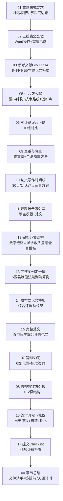

# 12 毕业论文实战（重庆财经学院专用）

> 前面 10、11 章教你"怎么写一篇论文"。
> 这一章教你"怎么写一篇**重庆财经学院本科毕业论文格式过关、答辩通过**的论文"。
>
> 这是全书最细的一章，每一条格式要求都给正反面教材和可直接套用的模板。

---

## 为什么要有这一章？

很多同学论文内容写得很好，但最后因为格式被打回三稿：
- 标题层级用错（应该用"一、（一）1.（1）"，结果用了"1.1 1.1.1"）；
- 表格用了网格线（应该三线表）；
- 参考文献格式不对（GB/T 7714）；
- 摘要写了 500 字（应该 200-300 字）；
- 答辩 [[08_答辩PPT怎么做|PPT]] 堆了一堆字。

**内容决定你能不能过，格式决定你要被打回几次。**

这一章把所有格式坑、写作模板、答辩问题提前告诉你。

---

## 这一章你会学到什么？

---

## 怎么用这一章？

- **写论文前**：先看 `[[01_重庆财经学院格式要求]]`，把 Word 样式预设好；
- **定题后**：按 `[[10_论文写作时间线]]` 排进度，用 `[[11_开题报告怎么写]]` 立题；
- **动笔时**：照 `[[12_完整范文结构]]`（实证类）或 `[[14_填空式论文模板]]`（综合评价类）填空；
- **写实证时**：对照 `[[06_实证部分错误vs正确]]`；
- **快交稿时**：看 `[[02_三线表怎么做]]`、`[[03_参考文献GB-T7714]]`、`[[09_查重与降重]]`，最后用 `[[17_提交Checklist]]` 打勾；
- **答辩前一周**：看 `[[07_答辩50问]]`、`[[08_答辩PPT怎么做]]`、`[[16_答辩流程与礼仪]]`。

---

---

上一篇：[[../11_方法选择决策/README|11 方法选择决策]] ｜ 下一篇：[[01_重庆财经学院格式要求]]

---

## 📖 配套教材笔记
- [[../../教材笔记/02_计量经济学/14_实证研究指南/00_实证研究流程|计量经济学·实证研究流程]]
- [[../../教材笔记/05_统计学原理/11_统计分析/知识点/KP08_统计分析报告的特点与结构|统计学原理·统计分析报告]]

## 📚 配套原书
- [[../../原文件/计量经济学/陈强_计量经济学及Stata应用_全书|陈强《计量经济学及Stata应用》]]

## 📖 配套统计学原理

### 描述统计与实证写作
- 描述统计章节 → [[../../教材笔记/05_统计学原理/05_平均与变异指标/README|05章 平均与变异指标]]
- 实证结果解读参考 → [[../../教材笔记/05_统计学原理/08_相关与回归/README|08章 相关与回归]]
- 统计报告写作 → [[../../教材笔记/05_统计学原理/11_统计分析/知识点/KP08_统计分析报告的特点与结构|统计分析报告结构]]

### 一手数据 / 问卷类论文（Ch02 数据采集）
如果你做的是**问卷调研类**毕业论文（一手数据），下面 6 个知识点就是你方法学章节的依据：
- [[../../教材笔记/05_统计学原理/02_统计数据采集/知识点/KP01_统计调查的种类|KP01 统计调查的种类]] —— 普查 / 抽样调查 / 典型调查 / 重点调查，先搞清楚你做的是哪一种
- [[../../教材笔记/05_统计学原理/02_统计数据采集/知识点/KP02_调查方案六要素|KP02 调查方案六要素]] —— 目的、对象、单位、项目、调查表、时限，开题报告"研究设计"直接套
- [[../../教材笔记/05_统计学原理/02_统计数据采集/知识点/KP03_五种调查组织方式对比|KP03 五种调查组织方式对比]] —— 访谈 / 邮寄 / 网上 / 座谈会 / 现场发，选哪个最适合你
- [[../../教材笔记/05_统计学原理/02_统计数据采集/知识点/KP04_数据采集方法|KP04 数据采集方法]] —— 一手 vs 二手，数据到底怎么真的拿到手
- [[../../教材笔记/05_统计学原理/02_统计数据采集/知识点/KP05_问卷设计原则|KP05 问卷设计原则]] —— 避免诱导题、双重含义题，这是问卷不被导师打回的底线
- [[../../教材笔记/05_统计学原理/02_统计数据采集/知识点/KP06_问卷结构与问题措辞|KP06 问卷结构与问题措辞]] —— 问候语 → 筛选题 → 主体量表题 → 背景题，怎么排

---

## 📋 问卷研究套路（一手数据毕业论文速通）

如果你做的是**问卷调研类**论文（比如"XX市大学生消费行为调查""XX社区居民满意度调查"），按下面 6 步走，每一步都对应上面一个知识点：

1. **确定调查目的** —— 一句话说清你要回答什么问题，别贪多。参考 [[../../教材笔记/05_统计学原理/02_统计数据采集/知识点/KP02_调查方案六要素|调查方案六要素]]。
2. **设计调查方案** —— 写清调查对象是谁、调查单位是谁、要问哪些项目、什么时候完成，这就是开题报告里的"研究设计"。同上 KP02。
3. **选择调查方式** —— 问卷星网上发、现场发、还是面对面访谈？看 [[../../教材笔记/05_统计学原理/02_统计数据采集/知识点/KP03_五种调查组织方式对比|五种调查组织方式对比]] 选一个。
4. **设计问卷** —— 先看 [[../../教材笔记/05_统计学原理/02_统计数据采集/知识点/KP05_问卷设计原则|问卷设计原则]]（别踩诱导题、双重含义题的坑），再按 [[../../教材笔记/05_统计学原理/02_统计数据采集/知识点/KP06_问卷结构与问题措辞|问卷结构与问题措辞]] 排版。
5. **发放回收** —— 用 [[../../教材笔记/05_统计学原理/02_统计数据采集/知识点/KP04_数据采集方法|数据采集方法]] 里说的渠道发，注意回收率，回收后剔除乱填、全选同一选项的无效问卷。
6. **数据整理分析** —— 清洗后先做描述统计（均值、频数），再跑相关分析 / 回归 / 交叉表。方法部分直接写："采用问卷调查法，共发放 X 份，回收有效 Y 份，有效回收率 Z%。"

> **样本量怎么定？** 别凭感觉发 100 份就完事。看 [[../../教材笔记/05_统计学原理/06_抽样与参数估计/知识点/KP13_样本量的确定|KP13 样本量的确定]]——按你想要的置信度（通常 95%）和允许误差（通常 ±5%），算出来最少要发多少份，再上浮 20% 应对无效问卷。
