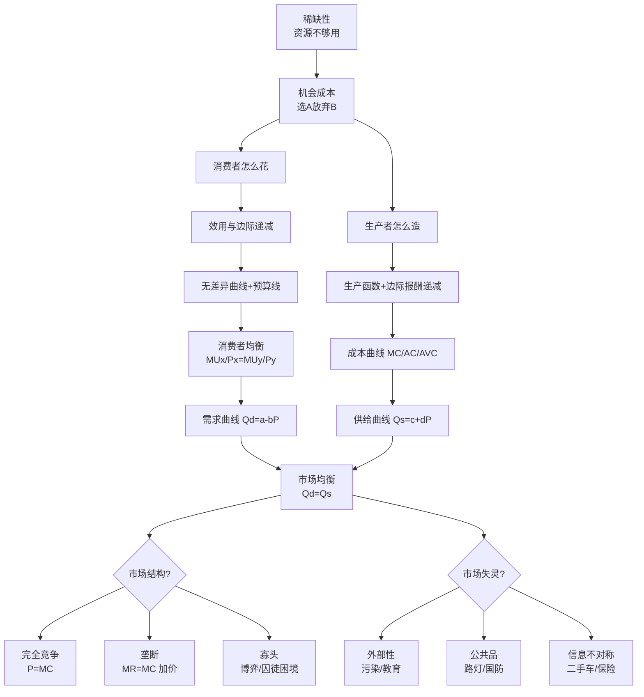

# 13 微观经济学基础 · 章节总结

> 这一章学完你会什么：看到一篇实证论文，能一眼认出它在用哪套微观理论——是需求弹性？是消费者均衡？是市场结构？是外部性？——并能把"变量怎么设计、回归系数怎么解释、政策建议怎么给"串起来。

---

## 一、一句话总览

微观经济学就是回答三个问题：**老百姓怎么花钱（消费者）**、**厂子怎么生产（生产者）**、**买卖双方凑到一起市场长什么样（市场结构 + 市场失灵）**。你写论文时跑的每一个回归，背后基本都是这三句话在给你撑腰。

---

## 二、核心概念清单表

| 序号 | 概念 | 一句话 | 对应原 KP |
|------|------|--------|-----------|
| 01 | 稀缺性与机会成本 | 资源不够用，选了 A 就得放弃 B，放弃的那个最高代价就是机会成本 | [[../../教材笔记/06_西方经济学/00_导论/知识点/KP01_资源稀缺性与经济学研究对象\|KP01]]、[[../../教材笔记/06_西方经济学/00_导论/知识点/KP02_机会成本\|KP02]] |
| 02 | 需求与供给 | 价高买的人少、价高卖的人多，两条线交叉就是均衡 | [[../../教材笔记/06_西方经济学/01_需求供给与均衡价格/知识点/KP01_需求与需求定律\|KP01]]、KP02、KP03 |
| 03 | 需求价格弹性 | 价格涨 1%，需求量变百分之几 | [[../../教材笔记/06_西方经济学/01_需求供给与均衡价格/知识点/KP04_需求价格弹性\|KP04]] |
| 04 | 收入弹性与交叉弹性 | 收入涨 1% 买多少；A 涨价 B 买多少 | [[../../教材笔记/06_西方经济学/01_需求供给与均衡价格/知识点/KP05_需求收入弹性与交叉弹性\|KP05]] |
| 05 | 效用与边际效用递减 | 第一杯奶茶爽，第二杯腻，第三杯想吐 | [[../../教材笔记/06_西方经济学/02_消费者选择/知识点/KP01_效用与边际效用递减\|KP01]]、KP02 |
| 06 | 无差异曲线与消费者均衡 | 花完最后一块钱，每块钱买到的"爽"要一样多 | [[../../教材笔记/06_西方经济学/02_消费者选择/知识点/KP03_无差异曲线\|KP03]]、KP04、KP05 |
| 07 | 生产函数与边际报酬递减 | 加一个工人，多出来的产出越来越少 | [[../../教材笔记/06_西方经济学/03_生产与成本/知识点/KP01_生产函数与短期长期\|KP01]]、KP02 |
| 08 | 成本曲线 | 固定成本、可变成本、平均成本、边际成本四条曲线怎么绕 | [[../../教材笔记/06_西方经济学/03_生产与成本/知识点/KP05_成本概念\|KP05]]、KP06、KP07 |
| 09 | 完全竞争市场 | 无数小买家小卖家，谁都定不了价，价格由市场决定 | [[../../教材笔记/06_西方经济学/04_完全竞争市场/知识点/KP01_完全竞争市场的特征\|KP01]]~KP04 |
| 10 | 完全垄断与价格歧视 | 独家卖家说了算，还能对不同人收不同价 | [[../../教材笔记/06_西方经济学/05_不完全竞争市场/知识点/KP01_完全垄断市场\|KP01]]、KP03 |
| 11 | 寡头与囚徒困境 | 几家大厂互相盯着，合作难受、背叛又怕报复 | [[../../教材笔记/06_西方经济学/05_不完全竞争市场/知识点/KP05_寡头市场与囚徒困境\|KP05]] |
| 12 | 外部性与公共品 | 抽烟连累室友、路灯谁都能用但没人愿意装 | [[../../教材笔记/06_西方经济学/08_市场失灵与微观经济政策/知识点/KP02_外部性\|KP02]]、KP03 |
| 13 | 信息不对称 | 卖瓜的比买瓜的懂瓜，二手车市场容易烂掉 | [[../../教材笔记/06_西方经济学/08_市场失灵与微观经济政策/知识点/KP04_信息不对称与逆向选择道德风险\|KP04]] |

---

## 三、核心公式大表

| 公式 | 是什么 | 一句话 |
|------|--------|--------|
| 机会成本 = 放弃选项中的最高收益 | 选 A 的真实代价 | 不是你花了多少，而是你没赚到多少 |
| $Q_d = a - bP$ | 需求函数 | 价越高买得越少 |
| $Q_s = c + dP$ | 供给函数 | 价越高卖得越多 |
| $E_d = \frac{\Delta Q / Q}{\Delta P / P} = \frac{\Delta Q}{\Delta P}\cdot\frac{P}{Q}$ | 需求价格弧弹性 | 价涨 1%，量变百分之几 |
| $E_d = \frac{dQ}{dP}\cdot\frac{P}{Q}$ | 点弹性 | 极小变化下的弹性 |
| $E_i = \frac{\Delta Q / Q}{\Delta I / I}$ | 收入弹性 | 正常品 >0，低档品 <0，奢侈品 >1 |
| $E_{xy} = \frac{\Delta Q_x / Q_x}{\Delta P_y / P_y}$ | 交叉弹性 | 替代品 >0，互补品 <0 |
| $MU = \Delta TU / \Delta Q$ | 边际效用 | 多吃一口多爽多少 |
| $MU_x / P_x = MU_y / P_y = \lambda$ | 消费者均衡 | 最后一块钱花在哪都一样爽 |
| $MP_L = \Delta Q / \Delta L$ | 劳动边际产量 | 多雇一个工人多产多少 |
| $MC = \Delta TC / \Delta Q$ | 边际成本 | 多产一件多花多少 |
| $ATC = AFC + AVC$ | 平均成本 | 摊到每件上的总成本 |
| $P = MC$ | 完全竞争厂商最优产量 | 价格等于边际成本 |
| $MR = MC$ | 所有厂商最优产量 | 多卖一件多赚的 = 多做一件多花的 |
| $MR = P(1 - 1/|E_d|)$ | 垄断厂商定价 | 弹性越小，加价越狠 |

---

## 四、概念关系图

---

## 五、十大易错点

1. **把斜率当弹性**：弹性是"百分比变动比"，斜率是"绝对量变动比"，直线上每一点弹性都不一样。
2. **必需品弹性小、奢侈品弹性大**：不是看东西贵不贵，是看"有没有替代品"。
3. **吉芬商品**：需求曲线向右上方倾斜（穷人主食涨价反而多买），别拿"违反需求定律"当重大发现，它有严格前提。
4. **边际效用递减 ≠ 总效用递减**：MU 降但只要还是正的，TU 还在涨。
5. **边际成本穿过平均成本的最低点**：MC<AC 时 AC 下降，MC>AC 时 AC 上升，这是必考点。
6. **完全竞争厂商的需求曲线是水平线**：不是市场需求曲线（那条是向下倾斜的），是单个厂商面对的线。
7. **价格歧视要求能隔开市场**：不能让低价买家倒卖给高价买家（否则就成了套利）。
8. **囚徒困境里"背叛"是占优策略**：不管对方选什么，自己背叛都更划算，但两个人都背叛结果最差。
9. **外部性不只有负的**：教育、打疫苗是正外部性，私人市场供给不足。
10. **信息不对称 ≠ 信息不完全**：不完全是"大家都不知道未来"，不对称是"一方知道另一方不知道"。

---

## 六、论文里怎么用这一章？

| 论文里的角色 | 这一章哪个概念在撑腰 |
|--------------|----------------------|
| **文献综述的理论基础** | 开篇引"需求定律""效用最大化"作为分析框架 |
| **变量设计（被解释变量）** | 消费量、产量、价格、工资、环境污染排放 |
| **变量设计（解释变量）** | 价格、收入、广告、税率、补贴、信息披露 |
| **核心系数解释** | 回归出的价格系数，要拿"需求弹性"去解释 |
| **机制分析** | 价格弹性 → 税负归宿；信息不对称 → 银行惜贷；外部性 → 排污权交易 |
| **政策建议** | 对必需品涨价收税 vs 补贴；教育补贴治正外部性；信息披露治不对称 |

**举个具体题目**：《数字经济对农村居民消费升级的影响——基于需求价格弹性的机制分析》
- 理论框架：效用最大化 + 需求定律
- 被解释变量：农村居民各类消费支出占比（食品/衣着/教育）
- 解释变量：互联网普及率、数字支付覆盖率
- 机制：用收入弹性判断"消费升级"（从必需品转向弹性 >1 的享受品）
- 政策建议：针对低弹性必需品给补贴，针对高弹性享受品鼓励数字消费

---

## 七、自测题（不附答案，回头找对应文件）

**题1**：奶茶店一杯 15 元时卖 100 杯，涨到 18 元卖 80 杯。用弧弹性中点公式算需求价格弹性，并判断是富有弹性还是缺乏弹性。

**题2**：收入从 1 万变 1.2 万，打车出行从每月 200 元涨到 320 元。收入弹性是多少？打车是正常品、低档品还是奢侈品？

**题3**：MU_x = 10，P_x = 5；MU_y = 20，P_y = 10。消费者是否均衡？如果不均衡，应该多买 X 还是多买 Y？

**题4**：说"边际成本曲线穿过平均成本曲线最低点"的道理，用奶茶店多做一杯奶茶的成本直觉解释。

**题5**：完全竞争厂商和垄断厂商，利润最大化条件都是 MR=MC，为什么垄断厂商能定更高的价？

**题6**：囚徒困境里两个寡头都降价博弈，结果"双方都降价"。这对中国家电价格战有什么解释力？

**题7**：教育是正外部性。为什么私人市场教育供给不足？政府该怎么补？

**题8**：二手车市场为什么容易变成"柠檬市场"？这个逻辑怎么套到"大学生求职市场"（招聘方 vs 求职者信息不对称）上？

---

## 八、配套教材笔记链接

- [[../../教材笔记/06_西方经济学/00_导论/00_章节总结|原书·导论章]]
- [[../../教材笔记/06_西方经济学/01_需求供给与均衡价格/00_章节总结|原书·第1章 需求供给与均衡价格]]
- [[../../教材笔记/06_西方经济学/02_消费者选择/00_章节总结|原书·第2章 消费者选择]]
- [[../../教材笔记/06_西方经济学/03_生产与成本/00_章节总结|原书·第3章 生产与成本]]
- [[../../教材笔记/06_西方经济学/04_完全竞争市场/00_章节总结|原书·第4章 完全竞争市场]]
- [[../../教材笔记/06_西方经济学/05_不完全竞争市场/00_章节总结|原书·第5章 不完全竞争市场]]
- [[../../教材笔记/06_西方经济学/08_市场失灵与微观经济政策/00_章节总结|原书·第8章 市场失灵]]

---

⬅️ 上一篇：[[../12_工具变量与内生性/README|12 工具变量与内生性]] ｜ 📑 [[README|返回主目录]] ｜ 下一篇：[[01_稀缺性与机会成本是什么|01 稀缺性与机会成本]] ➡️
